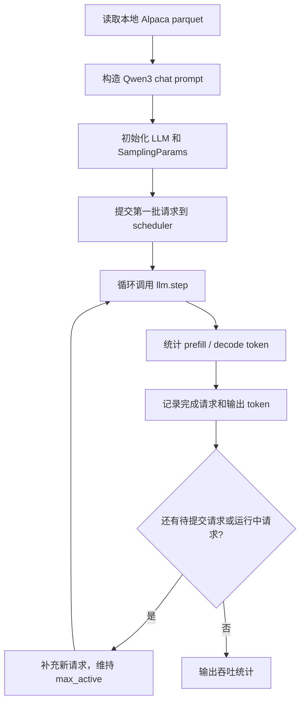

# Benchmarks

这个目录用于放置 nano-vLLM 的 benchmark 脚本。后续每新增一个脚本，都应在这里说明它测量的对象、适用场景、启动方式、关键参数和输出指标。

## 目录定位

- **吞吐测试**：关注单位时间内完成多少请求、处理多少 token，适合观察调度、batching、CUDA graph、KV cache 等机制对整体吞吐的影响。
- **延迟测试**：关注单个请求的端到端耗时、首 token 延迟和逐 token 延迟，适合评估在线服务体验。
- **算子测试**：关注单个 kernel 或局部模块的耗时，例如 RMSNorm、attention、KV cache 写入等。
- **服务测试**：关注 HTTP / OpenAI-compatible server 场景下的请求到达率、并发、流式输出和客户端侧延迟。

当前已有脚本主要覆盖 **Engine 吞吐测试**，还不是严格的 latency benchmark。

## 指标约定

- **Request throughput**：请求吞吐，单位是 `req/s`，表示每秒完成多少个请求。
- **Output token throughput**：输出 token 吞吐，单位是 `tok/s`，只统计生成出来的 completion token。
- **Total token throughput**：总 token 吞吐，单位是 `tok/s`，统计 prompt token 和 output token 之和。
- **Prefill tokens**：prefill 阶段处理的 prompt token 数。nano-vLLM 当前用 `num_tokens > 0` 表示一次 prefill step。
- **Decode tokens**：decode 阶段处理的 token 数。nano-vLLM 当前用 `num_tokens < 0` 表示一次 decode step，数值取反后代表本轮 decode token 数。
- **TTFT**：Time To First Token，首 token 延迟，表示请求提交后多久生成第一个 token。当前脚本暂未统计。
- **TPOT**：Time Per Output Token，首 token 之后的平均逐 token 时间。当前脚本暂未统计。
- **ITL**：Inter-Token Latency，相邻输出 token 之间的间隔。当前脚本暂未统计。
- **E2E latency**：端到端延迟，表示请求提交到完整输出结束的总耗时。当前脚本暂未按请求统计。

## benchmark_engine_throughput.py

`benchmark_engine_throughput.py` 用于测试 nano-vLLM Engine 在持续请求压力下的吞吐。它直接使用 `LLM.add_request()` 和 `LLM.step()`，而不是调用 `LLM.generate()`。

### 测试目标

- 观察 Engine 在固定最大活跃请求数下的整体吞吐。
- 观察 prefill token、decode token、完成请求数和 engine step 数之间的关系。
- 为后续分析 scheduler、KV cache、CUDA graph 和 kernel launch 开销提供基础数据。

### 执行流程



这个脚本模拟的是“持续灌请求”的 engine benchmark：只要有请求完成，就继续从数据集中补新请求，尽量让 engine 内的活跃请求数维持在 `--max-active` 附近。

### 数据集

默认读取本地 Alpaca parquet：

```shell
/home/huangxy/datasets/alpaca/data/train-00000-of-00001-a09b74b3ef9c3b56.parquet
```

每条样本使用 `instruction` 和 `input` 构造用户 prompt，然后通过模型 tokenizer 的 `apply_chat_template()` 转成 Qwen3 chat 格式。

### 运行命令

小规模冒烟测试：

```shell
python benchmarks/benchmark_engine_throughput.py \
  --num-prompts 1 \
  --max-active 1 \
  --max-tokens 1 \
  --enforce-eager
```

常规吞吐测试：

```shell
python benchmarks/benchmark_engine_throughput.py \
  --num-prompts 128 \
  --max-active 16 \
  --max-tokens 128 \
  --enforce-eager
```

测试 CUDA graph 路径时去掉 `--enforce-eager`：

```shell
python benchmarks/benchmark_engine_throughput.py \
  --num-prompts 128 \
  --max-active 16 \
  --max-tokens 128
```

### 参数说明

| 参数 | 默认值 | 含义 |
| --- | --- | --- |
| `--model-path` | `/home/huangxy/models/Qwen3-0.6B` | 本地 Hugging Face 模型目录。 |
| `--dataset-path` | `/home/huangxy/datasets/alpaca/data/train-00000-of-00001-a09b74b3ef9c3b56.parquet` | 本地 Alpaca parquet 文件路径。 |
| `--num-prompts` | `128` | 本次最多读取并执行多少条 prompt。 |
| `--max-active` | `16` | Engine 内同时保持的最大未完成请求数。 |
| `--max-tokens` | `128` | 每条请求最多生成多少 output token。 |
| `--temperature` | `0.6` | 采样温度。 |
| `--enforce-eager` | 关闭 | 开启后禁用 CUDA graph，便于调试和 profiling，但 decode 性能通常更低。 |

### 输出指标

脚本结束后会输出：

```shell
num_prompts: 128
num_submitted: 128
num_finished: 128
num_engine_steps: 1032
input_tokens: 3225
output_tokens: 16335
prefill_tokens_by_engine: 3225
decode_tokens_by_engine: 16207
elapsed: 38.781 s
requests/s: 3.301
total_tokens/s: 504.375
output_tokens/s: 421.215
```

其中：

- `num_prompts` 表示本次加载的 prompt 数。
- `num_submitted` 表示实际提交给 engine 的请求数。
- `num_finished` 表示成功完成的请求数。
- `num_engine_steps` 表示调用 `llm.step()` 的次数。
- `input_tokens` 表示所有 prompt token 数之和。
- `output_tokens` 表示所有 completion token 数之和。
- `prefill_tokens_by_engine` 表示 prefill step 处理的 token 数累计。
- `decode_tokens_by_engine` 表示 decode step 处理的 token 数累计。
- `elapsed` 表示从提交第一批请求到全部请求完成的耗时，不包含 tokenizer 和模型初始化阶段。
- `requests/s` 表示完成请求数除以 `elapsed`。
- `total_tokens/s` 表示 `(input_tokens + output_tokens) / elapsed`。
- `output_tokens/s` 表示 `output_tokens / elapsed`。

注意：`output_tokens` 通常会比 `decode_tokens_by_engine` 多出 `num_finished` 左右，因为 nano-vLLM 当前会在 prefill 结束后采样第一个 output token，后续 token 才来自 decode step。

## 当前限制

- 当前脚本主要统计吞吐，不统计严格的 TTFT、TPOT、ITL 和 per-request E2E latency。
- 当前脚本直接访问 `llm.add_request()` 和 `llm.step()`，适合研究 Engine 行为，但不等价于 HTTP serving benchmark。
- 当前 `llm.step()` 只返回已完成请求，不能直接拿到每一步新生成 token 的时间戳，因此 ITL 需要等 Engine 输出结构进一步改造后再做。
- 当前 benchmark 默认使用固定 `max_active` 补请求，不模拟泊松到达、突发流量或真实在线服务请求率。

## 后续方向

- 新增 `benchmark_engine_latency.py`，按请求统计 TTFT、TPOT、E2E latency 的 p50 / p90 / p99。
- 新增 NVTX range，把 `load_dataset`、`init_llm`、`benchmark_loop`、`prefill_step`、`decode_step` 标到 Nsight Systems 时间线里。
- 新增 JSON 输出，方便保存多组参数下的 benchmark 结果。
- 新增 serving benchmark，在 HTTP server 和 streaming 场景下统计客户端侧延迟。
