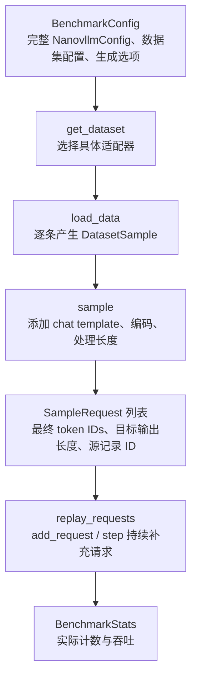

# 本地推理 Benchmarks

这个目录将数据集读取、配置、指标和吞吐回放分开。当前支持单进程 Engine 的
Alpaca 与 LongBench 文本负载；后续新增数据集，只需实现适配器并登记名称。

## 模块职责

| 文件 | 职责 |
| --- | --- |
| [config.py](config.py) | DatasetConfig、BenchmarkConfig 和共享 CLI。 |
| [datasets/base.py](datasets/base.py) | 原始 DatasetSample、统一 SampleRequest，以及 chat template、编码和长度策略。 |
| [datasets/io.py](datasets/io.py) | 本地 Parquet / JSONL 逐批、逐行读取，不访问 Hub。 |
| [datasets/alpaca.py](datasets/alpaca.py) | Alpaca 的 instruction/input 字段适配。 |
| [datasets/longbench.py](datasets/longbench.py) | LongBench 的 context/input 字段适配和子集选择。 |
| [datasets/__init__.py](datasets/__init__.py) | 数据集注册表与 get_dataset() 工厂。 |
| [utils.py](utils.py) | NVTX 范围与回放前的随机数初始化。 |
| [metrics.py](metrics.py) | 实际请求/token 计数与吞吐输出。 |
| [benchmark_engine_throughput.py](benchmark_engine_throughput.py) | 创建 Engine，持续补充请求，调用 step() 并消费完成结果。 |

这里使用 Python ABC 基类与显式注册表。格式差异放在各数据集类中，共同的编码和
长度策略留在基类；不需要为当前单轮文本任务引入 Traits 或多重继承。

## 配置与数据怎样流动



BenchmarkConfig 直接持有 NanovllmConfig，模型路径、KV 策略、Graph 选项和
Scheduler 容量均由它的子配置提供。CLI 只负责组装配置；Python 调用方也可自行
构造完整配置，再调用 run_benchmark(config)。

数据统一经过以下三种表示：

| 表示 | 例子 | 后续变化 |
| --- | --- | --- |
| Alpaca 原始记录 | instruction="翻译成英文"，input="今天天气很好。"。 | 适配器组合为一条用户文本，忽略 output 参考答案。 |
| DatasetSample | prompt="翻译成英文\n\n今天天气很好。"，sample_id 标识文件与记录下标。 | 公共层应用模型 chat template，关闭 Qwen3 thinking，再编码。 |
| SampleRequest | prompt 是最终 token IDs，prompt_len 从同一列表计算。 | 回放直接提交 IDs，不再次编码；expected_output_len 决定生成预算。 |

LongBench 走同一公共流程：非空 input 放在长 context 后作为任务指令；GovReport、
MultiNews、VCSUM 等空 input 的摘要记录补充摘要指令。answers 不进入模型输入。
当前模板用于系统吞吐测试，不声明与 LongBench 官方逐任务质量评分模板完全相同。

## 安装与启动

在项目根目录运行，推荐使用模块入口；原来的直接脚本启动方式也保留：

```shell
conda activate nano-vllm
pip install -e ".[benchmark]"
python -m benchmarks.benchmark_engine_throughput --help
```

可选 benchmark 依赖只增加 PyArrow，用来读取本地 Alpaca Parquet。JSONL 读取不需要
Hugging Face datasets 包，也不会触发下载探测或生成额外 datasets 缓存。

## Alpaca 回放

原有选项继续有效；默认数据集名称为 alpaca，路径默认指向：

```shell
~/datasets/alpaca/data/train-00000-of-00001-a09b74b3ef9c3b56.parquet
```

先执行小规模 eager 验证：

```shell
VLLM_HOST_IP=127.0.0.1 python -m benchmarks.benchmark_engine_throughput \
  --dataset-name alpaca \
  --num-prompts 4 \
  --max-active 2 \
  --max-tokens 8 \
  --max-model-len 1024 \
  --gpu-memory-utilization 0.5 \
  --enforce-eager
```

持续吞吐测试：

```shell
VLLM_HOST_IP=127.0.0.1 python -m benchmarks.benchmark_engine_throughput \
  --num-prompts 2048 \
  --max-active 32 \
  --max-tokens 128 \
  --gpu-memory-utilization 0.5 \
  --ignore-eos \
  --seed 0 \
  --enforce-eager
```

去掉 --enforce-eager 即可测试 FULL decode CUDA Graph。--ignore-eos 关闭 EOS 提前
结束；数据准备会为目标输出预留上下文容量，便于比较相同输出工作量。

## LongBench 回放

已下载的默认目录为 ~/datasets/LongBench/data。可直接指定 JSONL，也可指定
LongBench 根目录或 data 目录，再通过 --dataset-subset 选择子集。

下面使用 MultiNews 的 4 条记录，控制最终输入最多 1024 token：

```shell
VLLM_HOST_IP=127.0.0.1 python -m benchmarks.benchmark_engine_throughput \
  --dataset-name longbench \
  --dataset-subset multi_news \
  --num-prompts 4 \
  --max-active 2 \
  --max-prompt-tokens 1024 \
  --long-prompt-policy truncate \
  --max-model-len 2048 \
  --max-tokens 32 \
  --gpu-memory-utilization 0.5 \
  --ignore-eos \
  --enforce-eager
```

也可以将路径显式设为：

```shell
--dataset-path ~/datasets/LongBench/data/gov_report.jsonl
```

指定单文件时若还设置 --dataset-subset，两者名称必须一致。目录模式未指定子集时，
按文件名顺序读取全部原版 JSONL，默认排除 _e 文件；显式指定 qasper_e 等子集则可
读取 LongBench-E。两种版本存在重叠，默认不混合为一份独立样本集。

--num-prompts 限制最终接受的样本数量。源数据不足或长度过滤后不足时，脚本打印
实际接受数量并运行这些请求，不自动重复填满；num_prompts 输出也是实际数量。

## 长度策略

所有长度都使用当前模型 tokenizer，包含最终 chat template。输入的实际上限为：

```python
input_limit = max_model_len - max_tokens
if max_prompt_tokens is not None:
    input_limit = min(input_limit, max_prompt_tokens)
```

例如模型上限 4096、目标输出 512、输入上限 2048，则最终输入不超过 2048 token；
没有显式输入上限时，最多使用 3584 token，为目标输出留下 512 个位置。

| 策略 | 输入超过上限时的行为 |
| --- | --- |
| error，默认值 | 报告源记录 ID、真实长度和上限，在创建 GPU Engine 前结束。 |
| skip | 跳过该记录，继续寻找后续有效样本；没有任何有效样本时报错。 |
| truncate | 保留用户文本首尾，删除中间部分，再重新构建完整对话并确认编码长度。 |

truncate 会改变原始任务内容，适用于性能负载控制。它保留对话边界，但不保证
原任务答案仍可由剩余上下文推导；质量评分应采用相应任务的正式评测流程。

## 公共参数

| 选项 | 默认值 | 含义 |
| --- | --- | --- |
| --model-path | ~/models/Qwen3-0.6B | 本地模型与 tokenizer 目录。 |
| --dataset-name | alpaca | 注册表中的适配器名称。 |
| --dataset-path | 适配器默认路径 | 本地文件或目录。 |
| --dataset-subset | 不指定 | 子集名称，目前由 LongBench 支持。 |
| --num-prompts | 128 | 最多接受的有效请求数量。 |
| --max-active | 16 | Scheduler/Runner 的请求槽位容量，也是回放并发上限。 |
| --max-tokens | 128 | 每请求目标输出长度。 |
| --temperature | 0.6 | 正 temperature 随机采样，当前没有 greedy 分支。 |
| --ignore-eos | 关闭 | 忽略 EOS，执行到目标输出长度。 |
| --seed | 0 | Engine 启动后重置生成随机数状态。 |
| --enforce-eager | 关闭 | 禁用 CUDA Graph，局部层编译和内核预热仍存在。 |
| --max-model-len | 4096 | prompt 与 output 的总上下文容量。 |
| --max-num-batched-tokens | 256 | 单轮真实 token 预算，必须不小于 max-active。 |
| --gpu-memory-utilization | 0.9 | 当前实例占设备总显存的预算，示例使用 0.5。 |
| --max-prompt-tokens | 不指定 | 含模板的输入上限，同时受剩余模型上下文约束。 |
| --long-prompt-policy | error | 超长输入的报错、过滤或截断策略。 |

seed 固定的是生成前随机数初态，不保证不同 batch 调度或 Graph 模式生成逐字相同
的文本。需要固定工作量时，同时使用 --ignore-eos 和相同的输入/输出长度策略。

## 指标与计时边界

| 指标 | 含义 |
| --- | --- |
| num_prompts / num_submitted / num_finished | 接受、提交和完成的实际请求数。 |
| num_engine_steps | 计时循环内的 step() 次数，不含最后的 Worker 清理调用。 |
| input_tokens | 实际提交的逻辑 prompt 长度之和，包含 chat template。 |
| output_tokens | 完成请求实际返回的生成 token 数。 |
| scheduled_tokens | 各轮真实调度 token 总量，包含混合 batch 和可能的重算，不含 Graph padding。 |
| elapsed | 从首批提交到全部结果完成的秒数。 |
| requests/s | num_finished / elapsed。 |
| total_tokens/s | (input_tokens + output_tokens) / elapsed。 |
| output_tokens/s | output_tokens / elapsed。 |

读取数据、格式化、编码、模型加载、启动 profiling、Graph 捕获和最终清理均在
elapsed 之外。旧脚本在提交时编码字符串，该 CPU 开销计入计时；此次重构后统一
预编码，因此与旧结果比较时应记录这一计时口径变化。

逻辑输入可能命中 prefix cache，最后一个采样 token 也不会再次 forward，所以
input_tokens + output_tokens 不等于 scheduled_tokens。当前不按 step 返回值的
正负号拆分 prefill/decode。

NVTX 保留 load_tokenizer、load_prompts、init_llm、submit_initial_requests 和
benchmark_loop 范围。脚本目前不统计逐 token 时间戳、TTFT、TPOT、ITL 或服务端
请求到达率。

## 新增一个数据集

1. 在 datasets/ 中新增适配器，继承 BenchmarkDataset，并定义默认本地路径。
2. 实现 load_data()，按需输出 DatasetSample(prompt, sample_id)。只放入用户请求文本。
3. 在 datasets/__init__.py 的 DATASET_REGISTRY 登记名称。
4. 补充 README 的字段说明、路径与启动例子；吞吐回放无需修改。

例如一个 JSONL 适配器可以复用 iter_jsonl()，Parquet 适配器可以复用
iter_parquet()。公共 sample() 继续负责 chat template、最终 token 数与生成预算，
后续延迟脚本也可消费相同的 SampleRequest。
