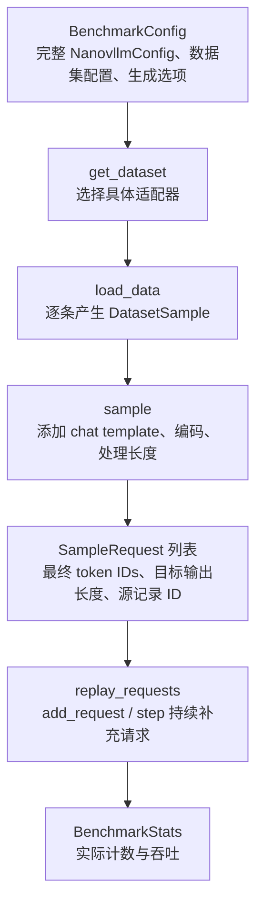

# 本地推理 Benchmarks

这个目录将数据集读取、配置、指标和回放分开。当前支持单进程 Engine 的吞吐与
逐 token 延迟测试，可选择同步或异步调度，复用相同的配置、数据集和启动流程。数据集包含
Alpaca 与 LongBench 文本负载；后续新增数据集，只需实现适配器并登记名称。

## 模块职责

| 文件 | 职责 |
| --- | --- |
| [config.py](config.py) | DatasetConfig、BenchmarkConfig 和共享 CLI。 |
| [datasets/base.py](datasets/base.py) | 原始 DatasetSample、统一 SampleRequest，以及 chat template、编码和长度策略。 |
| [datasets/io.py](datasets/io.py) | 本地 Parquet / JSONL 逐批、逐行读取，不访问 Hub。 |
| [datasets/alpaca.py](datasets/alpaca.py) | Alpaca 的 instruction/input 字段适配。 |
| [datasets/longbench.py](datasets/longbench.py) | LongBench 的 context/input 字段适配和子集选择。 |
| [datasets/__init__.py](datasets/__init__.py) | 数据集注册表与 get_dataset() 工厂。 |
| [utils.py](utils.py) | NVTX 范围与回放前的随机数初始化。 |
| [metrics.py](metrics.py) | 实际请求/token 计数与吞吐输出。 |
| [latency_metrics.py](latency_metrics.py) | 逐请求时间轴、TTFT/TPOT/ITL 分布及 JSON 统计。 |
| [runner.py](runner.py) | 公共数据准备、Engine 启停、随机数重置与报告保存。 |
| [benchmark_engine_throughput.py](benchmark_engine_throughput.py) | 创建 Engine，持续补充请求，调用 step_fn() 并消费完成结果。 |
| [benchmark_engine_latency.py](benchmark_engine_latency.py) | 持续补充请求，在每轮 step_fn() 返回后观察生成 token，统计本地延迟。 |
| [profile_engine_overlap.py](profile_engine_overlap.py) | 真实请求预热后，临时标记各批次 CPU 阶段，供 Nsight 诊断跨批次重叠。 |
| [analyze_engine_overlap.py](analyze_engine_overlap.py) | 读取四组 Nsight SQLite 与批次布局，计算 16 并发稳态 decode 的重叠及等待。 |

这里使用 Python ABC 基类与显式注册表。格式差异放在各数据集类中，共同的编码和
长度策略留在基类；不需要为当前单轮文本任务引入 Traits 或多重继承。

同步与异步在 eager、CUDA Graph 下的实测对比，以及 Nsight 采集命令见
[异步调度性能记录](../docs/performance/async_schedule.md)。诊断入口增加观测开销，
其 TPS 不用于替代两个正式 benchmark 的结果。

## 配置与数据怎样流动



BenchmarkConfig 直接持有 NanovllmConfig，模型路径、KV 策略、Graph 选项和
Scheduler 容量均由它的子配置提供。CLI 只负责组装配置；Python 调用方也可自行
构造完整配置，再调用 run_benchmark(config)。

数据统一经过以下三种表示：

| 表示 | 例子 | 后续变化 |
| --- | --- | --- |
| Alpaca 原始记录 | instruction="翻译成英文"，input="今天天气很好。"。 | 适配器组合为一条用户文本，忽略 output 参考答案。 |
| DatasetSample | prompt="翻译成英文\n\n今天天气很好。"，sample_id 标识文件与记录下标。 | 公共层应用模型 chat template，关闭 Qwen3 thinking，再编码。 |
| SampleRequest | prompt 是最终 token IDs，prompt_len 从同一列表计算。 | 回放直接提交 IDs，不再次编码；expected_output_len 决定生成预算。 |

LongBench 走同一公共流程：非空 input 放在长 context 后作为任务指令；GovReport、
MultiNews、VCSUM 等空 input 的摘要记录补充摘要指令。answers 不进入模型输入。
当前模板用于系统吞吐测试，不声明与 LongBench 官方逐任务质量评分模板完全相同。

默认只提供 user 消息。传入 `--system-prompt "共享指令"` 后，公共编码层会将
相同的 system 消息放在每条 user 消息前。system 也计入输入长度，超长策略
只截断 user，保留完整 system。缓存开关的实测对照和共享指令全文见
[前缀缓存收益](../docs/performance/prefix_cache.md)。

## 安装与启动

在项目根目录运行，推荐使用模块入口；原来的直接脚本启动方式也保留：

```shell
conda activate nano-vllm
pip install -e ".[benchmark]"
python -m benchmarks.benchmark_engine_throughput --help
python -m benchmarks.benchmark_engine_latency --help
```

可选 benchmark 依赖只增加 PyArrow，用来读取本地 Alpaca Parquet。JSONL 读取不需要
Hugging Face datasets 包，也不会触发下载探测或生成额外 datasets 缓存。

## Alpaca 回放

原有选项继续有效；默认数据集名称为 alpaca，路径默认指向：

```shell
~/datasets/alpaca/data/train-00000-of-00001-a09b74b3ef9c3b56.parquet
```

先执行小规模 eager 验证：

```shell
VLLM_HOST_IP=127.0.0.1 python -m benchmarks.benchmark_engine_throughput \
  --dataset-name alpaca \
  --num-prompts 4 \
  --max-active 2 \
  --max-tokens 8 \
  --max-model-len 1024 \
  --gpu-memory-utilization 0.5 \
  --enforce-eager
```

持续吞吐测试：

```shell
VLLM_HOST_IP=127.0.0.1 python -m benchmarks.benchmark_engine_throughput \
  --num-prompts 2048 \
  --max-active 32 \
  --max-tokens 128 \
  --gpu-memory-utilization 0.5 \
  --ignore-eos \
  --seed 0 \
  --enforce-eager
```

去掉 --enforce-eager 即可测试 FULL decode CUDA Graph。--ignore-eos 关闭 EOS 提前
结束；数据准备会为目标输出预留上下文容量，便于比较相同输出工作量。

两个正式 benchmark 都支持 `--distributed-executor-backend mp`，单 GPU 可配合
`--tensor-parallel-size 1` 验证子进程执行。多 GPU 使用对应的 TP size；省略后端时，
TP=1 默认 uni，TP>1 默认 mp。执行器会在创建队列和 Worker 前检查可见设备数量。
Nsight 重叠诊断入口目前仍要求 UniProcExecutor，其 Runner 标记安装在当前进程。

## LongBench 回放

已下载的默认目录为 ~/datasets/LongBench/data。可直接指定 JSONL，也可指定
LongBench 根目录或 data 目录，再通过 --dataset-subset 选择子集。

下面使用 MultiNews 的 4 条记录，控制最终输入最多 1024 token：

```shell
VLLM_HOST_IP=127.0.0.1 python -m benchmarks.benchmark_engine_throughput \
  --dataset-name longbench \
  --dataset-subset multi_news \
  --num-prompts 4 \
  --max-active 2 \
  --max-prompt-tokens 1024 \
  --long-prompt-policy truncate \
  --max-model-len 2048 \
  --max-tokens 32 \
  --gpu-memory-utilization 0.5 \
  --ignore-eos \
  --enforce-eager
```

也可以将路径显式设为：

```shell
--dataset-path ~/datasets/LongBench/data/gov_report.jsonl
```

指定单文件时若还设置 --dataset-subset，两者名称必须一致。目录模式未指定子集时，
按文件名顺序读取全部原版 JSONL，默认排除 _e 文件；显式指定 qasper_e 等子集则可
读取 LongBench-E。两种版本存在重叠，默认不混合为一份独立样本集。

--num-prompts 限制最终接受的样本数量。源数据不足或长度过滤后不足时，脚本打印
实际接受数量并运行这些请求，不自动重复填满；num_prompts 输出也是实际数量。

## 长度策略

所有长度都使用当前模型 tokenizer，包含最终 chat template。输入的实际上限为：

```python
input_limit = max_model_len - max_tokens
if max_prompt_tokens is not None:
    input_limit = min(input_limit, max_prompt_tokens)
```

例如模型上限 4096、目标输出 512、输入上限 2048，则最终输入不超过 2048 token；
没有显式输入上限时，最多使用 3584 token，为目标输出留下 512 个位置。

| 策略 | 输入超过上限时的行为 |
| --- | --- |
| error，默认值 | 报告源记录 ID、真实长度和上限，在创建 GPU Engine 前结束。 |
| skip | 跳过该记录，继续寻找后续有效样本；没有任何有效样本时报错。 |
| truncate | 保留用户文本首尾，删除中间部分，再重新构建完整对话并确认编码长度。 |

truncate 会改变原始任务内容，适用于性能负载控制。它保留对话边界，但不保证
原任务答案仍可由剩余上下文推导；质量评分应采用相应任务的正式评测流程。

## 公共参数

| 选项 | 默认值 | 含义 |
| --- | --- | --- |
| --model-path | ~/models/Qwen3-0.6B | 本地模型与 tokenizer 目录。 |
| --dataset-name | alpaca | 注册表中的适配器名称。 |
| --dataset-path | 适配器默认路径 | 本地文件或目录。 |
| --dataset-subset | 不指定 | 子集名称，目前由 LongBench 支持。 |
| --system-prompt | 不指定 | 所有请求共享的 system 文本，去除首尾空白后放在 user 消息前；省略时保持原有单 user 模板。 |
| --num-prompts | 128 | 最多接受的有效请求数量。 |
| --max-active | 16 | Scheduler/Runner 的请求槽位容量，也是回放并发上限。 |
| --max-tokens | 128 | 每请求目标输出长度。 |
| --temperature | 0.6 | 正 temperature 随机采样，当前没有 greedy 分支。 |
| --ignore-eos | 关闭 | 忽略 EOS，执行到目标输出长度。 |
| --seed | 0 | 写入 ModelConfig，并通过 RPC 在所有 Worker 内重置生成随机数状态。 |
| --result-path | 不指定 | 可选 JSON 报告路径；计时结束后保存配置摘要和统计，可覆盖已有文件。 |
| --enforce-eager | 关闭 | 禁用 CUDA Graph，局部层编译和内核预热仍存在。 |
| --tensor-parallel-size | 1 | 单机 TP Worker 数；模型分片维度须满足当前整除约束。 |
| --distributed-executor-backend | 自动选择 | uni 或 mp；TP=1 也可显式选择 mp，uni 不支持 TP>1。 |
| --async-scheduling / --no-async-scheduling | 关闭 | 启用或显式关闭异步调度，两个入口均支持。 |
| --max-model-len | 4096 | prompt 与 output 的总上下文容量。 |
| --max-num-batched-tokens | 1024 | 单轮真实 token 预算，必须不小于 max-active。 |
| --gpu-memory-utilization | 0.9 | 当前实例占设备总显存的预算，示例使用 0.5。 |
| --block-size | 256 | Manager KV block 的 token 数，当前须为 256 的倍数。 |
| --enable-prefix-caching / --no-enable-prefix-caching | 开启 | 控制前缀复用；关闭后也不生成 Request block hashes。 |
| --prefix-match-unit | 不指定 | 前缀 hash 的 token 粒度；当前单 group 启用缓存时须与 block-size 相等。关闭缓存时忽略。 |
| --watermark | 0.0 | 接纳等待或恢复请求时额外保留的总 KV block 比例，范围 [0, 1)。 |
| --max-prompt-tokens | 不指定 | 含模板的输入上限，同时受剩余模型上下文约束。 |
| --long-prompt-policy | error | 超长输入的报错、过滤或截断策略。 |

seed 固定的是生成前随机数初态，不保证不同 batch 调度或 Graph 模式生成逐字相同
的文本。需要固定工作量时，同时使用 --ignore-eos 和相同的输入/输出长度策略。
Python 调用方省略 `BenchmarkConfig.seed` 时沿用 `ModelConfig.seed`；显式提供时
覆盖模型配置中的值。正式回放和诊断请求预热后的重置都发生在 Worker 进程中。
JSON 报告会记录 TP size、执行器后端和实际 seed，便于区分执行方式。

`watermark` 只在本轮已有请求被安排执行时影响新接纳的 WAITING/PREEMPTED 请求；
首个请求和 RUNNING 请求继续计算不受该门槛限制。预留块数为
`int(watermark * num_blocks)`，0.0 保持原有行为。JSON 报告同时记录缓存开关、请求的
匹配单位、实际 scheduler/hash block 粒度和 watermark，便于核对对比负载。

## 同步与异步调度对比

默认使用同步调度。添加 `--async-scheduling` 后，Engine 使用 AsyncScheduler 和
最多两个在途批次，让 CPU 准备后续批次时，GPU 可以继续处理已经提交的工作。
启动日志和 JSON 的 `config.async_scheduling` 都会记录实际选项。

Engine 在初始化时将 `step_fn` 绑定到同步 `step()` 或 `step_with_batch_queue()`。
回放与手动驱动统一调用 `llm.step_fn()`，`generate()` 的调用方式保持不变。

下面在相同负载上分别运行两种模式，默认启用 decode CUDA Graph：

```shell
for mode in no-async-scheduling async-scheduling; do
  VLLM_HOST_IP=127.0.0.1 python -m benchmarks.benchmark_engine_throughput \
    --num-prompts 128 \
    --max-active 16 \
    --max-prompt-tokens 256 \
    --long-prompt-policy truncate \
    --max-model-len 1024 \
    --max-num-batched-tokens 1024 \
    --max-tokens 128 \
    --gpu-memory-utilization 0.5 \
    --ignore-eos \
    --seed 0 \
    --"$mode" \
    --result-path "benchmark_results/throughput_${mode}.json"
done
```

比较报告中的 `metrics.output_tps`，并确认完成请求数、输入与输出 token 总数一致。
两种模式应分别在没有其他 GPU 任务时运行，重复测试并交替先后顺序。添加
`--enforce-eager` 可比较 eager 模式；将入口替换为
`benchmarks.benchmark_engine_latency` 可同时观察 TTFT 和 ITL 的变化。

异步模式可能在收到请求完成结果前，已经提交了该请求的下一步，因此
`scheduled_tokens` 和 `num_engine_steps` 可能与同步模式不同。回放会消费增量输出，
不会只按调度提交数量提前结束计时。吞吐入口等待请求和在途队列都结束；延迟入口
在全部请求完成时结束计时，然后排空剩余在途结果。两个入口都在返回前清理 Worker。

### 本机实测

2026-10-22，在 WSL 的 RTX 4060 Laptop 8 GB 上，使用 Qwen3-0.6B BF16、
PyTorch 2.5.1+cu121、FlashAttention 2.8.3.post1，按上面的参数运行。
首次测试沿用 WSL 下关闭锁页内存的策略，Graph 同步为 1587.6 token/s、异步为
1674.0 token/s，提升 5.44%。检查发现 temperature 每轮上传时会触发阻塞同步。

允许本机 CUDA 平台分配锁页内存后，重新加入未锁页对照，测得：

| 执行方式 | pin_memory | 同步输出 token/s | 异步输出 token/s | 异步相对提升 |
| --- | --- | --- | --- | --- |
| decode CUDA Graph | False，对照 | 1750.1 | 1839.9 | +5.13% |
| decode CUDA Graph | True | 1742.6 | 2016.2 | +15.70% |
| eager | True | 581.2 | 594.3 | +2.25% |

每种组合测两次，表中为输出吞吐的算术平均值。Graph 先依次运行未锁页同步、
锁页同步、锁页异步、未锁页异步，再逆序运行；eager 按同步、异步、异步、同步运行。
未锁页对照仅在独立测试进程中覆盖平台检测结果，不修改项目的运行策略。
本轮与初测的机器状态存在差异，应使用同轮对照判断收益。

所有测试均完成 128 条请求，逻辑输入共 3737 token，输出共 16384 token。
锁页 Graph 同步两次为 1779.4、1705.7 token/s，异步为 2036.4、1996.0 token/s；
同轮锁页异步相对未锁页异步提升 9.58%。锁页 eager 同步为 603.5、558.9 token/s，
异步为 605.0、583.6 token/s，波动大于平均提升，当前结果不足以说明它有稳定收益。
这些数字只代表本机这组负载，不能推广为所有并发和输入长度下的提升幅度。

运行时核对了 temperature、输入 token、长度、block table、slot mapping 等
12 类 staging tensor 的 `is_pinned()`，确认它们接收了平台策略；异步输出的
CPU tensor 也已锁页。完整 token 历史矩阵只在 CPU 上用于 gather，继续保持未锁页。
额外用确定性 argmax 验证了变长输出、分块 prefill、槽位复用和重复前缀下的同步/
异步 token 序列一致，延迟入口的时间戳数量与实际输出长度一致；吞吐测试仍使用
原有随机采样器。

另用 32 条请求、每条输出 64 token 的异步 Graph trace 核对同步点，temperature
上传里的 `cudaStreamSynchronize` 从初测的 128 次变为 0 次。本次 trace 中，
`refresh_metadata()` 共耗时 16.2 ms，输入 buffer 复用保护的事件等待为 1.4 ms，
结果回收的事件等待为 590.2 ms。后两处事件分别保护 CPU staging buffer 复用和
采样结果读取，应保留；不能把它们当作无效同步直接删除。trace 用于定位调用，
吞吐表采用未启用 profiler 的独立测试。

## 指标与计时边界

| 指标 | 含义 |
| --- | --- |
| num_prompts / num_submitted / num_finished | 接受、提交和完成的实际请求数。 |
| num_engine_steps | 计时循环内的 step_fn() 次数，不含最后的 Worker 清理调用。 |
| input_tokens | 实际提交的逻辑 prompt 长度之和，包含 chat template。 |
| output_tokens | 完成请求实际返回的生成 token 数。 |
| scheduled_tokens | 各轮真实调度 token 总量，包含混合 batch 和可能的重算，不含 Graph padding。 |
| elapsed | 从首批提交到全部结果完成的秒数。 |
| requests/s | num_finished / elapsed。 |
| total_tokens/s | (input_tokens + output_tokens) / elapsed。 |
| output_tokens/s | output_tokens / elapsed。 |

读取数据、格式化、编码、模型加载、启动 profiling、Graph 捕获和最终清理均在
elapsed 之外。旧脚本在提交时编码字符串，该 CPU 开销计入计时；此次重构后统一
预编码，因此与旧结果比较时应记录这一计时口径变化。

逻辑输入可能命中 prefix cache，最后一个采样 token 也不会再次 forward，所以
input_tokens + output_tokens 不等于 scheduled_tokens。当前不按 step 返回值的
正负号拆分 prefill/decode。

NVTX 保留 load_tokenizer、load_prompts、init_llm、submit_initial_requests 和
benchmark_loop 范围。吞吐脚本只收集公共工作量；逐 token 时间由下面的延迟入口记录。

## TTFT、TPOT、ITL 与 TPS 延迟测试

延迟入口使用相同的 Alpaca / LongBench 适配器和全部公共参数。例如先运行一组
输入上限 256、输出长度 128、最大并发 16 的 eager 负载：

```shell
VLLM_HOST_IP=127.0.0.1 python -m benchmarks.benchmark_engine_latency \
  --dataset-name alpaca \
  --num-prompts 128 \
  --max-active 16 \
  --max-prompt-tokens 256 \
  --long-prompt-policy truncate \
  --max-model-len 1024 \
  --max-num-batched-tokens 1024 \
  --max-tokens 128 \
  --gpu-memory-utilization 0.6 \
  --ignore-eos \
  --seed 0 \
  --enforce-eager \
  --result-path benchmark_results/latency_eager.json
```

去掉 `--enforce-eager`，把报告改为 `latency_graph.json`，即可比较启用 Graph 后的
同一组负载。使用 LongBench 时替换数据集选项即可。`--max-active 1` 可以观察串行
请求延迟，增大并发则能观察排队和批处理对延迟分布的影响。

对于输入上限为 512 token 的 LongBench 负载，默认单轮预算已从 256 提高到 1024，
让请求有机会在一轮完成 prefill，并减少首批请求的分块等待。实际可用预算还要扣除
同轮其他请求的工作量。比较预算时保持其余参数一致，并分别保存报告；更大的
prefill batch 也可能拉长已有请求的 ITL，需要一起观察。

### 指标的计算口径

设请求在 `t0` 开始调用 `add_request()`，实际生成 N 个 token，逐 token 观察时间为
`t1 ... tN`，收到完成结果的时间为 `t_end`。所有时刻均使用单调时钟 `perf_counter()`。

| 指标 | 计算方式 | 汇总样本 |
| --- | --- | --- |
| TTFT，首 token 延迟 | `t1 - t0`。包含提交、Engine 内排队、prefill 和首 token 采样。 | 每个有输出的请求一个样本。 |
| TPOT，首 token 之后的平均输出间隔 | `(t_end - t1) / (N - 1)`。当前最后一个 token 与完成结果在同轮返回，`t_end = tN`。 | 每个 `N >= 2` 的请求一个样本。 |
| ITL，相邻 token 间隔 | `t2 - t1`、`t3 - t2`，直到 `tN - t(N-1)`。 | 每个相邻 token 对一个样本。 |
| E2EL，端到端请求延迟 | `t_end - t0`。 | 每个完成请求一个样本。 |
| TPS，输出吞吐 | 全部完成请求的实际输出 token 总数 / 整次回放 elapsed。 | 整次回放一个 token/s 值。 |

TTFT、TPOT、ITL 和 E2EL 输出有效样本数、均值、中位数、总体标准差、最小值、
最大值及 P90/P95/P99，单位为毫秒。分位数对排序样本做线性插值。TPS 沿用公共
吞吐指标的 `output_tokens/s`，包含所有并发请求的首 token 和后续 token。

例如某请求的到达时间为 0 秒，三个 token 在 0.100、0.120、0.150 秒可见，
最后一轮同时返回完成结果：

- TTFT 为 100 ms。
- 两个 ITL 分别为 20 ms 和 30 ms。
- 该请求 TPOT 为 `(150 - 100) / 2 = 25 ms`。
- E2EL 为 150 ms。

TPOT 的均值对请求等权，ITL 的均值对 token 间隔等权。不同请求的输出长度不同时，
两个均值可以不同。只有一个输出 token 的请求仍贡献 TTFT 和 E2EL，TPOT、ITL
没有样本；整组都只有单 token 时，对应指标显示 `N/A`，JSON 中保留 null。

### 时间戳怎样采集

当前统一入口 `LLMEngine.step_fn()` 返回
`(dict[int, EngineCoreOutputs], 本次新提交的 token 数)`。
字典按 client 分组，每条输出的 `new_token_ids` 仅包含本轮增量，`finished`
表示请求已经结束。吞吐脚本逐轮累计增量 token；`generate()` 自行累计完整结果。
延迟脚本在提交时取得
Scheduler 中的 Request 引用，每轮 `step_fn()` 返回后立即采集一次时间，并检查各个
活跃 Request 的 `num_output_tokens`。长度增加 1 时，追加一个 token 时间戳；
中间 prefill chunk 长度保持不变，等待时间自然进入 TTFT 或下一次 ITL。

请求完成时 Scheduler 会把它移出活跃表，benchmark 仍持有原来的 Request 引用，
因此能在处理完成标记前记录最后一个 token。随后对照 Request 的实际输出长度校验时间戳
数量，移除活跃引用并补充下一条请求。当前每请求每步最多产生一个 token，遇到
多个新增 token 会直接报错，保留逐 token 间隔的明确含义。

这些时间表示 **本地 Engine 在 step 返回时的 token 可见时间**。同轮请求共用
一个观察时刻，范围包含调度、执行、采样结果回收及 Engine 状态提交；文本解码、HTTP
传输和客户端接收由服务层另行计时。异步模式下，提交批次但尚未回收结果的 step
不会增加时间戳；占位 token 也不计为真实输出。观察过程只读取 CPU Request 状态，
逐 token 记录和循环管理会增加少量开销，TPS 包含这些测量开销。

回放采用固定最大并发的闭环方式：完成一条后补充一条。请求在 benchmark 中尚未
提交的等待不计入 TTFT；成功提交后在 Engine 内的等待计入 TTFT。数据读取、编码、
Engine 初始化、启动预热、报告汇总和最终清理均在回放计时之外。正式负载首次遇到
的新形状仍可能触发延迟编译，这部分会反映在测量结果中。

### JSON 报告

指定 `--result-path` 后，脚本在计时结束后创建父目录并写入：

- `config`：模型、精度、eager 与异步调度选项、数据集、并发、token 预算与采样参数摘要。
- `metrics`：公共工作量计数、`output_tps` 和毫秒延迟分布。
- `metrics.request_latencies`：按提交顺序保存请求 ID、输入长度、到达时间、逐 token
  时间戳、完成时间及派生指标。原始时间戳单位为秒，原点统一为回放开始时刻。

吞吐入口也支持同一个保存选项，其报告包含公共计数与吞吐。逐请求时间轴由延迟入口提供。

## 新增一个数据集

1. 在 datasets/ 中新增适配器，继承 BenchmarkDataset，并定义默认本地路径。
2. 实现 load_data()，按需输出 DatasetSample(prompt, sample_id)。只放入用户请求文本。
3. 在 datasets/__init__.py 的 DATASET_REGISTRY 登记名称。
4. 补充 README 的字段说明、路径与启动例子；吞吐回放无需修改。

例如一个 JSONL 适配器可以复用 iter_jsonl()，Parquet 适配器可以复用
iter_parquet()。公共 sample() 继续负责 chat template、最终 token 数与生成预算，
吞吐和延迟脚本都消费相同的 SampleRequest。
