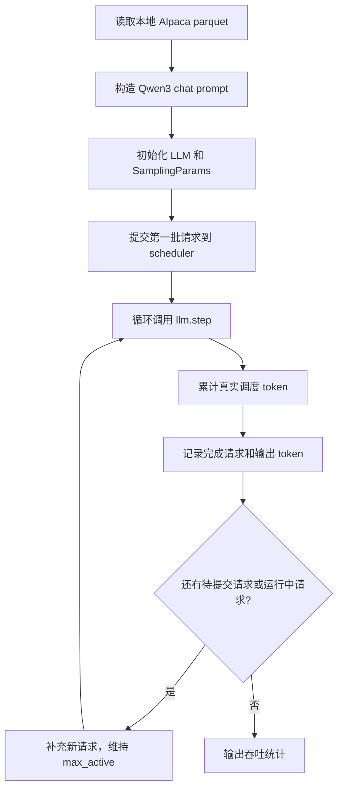

# Benchmarks

这个目录用于放置 nano-vLLM 的 benchmark 脚本。后续每新增一个脚本，都应在这里说明它测量的对象、适用场景、启动方式、关键参数和输出指标。

## 目录定位

- **吞吐测试**：关注单位时间内完成多少请求、处理多少 token，适合观察调度、batching、CUDA graph、KV cache 等机制对整体吞吐的影响。
- **延迟测试**：关注单个请求的端到端耗时、首 token 延迟和逐 token 延迟，适合评估在线服务体验。
- **算子测试**：关注单个 kernel 或局部模块的耗时，例如 RMSNorm、attention、KV cache 写入等。
- **服务测试**：关注 HTTP / OpenAI-compatible server 场景下的请求到达率、并发、流式输出和客户端侧延迟。

当前已有脚本主要覆盖 **Engine 吞吐测试**，还不是严格的 latency benchmark。

## 指标约定

- **Request throughput**：请求吞吐，单位是 `req/s`，表示每秒完成多少个请求。
- **Output token throughput**：输出 token 吞吐，单位是 `tok/s`，只统计生成出来的 completion token。
- **Total token throughput**：总 token 吞吐，单位是 `tok/s`，统计 prompt token 和 output token 之和。
- **Scheduled tokens**：`step()` 返回的真实调度 token 数之和，包含混合 batch、chunked prefill 和可能的重算；不包含 CUDA Graph padding。当前不按正负号区分 prefill/decode。
- **TTFT**：Time To First Token，首 token 延迟，表示请求提交后多久生成第一个 token。当前脚本暂未统计。
- **TPOT**：Time Per Output Token，首 token 之后的平均逐 token 时间。当前脚本暂未统计。
- **ITL**：Inter-Token Latency，相邻输出 token 之间的间隔。当前脚本暂未统计。
- **E2E latency**：端到端延迟，表示请求提交到完整输出结束的总耗时。当前脚本暂未按请求统计。

## benchmark_engine_throughput.py

`benchmark_engine_throughput.py` 用于测试 nano-vLLM Engine 在持续请求压力下的吞吐。它直接使用 `LLM.add_request()` 和 `LLM.step()`，而不是调用 `LLM.generate()`。

### 测试目标

- 观察 Engine 在固定最大活跃请求数下的整体吞吐。
- 观察逻辑输入量、实际调度 token 量、生成 token 量和 engine step 数之间的关系。
- 为后续分析 scheduler、KV cache、CUDA graph 和 kernel launch 开销提供基础数据。

### 执行流程



这个脚本模拟的是“持续灌请求”的 engine benchmark：只要有请求完成，就继续从数据集中补新请求，尽量让 engine 内的活跃请求数维持在 `--max-active` 附近。

### 数据集

默认读取本地 Alpaca parquet：

```shell
/home/huangxy/datasets/alpaca/data/train-00000-of-00001-a09b74b3ef9c3b56.parquet
```

每条样本使用 `instruction` 和 `input` 构造用户 prompt，再通过 tokenizer 的 `apply_chat_template()` 转成 Qwen3 chat 格式。当前关闭 thinking，生成预算用于普通回答。

### 运行命令

在项目根目录激活 `nano-vllm` 环境。模型和数据集使用上面的本地默认路径。
先用 4 条请求、2 个并发槽位和最多 8 个输出 token 做冒烟测试：

```shell
conda activate nano-vllm
VLLM_HOST_IP=127.0.0.1 python -m benchmarks.benchmark_engine_throughput \
  --num-prompts 4 \
  --max-active 2 \
  --max-tokens 8 \
  --max-model-len 1024 \
  --max-num-batched-tokens 256 \
  --gpu-memory-utilization 0.5 \
  --enforce-eager
```

常规吞吐测试：

```shell
VLLM_HOST_IP=127.0.0.1 python -m benchmarks.benchmark_engine_throughput \
  --num-prompts 128 \
  --max-active 16 \
  --max-tokens 128 \
  --gpu-memory-utilization 0.5 \
  --enforce-eager
```

测试 CUDA graph 路径时去掉 `--enforce-eager`：

```shell
VLLM_HOST_IP=127.0.0.1 python -m benchmarks.benchmark_engine_throughput \
  --num-prompts 128 \
  --max-active 16 \
  --max-tokens 128 \
  --gpu-memory-utilization 0.5
```

`--max-active` 同时写入 SchedulerConfig.max_num_seqs，因此小并发命令也会减小
Runner 请求容量及 FULL decode 捕获范围。`--max-num-batched-tokens` 控制 token
buffer 和 profiling 容量，必须不小于 `--max-active`；较长 prompt 可分块执行。

### 参数说明

| 参数 | 默认值 | 含义 |
| --- | --- | --- |
| `--model-path` | `/home/huangxy/models/Qwen3-0.6B` | 本地 Hugging Face 模型目录。 |
| `--dataset-path` | `/home/huangxy/datasets/alpaca/data/train-00000-of-00001-a09b74b3ef9c3b56.parquet` | 本地 Alpaca parquet 文件路径。 |
| `--num-prompts` | `128` | 本次最多读取并执行多少条 prompt。 |
| `--max-active` | `16` | 最大活跃请求数，同时作为 Scheduler 和 Runner 的请求槽位容量。 |
| `--max-tokens` | `128` | 每条请求最多生成多少 output token。 |
| `--temperature` | `0.6` | 采样温度。 |
| `--enforce-eager` | 关闭 | 开启后禁用 CUDA graph，便于调试和 profiling，但 decode 性能通常更低。 |
| `--max-model-len` | `4096` | 单请求的 prompt 与 output 总长度上限。 |
| `--max-num-batched-tokens` | `256` | 单轮真实 token 预算及 Runner token buffer 容量。 |
| `--gpu-memory-utilization` | `0.9` | 当前实例的预算占 GPU 总显存的比例，包含权重、激活、Graph 和 KV。 |

### 输出指标

脚本结束后输出以下统计：

- `num_prompts` 表示本次加载的 prompt 数。
- `num_submitted` 表示实际提交给 engine 的请求数。
- `num_finished` 表示成功完成的请求数。
- `num_engine_steps` 表示调用 `llm.step()` 的次数。
- `input_tokens` 表示所有 prompt token 数之和。
- `output_tokens` 表示所有 completion token 数之和。
- `scheduled_tokens` 表示各轮真实执行 token 数之和；不包含 Graph padding，也不强行拆分混合 batch 的 prefill/decode。
- `elapsed` 表示从提交第一批请求到全部请求完成的耗时，不包含数据集和模型加载、启动 profiling、预热、Graph 捕获或最后的 Worker 清理。
- `requests/s` 表示完成请求数除以 `elapsed`。
- `total_tokens/s` 表示 `(input_tokens + output_tokens) / elapsed`。
- `output_tokens/s` 表示 `output_tokens / elapsed`。

`input_tokens` 是逻辑 prompt 长度，即使命中 prefix cache 也会计入；`output_tokens`
包含最后一个已采样、尚未再次 forward 的 token。因此 `input_tokens + output_tokens`
不等于 `scheduled_tokens`，实际调度量还会受到 prefix cache 复用与抢占重算影响。
脚本在结束或异常时显式关闭 Engine。

## 当前限制

- 当前脚本主要统计吞吐，不统计严格的 TTFT、TPOT、ITL 和 per-request E2E latency。
- 当前脚本直接访问 `llm.add_request()` 和 `llm.step()`，适合研究 Engine 行为，但不等价于 HTTP serving benchmark。
- 当前 `llm.step()` 只返回已完成请求，不能直接拿到每一步新生成 token 的时间戳，因此 ITL 需要等 Engine 输出结构进一步改造后再做。
- 当前 benchmark 默认使用固定 `max_active` 补请求，不模拟泊松到达、突发流量或真实在线服务请求率。

## 后续方向

- 新增 `benchmark_engine_latency.py`，按请求统计 TTFT、TPOT、E2E latency 的 p50 / p90 / p99。
- 新增 NVTX range，把 `load_dataset`、`init_llm`、`benchmark_loop`、`prefill_step`、`decode_step` 标到 Nsight Systems 时间线里。
- 新增 JSON 输出，方便保存多组参数下的 benchmark 结果。
- 新增 serving benchmark，在 HTTP server 和 streaming 场景下统计客户端侧延迟。
