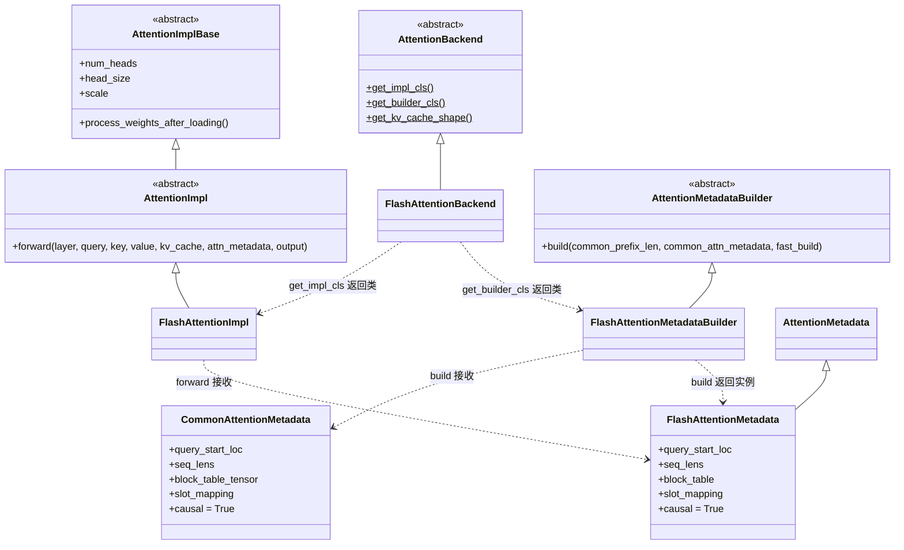
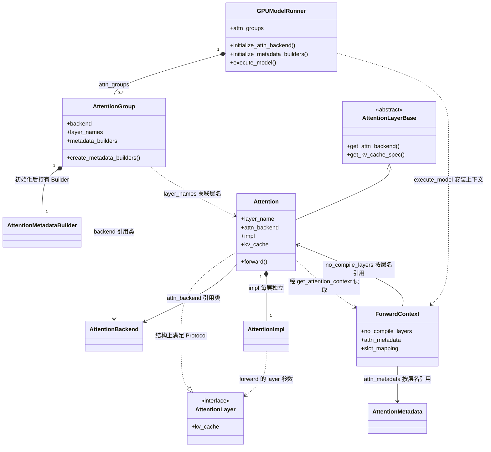
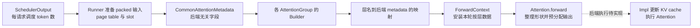

# Attention 后端抽象：从批次元数据到单层计算

源码入口：[backend.py](../../nanovllm/attention/backend.py)、[flash_attn.py](../../nanovllm/attention/backends/flash_attn.py)、[attention.py](../../nanovllm/model_executor/layers/attention/attention.py)、[attention_layer_base.py](../../nanovllm/model_executor/layers/attention_layer_base.py)、[forward_context.py](../../nanovllm/forward_context.py)、[gpu_model_runner.py](../../nanovllm/worker/gpu_model_runner.py)、[utils.py](../../nanovllm/worker/utils.py)。

> **当前状态**：后端选择、分组、KV 布局、缓存绑定、metadata 构造和 Attention 包装层的调用流程已有实现；CUDA platform、FA2 调用与缓存写入基础接口也已移植，见 [fa_utils.md](fa_utils.md)。`FlashAttentionImpl` 的 `do_kv_cache_update()` 与 `forward()` 尚未完整接通，下文不把架构准备当成已经能够推理。

## 为什么需要这些类

一次 Attention 计算包含三个变化尺度，拆开才能让 Runner 不必了解每个 kernel 的细节：

| 尺度 | 例子 | 变化时机 | 负责对象 |
| --- | --- | --- | --- |
| 后端能力 | 支持哪些 kernel page 大小、KV tensor 是什么形状。 | 选择后端时确定。 | `AttentionBackend` |
| 单层参数与存储 | 本地 Query/KV head 数、head size、缩放系数、这一层的 KV cache。 | 模型构造或 KV 初始化时确定。 | `Attention` 层、`AttentionImpl` |
| 本轮批次 | 哪些请求参与、各算几个 token、读哪些 page、新 K/V 写到哪个 slot。 | 每个 engine step 都变化。 | `CommonAttentionMetadata`、Builder、后端 metadata |

**核心分工**：Backend 声明能力与工厂接口；Builder 把本轮公共输入翻译成后端格式；Impl 才执行单层 Attention。`GPUModelRunner` 组织三者，但不应硬编码每个后端的 KV 布局。

## 类之间是什么关系

先区分 UML 箭头的含义，尤其不要把“返回一个类”理解成“持有一个实例”：

| 图中符号 | 含义 | 本项目中的例子 |
| --- | --- | --- |
| `父类 <\|-- 子类` | 继承，子类实现或扩展父类接口。 | `AttentionBackend <|-- FlashAttentionBackend`。 |
| `A *-- B` | 组合，A 创建并持有 B 实例。 | 每层 `Attention` 创建自己的 `impl`。 |
| `A --> B` | 关联，A 保存或引用 B；不表示创建 B。 | `ForwardContext` 按层名引用已有 Attention 层。 |
| `A ..> B` | 依赖，A 调用、接收或返回 B。 | Backend 的工厂方法返回 Impl **类**。 |
| `A ..\|> 接口` | 满足接口约定。 | `Attention` 结构上满足 `AttentionLayer` Protocol。 |

### 后端类族：谁继承谁，谁返回谁



这张图有三条继承主线：**Backend 声明后端能力，Impl 实现单层计算，Builder 实现元数据转换**。`FlashAttentionBackend.get_impl_cls()` 返回的是 `FlashAttentionImpl` 类，由 Attention 层随后实例化；`get_builder_cls()` 返回的是 Builder 类，由 AttentionGroup 随后实例化。Backend 不持有这些实例。

图中省略了泛型参数。源码里的 `FlashAttentionImpl(AttentionImpl[FlashAttentionMetadata])` 表示该 Impl 消费 FlashAttention metadata；`FlashAttentionMetadataBuilder(AttentionMetadataBuilder[FlashAttentionMetadata])` 表示该 Builder 返回这种 metadata。**Builder 和 Impl 不互相继承，也不直接互相调用，它们通过同一种 metadata 类型衔接。**

`CommonAttentionMetadata` **没有继承** `AttentionMetadata`。前者是 Runner 的公共输入，后者是后端输入的类型标记；Builder 将公共输入转换成 `FlashAttentionMetadata`，两者不是父子关系。

`causal` 沿用 vLLM 的传递流程：公共 metadata 默认 `True`，Builder 复制到后端 metadata，`FlashAttentionImpl.forward()` 再传给 FA。当前仅支持 bool，裁剪 FA4 的逐请求 tensor 模式。例如已有两个历史 token、本轮执行三个 Query 时，第一个 Query 位于序列位置 2，只能读取位置 0～2，不能读取本轮后面的位置 3、4。

### 运行时对象：谁创建实例，谁引用实例



这张图画的是**构造和初始化完成后的对象关系**：Runner 持有 AttentionGroups，当前每组持有一个 Builder；每层 Attention 持有一个独立 Impl。`AttentionGroup.layer_names` 只保存层名列表，不保存或创建 Attention 层实例。ForwardContext 引用静态层注册表与本轮 metadata，不创建第二套模型，也不复制 KV cache。

`AttentionLayerBase` 和 `AttentionLayer` 容易混淆，但用途不同：

| 类型 | 使用方 | 要求层提供什么 | Attention 如何满足 |
| --- | --- | --- | --- |
| `AttentionLayerBase` | Worker 发现层、规划缓存。 | `get_attn_backend()`、`get_kv_cache_spec()` 等接口。 | 显式继承并实现抽象方法。 |
| `AttentionLayer` | Impl 的 `forward(layer, ...)` 参数类型。 | 当前只要求 `kv_cache` 属性。 | 具有该属性即可，不需要显式继承 Protocol。 |

`Attention` 还继承 `torch.nn.Module`，图中省略了这一通用模型关系。槽位 tensor 的映射 `ForwardContext.slot_mapping` 也只保存引用；它不是 Attention metadata 的父类或子类。

### 具体例子：两层共享什么，各自保存什么

假设 `model.layers.0.self_attn.attn` 和 `model.layers.1.self_attn.attn` 处于同一个 KV group，后端、KV 规格与本地 Query head 数相同。初始化完成后，它们被放入同一个 AttentionGroup：

| 对象或字段 | 两层之间的关系 | 生命周期 |
| --- | --- | --- |
| `attn_backend` / `group.backend` | 都引用 `FlashAttentionBackend` 这个类。 | 初始化后复用。 |
| `layer0.impl`、`layer1.impl` | 两个不同的 `FlashAttentionImpl` 实例。 | 各自随对应 Attention 层存在。 |
| `group.metadata_builders[0]` | 当前只有一个 Builder，服务组内两层。 | 初始化后跨 step 复用。 |
| `attn_metadata[layer0_name]`、`attn_metadata[layer1_name]` | 指向本轮 `build()` 返回的同一个 metadata 对象。 | 每轮重新构造并安装。 |
| `layer0.kv_cache`、`layer1.kv_cache` | 各层绑定自己的缓存视图；相同 page ID 定位各层自己的 K/V。 | KV 初始化后跨 step 复用。 |

例如后文的 A/B 请求形成 `query_start_loc=[0, 3, 4]`、`seq_lens=[8, 11]`。这个请求布局适用于上述两层，所以 Builder 只需生成一次 metadata。模型依次执行两层时，各层的 `get_attention_context(layer_name)` 得到的是**同一份请求布局、不同层实例和不同层缓存**；第二层会用自己投影得到的 K/V，不能复用第一层存下来的 K/V 数值。

## 两条生命周期

### 模型与 KV cache 初始化

模型构造时，`Attention` 层用稳定的 `prefix` 注册到 `static_forward_context`，并通过 `get_attn_backend()` 暴露后端类。Runner 根据 Engine 的 KV cache 规划建立分组，选择 kernel page 粒度，创建 Builder，分配并绑定各层 KV cache。


图中是**初始化阶段**，并非每轮重新分配。这里有两层“组”：KV cache group 规定逻辑 block 规划及所属层；同一个 KV group 内，还可以按后端、KV 规格和本地 Query head 数划分多个 `AttentionGroup`。后者共享 Builder，不共享组内各层的 KV tensor。不同层使用相同的 block ID 时，访问的是各自缓存中的同一编号位置。

### 每个 engine step

Scheduler 决定每个 request 本轮计算的 token 数；Runner 打包 token 和 position，准备序列长度、page table、slot mapping，并创建一份后端无关的 `CommonAttentionMetadata`。各 AttentionGroup 的 Builder 再生成本轮后端 metadata，按完整层名交给模型。



虚线是当前实现边界：Runner 已经安装 ForwardContext，`Attention.forward()` 已通过统一接口读取本层数据、安排缓存更新与计算。FlashAttention 声明 `forward_includes_kv_cache_update=False`，所以正常写缓存路径会先进入 `unified_kv_cache_update()`；由于其 Impl 尚无 `do_kv_cache_update()`，此处会断言失败。缓存写入和 FA2 计算的基础入口已经具备，但还需要在 Impl 中调用；`forward()` 当前只完成部分准备与无 metadata 的 profiling 分支。

## 基类的职责

### `AttentionBackend`：声明能力和选择实现

Backend 是**后端类**，不保存某个 request 的状态。`get_name()` 给出稳定标识，`get_impl_cls()` 与 `get_builder_cls()` 分别返回计算实现类和元数据构造器类。

| 接口或属性 | 用途 | 当前 FlashAttention 的结果 |
| --- | --- | --- |
| `get_supported_kernel_block_sizes()` | 给出 kernel page 粒度约束，供 `select_common_block_size()` 选择。 | `[MultipleOf(256)]`，匹配当前上游 FA2 扩展。 |
| `get_kv_cache_shape(...)` | 声明**单层** KV tensor 的逻辑形状。 | `(num_blocks, 2, block_size, num_kv_heads, head_size)`。 |
| `get_kv_cache_stride_order(...)` | 声明逻辑维度在内存中的排列，指导 raw storage 变成 view。 | 单层为 `(0, 1, 2, 3, 4)`，即按逻辑维度连续。 |
| `get_kv_cache_block_dim(...)` | 找出形状中 `num_blocks` 所在维度。 | 维度 `0`。 |
| `forward_includes_kv_cache_update` | 声明 Impl 的 forward 是否自行写入新 K/V。 | `False`，包装层在 forward 前调用 Impl 的独立缓存更新接口；实际更新方法尚未实现。 |
| `supported_dtypes`、`supported_kv_cache_dtypes` | 声明支持的计算类型和 KV 类型。 | 当前列出 FP16、BF16 及 `auto` 等值。 |

`MultipleOf(256)` 是“page 大小必须是 256 的倍数”，**不是**“page 大小只能等于 256”。例如 manager block 为 256 token 时，256 自身符合约束，当前选择 `kernel_block_size=256`；若其他后端只接受固定的 64，manager block 才需要转换成四个 kernel page。参考 vLLM 的扩展允许 16 的倍数，但当前直接使用的上游 FA2 要求 256 的倍数。两种粒度的区别见 [block_table.md](../worker/block_table.md)。

### `AttentionMetadata`：公共输入与后端输入

`AttentionMetadata` 是一个不规定字段的类型标记。Runner 构造的 `CommonAttentionMetadata` 则包含后端无关的**本轮**批次信息：

| 字段 | 含义与下标方式 |
| --- | --- |
| `query_start_loc` / `query_start_loc_cpu` | 长度为 `num_reqs + 1` 的前缀和；相邻两项圈定一个 request 的 packed query 区间。 |
| `seq_lens` | 按 request 排列；每个值是执行本轮 token **之后**的序列长度。 |
| `num_reqs`、`num_actual_tokens` | 请求数和送入 Attention 的 packed token 数；当前没有 padding。 |
| `max_query_len`、`max_seq_len` | 单请求本轮最多计算的 token 数、执行后的最大序列长度。 |
| `block_table_tensor` | 第 `i` 行是第 `i` 个 request 的物理 **kernel page ID** 序列；用于定位历史 K/V。 |
| `slot_mapping` | 按本轮 packed token 排列；每项是新 K/V 应写入的物理 slot。 |

**注意两套下标**：`seq_lens[i]` 和 `block_table_tensor[i]` 按 request 排列，`slot_mapping[j]` 按 packed token 排列；`query_start_loc` 将 packed token 切回各 request。Worker 的 `BlockTable` 提供 page table 和 slot mapping，但不管理 KV block 的所有权。

### `AttentionMetadataBuilder[M]`：组级翻译器

`AttentionGroup.create_metadata_builders()` 在 kernel page 大小确定后创建 Builder。它保存 `kv_cache_spec`、`layer_names`、配置和设备等静态信息；每轮调用 `build(common_prefix_len, common_attn_metadata, fast_build=False)`，返回后端专属的 `M`。当前调用方传 `common_prefix_len=0`，未启用 cascade attention 或 fast-build 特化。

同一 AttentionGroup 的层共享一个 Builder 及**同一轮生成的 metadata 对象**，因为它们读取的是同一批请求布局；这不表示 K/V 数据共享。当前 `FlashAttentionMetadataBuilder.build()` 只重组字段并引用公共 tensor，不复制 GPU tensor。

### `AttentionImplBase[T]`、`AttentionImpl[T]`、`AttentionLayer`

`AttentionImplBase` 声明 `num_heads`、`head_size`、`scale`，并提供默认空实现的 `process_weights_after_loading()`。`AttentionImpl` 定义普通 decoder Attention 的构造和 `forward(layer, query, key, value, kv_cache, attn_metadata, output)` 契约；`T` 把 Impl 与对应的后端 metadata 类型关联起来。

`AttentionLayer` 是 **Protocol（结构化类型约定）**，当前只要求层对象具有 `kv_cache` 属性。它本身不分配缓存，也不执行 Attention。`AttentionType` 虽列出其他类型，目前只考虑 decoder self-attention。

## FlashAttention 的完整数值例子

假设一个混合 P/D 批次有两个 request：`A` 继续执行分块 prefill，`B` 执行一步 decode。两者处于同一个 KV group，manager block 和 kernel page 均为 256 token。

| request | 已计算 token | 本轮调度 token | 本轮 position | 执行后长度 | page table 行 |
| --- | ---: | ---: | --- | ---: | --- |
| `A` | 5 | 3 | `[5, 6, 7]` | 8 | `[2]` |
| `B` | 10 | 1 | `[10]` | 11 | `[5]` |

按 `A` 再 `B` 打包 query，公共 metadata 中的关键值为：

```python
num_reqs = 2
num_actual_tokens = 4
query_start_loc = [0, 3, 4]  # A 是 [0:3]，B 是 [3:4]
seq_lens = [8, 11]
max_query_len = 3
max_seq_len = 11
block_table_tensor = [[2], [5]]
slot_mapping = [517, 518, 519, 1290]
```

这里的 `block_table_tensor` 只展示两行的**有效 page ID 前缀**；实际 `get_device_tensor(2)` 返回固定列宽 `[2, max_num_blocks_per_req]` 的 GPU view，剩余列不属于这两个请求的有效 page。

page table 记录的是**物理 page ID**，不是每个 token 的 slot。`A` 的 page ID 为 2，页内偏移是 5、6、7，所以 slot 为 `2 * 256 + [5, 6, 7] = [517, 518, 519]`；`B` 的 page ID 为 5，页内偏移为 10，得到 `5 * 256 + 10 = 1290`。

再假设一层本地 `num_kv_heads=2`、`head_size=128`、KV dtype 为 BF16，分得 8 个物理 page：

```python
FlashAttentionBackend.get_kv_cache_shape(
    num_blocks=8,
    block_size=256,
    num_kv_heads=2,
    head_size=128,
)
# (8, 2, 256, 2, 128)
```

第二维 `2` 是 **K/V 两份**，不是两个 request。每个 page 占 `2 * 256 * 2 * 128 * 2 = 262144` 字节；8 个 page 对**这一层**占 2 MiB。另一层即使也使用 page ID `2`，也访问它自己的 KV tensor。

`FlashAttentionMetadataBuilder.build()` 将 `CommonAttentionMetadata` 变成 `FlashAttentionMetadata`：保留 `query_start_loc`、`seq_lens`、`slot_mapping` 等 tensor 引用，并把 `block_table_tensor` 映射到 `block_table` 字段。Runner 将这一对象放到对应层名下，并通过 ForwardContext 暴露给 Attention 包装层。至此**准备阶段**完成；实际后端尚未写入 K/V、调用 FA kernel，因此该数值例子不代表目前能够端到端运行。

## 当前边界与下一步

- `initialize_attn_backend()`、`initialize_metadata_builders()`、`initialize_kv_cache_tensors()` 和 `_build_attention_metadata()` 已连接准备路径；当前 `_build_attention_metadata()` 只支持**一个 full-attention KV group**。
- `Attention.forward()` 已整理输入形状和预分配输出，通过 `get_attention_context()` 按层名读取 metadata 与 combined `kv_cache`；不再直接调用 kernel 或维护 prefill/decode 分支。
- `FlashAttentionImpl.do_kv_cache_update()` 尚未实现，`forward()` 尚未完成对移植基础接口的调用。独立更新流程是包装层安排调用、Impl 执行缓存写入；“在 forward 外更新”并不表示写入 kernel 属于包装层。
- 后续应实现 Impl 的缓存写入与混合 P/D 计算，再做真实模型的端到端测试。

记住一条主线即可：**Backend 决定“怎么存、选谁算”；Runner 决定“这一轮算谁”；Builder 翻译本轮数据；Impl 真正计算。**
