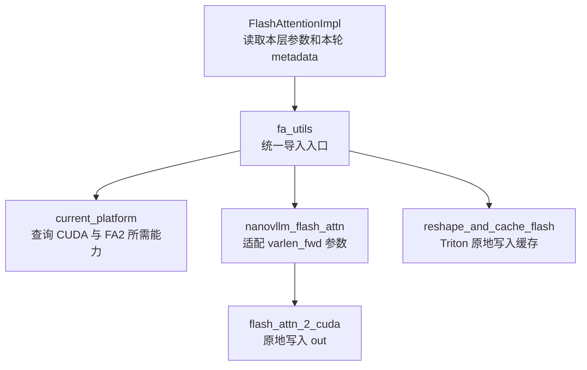

# CUDA 与 FlashAttention 基础接口

这次移植保留 vLLM 的分层和参数命名，当前支持 **CUDA、FA2、FP16/BF16、普通 decoder Attention、MQA/GQA 和 paged KV cache**。调用底层已安装的 `flash_attn_2_cuda`，不依赖参考仓库中单独编译的 vLLM 扩展。

## 文件如何对应 vLLM

| vLLM 文件 | 当前项目文件 | 职责 |
| --- | --- | --- |
| `vllm/platforms/interface.py` | [platforms/interface.py](../../nanovllm/platforms/interface.py) | 平台身份、设备能力和统一操作接口。 |
| `vllm/platforms/cuda.py` | [platforms/cuda.py](../../nanovllm/platforms/cuda.py) | CUDA 设备操作、硬件能力、精度检查、显存统计与块复制。 |
| `vllm/platforms/__init__.py` | [platforms/__init__.py](../../nanovllm/platforms/__init__.py) | 导出唯一的 `current_platform`。 |
| `vllm/v1/attention/backends/fa_utils.py` | [backends/fa_utils.py](../../nanovllm/attention/backends/fa_utils.py) | FA 版本与能力查询，统一导出计算和缓存写入接口。 |
| `vllm/vllm_flash_attn/flash_attn_interface.py` | [flash_attn_interface.py](../../nanovllm/nanovllm_flash_attn/flash_attn_interface.py) | 将 vLLM 风格参数直接传给当前上游 FA2 扩展。 |
| `vllm/_custom_ops.py` | [_custom_ops.py](../../nanovllm/_custom_ops.py) | 保留 `reshape_and_cache_flash` 参数名和顺序。 |
| `vllm/v1/attention/ops/triton_reshape_and_cache_flash.py` | [triton_reshape_and_cache_flash.py](../../nanovllm/attention/ops/triton_reshape_and_cache_flash.py) | 按物理 slot 原地写入非量化 K/V，尊重实际 stride。 |



这里的两个写入过程各自独立：`reshape_and_cache_flash` 写 K/V cache，`flash_attn_varlen_func` 读取 cache 并写 Attention 输出。包装层已经规定先更新缓存，再执行计算；基础接口不会在计算时重复更新 K/V。

## 平台身份与硬件可用性

`current_platform` 是 `CudaPlatform` 单例；导入和创建单例不查询 GPU，也不初始化 CUDA。当前没有 CPU 回退平台、其他平台或插件选择。

| 调用 | 返回或副作用 |
| --- | --- |
| `current_platform.is_cuda()` | 报告项目选择的平台身份，因此没有可用 GPU 时仍为 `True`。 |
| `get_device_capability(device_id=0)` | 返回 `DeviceCapability(major, minor)`；CUDA 不可用时返回 `None`。显式属性查询可能初始化 CUDA。 |
| `has_device_capability(80)` | 判断能力是否至少为 SM 8.0。 |
| `is_device_capability(89)` | 判断是否精确为 SM 8.9。 |
| `is_device_capability_family(90)` | 判断是否属于 SM 9.x。 |
| `set_device(torch.device("cuda", local_rank))` | 切换设备并做一次小分配，沿用 vLLM 的 eager 设置流程。Worker 已使用这个入口。 |

例如 SM 8.9 满足 `has_device_capability(80)`，但不满足 `is_device_capability(80)`。无设备时三个能力判断都返回 `False`，不把未知能力视为支持。

### CUDA 公共接口

`Platform` 保存通用接口和默认功能开关；`CudaPlatformBase` 实现 CUDA 公共操作；`CudaPlatform` 采用参考源码 `NonNvmlCudaPlatform` 的 PyTorch 查询方式。因此部分可用方法继承自 `Platform`，不必在 `CudaPlatformBase` 中重复定义。

| 接口 | 输入、输出和副作用 |
| --- | --- |
| `device_count()` | 返回 `CUDA_VISIBLE_DEVICES` 过滤后的逻辑 GPU 数量；Worker 用它检查 `local_rank`。直接使用 PyTorch，不提供参考源码 NVML 路径的 stateless 保证。 |
| `supported_dtypes` | 按架构返回精度列表：SM ≥ 8.0 时为 BF16/FP16/FP32，SM ≥ 6.0 时为 FP16/FP32，否则为 FP32。 |
| `check_if_supports_dtype(dtype)` | Worker 绑定设备后校验 BF16 的 SM 8.0 门槛，不满足时抛 `ValueError`；检查当前设备，避免异构多卡只检查 `cuda:0`。其他模型精度的解析由 `ModelConfig` 负责。 |
| `get_device_name(id)`、`get_device_total_memory(id)` | 查询指定逻辑 GPU 的型号、总显存字节数，可能初始化 CUDA。 |
| `get_current_memory_usage(device)` | 清空 allocator 空闲缓存、重置指定设备的峰值，再返回当前 PyTorch 分配量，单位为字节。会覆盖此前峰值统计。 |
| `num_compute_units(id)`、`is_integrated_gpu(id)` | 查询 SM 数量、是否共享系统内存。旧 PyTorch 没有 `is_integrated` 属性时保守返回 `False`。 |
| `is_pin_memory_available()` | CUDA 可用且不在 WSL 时为 `True`；Runner 用结果配置 CPU staging buffer，代替硬编码 `True`。 |
| `inference_mode()` | 返回 `torch.inference_mode` 上下文；退出时恢复 autograd 状态。 |
| `manual_seed_all(seed)` | 设置所有可见 CUDA 设备的随机种子。 |
| `supports_fp8()`、`is_arch_support_pdl()` | 分别检查 SM ≥ 8.9 的 FP8 硬件能力、当前设备 SM ≥ 9.0 的 PDL 架构能力；不启用相应 kernel。 |
| `is_fp8_fnuz()`、`fp8_dtype()` | CUDA 返回 `False` 和 `torch.float8_e4m3fn`，仅描述编码。当前模型与缓存仍限于已支持的非量化精度。 |
| `insert_blocks_to_device(...)`、`swap_out_blocks_to_host(...)` | 按两组下标一一对应，原地更新目标缓存第一维的块；不更新 block table，不提供 offload 调度。 |
| `is_fully_connected(physical_device_ids)` | 当前没有 NVML，按参考源码的 NonNvml 策略返回 `False`；不能把 CUDA peer access 等同于 NVLink 全互联。 |
| `get_global_graph_pool()` | 首次显式调用时创建原生 CUDA Graph pool，之后在本进程同一平台类的实例间复用。不会自动捕获或回放模型。 |
| `get_infinity_values(dtype)`、`can_update_inplace()` | 返回 `(-inf, inf)` 和 `True`，允许对持久 buffer 原地更新。 |

例如一张 GPU 总显存为 24 GiB，当前 tensor 占 2 GiB，上一轮峰值曾达到 4 GiB。调用 `get_current_memory_usage()` 得到约 2 GiB，同时峰值统计重置到当前分配量；`get_device_total_memory()` 返回 24 GiB。需要上一轮峰值时应直接读取 `max_memory_allocated()`，不要先调用前者。

块复制的下标关系也与参考源码一致：源下标 `[2, 0]`、目标下标 `[1, 3]` 表示源 block 2 写到目标 block 1、源 block 0 写到目标 block 3，其他目标块不变。当前缓存 `[num_blocks, 2, page_size, num_kv_heads, head_size]` 的第一维正是这些物理 block。

### 继承、转发与裁剪

`Platform.__getattr__` 按参考源码转发未显式定义的属性到 `torch.cuda`，因此可以使用 `current_platform.Stream`、`Event`、`current_stream()`、`synchronize()`、`empty_cache()` 等原生接口。只读取函数或类属性不执行 CUDA 操作；调用时才产生相应副作用。普通未知属性告警并返回 `None`，未知 dunder 属性抛 `AttributeError`。

以下是执行器功能开关，不是硬件架构查询。当前 `use_custom_allreduce()`、`use_custom_op_collectives()`、`opaque_attention_op()`、`support_hybrid_kv_cache()`、`support_static_graph_mode()`、`support_deep_gemm()` 均返回 `False`，对应实现尚未接入。原生 graph pool 可用不等于已经提供 vLLM 的编译 wrapper；GPU 支持 FP8 也不等于本项目支持 FP8 Attention。

仍裁剪 `get_valid_backends()` / `get_attn_backend_cls()` 的自动后端选择、`get_device_communicator_cls()` 的自定义 communicator、配置自动改写和 stateless process group 初始化：它们分别依赖尚未移植的 selector/registry、自定义通信类、扩展配置字段和分布式初始化流程。当前 Attention 明确使用 FlashAttention，TP 使用已有的 `torch.distributed` NCCL 初始化路径。

`nanovllm_flash_attn/__init__.py` 沿用 vLLM 的流程：导入接口实现，检查扩展可用性，再提供公共接口。当前只有 FA2，缺少 `flash_attn_2_cuda` 时直接抛 `ImportError`；不提供延迟报错或 CPU 回退。检查的是扩展能否加载，不是机器是否有可用 GPU，因此扩展已安装时仍可在无 GPU 的环境导入。

包的 `__all__` 只保留 `fa_version_unsupported_reason`、`flash_attn_varlen_func`、`is_fa_version_supported`，对应 vLLM 公共接口裁剪掉 FA3 的 `get_scheduler_metadata`。`FA2_AVAILABLE` 与参考源码一样作为包属性保留，但不加入 `__all__`；默认版本、加载失败原因和 `maybe_contiguous` 留在 `flash_attn_interface.py` 中。FA4/CuTe 的源码软链接导入逻辑尚无对应功能，因此裁剪。

`is_flash_attn_varlen_func_available()` 沿用 vLLM CUDA 分支：包入口已通过扩展检查，CUDA 平台返回 `True`，不再次查询硬件；`get_flash_attn_version(head_size=128)` 则检查当前硬件与模型要求，支持时返回 `2`。两者分开，避免“装了 FA”等同于“当前设备可以运行 FA”。

## 保留 seqused_k 与 out 的调用方式

安装的上游公开 `flash_attn_varlen_func` 没有 `seqused_k` 和 `out` 参数，但它调用的 CUDA 扩展 `varlen_fwd` 提供这两个参数。移植接口直接使用该扩展，保留 vLLM 的请求长度与预分配输出流程。

例如 A 本轮执行 3 个 Query，执行后拥有 8 个 KV token；B 本轮执行 1 个 Query，执行后拥有 11 个 KV token：

| 参数 | 数值或形状 | 含义 |
| --- | --- | --- |
| `cu_seqlens_q` | `[0, 3, 4]` | A 读取 Query `[0:3]`，B 读取 `[3:4]`。 |
| `seqused_k` | `[8, 11]` | A/B 各自可读的完整 KV 长度，直接使用 metadata 的 `seq_lens`。 |
| `block_table` | 有效 page 前缀 `[[2], [5]]` | A/B 历史缓存所在的物理页；实际 tensor 可有固定列宽。 |
| `k`、`v` | `[num_blocks, 256, num_kv_heads, head_size]` | 当前层的缓存视图，不是仅本轮新投影的 Key/Value。 |
| `out` | `[4, num_heads, head_size]` | 包装层预分配的输出视图，由扩展直接写入。 |

下面展示后端接线时的调用形式。**这是一段接口示例；当前 FlashAttentionImpl 的完整执行方法仍待接通。**

```python
from nanovllm.attention.backends.fa_utils import flash_attn_varlen_func

# 前置条件：本轮新 K/V 已通过 do_kv_cache_update 写入当前层缓存。
key_cache, value_cache = kv_cache.unbind(1)
num_actual_tokens = attn_metadata.num_actual_tokens
flash_attn_varlen_func(
    q=query[:num_actual_tokens],
    k=key_cache,
    v=value_cache,
    out=output[:num_actual_tokens],
    cu_seqlens_q=attn_metadata.query_start_loc,
    max_seqlen_q=attn_metadata.max_query_len,
    seqused_k=attn_metadata.seq_lens,
    max_seqlen_k=attn_metadata.max_seq_len,
    softmax_scale=self.scale,
    causal=attn_metadata.causal,
    block_table=attn_metadata.block_table,
    fa_version=2,
)
```

paged 模式直接传 `seqused_k`，不额外计算 KV 长度前缀和。底层 ABI 仍要求一个形状为 `[num_reqs + 1]` 的 `cu_seqlens_k` 占位 tensor，由适配层创建；有效 KV 长度由 `seqused_k` 给出。非 paged 的 packed K/V 则必须传真实 `cu_seqlens_k`，否则无法定位各请求的 packed KV 起点。

返回值默认是输出 tensor；传入 `out` 时返回同一个对象。`return_softmax_lse=True` 时返回 `(out, lse)`，其中 LSE 为 `[num_heads, total_q]`。调用不会复制结果到第二个输出 buffer，也不会更新 KV cache。

上游 FA2 在 `max_seqlen_q=1` 的 GQA decode 中有一次 reshape/transpose 优化，某些多请求布局可能隐式复制 `out`，返回 LSE 的 head 顺序也可能受影响。适配层只在需要保护预分配输出或 LSE 的这些分支中将 kernel launch 的 Query 长度上界提升到 2，关闭该优化；**真实 Query 长度仍由 `cu_seqlens_q` 给出，并没有 padding 或增加计算 token**。

## 缓存写入的实际布局

当前 combined cache 为 `[num_blocks, 2, page_size, num_kv_heads, head_size]`。`unbind(1)` 去掉 K/V 这一维，得到两个缓存视图；它们保留原存储的 page stride，通常不是完全连续的 tensor。

缓存写入使用如下地址关系，分别套用 K 与 V 自身的 stride：

```python
block_idx = slot // block_size
block_offset = slot % block_size
offset = (
    block_idx * cache.stride(0)
    + block_offset * cache.stride(1)
    + head_idx * cache.stride(2)
    + dim_idx * cache.stride(3)
)
```

例如 slot `517` 在 page size 为 256 时对应物理 page `2`、页内偏移 `5`。`slot_mapping` 的长度决定写多少 token；输入尾部可以多出 padding，负 slot 跳过，其他缓存位置保持原值。有效 slot 范围和同批次唯一性由调度/缓存管理保证。

## 当前支持范围

- 只实现 FA2 前向、FP16/BF16、等维度 Q/K/V、无量化缓存；不提供 backward。
- 不支持 FA3/FA4、MLA、ALiBi、sliding window、softcap、attention sinks、量化 Query 或 FA3 scheduler metadata。非默认的不支持参数明确报错。
- 上游 FA2 paged page size 必须是 **256 的倍数**，后端布局声明和检查已同步，不再沿用 vLLM 扩展的 16 倍数约束。
- Python 包装层按 vLLM 保留 `cu_seqlens_k` / `seqused_k` 的关系断言、窗口参数准备和 `maybe_contiguous`。不另设 tensor 校验 helper；设备、dtype、shape、stride 和页大小检查交给 FA C++ 入口。调用方负责保证同设备、有效索引及仅用于推理。
- 上游扩展的 `varlen_fwd` 没有显式 `num_splits` 参数，因此当前仅接受 `num_splits=0`，由其内部选择执行策略。
- 已安装并核对的扩展为 `flash-attn 2.8.3.post1`。项目依赖限定在 `2.8.3 <= version < 2.9`；这层 Python 适配不编译或安装 vLLM 的 `_vllm_fa2_C`。

下一步在 `FlashAttentionImpl` 中调用这些入口，完成 `do_kv_cache_update()` 与混合 prefill/decode 的 `forward()`。基础接口可用不等于 Runner 的采样、profiling 或完整生成流程已经实现。
