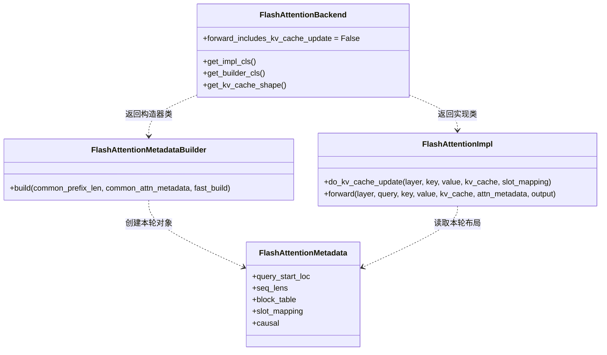
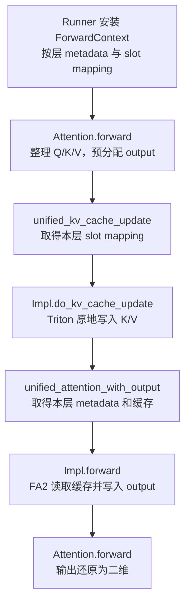

# FlashAttention 后端：从本轮 Query 到分页缓存计算

源码入口：[flash_attn.py](../../nanovllm/attention/backends/flash_attn.py)。后端抽象与对象关系见 [backend.md](backend.md)，CUDA、FA 适配层和 Triton 写入接口见 [fa_utils.md](fa_utils.md)。本文以当前源码为准，主要解释本文件的接口如何改变 metadata、KV cache 和 output。

**当前后端已接通独立 KV 写入与 FA2 前向调用**：先把本轮新 K/V 写入当前层缓存，再用本轮 Query 读取包含历史和新增 token 的分页 K/V，结果写入包装层预分配的 output。Runner 的采样、profiling 与 decode FULL Graph 编排见 [GPUModelRunner](../worker/gpu_model_runner.md)。

## 四个类分别负责什么

| 类 | 保存什么 | 输入 → 输出或变化 | 使用时机 |
| --- | --- | --- | --- |
| `FlashAttentionBackend` | 类级别的能力声明，不保存请求状态。 | 缓存规格 → 逻辑形状、维度顺序；返回 Impl 和 Builder **类**。 | 后端选择、模型构造、缓存规划。 |
| `FlashAttentionMetadata` | 本轮 Query 边界、总 KV 长度、分页表、写入槽位与 causal 设置。 | 作为本轮计算的参数容器，本身不执行 kernel。 | 每轮构造，组内各层可以共用。 |
| `FlashAttentionMetadataBuilder` | KV 规格、组内层名、配置和设备。 | `CommonAttentionMetadata` → 后端 metadata，保留 tensor 引用。 | 初始化时创建，之后逐轮调用 `build()`。 |
| `FlashAttentionImpl` | 本层本地 head 数、head size、scale、缓存精度名称和 FA 版本。 | 新 K/V → 原地更新 cache；Query + cache + metadata → 原地更新 output。 | 每个 Attention 层独立创建，逐轮调用。 |



虚线表示依赖。Backend 返回类，由外部创建实例；Builder 与 Impl 通过 metadata 衔接，彼此不直接调用。**KV cache 实际保存在 Attention 层上**，Impl 在调用时接收该层的缓存 tensor，不另建一份缓存。

## 贯穿示例：A 做分块 prefill，B 做 decode

下面始终使用同一轮批次，位置下标从 0 开始。假设历史 token 的 K/V 已在缓存中，各请求本轮新增的 K/V 尚未写入。

| 请求 | 已有历史 token 数 | 本轮 Query 数 | 本轮序列位置 | 执行后总 KV 长度 | 物理 page ID |
| --- | --- | --- | --- | --- | --- |
| A | 5 | 3 | `[5, 6, 7]` | 8 | `[2]` |
| B | 10 | 1 | `[10]` | 11 | `[5]` |

这一层采用 `num_heads=4`、`num_kv_heads=2`、`head_size=8`、BF16 和 `block_size=256`，共分配 8 个物理 page。每个 KV head 服务两个 Query heads，属于 GQA（分组 Query Attention）。

| 数据 | 形状或值 | 含义 |
| --- | --- | --- |
| `query` | `[4, 4, 8]` | 前三行是 A 的三个 Query，第四行是 B 的 Query。 |
| `key`、`value` | 各 `[4, 2, 8]` | 与 Query 行顺序一致的本轮新 K/V。 |
| `kv_cache` | `[8, 2, 256, 2, 8]` | 当前层的物理缓存，第二维区分 K/V。 |
| `output` | `[4, 4, 8]` | 包装层预分配，等待后端写入。 |
| `query_start_loc` | `[0, 3, 4]` | A 对应 packed 行 `[0:3]`，B 对应 `[3:4]`。 |
| `seq_lens` | `[8, 11]` | 各请求包含历史和本轮 token 的完整 KV 长度。 |
| `block_table` | 有效前缀 `[[2], [5]]` | A 的逻辑 page 0 在物理 page 2，B 的在物理 page 5。 |
| `slot_mapping` | `[517, 518, 519, 1290]` | 本轮四行 K/V 的物理写入位置。 |

实际 `block_table` 可以有固定列宽，表中只展示有效列。一个请求需要读取的 page 数由其 `seq_lens` 和 page 大小决定，不能把表的所有列都当作有效缓存。

这里有三个不同的下标空间：

- **packed 行号**：A 的序列位置 5、6、7 对应本轮行号 0、1、2，B 的位置 10 对应行号 3。
- **请求内序列位置**：用于确定因果关系、逻辑 page 编号和页内偏移。
- **物理 slot**：由物理 page ID 与页内偏移组成，决定新 K/V 写到哪里。

## `FlashAttentionBackend`：声明实现与缓存布局

### 能力和工厂接口

| 接口或属性 | 当前返回值 | 对调用方的影响 |
| --- | --- | --- |
| `get_name()` | `"FLASH_ATTN"` | 后端标识与日志名称。 |
| `get_impl_cls()` | `FlashAttentionImpl` 类 | Attention 包装层据此创建本层 Impl。 |
| `get_builder_cls()` | `FlashAttentionMetadataBuilder` 类 | AttentionGroup 据此创建组内共用 Builder。 |
| `supported_dtypes` | FP16、BF16 | 声明支持的计算精度。 |
| `supported_kv_cache_dtypes` | `auto`、`float16`、`bfloat16` | 声明非量化缓存类型；输入和缓存实际精度必须一致。 |
| `get_supported_kernel_block_sizes()` | `[MultipleOf(256)]` | 当前加载的上游 FA2 paged kernel 要求 page 大小为 256 的倍数。 |
| `forward_includes_kv_cache_update` | `False` | 包装层须在 `forward()` 前调用独立缓存更新接口。 |

能力声明不分配 tensor，也不执行 Attention。`auto` 表示沿用实际缓存精度；它不是在写入时自动把任意输入转换成缓存精度。

### `get_kv_cache_shape()`：规格变成单层形状

```python
shape = FlashAttentionBackend.get_kv_cache_shape(
    num_blocks=8,
    block_size=256,
    num_kv_heads=2,
    head_size=8,
    cache_dtype_str="auto",
)
# shape == (8, 2, 256, 2, 8)
```

- **返回值**：维度依次是物理 page、K/V、page 内 token、KV head、head 内元素。后三维采用 NHD，即 token、head、head 维度。
- **约束**：`block_size` 必须为正且是 256 的倍数，否则抛 `ValueError`。`cache_dtype_str` 当前不改变形状。
- **副作用**：无；方法只返回形状，实际分配与缓存绑定由 Runner 完成。

示例 BF16 缓存共占 `8 * 2 * 256 * 2 * 8 * 2 = 131072` 字节，即这一层 128 KiB。形状中的第二维 `2` 表示 K/V 两份，与请求数无关；两个层使用相同 page ID 时，访问各自层的缓存。

### `get_kv_cache_stride_order()`：逻辑维度如何排列

常规单层调用返回 `(0, 1, 2, 3, 4)`，表示上述逻辑维度按原顺序排列。若调用方额外加入层维度，接口返回 `(1, 0, 2, 3, 4, 5)`；当前逐层缓存路径使用前一种情况。

这个返回值用于解释原始存储的布局，**不会直接对传入 tensor 做 permute 或复制**。

## `FlashAttentionMetadataBuilder.build()`：保留数据，只换容器

构造 Builder 时，基类保存 `kv_cache_spec`、`layer_names`、`vllm_config` 和 `device`。它不在构造阶段生成某个请求的 metadata，也不写入缓存。

**重要接口**：

```python
def build(
    self,
    common_prefix_len: int,
    common_attn_metadata: CommonAttentionMetadata,
    fast_build: bool = False,
) -> FlashAttentionMetadata:
    ...
```

`common_prefix_len` 和 `fast_build` 为对齐上游接口保留，当前不改变构建路径。Runner 正常调用时传入前缀长度 0；Builder 不执行 cascade 的前缀拆分。

### 公共字段怎样进入后端 metadata

| 公共 metadata 字段 | 后端 metadata 字段 | 本例值 | 后续使用方 |
| --- | --- | --- | --- |
| `num_actual_tokens` | 同名 | `4` | `forward()` 切片 Query 和 output。 |
| `max_query_len` | 同名 | `3` | FA 的 `max_seqlen_q`。 |
| `query_start_loc` | 同名 | `[0, 3, 4]` | FA 的 `cu_seqlens_q`。 |
| `max_seq_len` | 同名 | `11` | FA 的 `max_seqlen_k`。 |
| `seq_lens` | 同名 | `[8, 11]` | FA 的 `seqused_k`。 |
| `block_table_tensor` | `block_table` | 有效前缀 `[[2], [5]]` | FA 定位各请求的分页 K/V。 |
| `slot_mapping` | 同名 | `[517, 518, 519, 1290]` | 保存本轮写入布局；独立更新调用使用上下文传来的映射。 |
| `causal` | 同名 | `True` | FA 的因果 mask 开关。 |

例如以下片段中的 `builder` 和 `common_metadata` 已由 Runner 准备：

```python
metadata = builder.build(0, common_metadata)

assert metadata.query_start_loc is common_metadata.query_start_loc
assert metadata.seq_lens is common_metadata.seq_lens
assert metadata.block_table is common_metadata.block_table_tensor
assert metadata.slot_mapping is common_metadata.slot_mapping
```

**tensor 字段直接保留同一个对象引用，没有 GPU 拷贝**。`build()` 创建新的 Python metadata 对象，但 tensor 内容不是独立快照；公共缓冲区被原地改写时，后端 metadata 看到的内容也随之改变。

`query_start_loc` 是 GPU int32、形状 `[num_reqs + 1]`；`seq_lens` 是 GPU int32、形状 `[num_reqs]`。前者回答“每个请求的本轮 Query 在哪里”，后者回答“每个请求能读多少 KV”。两者不能互换。

## `FlashAttentionImpl`：静态参数与两次原地写入

### `__init__()`：保存本层参数，选择 FA 版本

| 构造参数 / 成员变量 | 本例值 | 作用 |
| --- | --- | --- |
| `num_heads` | `4` | 当前 TP rank 的 Query head 数。 |
| `head_size` | `8` | 当前 Q/K/V 共用的每 head 维度。 |
| `scale` | `8 ** -0.5` | softmax 前缩放 QK 分数。 |
| `num_kv_heads` | `2` | 本地 KV head 数；省略时使用 `num_heads`，对应 MHA。 |
| `kv_cache_dtype` | `"auto"` | 传给缓存写入接口的精度名称。 |
| `vllm_flash_attn_version` | 支持时为 `2` | 调用 `get_flash_attn_version(head_size=8)` 后保存的结果。 |

版本选择依赖当前设备与 head size；当前 FA2 要求可用的 SM 8.0 或更新 CUDA GPU，head size 为正、是 8 的倍数且不超过 256。无法选择时保存 `None`，`forward()` 的版本断言会拒绝继续执行。缺少 FA2 扩展时，包入口会更早在导入阶段报错。

构造方法不分配 KV cache 或 output。`num_heads` 等参数描述层的静态结构；每轮请求长度与 page ID 来自 metadata。

### `do_kv_cache_update()`：新 K/V 写到哪些位置

**用途**：在计算之前，按本轮 `slot_mapping` 散写 K/V。方法返回 `None`，真正的结果是传入缓存被原地更新。

```python
def do_kv_cache_update(
    self,
    layer: torch.nn.Module,
    key: torch.Tensor,
    value: torch.Tensor,
    kv_cache: torch.Tensor,
    slot_mapping: torch.Tensor,
) -> None:
    ...
```

#### `unbind(1)`：分离 K/V，共享原存储

```python
key_cache, value_cache = kv_cache.unbind(1)

# kv_cache:   [8, 2, 256, 2, 8]
# key_cache:  [8, 256, 2, 8]，对应 kv_cache[:, 0]
# value_cache:[8, 256, 2, 8]，对应 kv_cache[:, 1]
```

这两个 tensor 是视图，**没有把整个缓存复制出来**。写入 `key_cache` 或 `value_cache` 就是在修改原始 `kv_cache` 的相应位置。

stride（步幅）决定相邻元素在存储中相隔多少个元素。对于本例连续的 combined cache，K/V 视图的 stride 都是 `(8192, 16, 8, 1)`：跨一个物理 page 要跳过整页的 K 和 V。单独四维缓存若完全连续，page stride 则是 4096，因此不能仅凭视图形状假设它完全连续。

#### 物理 slot 变成 page 和偏移

地址关系为 `page_id = slot // block_size`、`offset = slot % block_size`。本例写入前后的变化如下，`key[i]` / `value[i]` 均表示一整个 `[2, 8]` 的 KV head 切片：

| packed 行号 | 请求及序列位置 | 物理 slot | 写入 K 的位置 | 写入 V 的位置 |
| --- | --- | --- | --- | --- |
| `0` | A，位置 5 | `517` | `key_cache[2, 5] = key[0]` | `value_cache[2, 5] = value[0]` |
| `1` | A，位置 6 | `518` | `key_cache[2, 6] = key[1]` | `value_cache[2, 6] = value[1]` |
| `2` | A，位置 7 | `519` | `key_cache[2, 7] = key[2]` | `value_cache[2, 7] = value[2]` |
| `3` | B，位置 10 | `1290` | `key_cache[5, 10] = key[3]` | `value_cache[5, 10] = value[3]` |

调用后，A 在 page 2 上已有位置 0～7 的 K/V，B 在 page 5 上已有位置 0～10 的 K/V。历史位置保留原值，其他未映射位置也保持原值。**写入方法不更新 `seq_lens`、`block_table` 或请求进度**，这些信息应由 Runner 和调度流程提前准备。

实际写入调用 `reshape_and_cache_flash()`，其内部委托给项目的 Triton 算子；当前非量化路径不读取 `layer` 的量化缩放状态。写入发生在当前 CUDA stream 上，方法不主动同步 GPU。

#### 写入长度和 padding 的关系

- `slot_mapping` 长度为 `N` 时，只处理 K/V 的前 `N` 行，要求 `N <= T`。所以 K/V 即使有尾部 padding，也无需在本方法中先切片。
- 映射中的负值表示跳过该行，例如 `-1` 不会写入缓存；它与“映射长度之外的输入行”是两种跳过方式。
- 调用方保证有效 slot 在缓存范围内，同批次有效写入槽位不冲突。K/V 和缓存必须同设备、同精度，当前精度为 FP16 或 BF16。

### `forward()`：本轮 Query 读取完整分页 KV

**用途**：读取已经更新的缓存，计算 Attention，并把结果写入传入的 output，返回同一个完整 output 对象。

```python
def forward(
    self,
    layer: AttentionLayer,
    query: torch.Tensor,
    key: torch.Tensor,
    value: torch.Tensor,
    kv_cache: torch.Tensor,
    attn_metadata: FlashAttentionMetadata,
    output: torch.Tensor,
) -> torch.Tensor:
    ...
```

`layer`、`key`、`value` 保留上游接口；当前普通 decoder 计算路径不直接读取它们。**传给 FA 的 K/V 是缓存视图，包含历史与本轮数据**，并非参数中只有四行的新 K/V。

#### metadata 如何变成 FA 参数

| FA 参数 | 来自哪里 | 本例值或形状 | 对计算的影响 |
| --- | --- | --- | --- |
| `q` | `query[:num_actual_tokens]` | `[4, 4, 8]` | 只计算本轮有效 Query。 |
| `k`、`v` | `kv_cache.unbind(1)` | 各 `[8, 256, 2, 8]` | 提供整层物理页池。 |
| `out` | `output[:num_actual_tokens]` | `[4, 4, 8]` | 直接写入调用方的有效输出前缀。 |
| `cu_seqlens_q` | `query_start_loc` | `[0, 3, 4]` | 将 packed Query 分成 A 的三行和 B 的一行。 |
| `max_seqlen_q` | `max_query_len` | `3` | 本批次单请求 Query 长度上界。 |
| `seqused_k` | `seq_lens` | `[8, 11]` | 限定 A/B 各自有效 KV 长度。 |
| `max_seqlen_k` | `max_seq_len` | `11` | 本批次单请求 KV 长度上界，供 kernel 调度。 |
| `block_table` | 同名字段 | 有效前缀 `[[2], [5]]` | A 读取物理 page 2，B 读取物理 page 5。 |
| `softmax_scale` | `self.scale` | `8 ** -0.5` | 缩放 QK 分数。 |
| `causal` | 同名字段 | `True` | 阻止读到请求内的未来 token。 |
| `fa_version` | `self.vllm_flash_attn_version` | `2` | 选择当前已接入的 FA2 路径。 |

Query 使用 packed 前缀和分段；K/V 使用 page table 与实际长度定位。**不需要把 `seq_lens` 重新求前缀和作为 KV 起点**，因为各请求的缓存并非按请求顺序连续拼接。底层适配层负责满足 CUDA 扩展的参数 ABI（调用约定），本方法只传这些已有字段。

#### 为什么因果 mask 要右下对齐

一个请求的 Query 长度为 `q_len`、总 KV 长度为 `kv_len` 时，第 `i` 行 Query 对应序列位置 `kv_len - q_len + i`。`causal=True` 只允许读取不超过该位置的 K/V。

| 输出行 | 对应 Query | 可读取的序列位置 | 实际缓存范围 |
| --- | --- | --- | --- |
| `output[0]` | A 的位置 5 | A 的 0～5 | page 2 的 `[0:6]` |
| `output[1]` | A 的位置 6 | A 的 0～6 | page 2 的 `[0:7]` |
| `output[2]` | A 的位置 7 | A 的 0～7 | page 2 的 `[0:8]` |
| `output[3]` | B 的位置 10 | B 的 0～10 | page 5 的 `[0:11]` |

即使 A 的位置 6、7 已经先写入缓存，A 的第一个 Query 仍不会读它们；**缓存写入决定数据是否就位，因果 mask 决定数据能否被当前 Query 读取**。page table 同时保证 A 不会读 B 的 page。

若 `causal=False`，A 的三个 Query 都能读 A 的全部 8 个 KV，B 仍只读 B 的 11 个 KV。当前 `causal` 是整批共用的 bool，不支持 FA4 的逐请求 tensor mask。

#### 一个可手算的输出变化

为看清 mask 的作用，额外假设 Q/K 全为零；A 的 Value 在序列位置 0～7 上分别为 1～8，B 的 Value 在位置 0～10 上分别为 1～11，每个 head 内各维都填同一值。此时有效 QK 分数都为零，softmax 在允许读取的位置上均匀分配权重。

| 输出行 | `causal=True` 时每个元素的值 | `causal=False` 时每个元素的值 |
| --- | --- | --- |
| A，位置 5 | `(1 + ... + 6) / 6 = 3.5` | `(1 + ... + 8) / 8 = 4.5` |
| A，位置 6 | `(1 + ... + 7) / 7 = 4` | `4.5` |
| A，位置 7 | `(1 + ... + 8) / 8 = 4.5` | `4.5` |
| B，位置 10 | `(1 + ... + 11) / 11 = 6` | `6` |

这是解释计算语义的手算例子。真实模型中不同 Query/head 的分数和 Value 不同，但请求分段、页定位与因果范围仍遵循同样规则。

后端输出是 `[4, 4, 8]`，包装层再还原为 `[4, 32]`，**每个本轮 Query 一行**。这里没有做“每请求一行”的 logits 选择或采样；若下游只需要每请求最后一个 Query，A/B 对应 packed 行号为 `[2, 3]`，由 Runner 后续选择。

#### profiling 与输出 padding

| 输入状态 | 方法行为 | 修改范围 |
| --- | --- | --- |
| FA 版本为 `None` | 开始时断言失败，包括 profiling 调用。 | 尚未写入 output。 |
| 版本已选定，`attn_metadata is None` | `output.fill_(0)` 后返回，不读取缓存，不调用 FA。 | 整个 output。 |
| 版本已选定，有真实 metadata | 读取缓存并调用 FA。 | 前 `num_actual_tokens` 行；尾部保持调用前内容。 |

例如直接调用 Impl 时，Query/output 有 8 行而 `num_actual_tokens=4`，计算仅写入 `[0:4]`，尾部四行保持原值。当前 Runner 的 eager 路径使用真实数量；FULL decode 路径则将 `num_actual_tokens` 设为图的 token 容量。补齐请求通过重复 query 边界、零序列长度、空页和负 slot 表示，最终仅选择真实请求的 hidden states。不能仅凭该字段名把它理解为所有执行模式下的真实有效 token 数；完整例子见 [BatchDescriptor](../cudagraph/BatchDescriptor.md#完整例子三个请求怎样补到四槽图)。

## 包装层怎样保证先写缓存再计算



图中是存在有效缓存写入映射的普通推理路径。ForwardContext 提供按层数据引用；包装层决定调用顺序；本文件的 Impl 执行具体写入与计算。上下文没有本层 slot mapping 时，统一更新入口跳过写入，profiling 等路径需与相应 metadata 状态配套。

包装层传递的 `kv_cache_dummy_dep` 是兼容上游命名的空 tensor，当前直接调用路径靠 Python 调用顺序和当前 stream 的执行顺序衔接两次 kernel；未接入 `torch.compile` custom op 的依赖机制。统一计算入口主要依靠后端对 output 的原地写入，不用 Impl 的返回值替换已分配输出。

## 与 vLLM 对齐的流程和当前裁剪

参考源码为上游 [vllm/v1/attention/backends/flash_attn.py](https://github.com/vllm-project/vllm/blob/b5adb027ad03c29b46181752ba3b1cb84eff1dd4/vllm/v1/attention/backends/flash_attn.py)，链接固定到核对过的提交。

| 环节 | 当前保留的流程 | 当前边界 |
| --- | --- | --- |
| 后端分层 | Backend / Metadata / Builder / Impl 的职责与接口命名。 | 后端由包装层明确选择，未引入完整 selector。 |
| KV 更新 | `forward_includes_kv_cache_update=False`，独立 `do_kv_cache_update()`，按 slot 散写。 | 保留同名算子入口，内部使用 Triton；不处理 FP8 缩放。 |
| 普通 decoder 前向 | 版本断言、profiling 填零、K/V 视图、普通 varlen 参数、原地 output 与完整 output 返回。 | 只接入 FA2，不包含 encoder/cross-attention 路径。 |
| 请求布局 | packed Query + paged KV，支持同批次 prefill/decode 与 GQA/MQA。 | 没有 cascade、投机解码专用 metadata、decode context parallel。 |
| mask 与附加特性 | metadata 的 bool `causal` 直接传给 FA。 | 没有动态 causal tensor、sliding window、ALiBi、softcap 或 attention sinks。 |
| FA 基础接口 | 保留 `seqused_k`、`out` 等参数名与数据流。 | 调用已安装上游 FA2 扩展，不编译 vLLM 的 FA 扩展；不需要 FA3/FA4 的 TMA stride 规范化和 scheduler metadata。 |

当前方法实现已经具备缓存写入与计算接线。底层 CUDA 接口与缓存写入布局见 [fa_utils.md](fa_utils.md)。
