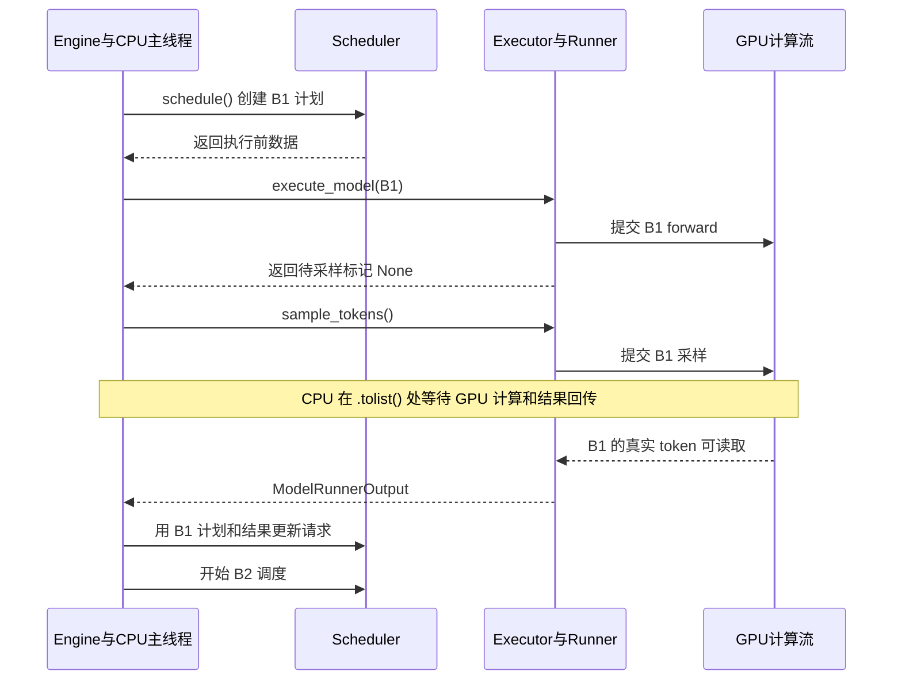
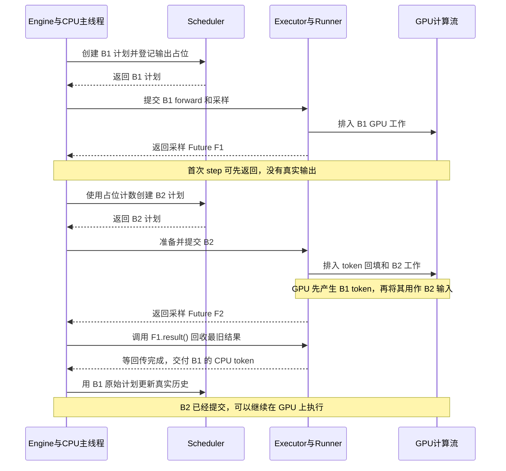
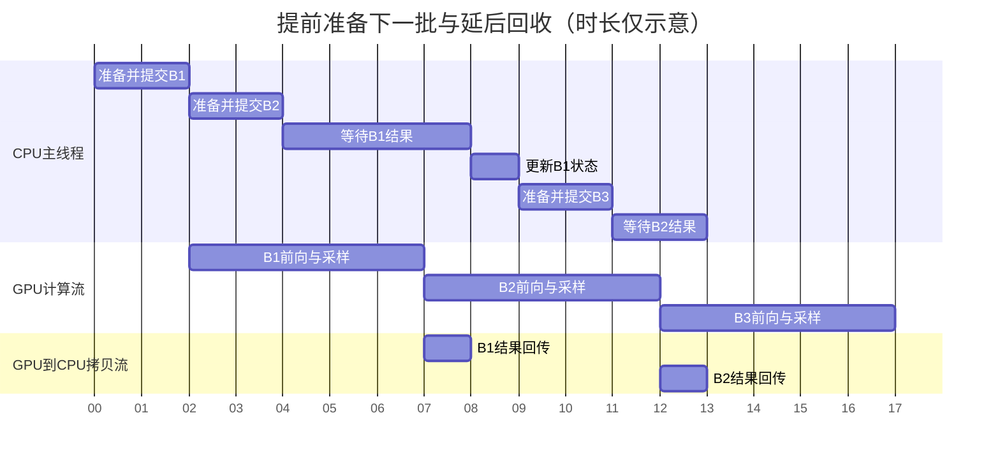
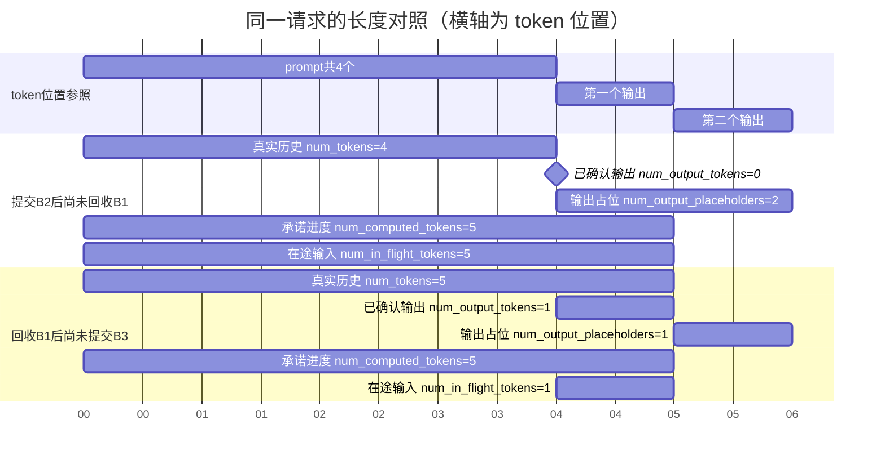
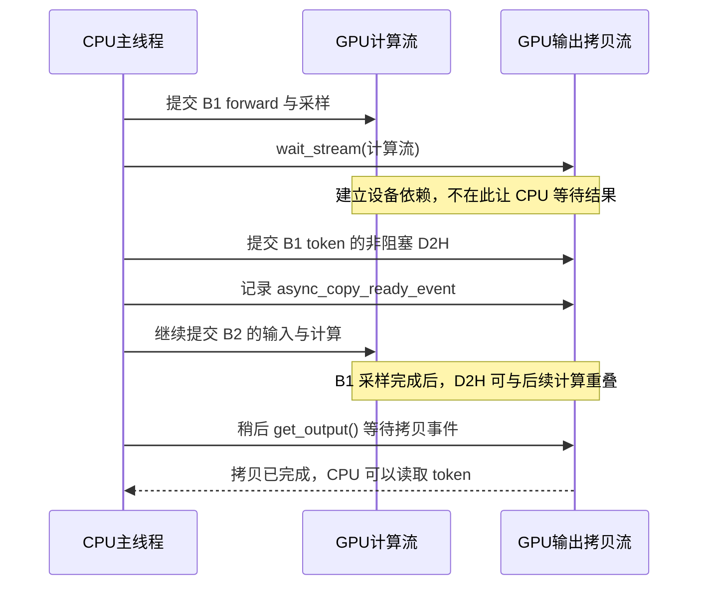

# 异步调度：提前提交批次与延后回收结果

本文按当前单进程、单 GPU Worker 的实现介绍异步调度。先看 CPU 与 GPU 怎样交错
执行，再解释为了保持这种交错，Engine、Scheduler、Executor 和 Runner 分别维护了
哪些额外状态。调度数据成员的详细含义见 [output-zh.md](output-zh.md)。

## 先区分提交、执行与回收

一次请求会经历许多轮模型执行：先处理输入 prompt，再逐步生成输出。
每轮可以包含多个请求，下文把这一轮的工作称为一个**批次**，用 B1、B2、B3 表示。

推理时涉及两类执行者：

| 执行者 | 负责的工作 |
| --- | --- |
| CPU 主线程 | 选择请求、准备输入、调用模型接口、向 CUDA 提交工作、处理返回结果。 |
| GPU | 按 CUDA stream（执行流）的顺序计算模型、采样 token，以及执行设备上的拷贝。 |

CPU 调用 PyTorch 的 CUDA 运算时，通常先把工作排入执行流，随后继续运行 Python。
因此下面三个时刻可能不同：

- **提交完成**：CPU 已经发出了这批工作的执行命令。
- **GPU 完成**：模型和采样已经在设备上算完。
- **CPU 回收完成**：采样 token 已复制回 CPU，Scheduler 已更新真实输出历史。

异步调度利用这些时刻之间的间隔：**在 CPU 回收 B1 的结果之前，先准备并提交 B2，
让 B2 的 CPU 工作尽量与 B1 的 GPU 执行重叠。**

当前 Executor 的 Python 调用仍在同一个主线程里执行，没有新增后台模型执行线程。
同一请求的后一个 token 仍依赖前一个 token；GPU 通过执行流顺序保持这个依赖。

## 同步路径在哪等待

先给几个参与者一个明确的职责：

| 对象 | 在一轮执行中做什么 |
| --- | --- |
| Engine | 驱动调度、执行和结果回收。 |
| Scheduler | 选择请求，产生本轮的 `SchedulerOutput` 调度计划。 |
| Executor / Worker | 将调用交给模型执行侧，并包装返回结果。 |
| GPUModelRunner，简称 Runner | 更新执行侧请求记录，准备输入，提交 forward 和采样。 |

`execute_model()` 提交 forward 并保留 logits，`sample_tokens()` 随后消费这份
logits、提交采样。当前同步路径在采样之后调用 GPU tensor 的 `.tolist()`，
需要等真实 token 可供 CPU 读取，随后才进入下一轮调度。



图中省略了同步路径上已经完成的 Future 包装：`execute_model(non_block=True)`
返回的 Future 此时保存的是 Python 返回值 `None`。等待这份 Future 不代表等待
整批 GPU 工作；主要的设备结果等待发生在后面的采样结果转 CPU 列表时。

## 异步路径把等待放到哪里

要提前提交 B2，需要同时解决两个问题：

- Scheduler 尚未拿到 B1 的真实 token，但必须知道该请求下一步还有一个输入位置。
  因此它为待返回的输出维护**占位计数**。
- Runner 尚未把 B1 的 token 写回 CPU，但 B2 的 GPU 输入需要这个 token。
  因此它直接保留并复用 **GPU 上的上一轮采样结果**。

`Future` 可以理解为稍后取结果的凭据。异步采样先返回这份凭据，Engine 在后面调用
`result()` 时，才等待拷贝完成并取得 CPU 结果。



这里 B2 的 CPU 提交可以先完成，GPU 实际计算仍按依赖顺序执行。
下一批不需要等待“CPU 已确认上一批结果”，但仍需要等待“GPU 已产生它所依赖的 token”。

### CPU 与 GPU 的重叠示意

下面用任意时间刻度展示流水线。图中的秒数仅用于绘图，不是实测耗时；实际输入准备
还包含拷贝、设备操作和必要的 buffer 保护。



CPU 准备 B2 时，GPU 正在执行 B1；CPU 准备 B3 时，GPU 正在执行 B2。
图中也保留了等待：提前提交只是把一部分 CPU 工作移到等待之前，GPU 尚未完成的
部分仍要在结果回收点等待。

## 一个开关怎样改变各层路径

入口是 `SchedulerConfig.async_scheduling`，默认为 `False`。Engine 和 Runner
读取同一份配置，必须让调度计数、输入准备和输出返回方式配套变化。

| 位置 | 同步模式 | 异步模式 |
| --- | --- | --- |
| Engine 创建调度器 | `Scheduler`。 | `AsyncScheduler`。 |
| Engine 执行一轮 | `step_fn` 绑定 `step()`，提交并回收本轮结果。 | `step_fn` 绑定 `step_with_batch_queue()`，先提交，再回收最旧结果。 |
| Engine 在途容器 | 不创建批次队列。 | 创建容量为 2 的 `batch_queue`。 |
| Runner 保存输出 | CPU 记录真实 token。 | CPU 记录占位，同时保存上一轮 GPU token。 |
| Runner 返回采样结果 | 已有 CPU token 的 `ModelRunnerOutput`。 | 延后取 CPU token 的 `AsyncGPUModelRunnerOutput`。 |
| Executor 包装结果 | 同步采样调用直接返回结果。 | 非阻塞采样调用返回 `AsyncOutputFuture`。 |
| 下一轮输入来源 | CPU 的真实 token 历史。 | 连续请求用上一轮 GPU token 回填，其他输入仍从 CPU 上传。 |
| 输入准备保护 | 采样回收已经形成逐轮等待。 | 额外使用 `prepare_inputs_event` 保护 CPU staging buffer 复用。 |

容量 2 表示最多两份批次结果在途，每个批次本身可以包含许多请求。
请求并发上限仍由调度容量配置决定；CUDA Graph 是否启用也有独立配置。

## Engine：两份批次在途，按提交顺序回收

Engine 在初始化时按是否存在批次队列选定统一入口 `step_fn`：同步模式绑定
`step()`，异步模式绑定 `step_with_batch_queue()`。两种方法分别实现各自路径，
`step()` 不再负责分派。生成循环、手动驱动与 benchmark 都调用 `step_fn()`。

### 队列里保存什么

每项保存一对对象：

```python
(future, scheduler_output)
```

- `future`：这批结果的回收入口。
- `scheduler_output`：产生这批结果的原始调度计划，包含当时的请求集合和计算量。

新批次通过 `appendleft()` 加到左侧，旧批次通过 `pop()` 从右侧取出，形成 FIFO
顺序。结果回收时必须使用同一对中的计划，不能拿刚创建的下一批计划解释旧结果。

### 每次 step_fn 怎样推进

| 时刻 | 本次操作 | 返回前保留的在途批次 |
| --- | --- | --- |
| 首次提交 | 提交 B1；队列尚未填满，可以先返回空输出。 | B1。 |
| 下一次调用 | 提交 B2；队列暂时达到 2 项，回收 B1 并更新 Scheduler。 | B2。 |
| 持续运行 | 提交 B3，回收 B2；随后提交 B4，回收 B3。 | 最近提交的一批。 |
| 不再提交新工作 | 继续回收队列中剩余结果，处理完成通知。 | 逐步排空。 |

代码要求每次进入函数时队列长度小于容量，避免有界 `deque` 自动覆盖尚未回收的
旧结果。因此队列容量是 2，但正常调用返回时通常只剩 1 项。

`step_fn()` 返回的第二个值是**本次新提交的 token 计算量**；返回的增量输出则可能属于
刚回收的上一批。首次调用可以有计算量而没有输出，纯回收调用可以有输出而没有
新计算量，两者不再描述同一批次。
因此 B1、B2 的编号表示提交顺序，不应直接对应到调用方收到输出的 step 序号。

### forward 与采样仍需紧邻提交

`execute_model()` 在 Runner 中保存 `execute_model_state`，其中包括本轮计划和
logits，并返回 `None`。`sample_tokens()` 立即消费并清空该状态，再构造采样结果。

Engine 对有 token 的批次先提交 forward，再立即调用非阻塞采样；延后的是 CPU
结果回收。这样下一轮才能安全复用 Runner 的临时执行状态。
零 token 批次只更新 Worker 状态，返回空结果，不调用采样。

## Executor：Future 延后的是哪一部分

当前 `UniProcExecutor.collective_rpc()` 直接在调用线程里运行 Worker 方法，随后
根据返回值决定包装方式：

| Worker 返回值 | `non_block=True` 的包装 | 含义 |
| --- | --- | --- |
| 普通返回值，包括 forward 的 `None`。 | 已完成的普通 `Future`。 | Python 方法已经返回，GPU 上排队的工作不一定结束。 |
| `AsyncModelRunnerOutput`。 | `AsyncOutputFuture`。 | 尚未回收 CPU 结果，调用 `result()` 时再进入 `get_output()`。 |
| Python 调用异常。 | 记录异常的 Future。 | 结果取出时传播错误；执行入口也会尽早暴露已完成 Future 的失败。 |

`AsyncOutputFuture.result()` 首次调用时取得实际输出，再通过 `set_result()` 保存。
后续取值读取缓存，不会再次消费异步输出。GPU 即使已经执行完，这个 Future 也不会
自动在后台调用 `get_output()`；回收由 Engine 主动驱动。

`UniProcExecutor.supports_async_scheduling()` 据此声明支持该模式。具体执行与采样
入口由 UniProcExecutor 覆盖，保持单结果 Future 的返回形式。

只把调用改成 `non_block=True` 不足以形成整条异步路径。调度器的占位、Runner 的
GPU token 复用和 Engine 的结果回收队列都需要同时接通。

## Scheduler：没有真实 token，怎样提前安排下一步

### 把真实历史与已承诺工作分开

请求状态保存在 `Request` 中。理解异步路径时，需要区分以下成员：

| 成员 | 计数对象 | 异步时的含义 |
| --- | --- | --- |
| `num_tokens` | prompt 加已确认输出。 | CPU 已知的真实 token 历史长度。 |
| `num_output_tokens` | 已确认输出。 | CPU 已经追加到真实输出历史的 token 数。 |
| `num_computed_tokens` | 缓存命中或已承诺执行的位置。 | 可以包含尚未回收的 GPU 工作，不能单独据此判断计算已经完成。 |
| `num_output_placeholders` | 待回收的有效输出位置。 | 提前调度时预留的输出数量，不包含具体 token ID。 |
| `num_in_flight_tokens` | 已提交但尚未回收的输入 token 计算量。 | 包含 prefill 和 decode；长 prefill 一批可计入许多 token。 |

普通运行请求本轮尚需推进的长度按以下关系计算，再受 token 预算和上下文上限限制：

```python
num_new_tokens = (
    request.num_tokens
    + request.num_output_placeholders
    - request.num_computed_tokens
)
```

占位只告诉 Scheduler“还会有一个输出位置”，不猜测它的 token ID。
CPU 可以先据此确定输入长度、位置和 KV 分配，具体 token 值由 GPU 回填。

### 提交时增加占位，回收时变成真实历史

Scheduler 先创建执行前的 `SchedulerOutput`，再推进 Request 的计算进度。
`AsyncScheduler._update_after_schedule()` 在基类处理之后，为本轮能够产生有效
输出的请求增加一个占位。

分块 prefill 如果尚未处理完 prompt 或恢复重算的已有历史，就不会产生有效的下一
token，这类中间 chunk 不增加输出占位。对应状态是 `is_prefill_chunk`。

结果回收后，基类把实际 token 追加到真实历史；AsyncScheduler 再减去对应的占位。
对于正常运行中的请求，它还将以下长度交给 `cache_blocks()`：

```python
request.num_computed_tokens - request.num_output_placeholders
```

这里使用扣除占位后的前缀进度，避免直接用提前推进的总进度登记前缀。
KV cache 的完整分配和缓存策略由管理器维护，这只是异步结果回收时的处理位置。

### 一个 4-token prompt 的计数变化

假设只有一个请求，没有 prefix cache 命中，允许继续生成多个 token。
B1 处理 4 个 prompt token，B2、B3 各处理一个后续输入位置：

| 事件完成后 | `num_computed_tokens` | `num_output_tokens` | `num_output_placeholders` | `num_in_flight_tokens` |
| --- | --- | --- | --- | --- |
| 初始。 | 0 | 0 | 0 | 0 |
| 提交 B1，处理 prompt。 | 4 | 0 | 1 | 4 |
| 提交 B2，尚未回收 B1。 | 5 | 0 | 2 | 5 |
| 回收 B1，确认第一个输出。 | 5 | 1 | 1 | 1 |
| 提交 B3，尚未回收 B2。 | 6 | 1 | 2 | 2 |
| 回收 B2，确认第二个输出。 | 6 | 2 | 1 | 1 |

提交 B2 之前，计算量为 `4 + 1 - 4 = 1`：真实历史只有 prompt，但占位表明下一步
会有第一个输出 token 可用。提交 B3 之前，计算量为 `(4 + 1) + 1 - 5 = 1`。

这也解释了为什么不能混用“输出占位数”与“在途输入计算量”：B1 预期产生一个
有效输出，但它本身执行了 4 个输入 token。

### 把各个长度放到同一条位置轴上

下面继续使用这个例子，对照**提交 B2 后、回收 B1 前**与**回收 B1 后**两个状态。
这里借用甘特图表示区间，**横轴是 token 位置，不是执行时间**：刻度 `00` 表示
位置边界 0，`04` 表示位置边界 4，每格代表一个 token。图中的日期和秒只是
Mermaid 绘图所需的坐标，不表示耗时。

4 个 prompt token 占据区间 `[0, 4)`，第一个输出占据 `[4, 5)`，第二个输出
占据 `[5, 6)`。每一行分别表示一个成员覆盖的区间，重叠部分不能相加。



图中长度为 0 的已确认输出用菱形标在 prompt 末尾，表示输出区间尚未展开。
上方的位置参照只标出输出会占据的位置，不表示 CPU 已经知道它们的真实值。

**提交 B2 后，CPU 的真实历史仍只有 4 个 prompt token。** B1 预留第一个输出，
B2 又预留第二个输出，因此逻辑历史长度为
`num_tokens + num_output_placeholders = 4 + 2 = 6`。
但已承诺计算的输入只覆盖 `[0, 5)`：B1 处理 prompt，B2 处理第一个
输出。第二个输出位于 `[5, 6)`，是 B2 将产生的结果，要到 B3 才作为输入处理。

**回收 B1 后，第一个输出从占位变成真实历史。** `num_tokens` 从 4 变成 5，
`num_output_tokens` 从 0 变成 1，占位从 2 减到 1；逻辑历史长度仍为 `5 + 1 = 6`。
`num_computed_tokens` 仍为 5，因为回收没有安排新的计算；在途输入量从 5 减到 1，
因为 B1 的 4 个输入已经完成回收，只剩 B2 的一个输入尚未回收。

此时准备 B3，需要推进的就是 `[5, 6)` 这一格，计算量为 `5 + 1 - 5 = 1`。
这里的“在途”由 CPU 是否回收结果决定，GPU 即使已经执行完成，该批输入仍会
计入 `num_in_flight_tokens`，直到 Scheduler 处理对应结果。

这个例子没有缓存命中、抢占和重算，所以可以把在途输入画成连续区间。
`num_in_flight_tokens` 本身是计数器，并不保存图中的区间边界。

### 调度输出保存执行前的计数

`SchedulerOutput` 中已有请求的 `num_computed_tokens` 保存本轮执行前位置。
Request 随后推进到下一位置，不会自动改写这份旧计划。

已有请求的 `CachedRequestData.num_output_tokens` 则按以下方式填写：

```python
request.num_output_tokens + request.num_output_placeholders
```

这是执行前的逻辑输出长度，包含之前批次的占位，不包含当前计划稍后新增的占位。
它帮助 Worker 对齐本地历史长度，并不表示 CPU 已取得相同数量的真实 token。

## Runner：CPU 先占位，GPU 负责传递真实 token

### 采样后分别保存什么

`Sampler` 返回 GPU 上形状为 `[请求数, 1]` 的 `sampled_token_ids`。
`_bookkeeping_sync()` 虽然名字中带有 sync，但函数内部区分两条路径：

| 保存位置 | 同步模式 | 异步模式 |
| --- | --- | --- |
| 本次返回的 CPU token 列表 | 立即 `.tolist()`，得到真实 token。 | 暂时为空，由异步输出包装器稍后提供。 |
| Worker 的 CPU 输出历史与 token 行 | 追加真实 token。 | 对有效输出追加 `-1`，维护逻辑位置。 |
| `InputBatch.prev_sampled_token_ids` | 不作为下一轮输入来源。 | 保存本轮 GPU 采样 tensor。 |
| `InputBatch.prev_req_id_to_index` | 不需要上一轮输出行映射。 | 保存有效请求 ID 到本轮采样行的映射。 |

这里有两种不同的占位：

- Scheduler 的 `num_output_placeholders` 是**数量**，用于提前计算下一轮工作量。
- Worker 的 `-1` 是 **CPU token 历史中的位置标记**，用于维持输入、输出长度。

二者都不表示一个猜出来的 token。模型执行前必须把需要的真实 GPU token 填到
输入里，不能直接把 `-1` 送进 embedding。

中间 prefill chunk 的采样候选会被过滤：不向 CPU 历史追加 `-1`，也不把该请求加入
下一轮有效 GPU 输出的行映射。其输入计算量仍需要在结果回收时核销。

### 请求行号变化后怎样找到正确的 token

请求会结束、新加入或暂时离开执行批次，Worker 会复用、压缩执行槽位。
上一轮 GPU tensor 的第 0 行，不一定仍对应下一轮的第 0 个请求。

`_compute_prev_positions()` 使用请求 ID 连接两轮位置。例如：

| 本轮请求顺序 | 上一轮顺序为 A、B、C 时的来源行 |
| --- | --- |
| C | 2。 |
| D，新请求 | -1，表示没有上一轮有效输出。 |
| A | 0。 |

此时 `prev_positions` 为 `[2, -1, 0]`。这组 `-1` 表示“没有上一轮来源行”，
与 CPU token 历史里的输出占位属于不同数组。

### 下一轮输入的三种准备方式

`_prepare_input_ids()` 在 CPU 完成位置规划后，按来源准备设备输入：

| 情况 | 处理方式 |
| --- | --- |
| 没有上一轮 GPU 采样结果。 | 从 CPU 上传本轮输入，例如首次 prefill。 |
| 需要复用的输出恰好形成来源与目标都一致的连续前缀。 | 直接从上一轮 GPU tensor 切片拷贝，省去索引构造。 |
| 请求重排、来源不连续，或混合了其他输入。 | 为来源行与目标位置构造索引，用 GPU gather / scatter 回填。 |

有新请求或 prefill 输入时，先上传所需的 CPU 输入，再覆盖其中属于异步连续请求的
占位位置。纯连续 decode 可以直接复用 GPU 输出，省去相应的 CPU token 上传。

回填与后续模型执行排在同一计算流中，因此 GPU 会依次完成：

1. B1 采样，产生真实 token。
2. 把该 token 回填到 B2 的设备输入。
3. B2 forward，读取已经填好的输入。

CPU 可以先发出这三类命令，而无需先读取 token 数值。
本轮输入准备使用旧 GPU 结果；`sample_tokens()` 提交当前轮采样后清除旧引用，
本轮 bookkeeping 再保存新结果，供下一轮使用。这是逐轮替换的工作区，不是所有
请求的完整 GPU 输出历史。

## 为什么还需要 all_token_ids 历史补发

连续执行请求可以沿用上一轮 GPU 输出，但某个请求缺席一轮后，最新 GPU 采样 tensor
里可能已经没有它。此时需要从 Scheduler 的真实历史重建 CPU 输入。

假设 A 的 prompt 是 `[10, 11, 12]`，B1 为 A 生成 token `21`：

| 执行过程 | A 的相关状态 |
| --- | --- |
| B1 包含 A、B，提交采样。 | Worker 的 CPU 输出历史先记为 `[-1]`，GPU 将产生真实值 `21`。 |
| B2 只包含 B。 | 最新的上一轮 GPU 输出映射只保留 B，A 暂时退出执行批次。 |
| 提交 B3 之前，Engine 已回收 B1。 | Scheduler 确认 A 的真实输出为 `[21]`；这次回收不会自动把 Worker 旧 CPU 历史中的 `-1` 改写为 `21`。 |
| B3 再次包含 A、B。 | Scheduler 为 A 补发完整真实历史，Worker 恢复输出并重新建槽。 |

因此 B3 的已有请求数据包含：

```python
all_token_ids = {
    "A": [10, 11, 12, 21],
}
```

Scheduler 对本轮已有请求逐一检查：如果上一轮没有调度它，就复制其真实历史放入
`all_token_ids`。Runner 在异步请求重新入批且已有输出时，从这份历史中取回输出
后缀，替换可能仍带 `-1` 的本地输出列表，再构建 CPU token 行。

如果重新加入源于抢占，Runner 还会用恢复请求的完整 block table 覆盖失效的旧映射。
补发历史负责恢复 token 数据，是否需要重算及从哪个位置开始，仍由执行前进度和
本轮调度量决定。

## 输出回传：独立拷贝流与延后的 CPU 读取

`AsyncGPUModelRunnerOutput` 持有 GPU 采样 tensor 和本轮结果对象。
构造时，它立即在 `async_output_copy_stream` 上提交设备到主机的拷贝，即 D2H。
CPU 到设备的输入上传则称为 H2D。



两类等待的作用不同：`wait_stream()` 把“先采样、后拷贝”的顺序交给 GPU 执行；
`async_copy_ready_event.synchronize()` 在 CPU 真正读取结果时等待拷贝完成。

### 包装器必须保留哪些数据

| 数据 | 为什么必须保存到结果回收 |
| --- | --- |
| `_sampled_token_ids` | 持有 GPU tensor 引用，防止 D2H 尚未结束时释放其存储。 |
| `sampled_token_ids_cpu` | 保存已经提交回传的 CPU tensor，事件完成后才读取。 |
| `async_copy_ready_event` | 表示本批 D2H 已结束，不需要为读取本批结果等待所有后续 GPU 工作。 |
| 结果中的 `req_ids`、`req_id_to_index` 副本 | 下一轮可能改动 Worker 槽位，旧输出仍需按旧行号解释。 |
| `_invalid_req_indices` | 回收后清除未完成 prefill 的无效采样行，避免将其当作生成 token。 |

`get_output()` 等事件、读取 CPU 列表、过滤无效行，再填入 `ModelRunnerOutput`。
CPU 真实输出由 Engine 随后的 Scheduler 更新提交；这条回收路径与 GPU 连续输入
所使用的上一轮结果缓存各司其职。

## CPU 输入 buffer 为什么也需要事件保护

非阻塞 H2D 返回后，设备可能还在读取 CPU staging buffer。如果 CPU 立即把同一块
内存改写成下一批的数据，上一批上传的内容就可能被破坏。

异步模式创建 `prepare_inputs_event`，`synchronize_input_prep()` 围住请求状态更新
和本轮输入准备：

1. 进入时等待上一次准备阶段记录的事件，确认旧 CPU buffer 可以重用。
2. 更新请求、填写 CPU buffer，提交本轮 H2D 和输入相关设备操作。
3. 离开准备阶段时，在计算流上重新记录该事件，标记本轮准备操作的完成位置。
4. 随后才提交本轮模型 forward。

事件位于**输入准备之后、模型 forward 之前**。等待它保护的是 buffer 复用，
不要求把本轮整个模型都执行完。这样 CPU 仍有机会在模型执行期间准备下一批。
同步模式中该事件为 `None`，前一轮采样结果回收已经形成等待边界。
启动期的 `_dummy_run()` 也复用这层输入准备保护，用于预热、profiling 和 Graph
捕获；它不产生真实用户请求的输出历史。

### 锁页内存与 non_blocking 是两个设置

- `pin_memory=True` 决定 CPU staging 内存的分配方式，使相应 H2D 能够有效异步提交。
- `non_blocking=True` 决定拷贝调用是否在返回前主动等待。
- 事件决定 CPU 什么时候可以安全改写旧 buffer，或读取输出数据。

Runner 从 CUDA 平台查询 `self.pin_memory`，在分配时传给 `InputBatch`、
`CpuGpuBuffer` 和 `BlockTable`。本项目 CUDA 平台现允许已验证支持锁页的本机 WSL2
使用该路径。完整 CPU token 历史矩阵只用于 gather，不会整块上传，仍保持未锁页。

`InputBatch.refresh_metadata()` 每轮上传 temperature 时使用
`non_blocking=self.pin_memory`。如果平台策略返回 `False`，这里的阻塞拷贝会提前等待
计算流中的旧工作，削弱本来希望保留到结果回收点的重叠空间。

三处机制不能互相替代：锁页和非阻塞上传负责创造重叠条件，事件负责保护内存使用。

## 长度上限、停止与迟到结果

### 知道上限时，提前限制提交

输出占位不能无限增加。调度已有请求时，Scheduler 同时检查已承诺位置、占位数量
和 `max_tokens`，并用 `max_model_len` 限制本轮计算量。

例如 prompt 长度为 4，最多生成 1 个 token：B1 提交后已有一个输出占位。
Scheduler 会等待这个结果，不再为同一请求提交下一次 decode。

EOS 或用户停止 token 的具体值要等实际结果回收后才能判断。因此某批结果使请求
结束时，下一批可能已经提交。已经提交的设备工作会继续完成；Scheduler 对已经
结束或已移除请求的迟到结果不再追加输出，最终交付长度仍由停止检查控制。

### 抢占后，旧结果属于哪个执行阶段

抢占是 KV 空间不足时暂时让请求让出物理映射，之后再恢复执行。
异步时，请求被抢占并不意味着旧的 GPU 批次已经消失，因此 Request 需要额外记录：

| 成员 | 处理方式 |
| --- | --- |
| `num_in_flight_tokens` | 保留尚未回收的全部输入计算量，按每批原始调度量扣减。 |
| `num_stale_output_tokens` | 抢占时设为当前在途输入计算量，标记旧执行阶段尚未回收的工作。 |
| `num_output_placeholders` | 抢占时清零，旧阶段的占位不再驱动恢复后的调度。 |
| `num_computed_tokens` | 抢占时重置，恢复时重新确定可用缓存前缀与重算起点。 |

**`num_stale_output_tokens` 虽然名字带 output，当前实现按旧的输入计算量计数。**
一批 64-token prefill 即使没有有效输出，回收时也应扣除 64，不能只按采样 token 数扣减。

结果按 FIFO 回收时，如果请求仍有旧工作，就把这批结果标记为 `is_stale`：

- 有效 token 仍可以加入真实历史，因为它确实来自抢占前已经执行的工作。
- 不再扣减已经清零的当前阶段输出占位，也不回退恢复后阶段的进度。
- 恢复队列中的请求在旧工作尚未全部回收时先跳过，避免在同一位置重复采样。
- 如果旧结果已使请求结束，就按结束处理，不再恢复该请求。

这个区分跨越基类 Scheduler、AsyncScheduler 和 Request，不能只在某一个类中处理。

## 请求结束后怎样排空与清理

逻辑请求结束、结果回收完毕、Worker 收到清理通知，是三个不同的条件：

| 判断或接口 | 当前语义 |
| --- | --- |
| `Scheduler.is_finish()` | waiting 与 running 已为空。 |
| `LLMEngine.is_finished()` | 上述条件成立，且在途批次队列为空。 |
| `LLMEngine.has_requests()` | Scheduler 仍有请求或清理通知，或者 Engine 仍有在途结果。 |
| 正常 `generate()` 收尾 | 继续调用 `step_fn()`，排空结果并发送 Worker 清理通知。 |
| `close()` | 停止提交新批次，等待已有 Future，再取消剩余请求并关闭资源。 |

完成或取消请求时，Scheduler 将 ID 放入 `finished_req_ids`，后续计划通知 Worker
删除本地请求记录和槽位。即使这份计划调度 token 总数为零，也仍要执行状态清理。

`close()` 的等待是销毁前的收尾，不继续生成，也不把这些结果作为正常增量输出
交给调用方。普通生成则走完整的结果回收与 Scheduler 更新路径。

benchmark 也需区分这些条件：吞吐入口等待请求与在途队列结束，之后清理 Worker；
延迟入口在全部请求收到完成结果时结束计时，再排空剩余工作。占位不计入实际输出，
具体测量说明见 [benchmark 文档](../../../benchmarks/README.md)。

## KV 延迟释放代码的当前状态

Scheduler 中还存在一组为延迟释放预留的状态：

| 成员 | 该分支中的用途 |
| --- | --- |
| `defer_block_free` | 决定是否按提交、回收进度推迟归还块引用。 |
| `sched_step_seq`、`last_sched_seq` | 标记批次提交进度和请求最后一次提交。 |
| `processed_step_seq` | 标记已经按顺序回收的非空批次进度。 |
| `deferred_frees` | 保存尚待满足释放条件的块引用。 |

**当前 `defer_block_free` 初始化为 `False`，AsyncScheduler 和 Engine 没有将其开启。**
因此普通异步开关不会自动启用这套 KV 释放 fence（进度屏障）分支，不能将它画成
当前异步执行时一定经过的保护路径。

同样，`_inflight_prefills` 当前只有初始化和移除操作，没有登记、等待的完整路径。
在途 prefill 的实际工作量由 `num_in_flight_tokens` 与每批调度计划核销。
这些预留状态应与前面已经接通的占位、GPU 回填、输出拷贝事件分别理解。

## 为什么收益取决于整条执行链

当前异步调度隐藏的是一部分 CPU 调度、输入准备和结果处理开销。
模型的 GEMM、Attention 和采样计算仍要执行，GPU 依赖仍要满足；新增的占位维护、
行映射、Future、事件和回填也有开销。

因此需要观察 GPU 前面的空隙是否减少，而不能把某个等待 API 的全部耗时都视为
可直接删除的开销。尤其要区分：

- 在输入准备中意外触发的阻塞拷贝，会把等待提前，降低可重叠的 CPU 工作量。
- 结果回收时等最旧结果，是在所需设备工作尚未完成时的正常等待。
- 输入 buffer 复用等待，保护仍在被 H2D 使用的内存。

CUDA Graph 与异步调度解决不同开销：前者减少模型执行的逐算子 CPU 提交，后者
调整批次提交与结果回收的关系。eager 模型内部的 Python 调用仍在当前线程运行，
异步开关不会把这些调用自动搬到另一个线程。

本机锁页前后的同轮对照与 trace 结果记录在
[benchmark 实测](../../../benchmarks/README.md#本机实测)；复测时需要固定请求、
输入和输出长度，并分别比较相同 Graph、锁页条件下的同步与异步模式。

## 对照源码时的阅读位置

| 文件 | 与异步执行相关的位置 |
| --- | --- |
| [config/scheduler.py](../../../nanovllm/config/scheduler.py) | 异步开关与调度容量配置。 |
| [engine/llm_engine.py](../../../nanovllm/engine/llm_engine.py) | 调度器选择、`step_fn` 绑定、批次队列、完成判断与收尾。 |
| [executor/uniproc_executor.py](../../../nanovllm/executor/uniproc_executor.py) | 非阻塞调用包装、`AsyncOutputFuture` 和主动结果回收。 |
| [worker/gpu_worker.py](../../../nanovllm/worker/gpu_worker.py) | 将执行与采样调用交给 Runner。 |
| [worker/gpu_model_runner.py](../../../nanovllm/worker/gpu_model_runner.py) | 输入准备、占位写回、GPU token 回填、异步输出包装器及事件保护。 |
| [worker/gpu_input_batch.py](../../../nanovllm/worker/gpu_input_batch.py) | 上一轮 GPU token、请求行映射、CPU 历史与采样 metadata。 |
| [request.py](../../../nanovllm/request.py) | 真实输出、占位、在途与旧执行阶段的计数。 |
| [core/sched/scheduler.py](../../../nanovllm/core/sched/scheduler.py) | 提前调度公式、执行前快照、旧结果识别、停止和抢占处理。 |
| [core/sched/async_scheduler.py](../../../nanovllm/core/sched/async_scheduler.py) | 增加、回收输出占位与回收时的缓存进度处理。 |
| [core/sched/output.py](../../../nanovllm/core/sched/output.py) | 逻辑输出长度、历史补发与每批原始计划的数据结构。 |
| [outputs.py](../../../nanovllm/outputs.py) | `AsyncModelRunnerOutput.get_output()` 的延后回收接口。 |
| [utils/buffer.py](../../../nanovllm/utils/buffer.py)、[platforms/cuda.py](../../../nanovllm/platforms/cuda.py) | 锁页策略与 CPU/GPU staging 拷贝。 |
