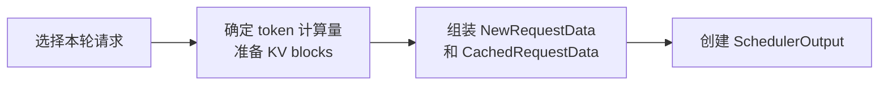

# 调度输出的数据成员

源码：[output.py](../../../nanovllm/core/sched/output.py)。

## Scheduler 怎样创建这些对象

Scheduler 是调度器，负责选择一轮模型执行要处理的请求；Worker 是执行侧，负责
根据安排准备输入并运行模型。这里的一轮，就是一次调度和对应的模型执行。

一次调度受两个主要条件限制：本轮能处理多少输入 token，以及 KV cache 还有多少
空间。KV cache 保存先前 token 的 Attention 计算结果，其存储空间按 block 分配。

[Scheduler.schedule()](../../../nanovllm/core/sched/scheduler.py) 大致按以下过程组装数据：

1. 先考虑正在处理的请求，再在资源允许时接纳等待中的请求。
2. 确定每个请求本轮计算多少 token，并为它准备所需的 KV blocks。
3. 首次发送到 Worker 的请求，用 `NewRequestData` 描述；已有请求的更新，用
   `CachedRequestData` 描述。
4. 将两类请求数据、本轮计算量和请求状态通知汇总成 `SchedulerOutput` 返回。



这三个类只保存调度已经确定的数据，本身不选择请求、不分配 KV blocks，也不运行
模型。下面按“单个新请求、已有请求集合、整轮汇总”的顺序介绍它们。

## 三种数据对象的分工

| 对象 | 描述范围 | 保存的主要内容 |
| --- | --- | --- |
| `NewRequestData` | 一个首次下发的请求。 | prompt、采样参数、完整 block table 和执行前进度。 |
| `CachedRequestData` | 本轮调度的所有已有请求。 | 请求 IDs、进度、KV blocks 更新和必要的 token 历史。 |
| `SchedulerOutput` | 一整轮调度。 | 两类请求数据、逐请求计算量及完成、抢占通知。 |

这里的 **new / cached 区分 Worker 是否已经建档**。prefill 负责处理输入，decode
负责逐步生成输出，它们与 new / cached 是不同的划分。前缀缓存（prefix cache）
则用于复用相同前缀已经计算好的 KV：

- 首次下发的请求可以已经命中 prefix cache，因此初始计算进度可以大于零。
- 已有请求也可能仍在做分块 prefill，或在抢占恢复后重算 prompt 与已有输出。
- 已建档请求暂时不参与一轮执行时，Worker 仍可保留其记录；再次运行时继续使用
  `CachedRequestData`。

## NewRequestData：首次建档的数据

当 Scheduler 选中一个此前尚未发送给 Worker 的请求时，会为它创建一个
`NewRequestData`，让 Worker 获得建立本地请求记录所需的信息。

| 成员 | 类型 | 语义 |
| --- | --- | --- |
| `req_id` | `str` | 请求在 Scheduler、KV cache 管理器和 Worker 间使用的共同标识。 |
| `prompt_token_ids` | `list[int]` | 完整原始 prompt 的 token IDs；不只包含本轮要计算的 chunk。 |
| `sampling_params` | `SamplingParams` | 该请求的生成配置。Worker 保存它，并使用其中的 temperature 等参数准备采样。 |
| `block_ids` | `list[int]` | 当前已分配的完整 block table，第 `i` 项是逻辑 block `i` 对应的物理 block ID。当前只有一个 KV cache group，因此没有外层分组容器。 |
| `num_computed_tokens` | `int` | 本轮执行前的逻辑进度。首次接纳时来自 prefix cache 命中的 token 数；不包含本轮新调度的 token。 |

`block_ids` 是**当前已分配的页表**，并不要求一次为请求未来的全部生成长度预留物理块。
后续跨越 block 边界时，调度器再通过已有请求的增量数据发送新增块。

例如一个 300-token prompt 命中前 256 个 token 的缓存，本轮调度剩余 44 个 token：

- `prompt_token_ids` 仍包含完整的 300 个 token。
- `num_computed_tokens = 256`。
- 模型本轮读取逻辑位置 `[256, 300)`，无需重新计算已命中的前缀。

`from_request(request, block_ids)` 保存执行前进度，共享只读的 prompt 和采样参数，
并将调用方提供的完整页表交给 Worker 建立请求镜像。

## CachedRequestData：已有请求的增量更新

一个对象描述本轮所有已有请求，包含持续运行和从抢占状态恢复的请求。
这些请求已经在 Worker 中建档，但不一定参与了上一轮执行。这里的抢占是指：
请求因 KV 空间不足暂时让出物理块，保留 token 历史，等资源允许时再恢复运行。

### 成员与对齐方式

| 成员 | 类型 | 语义 |
| --- | --- | --- |
| `req_ids` | `list[str]` | 本轮调度的已有请求 IDs，定义下标对齐字段的行顺序。它不是全部 Worker 请求的列表。 |
| `resumed_req_ids` | `set[str]` | 本轮从抢占状态恢复的请求 IDs，是 `req_ids` 的子集。Worker 需要用完整页表重建这些请求的执行记录。 |
| `new_token_ids` | `list[list[int]]` | 为流水线并行（PP）保留的增量 token 字段。当前未接入 PP，固定为 `[]`，执行侧也要求它为空。 |
| `all_token_ids` | `dict[str, list[int]]` | 本轮运行、但上一轮未被调度的已有请求的完整真实 token 历史，以请求 ID 查询。值为 prompt 加已确认输出，不包含异步占位。 |
| `new_block_ids` | `list[list[int] \| None]` | 与 `req_ids` 对齐。普通运行请求传新增块或 `None`；恢复请求传完整页表。 |
| `num_computed_tokens` | `list[int]` | 与 `req_ids` 对齐的执行前逻辑进度；包含缓存命中或先前已承诺执行的进度，不包含当前计划新增的调度量。 |
| `num_output_tokens` | `list[int]` | 与 `req_ids` 对齐的执行前逻辑输出长度。同步时为已确认输出数，异步时还包含尚未回收的输出占位数。 |

设 `data` 是一个 `CachedRequestData` 对象，下面四列按相同下标逐行对应：

```python
req_id = data.req_ids[i]
blocks = data.new_block_ids[i]
computed = data.num_computed_tokens[i]
output_count = data.num_output_tokens[i]
```

例如 `req_ids = ["B", "C"]`，则后三列的下标 `0` 都描述 B，下标 `1` 都描述 C。
`resumed_req_ids` 按集合成员判断，`all_token_ids` 按请求 ID 查询；当前
`new_token_ids=[]` 也无需满足与请求数量相同的长度。

这些行号只在本对象内部有效。Worker 执行时会重新安排请求的行位置，因此两侧
依靠 `req_id` 关联请求，不能假定同一请求始终位于同一行。

### new_block_ids：追加还是覆盖

同一个字段有两种含义，必须结合 `resumed_req_ids` 解释：

| 请求情况 | 本次字段值示例 | Worker 操作 |
| --- | --- | --- |
| 普通运行，本轮没有新增块。 | `None` | 保留已有 block table。`None` 不表示请求没有 KV cache。 |
| 普通运行，本轮分配了新块。 | `[9, 12]` | 将块追加到原有页表，例如 `[4, 6]` 变为 `[4, 6, 9, 12]`。 |
| 本轮从抢占状态恢复。 | `[15, 3]` | 用这份完整页表覆盖旧映射，再重建 batch 槽位；不能追加到旧表。 |

抢占会使旧物理映射失效，但逻辑 token 历史保留。恢复时可以命中 prefix cache，
也可以从头重算，因此恢复请求的 `num_computed_tokens` 应使用本次下发的值。

### all_token_ids：跨轮缺席后的历史补发

Scheduler 会为**本轮重新出现、上一轮没有调度到的已有请求**补发完整历史。
例如 A、B、C 都已在 Worker 建档，上轮运行 A、B，本轮运行 B、C：

| 请求 | 本轮是否补发完整历史 | 原因 |
| --- | --- | --- |
| A | 否。 | 本轮没有运行。 |
| B | 否。 | 持续参与相邻两轮执行，Worker 可以延续已有状态。 |
| C | 是，保存为 `all_token_ids["C"]`。 | 上轮缺席，本轮重新加入执行。 |

这里的缺席既可能来自抢占，也可能只是本轮预算不足，不能只用
`resumed_req_ids` 判断是否补发历史。

异步请求重新加入 batch 且已有输出时，Worker 会读取这份历史的输出后缀，
恢复真实输出历史。原因是 Worker 在异步运行期间可能用 `-1`
维护尚未确认的输出位置，重新建槽不能直接把这些占位当成真实 token。

异步连续执行时，Worker 可以直接使用上一轮保留在 GPU 上的采样结果准备下一步
输入，因此不必每轮都补发完整 CPU 历史。

### num_output_tokens：真实输出与占位计数

该字段的计算方式为：

**逻辑输出长度 = 已确认输出数 + 尚未回收的输出占位数。**

例如 Scheduler 已确认生成 2 个 token，还有 1 个预期输出尚未回收，那么本轮发送
`num_output_tokens[i] = 3`。这表示 Worker 应维护到第 3 个逻辑输出位置，
**不表示 CPU 已拿到 3 个真实 token**。

`all_token_ids` 只包含真实历史，因此不能用这个计数推断其末尾一定已有相同数量的
已确认输出。当前 Worker 对连续运行请求保留占位与 GPU 回填；对需要重新入批的
请求使用前面的完整历史恢复路径。

占位、GPU token 回填和历史补发如何配合，见
[异步调度的完整执行路径](AsyncScheduler-zh.md)。

### 派生查询与空对象

| 接口 | 返回值与约束 |
| --- | --- |
| `num_reqs` | `len(req_ids)`，只统计本对象描述的已有请求，不包含新请求。 |
| `_req_id_to_num_output_tokens` | 按 `req_ids` 与 `num_output_tokens` 建立查询字典。它使用 `cached_property`，首次访问后缓存；随后修改原始两列不会自动重建字典。 |
| `make_empty()` | 返回所有字段均为空容器的 `CachedRequestData`。每次调用独立创建容器。 |

## SchedulerOutput：一轮计划的总入口

前面两个类分别保存新请求的数据和已有请求的更新。Scheduler 选完本轮请求后，
把它们放入一个 `SchedulerOutput`，再补上本轮的计算量与状态通知。

| 成员 | 类型 | 语义 |
| --- | --- | --- |
| `scheduled_new_reqs` | `list[NewRequestData]` | 本轮首次下发的请求建档数据。 |
| `scheduled_cached_reqs` | `CachedRequestData` | 本轮已有请求的增量更新，包含恢复请求。 |
| `num_scheduled_tokens` | `dict[str, int]` | 请求 ID 到本轮模型计算量的映射，是执行请求集合与工作量的依据。正常调度中，每项均大于零。 |
| `total_num_scheduled_tokens` | `int` | 上述映射的值之和，用于 packed 输入规模、执行规划和工作量统计，不包含 CUDA Graph padding。 |
| `finished_req_ids` | `set[str]` | 此计划下发前已经结束、需要通知 Worker 清理的请求，用于删除本地请求记录和执行槽位。 |
| `preempted_req_ids` | `set[str]` | 本轮因 KV 资源不足被抢占的请求。它们以后仍可恢复，与已经结束的请求不同。 |

用 `output` 表示创建好的 `SchedulerOutput` 对象。正常非空计划中，每个执行请求
要么来自新请求列表，要么来自已有请求列表，且满足：

```python
set(output.num_scheduled_tokens) == (
    {request.req_id for request in output.scheduled_new_reqs}
    | set(output.scheduled_cached_reqs.req_ids)
)
output.total_num_scheduled_tokens == sum(output.num_scheduled_tokens.values())
```

`num_scheduled_tokens` 统计**模型输入位置的计算量**，不是生成 token 数。
prefill 或重算可以一次计算多个位置，但当前每请求每步最多采样一个有效输出；
中间 prefill chunk 的采样候选还会被丢弃。

### finished_req_ids 与 preempted_req_ids 的区别

- `finished_req_ids` 是 Worker 的清理通知，不是本轮 forward 才产生的完成结果。
  本轮采样后才结束的请求，会在后续计划中通知 Worker 清理。
- `preempted_req_ids` 记录本轮抢占事件。Worker 根据 `num_scheduled_tokens` 将
  未执行请求移出 batch，并保留请求镜像；恢复时由 `resumed_req_ids` 和完整页表
  重建执行状态。当前事件字段用于描述本轮发生的抢占，不参与 Worker 的直接判断。
- KV 资源释放或延迟释放由 Scheduler / KVCacheManager 负责；Worker 清理本地
  请求镜像与槽位，不通过这两个集合自行决定物理块的所有权。

### 零 token 计划仍可能需要执行

`SchedulerOutput.make_empty()` 创建一个所有容器为空、总调度量为零的对象。
但 Scheduler 返回的零 token 计划也可能携带 `finished_req_ids`：

```python
output = SchedulerOutput.make_empty()
output.finished_req_ids = {"D"}
```

这个计划无需 forward 或采样，仍需要发送给 Worker 清理 D 的本地记录。
因此不能仅凭 `total_num_scheduled_tokens == 0` 丢弃整个计划。

## 一个包含新请求、decode 与恢复请求的例子

假设本轮 A 首次运行，B 持续 decode，C 从之前的抢占中恢复；D 已经结束。
Scheduler 选好这些请求后，将相应数据组装成下面的对象：

```python
from nanovllm.core.sched.output import (
    CachedRequestData,
    NewRequestData,
    SchedulerOutput,
)
from nanovllm.sampling_params import SamplingParams

output = SchedulerOutput(
    scheduled_new_reqs=[
        NewRequestData(
            req_id="A",
            prompt_token_ids=[101, 102, 103, 104],
            sampling_params=SamplingParams(),
            block_ids=[11],
            num_computed_tokens=0,
        ),
    ],
    scheduled_cached_reqs=CachedRequestData(
        req_ids=["B", "C"],
        resumed_req_ids={"C"},
        new_token_ids=[],
        all_token_ids={"C": [301, 302, 303, 304, 305, 306, 401, 402]},
        new_block_ids=[None, [7]],
        num_computed_tokens=[8, 0],
        num_output_tokens=[1, 2],
    ),
    num_scheduled_tokens={"A": 4, "B": 1, "C": 8},
    total_num_scheduled_tokens=13,
    finished_req_ids={"D"},
    preempted_req_ids=set(),
)
```

这里按同步调度解释计数；B 的 prompt 有 8 个 token，C 的 prompt 有 6 个 token：

| 请求 | 本轮 Worker 状态更新 | 本轮模型计算 |
| --- | --- | --- |
| A | 新建镜像，保存完整 prompt 和页表 `[11]`。 | 从位置 0 开始计算 4 个 prompt token，即 `[0, 4)`。 |
| B | 复用已有镜像和页表，`None` 表示没有新块。 | 前 8 个位置已有进度，本轮计算位置 8 的第一个输出 token，即 `[8, 9)`，再采样下一个输出。 |
| C | 保留逻辑身份，用完整页表 `[7]` 重建槽位。 | 本次没有缓存命中，从位置 0 重算 6 个 prompt 加 2 个已有输出，即 `[0, 8)`。 |
| D | 删除镜像和槽位。 | 没有本轮模型计算。 |

本轮真实输入总量为 `4 + 1 + 8 = 13`，已有请求数量为 2，执行请求总数为 3。
C 的恢复事件出现在 `resumed_req_ids`；`preempted_req_ids` 为空，因为 C 是之前
被抢占、本轮恢复，并非本轮刚被抢占。

## 执行前进度与数据共享

对象中的进度描述的是**本轮模型执行的起点**。Scheduler 会先把这些数值保存到
调度对象中，再推进自己记录的请求进度。

例如前面 B 的起点为 8、本轮计算 1 个 token，创建对象后，调度器记录的请求进度
会推进到 9，但对象仍保存执行前的 8。Worker 据此从位置 8 开始准备本轮输入。

异步情况下，先前承诺执行的进度也可能仍在 GPU 上运行。因此 `num_computed_tokens`
不等于“CPU 已确认完成的 KV token 数”；执行顺序和结果回收共同保证这段进度可使用。

执行前计数作为本轮计划保存，各类容器按以下约定共享和维护：

- `num_computed_tokens` 等整数在构造时保存当时的值，后续请求进度推进不会
  自动改写旧对象中的数值。
- `NewRequestData` 共享只读的 prompt 和采样参数，持有调用方准备的页表列表，
  供 Worker 创建本地请求镜像。
- `CachedRequestData.all_token_ids` 的各条历史在 Scheduler 中显式 `.copy()`，
  后续真实输出追加不会改变已发送的这份历史。
- `finished_req_ids` 把当前集合交给计划后，Scheduler 用新集合接收后续通知。
  不能对旧集合调用 `.clear()`，否则在途计划中的清理通知也会被清空。
- `CachedRequestData` 的列式对应关系和派生查询缓存依赖输入稳定；构造完成后不要
  任意重排或改写 `req_ids` 与计数列。
