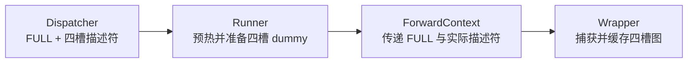

# BatchDescriptor：从捕获计划到固定执行布局

[`BatchDescriptor`](../../nanovllm/forward_context.py) 是不可变、可哈希的 batch 描述符。启动阶段，它表示**要按哪种布局准备 dummy 并捕获**；在线阶段，它表示**把真实 batch 放进哪套执行容量，并查找哪张已捕获的图**。

Dispatcher 选择描述符，Runner 按其要求准备固定 buffer，ForwardContext 传递描述符，Wrapper 据此查找缓存条目中的图并回放。捕获边界由 [CUDAGraphMode](CUDAGraphMode.md) 决定。

底层启动原理见 [总览](overview.md)，完整分派接口见 [Dispatcher](CudagraphDispatcher.md)，缓存和输出生命周期见 [Graph Wrapper](CUDAGraphWrapper.md)。

## 三个字段分别描述什么

当前定义裁剪了上游 [vLLM BatchDescriptor](https://github.com/vllm-project/vllm/blob/b5adb027ad03c29b46181752ba3b1cb84eff1dd4/vllm/forward_context.py) 中尚未支持的 LoRA 等维度：

```python
@dataclass(frozen=True)
class BatchDescriptor:
    num_tokens: int
    num_reqs: int | None = None
    uniform: bool = False
```

| 字段 | 用途 | FULL decode 的例子 |
| --- | --- | --- |
| `num_tokens` | 图执行的 packed token 行容量，包含模型 padding 行。普通 NONE 路径则保存本轮真实 token 数。 | 四行输入，对应 `num_tokens=4`。 |
| `num_reqs` | FULL 图的 Attention 请求槽位容量，包含空槽位；PIECEWISE key 可为 None。 | 四槽位 metadata，对应 `num_reqs=4`。 |
| `uniform` | Dispatcher 用来区分专用 uniform 执行计划的标记，具体值会按策略归一化。 | FULL_DECODE_ONLY 的单 token decode key 为 True。 |

`num_tokens` 统计模型计算的 token 行数，`num_reqs` 统计 Attention 的请求槽位数。例如 Query 长度 `[3, 1]` 表示两个请求、四个 token，而 `[1, 1, 1, 1]` 表示四个请求、同样四个 token。前者需要四行模型计算和两个请求的 Attention 结构，后者需要四行模型计算和四个请求的 Attention 结构。

在当前普通 decode 中，每个有效请求一个 Query，因此真实 token 数等于真实请求数。选中 decode 档位后，描述符的 token 容量和请求容量也相等。例如三个真实请求使用四槽位图时，真实数量为 3，描述符中的容量为 4，末槽位的 Query 长度为 0。

### uniform 怎样随策略确定

当前 Runner 用最大单请求调度量及总量关系识别单 token batch，再把 `uniform_decode` 传给 Dispatcher。例如 Query 长度为 `[1, 1, 1]`、历史 KV 长度为 `[128, 42, 7]` 时，Runner 判断结果为 True。

Dispatcher 还会按策略处理这个标记：

| 策略 / 路径 | key 中的 `uniform` | 原因 |
| --- | --- | --- |
| FULL_DECODE_ONLY 的 decode FULL | True。 | 与普通 mixed 分支区分。 |
| FULL_AND_PIECEWISE 的 decode FULL | True。 | 与 PIECEWISE 分支区分。 |
| 独立 FULL 策略的一般 FULL key | False。 | decode 和 mixed 共用一般 key。 |
| PIECEWISE 或 NONE 描述符 | False。 | 按相应路径的规则统一填写。 |

读取 `uniform` 时，需要结合策略。例如同一个 `[1,1,1]` batch，在 FULL_DECODE_ONLY 下使用专用 key，标记为 True；在独立 FULL 下使用一般 key，标记为 False。每个请求的历史 KV 长度和 padding 槽位的有效范围，分别由 `seq_lens` 和 `query_start_loc` 表达。

独立 FULL 和 PIECEWISE 的规则保留在 Dispatcher 中用于表达上游语义；当前 FA2 的最终策略仍是 FULL_DECODE_ONLY，分段执行链尚未接入。

## 为什么它能够作为图的 key

描述符按三个字段的值比较。启动阶段与在线阶段各自创建的对象，只要三个字段相同，就能匹配同一个字典条目：

```python
from dataclasses import replace

from nanovllm.forward_context import BatchDescriptor

captured = BatchDescriptor(4, 4, True)
online = BatchDescriptor(num_tokens=4, num_reqs=4, uniform=True)

assert captured == online
assert len({captured, online}) == 1
assert BatchDescriptor(4) != captured
assert replace(captured, uniform=False) != captured
```

`frozen=True` 使字段在构造后固定，保证字典和集合中的 key 稳定。需要表达另一种布局时，创建一个新描述符；相应图由 Runner 的捕获流程准备。

Wrapper 的缓存关系是：

```python
entry = wrapper.concrete_cudagraph_entries[batch_descriptor]
# entry 中保存该布局对应的 cudagraph、输出别名和输入地址等状态。
```

每个 Wrapper 持有自己的缓存字典。同一个 key 在模型 A 的 Wrapper 中指向模型 A 的图，在模型 B 的 Wrapper 中指向模型 B 的图；分段执行时，各片段 Wrapper 也分别保存自己的图。

### 描述符与完整启动参数的分工

捕获前，模型、设备、权重、dtype、head 结构、KV page 大小、最大上下文容量和持久 buffer 已经确定。描述符只需选择这一组固定条件下的 batch 布局；完整 kernel 函数、grid、block、共享内存、参数值和设备指针，保存在图的节点里。

| 信息 | 保存位置或保证方 |
| --- | --- |
| 本轮具体使用 FULL 还是 NONE | `ForwardContext.cudagraph_runtime_mode`。 |
| token 容量、请求容量和分派标记 | `BatchDescriptor`。 |
| 模型与硬件相关的静态执行条件 | Wrapper 绑定的模型与 Runner 初始化环境。 |
| 已捕获的完整 GPU 执行方案 | `CUDAGraphEntry.cudagraph`。 |
| 固定地址中的本轮有效数据 | Runner 输入 buffer、Attention metadata 和 KV cache。 |

**描述符负责选图，Runner 负责准备这张图能够处理的数据。** Runner 向捕获时使用的 GPU buffer 原地写入本轮数据，保持地址和布局兼容，并通过 metadata 指定有效范围。Wrapper 找到条目后，直接提交图里已经记录好的启动参数和设备地址。

## 描述符怎样指导启动捕获

假设最终配置为：

```python
# 已经过总配置与 Attention 能力解析的示例值。
cudagraph_mode = CUDAGraphMode.FULL_DECODE_ONLY
cudagraph_capture_sizes = [1, 2, 4, 8]
max_num_seqs = 8
uniform_decode_query_len = 1
```

Dispatcher 为 FULL 登记四个合法描述符 `(1,1,True)`、`(2,2,True)`、`(4,4,True)`、`(8,8,True)`，形成待捕获的布局集合。随后 Runner 遍历这些计划，由 Wrapper 创建实际 CUDA 图。

`get_capture_descs()` 返回 FULL 下按 token 容量降序排列的计划，Runner 再逐项执行：



对于 `BatchDescriptor(4,4,True)`，`_warmup_and_capture()` 使用 `desc.num_tokens=4` 和 `desc.uniform=True` 调用 `_dummy_run()`。当前 query 长度固定为 1，dummy 被组织成四个请求、各一个 Query，随后经过同一个 Dispatcher 重新得到匹配的描述符。模型和 FA2 根据准备好的 tensor 布局、metadata 和静态配置确定具体 CUDA 启动参数。

该档位的准备结果包括：

- 四行模型输入和 positions，四个请求槽位的 Attention metadata。
- `query_start_loc=[0,1,2,3,4]`，对应四个 dummy Query。
- dummy 页表指向保留的 block 0，slot mapping 全为 `-1`，KV 写入 kernel 遇到负 slot 时跳过该行。
- 捕获时的 `max_query_len=1`，`max_seq_len=max_model_len`，给后续增长的上下文保留执行范围。
- 模型与 metadata 使用持久 buffer；图记录实际使用的设备地址。

先用 NONE 模式预热，再用 FULL 模式调用相同执行链，Wrapper 记录 GPU 操作并把图放入对应条目。捕获后，条目的 `cudagraph` 字段保存实际图，描述符继续作为该条目的 key。

## 完整例子：三个请求怎样补到四槽图

### 输入请求与有效数量

假设 page 大小为 256，当前 A/B/C 三个请求本轮各执行一个 token：

| 请求 | 本轮输入 token ID | position | 本轮写入后的 KV 长度 | 物理页及写入 slot |
| --- | --- | --- | --- | --- |
| A | 15。 | 127。 | 128。 | page 1，slot `1*256+127=383`。 |
| B | 25。 | 41。 | 42。 | page 2，slot `2*256+41=553`。 |
| C | 32。 | 6。 | 7。 | page 3，slot `3*256+6=774`。 |

本轮真实数量为 `num_tokens=3`、`num_reqs=3`，Query 长度为 `[1,1,1]`。表中的 token ID 表示词表编号，position 表示它在请求序列中的位置。

### Dispatcher 返回执行模式和容量

在前面的配置下：

```python
# dispatcher 已完成初始化，且正式启动捕获已经完成。
mode, desc = dispatcher.dispatch(num_tokens=3, uniform_decode=True)

assert mode is CUDAGraphMode.FULL
assert desc == BatchDescriptor(4, 4, True)
```

选择过程为：

1. token 分档查表把 3 向上补到最小兼容尺寸 4。
2. decode Query 长度为 1，推导请求槽位容量 `min(4//1, max_num_seqs)=4`。
3. FULL_DECODE_ONLY 保留 `uniform=True`，得到四槽位 FULL key。
4. 确认它属于合法 key 集合，再返回模式与描述符。

这次调用返回 `(FULL, BatchDescriptor(4,4,True))`。接下来 Runner 保存真实数量 3，并按执行容量 4 填充固定 buffer。

### Runner 原地填充固定 buffer

`execute_model()` 先通过 `_prepare_inputs()` 写入真实请求数据，再按描述符准备模型和 Attention 的执行容量。`_get_slot_mappings()` 与 `_build_attention_metadata()` 处理补齐范围。

| 数据 | 三个真实请求的有效内容 | 按四槽图准备后的执行视图 |
| --- | --- | --- |
| `input_ids` | `[15,25,32]`。 | `[15,25,32,0]`，四行。 |
| `positions` | `[127,41,6]`。 | `[127,41,6,0]`，四行。 |
| `query_start_loc` | `[0,1,2,3]`。 | `[0,1,2,3,3]`，五个边界。 |
| `seq_lens` | `[128,42,7]`。 | `[128,42,7,0]`，四槽位。 |
| `slot_mapping` | `[383,553,774]`。 | `[383,553,774,-1]`，四行。 |
| `block_table` | 三行真实映射。 | 四行，末行全部填 `NULL_BLOCK_ID=0`。 |
| metadata 的 `max_query_len` | 1。 | 1。 |
| metadata 的 `num_actual_tokens` | 真实调度量为 3。 | 当前 Graph 路径填写执行容量 4。真实 Query 范围由前缀和末项 3 给出。 |

注意这里有两种 padding：

- **模型 token 行 padding：** 模型实际处理四行，末行 token 和 position 填 0；Triton KV 写入从负 slot 判断它无效。
- **Attention 请求槽位 padding：** 请求边界重复末项 3，使第四个请求的真实 Query 数为 0；序列长度填 0，页表填保留的空页。

因此，`query_start_loc[-1]=3` 可以小于模型行容量 4。当前变长 Attention 读取前三行有效 Query，第四槽位的 Query tile 直接退出。三个有效请求分别按 `seq_lens=[128,42,7]` 读取自己的 KV 范围。

这里的填充通过**既有 buffer 的原地赋值和固定容量视图**完成。CPU staging 先更新再上传到持久 GPU buffer，Graph 始终读取捕获时记录的 GPU 地址。

### 为什么捕获时的启动参数仍然适用

以当前单卡 Qwen3-0.6B 的 `Hq=16、Hkv=8、D=128` 为例，这个四槽位图满足：

| 启动条件 | 捕获时 | 回放时 |
| --- | --- | --- |
| 模型行数 | 4。 | 仍执行 4 行。 |
| FA2 Query 视图 | `[4,16,128]`。 | 使用相同布局。 |
| C++ 的 `batch_size` | 前缀和 tensor 有 5 项，得到 4。 | 仍有 5 项，容量仍为 4。 |
| metadata 的 Query 上界 | 1。 | 有效请求仍每个一个 Query。 |
| 扩展实际收到的 Query 上界 | 本例多请求 GQA 的输出保护将上界提高到 2，绕开重排。 | 图内继续使用捕获的上界 2。 |
| KV 长度上界 | 捕获时为 `max_model_len`。 | 继续使用该上界，真实长度由 GPU tensor 提供。 |
| 输入、metadata 和缓存指针 | 持久存储地址。 | 地址不变，数据内容原地更新。 |

在总览分析的 paged、未启用多 split 路径中，`kBlockM=64`，该图的 FA2 grid 为：

$$
\mathrm{grid} = \left(\left\lceil\frac{2}{64}\right\rceil,4,16\right)=(1,4,16)
$$

`block=128` 个线程，kernel 特化和共享内存大小也由捕获节点保存。回放依然启动这组 CTA；前三槽位从前缀和读到 Query 长度 1，第四槽位读到 0，其 Query tile 直接退出。

**回放始终执行捕获时的四槽位启动方案。** 设备 metadata 把前三槽位设为有效、第四槽位设为空。描述符选中固定容量，metadata 表达实际有效范围，两者配合完成这次回放。

### 图缓存查找与采样

Runner 把 `FULL` 和 `desc` 安装到 `ForwardContext`，Wrapper 在自己的缓存中找到 `concrete_cudagraph_entries[desc]`，回放图并返回固定输出存储的视图。

当前模型输出四行 hidden states，实际 `logits_indices=[0,1,2]`，Runner 选择 A/B/C 三行计算 logits 并采样。若 hidden size 为 1024，对应 `[4,1024]` 的模型输出和 `[3,1024]` 的采样输入，最终回写三个真实请求的采样结果。

## 下一轮哪些变化能复用同一张图

假设 A 结束，D 已完成 prefill 并加入 decode，当前有效请求变成 B/C/D：

| 数据 | 上一轮 | 下一轮 |
| --- | --- | --- |
| 请求顺序 | A、B、C。 | B、C、D。 |
| `input_ids` | `[15,25,32,0]`。 | `[26,33,40,0]`。 |
| `positions` | `[127,41,6,0]`。 | `[42,7,3,0]`。 |
| `seq_lens` | `[128,42,7,0]`。 | `[43,8,4,0]`。 |
| `slot_mapping` | `[383,553,774,-1]`。 | `[554,775,1027,-1]`，D 使用 page 4。 |
| 描述符 | `(4,4,True)`。 | 仍为 `(4,4,True)`。 |

请求 ID 用于 Runner 的请求映射，token、历史长度和物理页映射写入对应的固定 buffer；描述符继续保持 `(4,4,True)`，因此可以复用同一张图。若有四个真实 decode 请求，也可以使用该 key，此时前缀和末项变成 4，第四槽位成为有效请求。

其他变化则可能切换执行计划：

| 本轮情况 | 在示例配置下的结果 | 原因 |
| --- | --- | --- |
| 两个单 token 请求。 | FULL，`BatchDescriptor(2,2,True)`。 | 选择更小的已捕获档位。 |
| 五个单 token 请求。 | FULL，`BatchDescriptor(8,8,True)`。 | 向上补到八槽位。 |
| 两请求的 Query 长度 `[3,1]`。 | NONE，`BatchDescriptor(4)`。 | 按混合 batch 普通执行。 |

## num_reqs=None 与缺省描述符

PIECEWISE 分派会把 key 放宽为：

```python
BatchDescriptor(num_tokens=4, num_reqs=None, uniform=False)
```

PIECEWISE 路径将请求维度统一填写为 None，片段图按 token 容量分档；具体请求结构由图外 Attention 处理。字典查找仍按三个字段精确比较，例如 `BatchDescriptor(4,None,False)` 匹配同值条目，`BatchDescriptor(4,4,True)` 匹配另一个条目。

NONE 回退也可能返回同样的字段组合，此时 `num_tokens` 保存本轮真实数量，模型按普通调用执行。**描述符的用途由具体运行模式与所属 Wrapper 决定。** 当前项目已接入 FULL_DECODE_ONLY，PIECEWISE 作为后续扩展保留了相应 key 规则。

`set_forward_context()` 在 Graph 模式下仅收到 `num_tokens=4` 时，会缺省构造 `BatchDescriptor(4,None,False)`。FULL decode 路径需要传入 Dispatcher 返回的完整描述符，例如 `BatchDescriptor(4,4,True)`，使 Wrapper 查到对应条目。

## 哪些约束由其他组件保证

构造 `BatchDescriptor` 时保存三个字段。容量校验、输入准备和捕获状态分别由以下组件管理：

| 约束或动作 | 负责组件 |
| --- | --- |
| 模式和捕获尺寸是否合法 | 配置解析与 Attention 能力检查。 |
| 本轮是否满足单 token decode | Runner 的 `_is_uniform_decode()`。 |
| 描述符是否属于合法执行计划 | Dispatcher。 |
| padding、真实数量、固定地址与有效范围 | Runner、InputBatch、BlockTable 和后端 metadata 路径。 |
| 某个 key 是否已经有实际图 | Wrapper 的 `CUDAGraphEntry`。 |
| 是否允许新增捕获 | Runner 启动流程和捕获许可开关。 |

## 源码对应

| 阅读目标 | 源码入口 |
| --- | --- |
| 字段与相等、哈希语义 | [`forward_context.py`](../../nanovllm/forward_context.py)：`BatchDescriptor`。 |
| 分档、槽位推导和 key 匹配 | [`cudagraph_dispatcher.py`](../../nanovllm/cudagraph_dispatcher.py)：`_create_padded_batch_descriptor()`、`initialize_cudagraph_keys()`、`dispatch()`。 |
| 描述符怎样指导 dummy 和正式捕获 | [`worker/gpu_model_runner.py`](../../nanovllm/worker/gpu_model_runner.py)：`_warmup_and_capture()`、`_dummy_run()`、`capture_model()`。 |
| 在线 padding 和有效结果选择 | 同上：`execute_model()`、`_get_slot_mappings()`、`_build_attention_metadata()`。 |
| 描述符怎样对应实际图条目 | [`compilation/cuda_graph.py`](../../nanovllm/compilation/cuda_graph.py)：`CUDAGraphWrapper.__call__()`、`CUDAGraphEntry`。 |
| FA2 的上界与变长边界 | [`nanovllm_flash_attn/flash_attn_interface.py`](../../nanovllm/nanovllm_flash_attn/flash_attn_interface.py)，以及 [总览中的 C++ 启动分析](overview.md)。 |
