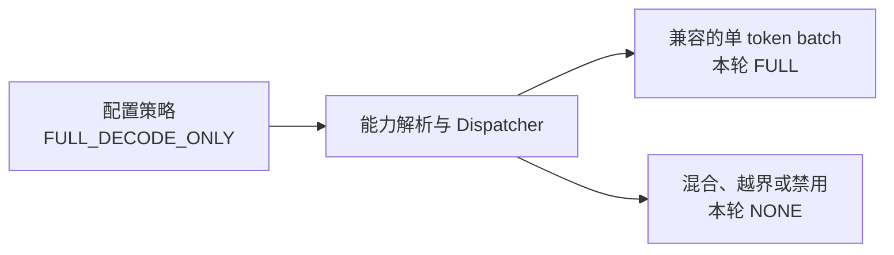

# CUDAGraphMode：捕获边界与执行策略

[`CUDAGraphMode`](../../nanovllm/config/compilation.py) 同时描述 **整个 Engine 使用哪种 Graph 策略**，以及 **本轮模型 forward 使用哪种具体执行模式**。

模式负责回答“回放哪里”，[BatchDescriptor](BatchDescriptor.md) 负责回答“使用哪套 batch 布局”。底层 GPU 原理见 [CUDA Graph 总览](overview.md)，图缓存与回放细节见 [Graph Wrapper](CUDAGraphWrapper.md)。

当前项目已接入 `NONE` 和 FA2 的 `FULL_DECODE_ONLY` 执行策略。`PIECEWISE`、`FULL_AND_PIECEWISE` 保留了枚举与基础分派语义，但尚无完整的分段编译执行链。

## 配置策略与本轮模式是两个层次

定义与上游 [vLLM 的 CUDAGraphMode](https://github.com/vllm-project/vllm/blob/b5adb027ad03c29b46181752ba3b1cb84eff1dd4/vllm/config/compilation.py) 对齐：

```python
class CUDAGraphMode(enum.Enum):
    NONE = 0
    PIECEWISE = 1
    FULL = 2
    FULL_DECODE_ONLY = (FULL, NONE)
    FULL_AND_PIECEWISE = (FULL, PIECEWISE)
```

两个组合枚举的顺序是 **`(decode 模式, mixed 模式)`**。这里 mixed 包含普通 prefill 和 prefill/decode 混合 batch；当前 decode 分支专指每个有效请求本轮一个 Query 的 uniform decode。

| 枚举 | `.value` | `decode_mode()` | `mixed_mode()` | 使用位置 |
| --- | --- | --- | --- | --- |
| `NONE` | `0`。 | `NONE`。 | `NONE`。 | 配置策略、本轮模式。 |
| `PIECEWISE` | `1`。 | `PIECEWISE`。 | `PIECEWISE`。 | 配置策略、本轮模式；当前执行链待接入。 |
| `FULL` | `2`。 | `FULL`。 | `FULL`。 | 配置策略、本轮模式；执行范围取决于后端能力。 |
| `FULL_DECODE_ONLY` | `(2, 0)`。 | `FULL`。 | `NONE`。 | 配置策略，分派后得到本轮模式。 |
| `FULL_AND_PIECEWISE` | `(2, 1)`。 | `FULL`。 | `PIECEWISE`。 | 配置策略，分派后得到本轮模式。 |

例如配置为 `FULL_DECODE_ONLY`，Dispatcher 对本轮 batch 作出选择后，向 `ForwardContext` 传入 `FULL` 或 `NONE`。`ForwardContext.__post_init__()` 检查这个字段，接受的具体模式为 NONE、PIECEWISE 和 FULL。



配置策略给出允许的执行路线。每轮 Dispatcher 结合 batch 类型、捕获尺寸和合法 key 集合，选择兼容的图；需要回退时返回 NONE。

## NONE：普通调用模型

**执行方式：** Wrapper 直接调用原始 callable，Python/C++ 按本轮输入提交 GPU 操作。启动阶段配置为 NONE 时，`capture_model()` 跳过正式捕获。

**执行范围：** 模型正常完成 embedding、Attention、MLP 等 GPU 计算，并逐步执行相应的主机调用和 kernel 提交。各算子继续使用自己的实现，例如 Triton kernel 或局部 `torch.compile` 函数。

常见使用场景包括：

- 用户设置 `enforce_eager=True`，总配置将 Graph 策略改为 `NONE`。
- 当前 `FULL_DECODE_ONLY` 遇到 prefill 或混合 batch，Dispatcher 回退 `NONE`。
- token 数超出捕获范围，或者没有匹配的合法 key。
- 启动阶段进行 eager 预热，先完成 kernel 初始化，再进入正式捕获。

同一个 Engine 可以上一轮 FULL、下一轮 NONE、再下一轮 FULL。已经捕获的图继续保存在 Wrapper 缓存中，后续兼容 batch 可以再次回放。

## FULL：把整个模型 forward 放进图

**捕获含义：** 用 FULL Wrapper 包住整个模型 callable，记录这个调用范围内的 GPU 操作及其依赖。当前模型中包括 embedding、各层 Norm、QKV 投影、RoPE、KV 写入、Attention、输出投影和 MLP。

**回放含义：** 对选中的 batch key 提交整张模型图，由图中的节点执行各个 kernel。捕获时确定的节点依赖保证各操作按所需顺序推进，模型内部的主机调度开销随之减少。


当前 FULL 的捕获范围从模型输入开始，到模型返回 hidden states 为止。随后 Runner 选择真实请求的 hidden states，调用 `compute_logits()` 并采样。这些步骤在模型 Graph 返回后执行。

### FULL 策略同时为 decode 和 mixed 请求整图执行

独立的 `FULL` 策略对 decode 和 mixed 都返回 FULL，因此其语义是要求二者都使用完整捕获。它是否成立，取决于后端是否支持对应执行方案，以及输入、metadata、临时空间和启动参数是否兼容。

当前 FA2 声明 `AttentionCGSupport.UNIFORM_BATCH`，对应本项目已实现的单 token decode 捕获方案。配置解析器据此把 FULL 降为 FULL_DECODE_ONLY，使 mixed 分支使用普通调用。

关于 FA2 的单 token GQA 特殊路径、mask 特化和 Query tile 上界，见 [总览](overview.md)。实现 mixed FULL 时，需要一起准备兼容的 Query 容量、请求布局、mask、固定存储和 kernel 启动方案。

## PIECEWISE：只捕获满足约束的模型片段

**捕获含义：** 将模型编译图按指定边界切分，为可捕获的片段分别建立图。典型 FA2 方案把 Attention 留在片段之外，保留其每轮正常调用和 kernel 选择过程。

**回放含义：** 逐个回放片段，在它们之间执行图外算子和必要的主机控制流。一次 forward 可能有多个图提交，也可能有多个普通 Attention 调用。


上图展示 Attention 前后片段的执行顺序。真实切分由编译器与 `splitting_ops` 决定，KV 写入也可能独立切分；编译器为得到的各个片段生成 callable，再由 Wrapper 捕获。

PIECEWISE 适用于图外 Attention 需要动态处理请求边界，而其余片段仍可固定 token 容量的情况。它可以减少部分 CPU 提交开销，但相比 FULL 仍保留图外调用、片段间控制流和多次图提交。

实现这一方案涉及三部分：

- **计算图切分：** 根据 Attention 等算子的边界，把模型计算划分成多个片段。
- **片段布局准备：** 为各片段确定 token 档位、padding、固定地址和兼容的执行参数。
- **片段捕获与调用：** 本地 vLLM 使用 `_attention_ops`、`splitting_ops`、`split_graph()` 和片段 Wrapper 等机制组成执行链。

当前项目保留了 PIECEWISE 的枚举、key 规则和 Wrapper 模式，模型切分与分段编译执行链待实现。现阶段配置解析器对 PIECEWISE 报错，`_dummy_run()` 也会拒绝该模式。

## FULL_DECODE_ONLY：decode 整图，其他 batch 普通执行

这是当前默认策略，组合值为 `(FULL, NONE)`。

**启动捕获：** Dispatcher 为合法的单 token decode 尺寸建立 FULL keys，Runner 逐档准备 dummy 并捕获整模型图。mixed 分支配置为 NONE，执行时直接调用模型。

**在线分派：** Runner 判断有效请求是否每个只执行一个 Query。满足条件且存在兼容 key 时选择 FULL，否则选择 NONE。

假设候选尺寸 `[1, 2, 4, 8]`、请求容量至少为 8：

| 本轮 Query 长度 | 实际 token 数 | 分派结果 | 执行行为 |
| --- | --- | --- | --- |
| `[1, 1, 1]` | 3。 | `FULL`，描述符 `(4, 4, True)`。 | 三请求补到四槽布局，回放四槽图。 |
| `[3, 1]` | 4。 | `NONE`，描述符 `(4, None, False)`。 | 混合 batch 普通执行。 |
| `[4]` | 4。 | `NONE`，描述符 `(4, None, False)`。 | 单请求 prefill 普通执行。 |
| 九个单 token 请求 | 9。 | `NONE`，描述符 `(9, None, False)`。 | 超出这里给定的图范围，回退普通执行。 |

这里的九请求例子还要求 Scheduler 和 Runner 本身容纳得下九个请求；捕获范围小于请求容量时才会出现这种越界分派。

Runner 根据本轮 Query 长度判断 uniform。例如 Query 长度 `[1,1,1]`、历史 KV 长度 `[128,42,7]` 时，三个请求满足条件，可以按兼容档位使用同一 decode 图。

## FULL_AND_PIECEWISE：decode 整图，其他 batch 分段

组合值为 `(FULL, PIECEWISE)`。它结合两个捕获边界：decode 争取使用整图，prefill 和混合阶段回放普通计算片段，Attention 则按切分方案处理。

**捕获计划：** 同一个 token 档位可以同时出现 FULL key 与 PIECEWISE key。FULL Wrapper 保存整模型图，各 PIECEWISE Wrapper 分别保存相应的片段图。

假设 token 档位为 4：

| 分支 | 描述符 | 捕获对象 |
| --- | --- | --- |
| FULL decode | `BatchDescriptor(4, 4, True)`。 | 整个模型 forward。 |
| PIECEWISE mixed | `BatchDescriptor(4, None, False)`。 | 各个可捕获的计算片段。 |

PIECEWISE 的 `num_reqs=None` 让片段 key 按 token 容量分档，请求结构交由图外算子处理。每个片段 Wrapper 都有自己的缓存；例如模型切成十个可捕获片段时，一个 token 档位可以对应十张片段图。

**在线分派：** 先尝试 FULL；不适用或被排除时，再尝试 PIECEWISE；仍未命中且允许 NONE 时回退普通执行。实际分派还受捕获范围和合法模式集合约束。

本地 vLLM 已有相应分段执行链。当前项目将 FULL_AND_PIECEWISE 作为后续扩展保留，配置解析器现阶段对该策略报错。

## 枚举的辅助接口怎样读取策略

以下示例展示各个辅助接口对 FULL_DECODE_ONLY 的返回结果：

```python
from nanovllm.config.compilation import CUDAGraphMode

mode = CUDAGraphMode.FULL_DECODE_ONLY

assert mode.value == (2, 0)
assert mode.decode_mode() is CUDAGraphMode.FULL
assert mode.mixed_mode() is CUDAGraphMode.NONE
assert mode.separate_routine()
assert mode.has_full_cudagraphs()
assert not mode.has_piecewise_cudagraphs()
assert mode.max_cudagraph_mode() is CUDAGraphMode.FULL
assert mode.has_mode(CUDAGraphMode.NONE)
assert not mode.is_valid_runtime_mode()
assert CUDAGraphMode.FULL.is_valid_runtime_mode()
```

| 接口 | 用途 | 返回结果怎样使用 |
| --- | --- | --- |
| `decode_mode()` / `mixed_mode()` | 取两个分支的具体模式。 | Dispatcher 根据对应分支建立合法 key。 |
| `separate_routine()` | 判断是否为组合策略。 | 为 True 时，Dispatcher 分别处理 decode 和 mixed 分支。 |
| `has_mode(mode)` | 判断策略是否包含指定的具体模式。 | 参数取 NONE、PIECEWISE 或 FULL；`has_mode(NONE)` 对 FULL_DECODE_ONLY 为 True。 |
| `max_cudagraph_mode()` | 按 `NONE < PIECEWISE < FULL` 取最大模式。 | 供初始化流程判断需要准备的 Graph 类型。 |
| `has_full_cudagraphs()` | 检查是否包含 FULL 路径。 | 为 True 时，模型加载流程可以安装 FULL Wrapper。 |
| `has_piecewise_cudagraphs()` / `requires_piecewise_compilation()` | 检查是否需要 PIECEWISE 路径。 | 配置解析器据此检查分段编译链的支持情况。 |
| `valid_runtime_modes()` / `is_valid_runtime_mode()` | 区分具体模式与组合策略。 | ForwardContext 接受 NONE、PIECEWISE、FULL 三个具体模式。 |
| `bool(mode)` / `str(mode)` | NONE 为 False，其余为 True；字符串为枚举名称。 | 用于配置分支判断及日志显示。 |

## 从用户配置到实际捕获

当前解析过程有三个不同阶段：

| 阶段 | 输入 | 对状态的影响 |
| --- | --- | --- |
| 总配置初始化 | `enforce_eager`、用户模式、Scheduler 容量。 | eager 优先设置 NONE；模式缺省时设置 FULL_DECODE_ONLY，并规范化捕获尺寸。 |
| Attention 能力解析 | 所有后端的最低 `AttentionCGSupport`。 | `resolve_cudagraph_mode_and_sizes()` 确定可用策略，必要时降级或报错。 |
| Dispatcher 初始化与运行 | 最终策略、尺寸，以及每轮 batch 信息。 | 建立合法 key，提供捕获计划；在线选择具体模式和描述符。 |

对于当前 FA2，用户指定 FULL 会降为 FULL_DECODE_ONLY；显式 PIECEWISE 或 FULL_AND_PIECEWISE 会在能力解析阶段报错。若后端的 FULL 能力为 NEVER，当前解析器对显式 FULL 报错，对 FULL_DECODE_ONLY 回退 NONE。

启动时，Runner 根据最终计划逐档进行 eager 预热和正式捕获；在线执行根据每轮 batch 选择已有图或 eager 路径。**模式解析、Dispatcher 初始化、固定 buffer 准备和图捕获共同组成启动流程。** 调整配置后，重新初始化 Engine 即可按新策略建立这套执行环境。

## 源码对应

| 阅读目标 | 源码入口 |
| --- | --- |
| 枚举及能力解析 | [`config/compilation.py`](../../nanovllm/config/compilation.py)：`CUDAGraphMode`、`resolve_cudagraph_mode_and_sizes()`。 |
| 默认策略及 eager 优先级 | [`config/vllm.py`](../../nanovllm/config/vllm.py)：`NanovllmConfig.__post_init__()`。 |
| 策略怎样生成 keys 和捕获计划 | [`cudagraph_dispatcher.py`](../../nanovllm/cudagraph_dispatcher.py)：`initialize_cudagraph_keys()`、`dispatch()`、`get_capture_descs()`。 |
| 本轮模式怎样传入模型 | [`forward_context.py`](../../nanovllm/forward_context.py)：`ForwardContext`、`set_forward_context()`。 |
| Wrapper 怎样响应具体模式 | [`compilation/cuda_graph.py`](../../nanovllm/compilation/cuda_graph.py)：`CUDAGraphWrapper.__call__()`。 |
| FA2 的 FULL 兼容范围 | [`attention/backends/flash_attn.py`](../../nanovllm/attention/backends/flash_attn.py)：`FlashAttentionMetadataBuilder`。 |
| vLLM 的分段捕获 | [`vllm/compilation/backends.py`](https://github.com/vllm-project/vllm/blob/b5adb027ad03c29b46181752ba3b1cb84eff1dd4/vllm/compilation/backends.py)：`split_graph()`、`wrap_with_cudagraph_if_needed()`。 |
