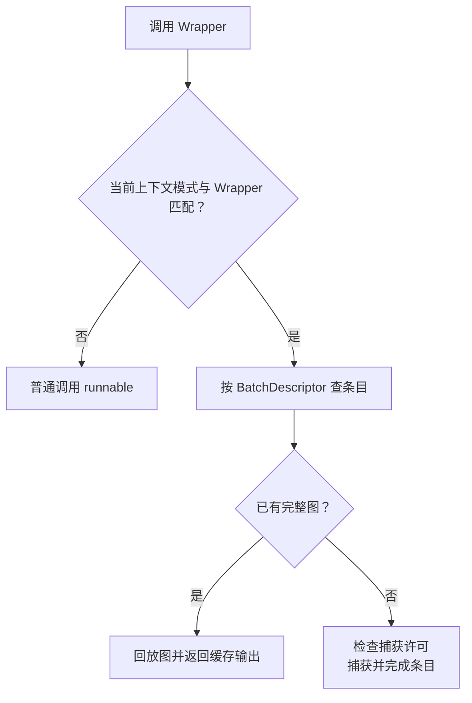

# CUDAGraphWrapper：按 batch 描述符捕获与回放模型

[`CUDAGraphWrapper`](../../nanovllm/compilation/cuda_graph.py) 持有一个原始模型或 callable，保存在 `self.runnable` 中，并为它提供统一的执行入口。调用这个入口时，Wrapper 根据本轮上下文执行模型、捕获新图或回放已有图。当前 Runner 用它包装整个模型 forward，运行模式为 FULL。

一个模型通常会为多个 batch 容量准备图。例如四槽和八槽的 decode 布局分别对应一张图，Wrapper 通过 `self.concrete_cudagraph_entries` 把布局与实际捕获结果关联起来。用 `entry4`、`entry8` 表示两个缓存条目，字典内容可以写成：

```python
concrete_cudagraph_entries = {
    BatchDescriptor(4, 4, True): entry4,
    BatchDescriptor(8, 8, True): entry8,
}
```

每个 value 都是一个 `CUDAGraphEntry`。其中 `cudagraph` 保存可以回放的图对象，`output` 保存访问图输出存储的 Tensor 别名，`input_addresses` 记录捕获时位置参数中 Tensor 的地址，`batch_descriptor` 记录该条目对应的布局。因此，取得 `entry4` 后，Wrapper 就能提交四槽图，并把结果所在的输出 Tensor 返回给调用方。

这些条目随着启动捕获逐步建立：刚构造 Wrapper 时，字典为空；第一次以四槽布局执行捕获时，先创建 `cudagraph=None` 的条目；捕获成功后，再把图、输出别名和输入地址填入该条目。Runner 随后准备其他档位，形成在线阶段使用的图缓存。

在线选择由 Dispatcher 完成。比如 A/B/C 三个单 token 请求选择了四槽计划，Runner 先更新固定地址中的输入和 Attention metadata，再把 FULL 模式与四槽描述符放入 `ForwardContext`。Wrapper 按描述符找到 `entry4`，回放其中的图。下一轮请求换成 B/C/D 后，Runner 更新同一批 buffer，Wrapper 继续使用同一个条目。

**图和输出地址会跨轮保留，地址中的数据随回放更新。** 例如 `entry4.output` 的形状为 `[4,32]`，前三行第一轮属于 A/B/C，第二轮属于 B/C/D。Runner 根据当前请求槽位选取有效行；需要保存第一轮结果时，在后续覆盖前复制为独立快照。

Wrapper 还持有平台提供的 `graph_pool` 标识，让不同捕获复用分配空间。输出别名访问的地址需要由存活的 Graph 及其分配池维持。调用方完成相关 GPU 工作并结束旧输出的使用后，可以通过 `clear_graphs()` 清空本实例的图条目。类级弱引用集合 `_all_instances` 则让 `clear_all_graphs()` 能统一清理仍存活的 Wrapper。

当前 Runner 已接通这套生命周期：加载模型时安装包装，启动阶段捕获合法档位，在线 decode 更新固定输入后回放。下面逐个介绍接口的声明和调用约定，再用两轮请求展示缓存与输出变化，最后概述资源管理。整体策略见 [CUDAGraphMode](CUDAGraphMode.md)，档位选择见 [CudagraphDispatcher](CudagraphDispatcher.md)，布局约束见 [BatchDescriptor](BatchDescriptor.md) 和 [总览](overview.md)。

## 对外接口

以下声明保留当前源码的参数、默认值、返回类型和相关装饰器。示例中的 `model`、`config` 和 Attention 输入由调用方提前准备。

### __init__()：绑定执行对象并创建图缓存

```python
def __init__(
    self,
    runnable: Callable[..., Any],
    vllm_config: NanovllmConfig,
    runtime_mode: CUDAGraphMode,
    cudagraph_options: CUDAGraphOptions | None = None,
) -> None:
    ...
```

**输入：** `runnable` 是模型或待捕获片段，捕获输出采用 Tensor、单层 list 或 tuple。`vllm_config` 是 Worker 总配置。`runtime_mode` 使用 FULL 或 PIECEWISE，表示这个 Wrapper 的捕获边界。`cudagraph_options` 控制捕获细节，省略时创建默认选项。

**返回：** `CUDAGraphWrapper(...)` 返回 Wrapper 对象；`__init__()` 返回 None。

**状态变化：** 保存执行对象、配置、模式和选项；取得平台共享的 `graph_pool` 标识；创建空的 `concrete_cudagraph_entries` 字典；将实例加入全局弱引用集合 `_all_instances`。首次取得 pool 标识时可能初始化 CUDA。

**调用时机：** Worker 已绑定 CUDA device，Runner 加载模型后，根据最终执行链需要安装 Wrapper。当前使用整模型 FULL。

```python
wrapper = CUDAGraphWrapper(
    runnable=model,
    vllm_config=config,
    runtime_mode=CUDAGraphMode.FULL,
)
assert wrapper.concrete_cudagraph_entries == {}
```

此时 Wrapper 已经持有模型和空缓存；实际图在后续指定模式与 key 的调用中创建。

### __call__()：执行模型、捕获或回放

```python
def __call__(self, *args: Any, **kwargs: Any) -> Any | None:
    ...
```

**输入：** `args`、`kwargs` 按原始模型的调用约定填写。Graph 路径中，调用方先原地更新捕获使用的固定地址输入和 metadata，再传入与捕获布局兼容的视图。

此外，本方法读取当前 `ForwardContext`：

- `cudagraph_runtime_mode` 决定本轮执行路径。NONE、模式与当前 Wrapper 不匹配，或上下文外调用时，直接执行原始 callable。
- 模式匹配时，`batch_descriptor` 用于查找本实例的图缓存。新的 key 进入捕获流程，已有完整图的 key 进入回放流程。
- Attention metadata 和 slot mapping 在普通执行与捕获时由模型层读取；回放时，图内 kernel 访问捕获记录的设备地址，并读取 Runner 已更新的内容。

**返回：** 普通调用返回原始 callable 的结果。首次捕获返回本次局部输出，默认选项下为非 owning tensor 别名；`weak_ref_output=False` 时保留原始 owning 输出。已有图回放返回 `entry.output` 保存的缓存别名。

这里的非 owning 别名具有正常 Tensor 的 shape、stride、dtype 和数据地址；底层分配的生命周期由存活的 Graph pool 等对象保证。回放会更新这段输出存储，需要保存历史结果时，调用方应在数据仍有效时复制。

**状态变化：** 新 key 创建 `CUDAGraphEntry`，捕获成功后写入图、输出别名和位置参数中的 Tensor 地址。已有图回放复用条目，并更新其输出地址中的数据。普通调用路径保持图缓存原值。

**调用时机：** 启动预热、正式捕获和每轮在线模型执行都会经过该入口。Runner 在启动窗口开放新增捕获许可，在线阶段使用已准备的图或普通执行路线。

例如，Runner 已准备四槽位输入、metadata 和按层 slot mapping：

```python
key = BatchDescriptor(num_tokens=4, num_reqs=4, uniform=True)
with set_forward_context(
    attn_metadata,
    config,
    cudagraph_runtime_mode=CUDAGraphMode.FULL,
    batch_descriptor=key,
    slot_mapping=slot_mappings_by_layer,
):
    hidden_states = wrapper(input_ids, positions)
```

相同模式和 key 首次调用时创建图，之后回放该图。这里的代码适用于捕获或回放，具体分支取决于条目状态与捕获许可。

### unwrap()：取得原始模型

```python
def unwrap(self) -> Callable[..., Any]:
    ...
```

**输入：** 读取构造时保存的 `runnable`。

**返回：** 原始 callable 的引用。

**状态变化：** Wrapper 的图缓存、配置和模式保持原值。

**调用时机：** Runner 需要直接访问原模型时使用。当前 `GPUModelRunner.get_model()` 通过它取得原模型，供权重、模型属性及 KV 相关逻辑使用。

```python
original_model = wrapper.unwrap()
assert original_model is model
```

调用 `original_model(...)` 会直接执行模型；需要 Graph 分派时调用 `wrapper(...)`。

### __getattr__()：向模型转发属性访问

```python
def __getattr__(self, key: str) -> Any:
    ...
```

**输入：** `key` 为属性名。Python 在 Wrapper 自身的常规属性查找落空后调用本方法。

**返回：** 原始模型上的同名属性或方法；查找失败时抛出 AttributeError。

**状态变化：** 读取模型属性，Wrapper 成员保持原值。返回的方法被调用时，按该模型方法自身的约定执行。

**调用时机：** 外部通过包装后的模型访问 `compute_logits` 等属性时自动发生。

```python
logits = wrapper.compute_logits(sample_hidden_states)
```

这次属性访问取得原模型的 `compute_logits` 方法。当前词表投影在模型 forward 图返回后由 Runner 调用。

### cudagraph_wrapper：取得包装对象本身

```python
@property
def cudagraph_wrapper(self) -> "CUDAGraphWrapper":
    ...
```

**输入：** 属性访问使用当前实例。

**返回：** 当前 Wrapper 自身。

**状态变化：** 实例状态保持原值。

**调用时机：** 调用方通过统一属性入口取得 Wrapper、检查其缓存或管理图时使用。

```python
assert wrapper.cudagraph_wrapper is wrapper
```

### clear_graphs()：清空当前实例的图条目

```python
def clear_graphs(self) -> None:
    ...
```

**输入：** 当前 Wrapper 的图缓存。调用前，调用方应完成相关 GPU 工作，并结束对旧输出别名的使用。

**返回：** None。

**状态变化：** 清空 `concrete_cudagraph_entries`，继续保留原始 callable、配置、运行模式和 pool 标识。之后相同 key 的匹配调用需要重新捕获，须在允许新增捕获的窗口执行。

**调用时机：** 释放临时 profiling 图、重建执行环境或清理模型图资源时使用。GPU 工作的同步由调用方安排。

```python
torch.cuda.synchronize()
wrapper.clear_graphs()
assert wrapper.concrete_cudagraph_entries == {}
```

清空字典会解除本实例对图条目的引用。实际分配回收还取决于其他存活引用和 PyTorch allocator 的生命周期。

### clear_all_graphs()：清空所有存活 Wrapper 的条目

```python
@classmethod
def clear_all_graphs(cls) -> None:
    ...
```

**输入：** 全局 `_all_instances` 弱引用集合中仍存活的 Wrapper。调用方先完成相关 GPU 工作并结束旧输出的使用。

**返回：** None。

**状态变化：** 对这些实例分别调用 `clear_graphs()`；各实例继续保留自己的模型、配置、模式和 pool 标识。弱引用注册表随对象生命周期更新。

**调用时机：** 当前 Runner 的 CUDA Graph 内存 profiling 清理阶段，用它统一移除临时图。正式捕获随后为需要的布局重新创建条目。

```python
torch.cuda.synchronize()
CUDAGraphWrapper.clear_all_graphs()
```

## 完整例子：捕获四槽图，再回放两轮请求

### 先确定执行布局和固定地址

假设 Dispatcher 使用 FULL_DECODE_ONLY 策略，为三个单 token 请求选中四槽位计划：

```python
runtime_mode = CUDAGraphMode.FULL
key = BatchDescriptor(num_tokens=4, num_reqs=4, uniform=True)
```

Runner 使用四行固定输入和四槽位 Attention metadata。为方便观察输出，下面把 hidden size 设为 32，输入地址分别记作 `P_ids`、`P_pos`，输出地址记作 `P_hidden`。

输入填充、请求边界、KV 分页映射和有效输出行均由 Runner 准备。这个四槽 key 对应的具体布局见 [BatchDescriptor 的例子](BatchDescriptor.md#完整例子三个请求怎样补到四槽图)。

### 启动捕获：空缓存变成一个完整条目

Runner 用合法 dummy 输入进行 eager 预热，再指定 FULL 和四槽 key 调用 Wrapper。捕获完成后，内部变化如下：

| 数据 | 捕获前 | 捕获后 |
| --- | --- | --- |
| `concrete_cudagraph_entries` | 空字典。 | 包含 `key → entry`。 |
| `entry.cudagraph` | 条目创建时为 None。 | 保存四槽图 `G4`。 |
| `entry.input_addresses` | 条目创建时为 None。 | 本例位置参数记录为 `[P_ids,P_pos]`。 |
| `entry.output` | 条目创建时为 None。 | 指向 `P_hidden`、形状为 `[4,32]` 的缓存别名。 |
| `graph_pool` | 构造时取得的标识。 | 继续使用该标识。 |

Wrapper 的缓存以描述符为 key；`entry` 保存实际图及输出地址。Runner 完成所有档位捕获后，关闭新增捕获许可，进入在线推理。

### 第一轮 A/B/C 与第二轮 B/C/D

第一轮三个请求为 A/B/C。A 完成后，D 已完成 prefill 并加入 decode，第二轮为 B/C/D。Runner 在相同 GPU buffer 中更新数据：

| 数据 | 第一轮 A/B/C | 第二轮 B/C/D |
| --- | --- | --- |
| `input_ids` | `[15,25,32,0]`。 | `[26,33,41,0]`。 |
| `positions` | `[7,11,19,0]`。 | `[12,20,4,0]`。 |
| `query_start_loc` | `[0,1,2,3,3]`。 | `[0,1,2,3,3]`。 |
| `seq_lens` | `[8,12,20,0]`。 | `[13,21,5,0]`。 |
| slot mapping 与页表 | A/B/C 的有效映射，末槽使用 padding 约定。 | 原地更新为 B/C/D 的映射。 |
| 输入地址 | `P_ids`、`P_pos`。 | 仍为 `P_ids`、`P_pos`。 |
| 描述符 | `(4,4,True)`。 | `(4,4,True)`。 |
| 执行的图 | `G4`。 | `G4`。 |
| 输出地址 | `P_hidden`。 | 仍为 `P_hidden`，其中内容已更新。 |

两轮调用都查到同一条目并回放。输出行对应哪个请求，由 Runner 的当前槽位映射决定；`logits_indices=[0,1,2]` 选择三行真实请求结果，末行作为模型 padding 行处理。

### 用可手算的结果观察输出覆盖

假设示例 callable 的输出定义为：

$$
H[i,j]=\mathrm{input\_ids}[i]+\mathrm{positions}[i]+j,\qquad 0\leq j<32
$$

那么两轮的第一列为：

| 行 | 第一轮结果 | 第二轮结果 |
| --- | --- | --- |
| 0 | A：`15+7=22`。 | B：`26+12=38`。 |
| 1 | B：`25+11=36`。 | C：`33+20=53`。 |
| 2 | C：`32+19=51`。 | D：`41+4=45`。 |
| 3 | padding：0。 | padding：0。 |

第一次回放返回的 Tensor 别名和第二次返回的别名都访问 `P_hidden`。第二轮执行后，通过第一轮别名读取，也会看到 `[38,53,45]`。第一轮结果若已复制为独立快照，快照继续保存 `[22,36,51]`。

## 可运行的 CUDA 调用例子

下面用上述计算演示真实 Wrapper 的预热、一次捕获和第二轮回放。运行环境需要 CUDA GPU、PyTorch 与本项目原生扩展的构建依赖。示例以 `SimpleNamespace` 提供 Wrapper 读取的配置入口，实际 Worker 使用完整 `NanovllmConfig`。

```python
from types import SimpleNamespace
from typing import cast

import torch

from nanovllm._C import load_extension
from nanovllm.compilation import monitor
from nanovllm.compilation.cuda_graph import CUDAGraphWrapper
from nanovllm.config import CompilationConfig, CUDAGraphMode, NanovllmConfig
from nanovllm.forward_context import BatchDescriptor, set_forward_context
from nanovllm.utils.torch_utils import current_stream

if not torch.cuda.is_available():
    raise SystemExit("该例子需要可用的 CUDA GPU。")

torch.cuda.set_device(0)
previous_stream = torch.cuda.current_stream()
stream = current_stream()  # 独立进程首次调用会选中非默认 stream。
load_extension()  # 在捕获前完成 C++ 扩展加载。

config = cast(
    NanovllmConfig,
    SimpleNamespace(compilation_config=CompilationConfig()),
)
key = BatchDescriptor(4, 4, True)
input_ids = torch.tensor([15, 25, 32, 0], device="cuda")
positions = torch.tensor([7, 11, 19, 0], device="cuda")
feature_indices = torch.arange(32, dtype=torch.float32, device="cuda")
forward_calls: list[int] = []

def toy_forward(input_ids: torch.Tensor, positions: torch.Tensor) -> torch.Tensor:
    """使用固定地址输入生成可手算的输出，记录 Python forward 调用次数。"""
    forward_calls.append(1)  # 捕获时追加记录，回放时调用次数保持原值。
    return (
        input_ids.to(torch.float32).unsqueeze(1)
        + positions.to(torch.float32).unsqueeze(1)
        + feature_indices
    )

wrapper = CUDAGraphWrapper(toy_forward, config, CUDAGraphMode.FULL)
previous_capture_permission = monitor.cudagraph_capturing_enabled
try:
    with torch.inference_mode():
        # 先执行普通预热；示例没有 Attention，因此 metadata 可以为 None。
        for _ in range(2):
            with set_forward_context(None, config, cudagraph_runtime_mode=CUDAGraphMode.NONE):
                warmup_output = wrapper(input_ids, positions)
            del warmup_output

        monitor.set_cudagraph_capturing_enabled(True)
        with set_forward_context(
            None, config, cudagraph_runtime_mode=CUDAGraphMode.FULL,
            batch_descriptor=key,
        ):
            captured_output = wrapper(input_ids, positions)

        entry = wrapper.concrete_cudagraph_entries[key]
        assert entry.input_addresses == [input_ids.data_ptr(), positions.data_ptr()]
        assert entry.output.data_ptr() == captured_output.data_ptr()
        assert captured_output.shape == (4, 32)
        # 保存第一轮的独立 CPU 快照，便于和后续回放结果比较。
        first_snapshot = captured_output[:3].cpu()
        assert first_snapshot[:, 0].tolist() == [22.0, 36.0, 51.0]
        calls_after_capture = len(forward_calls)
        assert calls_after_capture == 3  # 两次预热，一次捕获。

        # 模拟在线阶段：使用已经捕获的图。
        monitor.set_cudagraph_capturing_enabled(False)
        input_ids.copy_(torch.tensor([26, 33, 41, 0], device="cuda"))
        positions.copy_(torch.tensor([12, 20, 4, 0], device="cuda"))
        with set_forward_context(
            None, config, cudagraph_runtime_mode=CUDAGraphMode.FULL,
            batch_descriptor=key,
        ):
            replay_output = wrapper(input_ids, positions)

        assert replay_output is entry.output
        assert replay_output.data_ptr() == captured_output.data_ptr()
        assert len(forward_calls) == calls_after_capture
        assert replay_output[:3, 0].cpu().tolist() == [38.0, 53.0, 45.0]
        # 旧别名看到的也已是第二轮结果；独立 CPU 快照仍是第一轮。
        assert captured_output[:3, 0].cpu().tolist() == [38.0, 53.0, 45.0]
        assert first_snapshot[:, 0].tolist() == [22.0, 36.0, 51.0]
        print("一次捕获，第二轮回放成功，输入和输出地址保持不变。")
finally:
    stream.synchronize()  # 清理 Graph 前完成已排队的 GPU 工作。
    wrapper.clear_graphs()
    monitor.set_cudagraph_capturing_enabled(previous_capture_permission)
    torch.cuda.set_stream(previous_stream)
```


示例通过 CPU 拷贝观察结果，通过 Python 调用次数确认回放分支，并在清理图前完成同步。实际 Runner 的后续 GPU 计算通过 stream 依赖消费输出，历史结果按需要另行保存。

## 处理逻辑与资源生命周期

### 根据上下文选择三条执行路径



普通路径直接执行模型；捕获路径在当前 stream 上记录模型调用产生的 GPU 操作，成功后发布 `entry.cudagraph`；回放路径提交已有图，返回对应输出地址的别名。

当前地址检查覆盖位置参数中的 Tensor `data_ptr()`。Runner 的模型调用使用关键字参数，因此输入、Attention metadata、KV cache 的固定地址与布局主要由 Runner 的持久 buffer 约定保证。

### CUDAGraphOptions 控制捕获细节

```python
@dataclasses.dataclass
class CUDAGraphOptions:
    debug_log_enable: bool = True
    gc_disable: bool = False
    weak_ref_output: bool = True
```

- `debug_log_enable`：控制新增捕获时的 debug 日志。地址检查由 Wrapper 当前的 `is_debugging_mode` 独立控制。
- `gc_disable`：在捕获作用域内临时跳过 `gc.collect()` 和 `torch.cuda.empty_cache()` 调用，退出时恢复原函数，适合后续片段沿用前面已完成的清理工作。
- `weak_ref_output`：控制捕获内部转换局部输出的时机。True 时提前转为非 owning 别名；False 时捕获调用返回原始 owning 输出，供后续计算继续持有。

缓存字段 `entry.output` 在捕获结束后统一转换为非 owning 别名。vLLM 的分段链通常对非末尾片段使用 False、末尾片段使用 True，使前一片段输出在后续片段捕获期间保持所需生命周期。当前项目保留这项选项语义，分段编译执行链待接入。

### 共享 Graph pool 保留地址并复用分配

`Platform.get_global_graph_pool()` 在本进程首次请求时取得 `torch.cuda.graph_pool_handle()`，后续 Wrapper 复用这个标识。PyTorch allocator 据此让多次捕获共享可复用的分配空间，并维持图回放需要的地址。

当前 Worker 使用顺序执行：回放一张图、消费输出，再执行后续工作。不同档位的图可能复用 pool 中的存储，因此输出应在下一次覆盖前消费或复制。捕获时还需沿用兼容的 stream 与共享池使用顺序。

pool 标识属于 PyTorch 的捕获分配管理。模型权重、持久输入和预先创建的 KV cache 分别保持各自存储生命周期；实际占用由存活分配和捕获顺序共同决定。

### 输出别名的地址由 Graph 生命周期维持

`weak_ref_tensors()` 为输出建立非 owning Tensor 别名。底层 [LibTorch 实现](../../nanovllm/csrc/ops.h) 使用 `torch::from_blob` 包装原设备地址，保留 shape、stride、dtype 和 device；数据继续位于原存储中。

原 owning 输出的引用可以释放，Graph pool 维持捕获分配，缓存通过别名访问结果。清理图或复用共享空间时，应同步处理这些别名的使用范围。需要长期保存结果时，在有效期内复制到独立存储。

当前转换支持 Tensor、单层 list 和 tuple，容器中的普通对象按原值透传；顶层类型的检查由 helper 完成。

### 捕获许可由 Runner 管理

`monitor.cudagraph_capturing_enabled` 控制新增捕获。Runner 在启动捕获窗口开放许可，结束后关闭。已有完整图的条目继续允许回放；待捕获条目会在许可关闭时抛出 RuntimeError。

因此 `clear_graphs()` 之后，原 key 的下一次匹配调用会进入新的捕获流程。需要继续使用这些图时，应在允许捕获的初始化窗口重新准备；普通执行可通过 NONE 模式安排。

## 同文件中的统计辅助类

`CUDAGraphStat` 保存一次观察的有效 token 数、执行 token 数、padding 数和具体模式。`CUDAGraphLogging` 接收这些记录，按字段值合并、统计次数并生成表格。当前在线路径的自动 replay 计数仍待接入，记录由调用方显式提交。

```python
from nanovllm.compilation.cuda_graph import CUDAGraphLogging, CUDAGraphStat
from nanovllm.config import CUDAGraphMode

logging = CUDAGraphLogging(CUDAGraphMode.FULL_DECODE_ONLY, [1, 2, 4, 8])
record = CUDAGraphStat(3, 4, 1, "FULL")
logging.observe(record)
logging.observe(record)
table = logging.generate_metric_table()
assert len(logging.stats) == 2
logging.log(lambda text: None)
assert logging.stats == []
```

这个例子汇总成一行，次数为 2。`generate_metric_table()` 生成文本并保留记录，`log()` 成功输出后清空记录；`reset()` 可以直接开启新的统计窗口。

## 源码对应

- [`compilation/cuda_graph.py`](../../nanovllm/compilation/cuda_graph.py)：Wrapper、Entry、Options 与统计辅助类。
- [`worker/gpu_model_runner.py`](../../nanovllm/worker/gpu_model_runner.py)：模型包装、启动捕获、在线调用与 profiling 清理。
- [`forward_context.py`](../../nanovllm/forward_context.py)：本轮具体模式、描述符和 Attention 输入。
- [`platforms/interface.py`](../../nanovllm/platforms/interface.py)、[`utils/torch_utils.py`](../../nanovllm/utils/torch_utils.py)、[`compilation/monitor.py`](../../nanovllm/compilation/monitor.py)：pool、当前 stream、输出别名与捕获许可。
- 上游 [`vllm/compilation/cuda_graph.py`](https://github.com/vllm-project/vllm/blob/b5adb027ad03c29b46181752ba3b1cb84eff1dd4/vllm/compilation/cuda_graph.py) 和 [`vllm/compilation/backends.py`](https://github.com/vllm-project/vllm/blob/b5adb027ad03c29b46181752ba3b1cb84eff1dd4/vllm/compilation/backends.py)：原始 Wrapper 流程及分段选项的设置位置。

