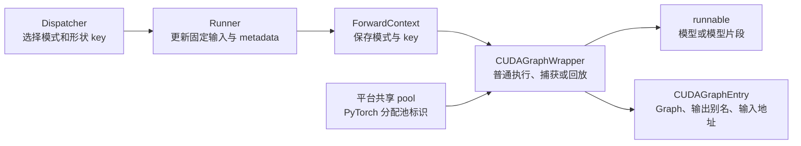
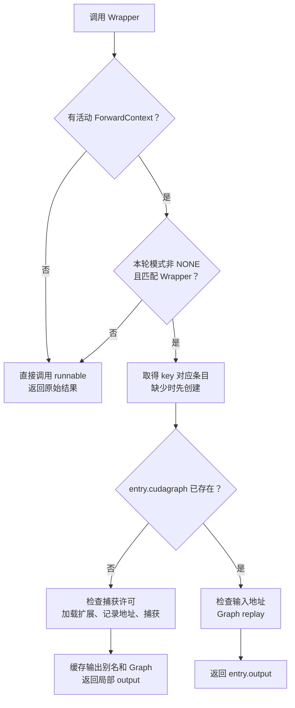

# CUDA Graph Wrapper：捕获、缓存与回放

[`CUDAGraphWrapper`](../../nanovllm/compilation/cuda_graph.py) 给一个可调用对象增加 CUDA Graph 的捕获和回放能力。它读取本轮 `ForwardContext` 中的运行模式与 `BatchDescriptor`：**模式匹配时，首次遇到形状 key 就捕获，之后使用已有图回放；模式不匹配时直接调用原函数。**

例如，三个单 token decode 请求补齐成四槽位输入，本轮传入 `FULL` 和 `BatchDescriptor(4, 4, True)`。Wrapper 只根据这个 key 查找图；请求从 A/B/C 变成 B/C/D，不要求重新捕获。前提是 Runner 已更新捕获时使用的固定地址输入，并满足后端的执行条件。

本文重点介绍 Wrapper 的接口、内部状态及输出生命周期。档位选择见 [Dispatcher](dispatcher.md)，FA2、连续批处理和 padding 的整体约束见 [CUDA Graph 总览](overview.md)。实现参考本地 [`vllm/compilation/cuda_graph.py`](../../../vllm/vllm/compilation/cuda_graph.py)，当前裁剪 offloader、通信分配器及未移植的编译计数器。

**当前 Wrapper 已实现捕获与回放，但新的 `GPUModelRunner` 尚未调用它。** Runner 的 `_dummy_run()`、`capture_model()` 仍未实现，在线 `execute_model()` 使用默认 `NONE`。下面的模型请求例子说明接入后的数据流；独立 CUDA 小例子直接调用现有 Wrapper，不依赖 Runner。

## Wrapper 在推理链中的位置



Dispatcher 给出执行计划，Runner 准备该计划需要的数据，ForwardContext 传递计划。Wrapper 管理实际图缓存：普通执行和捕获时调用 `runnable`，回放时直接调用 `entry.cudagraph.replay()`，不重新执行模型的 Python forward。

| 工作 | 负责组件 | 对 Wrapper 的影响 |
| --- | --- | --- |
| 从 3 个有效 token 选择容量为 4 的图 | Dispatcher。 | 返回 `FULL` 与四槽位 key。 |
| 将 token、position、block table 等写入固定 buffer | Runner 与 metadata builder。 | 保证图记录的地址包含本轮数据。 |
| 设置 padding 的 KV slot 和有效采样行 | Runner。 | Wrapper 不知道哪一行是真实请求。 |
| 临时暴露本轮模式、key 和 Attention 信息 | ForwardContext。 | Wrapper 在调用入口读取模式和 key。 |
| 首次捕获、按 key 缓存、之后回放 | Wrapper。 | 修改图缓存，返回输出访问入口。 |
| 读取有效 hidden states、计算 logits、采样 | Runner 的后续执行链。 | 包装模型 forward 不会自动把这些工作也捕获进去。 |

**Wrapper 不持有持久输入 buffer，也不把新的输入 Tensor 自动复制到捕获地址。** 位置参数的地址检查只是调试检查，不承担输入准备工作。

## 文件中的类与状态

### `CUDAGraphEntry`：一张图的缓存条目

`concrete_cudagraph_entries` 的类型是 `dict[BatchDescriptor, CUDAGraphEntry]`。字典属于一个 Wrapper；其他 Wrapper 即使使用相同 key，也有自己的条目和 Graph。

| 字段 | 刚创建时 | 捕获成功后 |
| --- | --- | --- |
| `batch_descriptor` | 调用方传入的 key。 | 同一个 key，不被 Wrapper 改写。 |
| `cudagraph` | `None`。 | 已完成捕获的 `torch.cuda.CUDAGraph`。 |
| `output` | `None`。 | 可读取图输出的非 owning Tensor 别名，或单层 list/tuple。 |
| `input_addresses` | `None`。 | 位置参数中各 Tensor 的 `data_ptr()` 列表。 |

**判断是否已经捕获，检查的是 `entry.cudagraph`，不是 key 是否已经出现在字典中。** 新条目先进入字典，再进行捕获。捕获被禁止或失败时，字典可能已有这个 key，但 `cudagraph` 仍为 `None`。

`BatchDescriptor` 不包含 token 值、请求 ID 或地址。FULL 使用整个描述符作为 key：`(4, 4, True)` 和 `(4, 2, False)` 不相等，即使 token 数都是 4，也会建立不同条目。PIECEWISE 的放宽 key 由 Dispatcher 准备，Wrapper 不做归一化。

### `CUDAGraphOptions`：改变捕获行为

| 字段 | 默认值 | 行为 |
| --- | --- | --- |
| `debug_log_enable` | `True`。 | 捕获时调用 `logger.debug()`；日志能否显示仍由日志级别决定。 |
| `gc_disable` | `False`。 | 为 True 时，在捕获作用域临时替换 `gc.collect()` 和 `torch.cuda.empty_cache()`，跳过重复清理调用。 |
| `weak_ref_output` | `True`。 | 为 True 时，在捕获内部就把局部输出转为非 owning 别名，提前释放 owning 输出引用。 |

`gc_disable` 不等于调用 `gc.disable()`。正常情况下，PyTorch 的 `torch.cuda.graph()` 进入时会执行同步、垃圾回收和缓存清理；此选项只屏蔽上述两项清理入口，其他行为照常执行。`ExitStack` 保证捕获正常结束或抛异常时都恢复原函数。

`debug_log_enable` 也不控制输入地址检查。当前项目的 `is_debugging_mode=True`，每次回放都会检查位置参数里的 Tensor 地址。

### Wrapper 的成员变量

| 成员 | 来源与初始状态 | 后续用途或变化 |
| --- | --- | --- |
| `runnable` | 构造参数。 | 普通执行与首次捕获时调用；回放时不调用。 |
| `vllm_config` | 当前 Worker 的 `NanovllmConfig` 引用。 | 保留上游参数名，不复制配置。 |
| `compilation_config` | `vllm_config.compilation_config`。 | 保存配置引用；本类不解析 Attention 能力或捕获尺寸。 |
| `runtime_mode` | FULL 或 PIECEWISE。 | 与本轮上下文中的具体模式比较。 |
| `graph_pool` | `current_platform.get_global_graph_pool()`。 | 每次捕获都传给 PyTorch，用于共享池。 |
| `cudagraph_options` | 显式选项，或独立创建的默认选项。 | 控制日志、清理和输出转换时机。 |
| `concrete_cudagraph_entries` | 空字典。 | 首次 key 加入条目，捕获成功后发布 Graph；清理接口清空字典。 |
| `is_debugging_mode` | 当前固定为 True。 | 开启回放地址检查和详细属性错误。 |
| `_runnable_str` | 原始 callable 的字符串。 | 缺少属性时用于错误信息。 |
| `first_run_finished` | False。 | 保留上游字段，当前未参与流程，也不会在捕获后变为 True。 |

类级 `_all_instances` 是 `weakref.WeakSet`，弱引用仍存活的 Wrapper，供 `clear_all_graphs()` 统一查找。**这里的 Python 弱引用与输出 Tensor 的非 owning 别名是两种机制。**

## `__init__()`：准备资源引用，不捕获模型

```python
wrapper = CUDAGraphWrapper(
    runnable=model,
    vllm_config=config,
    runtime_mode=CUDAGraphMode.FULL,
    cudagraph_options=CUDAGraphOptions(),
)
```

这里传入的是具体运行模式 FULL，而不是配置策略 FULL_DECODE_ONLY。后者应先由 Dispatcher 为本轮请求解析为 FULL 或 NONE。

构造完成时，图缓存仍为空，模型尚未执行；平台若还没有共享 pool 标识，会在这时创建标识并缓存。Worker 应在构造 Wrapper 前绑定 CUDA 设备。构造函数不会创建模型输入，不会编译原生扩展，也不检查 FA2 是否能捕获当前 batch。

## `__call__()`：普通执行、捕获与回放



流程图中的捕获需要许可检查通过；检查或 forward 失败会直接抛异常，不自动退回普通执行。已有图的回放不会再次检查捕获许可。

### 模式与 key 如何决定分支

| 活动上下文 | 本轮模式 | key 的捕获状态 | 行为 |
| --- | --- | --- | --- |
| 不存在 | 不读取。 | 不查询。 | 直接调用 `runnable`。 |
| 存在 | NONE。 | 不查询。 | 直接调用，适用于 profiling、预热或普通推理。 |
| 存在 | 与 Wrapper 不同。 | 不查询。 | 直接调用，允许嵌套不同模式的 Wrapper。 |
| 存在 | 与 Wrapper 匹配。 | key 缺少。 | 创建条目，再尝试捕获。 |
| 存在 | 与 Wrapper 匹配。 | 条目存在，Graph 为 None。 | 尝试捕获，包括此前失败后的重试。 |
| 存在 | 与 Wrapper 匹配。 | Graph 已存在。 | 检查地址，然后回放。 |

匹配 Graph 模式时必须携带非空 `batch_descriptor`。Wrapper 不会根据 `args` 的 shape 自己生成 key，也不选择更大的图。

### 首次捕获如何修改条目

以四槽位输入、两个位置参数为例，记输入地址为 `P_ids` 和 `P_pos`，输出地址为 `P_hidden`。

| 阶段 | 条目变化 | 执行工作 |
| --- | --- | --- |
| 取得 key | 新建 `Entry(key)`，Graph 和输出为 None。 | 只修改 Python 字典。 |
| 检查许可 | 不发布 Graph。 | 禁止捕获时抛 RuntimeError。 |
| 加载扩展 | 条目暂不改变。 | `load_extension()` 在捕获外编译或加载弱别名算子；已加载则直接返回。 |
| 记录输入 | `input_addresses=[P_ids, P_pos]`。 | 保存整数地址，不保活输入 Tensor。 |
| 捕获 forward | 局部 `output` 指向 `P_hidden`。 | 在共享 pool 和指定 stream 中调用 `runnable`，记录 GPU 工作。 |
| 转换局部输出 | 由 `weak_ref_output` 控制。 | 可能在捕获内释放 owning 输出引用。 |
| 保存缓存 | `entry.output` 指向 `P_hidden`。 | 始终保存非 owning 别名。 |
| 发布 Graph | `entry.cudagraph=graph`。 | 后续相同 key 进入回放分支。 |
| 返回 | 不再修改条目。 | 返回局部 `output`，保留其选定的所有权行为。 |

捕获过程中产生的 Tensor 分配交给 PyTorch Graph pool 管理；Wrapper 自己没有一块按 hidden size 提前分配的输出 buffer。

### 回放读取哪些参数

回放路径只读取上下文的模式与 key，以及位置参数中 Tensor 的地址用于调试检查，然后执行：

```python
entry.cudagraph.replay()
return entry.output
```

**模型 Python forward 不会再次执行，新的 Python 标量或 kwargs 不会自动改写图的 kernel 参数。** 例如捕获时 Python 标量 `scale=2.0` 参与了计算，之后传入 `scale=3.0`，不能期望回放自动采用新值。是否能变化，取决于相关算子能否从固定地址 Tensor 读取动态值。

当前地址检查有明确边界：

- 只遍历 `args` 中直接出现的 Tensor，不递归检查容器。
- 不检查 kwargs 中的 Tensor，也不遍历上下文里的 Attention metadata、block table 或 slot mapping。
- 比较的是 `data_ptr()` 列表，没有比较 shape、stride 或其他后端条件。
- Tensor 的 Python 包装对象可以换，只要地址与其他执行条件不变；同形状但地址不同的新分配不能替代捕获输入。

因此，关闭地址检查也不会让新地址自动生效。Runner 仍需维持输入、KV cache 和 metadata 的存储生命周期及布局。

## 贯穿例子：A/B/C 变成 B/C/D

### 先确定形状和各接口的工作

假设当前为 FA2 单 token decode，Dispatcher 使用 FULL_DECODE_ONLY 策略，三个有效请求选中四槽位计划：

```python
runtime_mode = CUDAGraphMode.FULL
key = BatchDescriptor(num_tokens=4, num_reqs=4, uniform=True)
```

下面关注 Wrapper 看到的输入与输出。真实模型还需要合法的 Attention metadata、KV cache、block table 和 slot mapping，这些由 Runner 与后端 builder 提供，padding 约定见 [总览的连续批处理例子](overview.md#贯穿例子a-结束d-加入仍回放四槽位图)。

| 数据 | 执行形状 | 第一轮内容 | 准备者 |
| --- | --- | --- | --- |
| 请求槽位 | 4 个。 | A、B、C、padding。 | Runner；请求 ID 不进入 Graph key。 |
| `input_ids` | `[4]`。 | `[15, 25, 32, 0]`。 | Runner 写入固定地址 `P_ids`。 |
| `positions` | `[4]`。 | `[7, 11, 19, 0]`。 | Runner 写入固定地址 `P_pos`。 |
| `slot_mapping` | 每层 `[4]`。 | 三个有效 slot，最后一项为 -1。 | Runner；padding 不写入真实 KV slot。 |
| Attention metadata | 与四槽位捕获布局一致。 | 内容指向 A/B/C 的本轮上下文。 | Runner 与 FA2 metadata builder。 |
| `hidden_states` | 示例设为 `[4, 32]`。 | 四行模型输出。 | 捕获或回放的模型 forward。 |
| 有效采样行 | 3 行。 | decode 下对应行 `[0, 1, 2]`。 | Runner 选择，Wrapper 不过滤 padding。 |

这里 num_tokens 和 num_reqs 都是 4，因为采用四槽位的单 token decode 计划；一般 packed batch 中，两者不必相等。

### 启动捕获与第一轮请求不是同一件事

正常接入时，启动期先用合法 dummy 输入捕获这个 key，图缓存从空变为已完成条目。在线第一轮 A/B/C 更新同一地址的 buffer 后，已经直接进入回放。

如果独立使用 Wrapper，没有提前捕获，也没有关闭捕获许可，那么 A/B/C 的首次调用会走捕获分支。两种情况最终都得到同一个 key 对应的 Graph；区别在于捕获发生的时机。Wrapper 本身不强制启动期捕获。

| 内部状态 | 捕获前 | 捕获后 |
| --- | --- | --- |
| `concrete_cudagraph_entries` | 空。 | 包含 `key → entry`。 |
| `entry.cudagraph` | None。 | Graph 对象 `G4`。 |
| `entry.input_addresses` | None。 | `[P_ids, P_pos]`，假设模型以位置参数接收二者。 |
| `entry.output` | None。 | 数据地址为 `P_hidden`、shape 为 `[4, 32]` 的非 owning 别名。 |
| `graph_pool` | 平台取得的标识。 | 同一标识，不为每个 key 重新创建。 |

### 第二轮：只更新数据，不替换存储

A 完成，D 已完成 prefill 并进入普通 decode。下一轮 B/C/D 仍各计算一个 token。

| 项目 | 第一轮 | 第二轮 | 是否影响 key |
| --- | --- | --- | --- |
| 有效请求 | A/B/C。 | B/C/D。 | 否。 |
| 有效 token 数 | 3。 | 3。 | 仍选择四槽位计划。 |
| `input_ids` 内容 | `[15, 25, 32, 0]`。 | `[26, 33, 41, 0]`。 | 值不进入 key。 |
| `positions` 内容 | `[7, 11, 19, 0]`。 | `[12, 20, 4, 0]`。 | 值不进入 key。 |
| `input_ids.data_ptr()` | `P_ids`。 | `P_ids`。 | 地址必须保持捕获条件。 |
| `positions.data_ptr()` | `P_pos`。 | `P_pos`。 | 地址必须保持捕获条件。 |
| block table、seq lens、slot mapping | A/B/C 的映射。 | 原地更新为 B/C/D 的映射。 | key 不保存内容；布局、地址和后端条件仍需保证。 |
| Graph | `G4`。 | `G4`。 | 不重新捕获。 |
| 输出地址 | `P_hidden`。 | `P_hidden`。 | 回放覆盖输出数据。 |
| 输出前三行的归属 | A/B/C。 | B/C/D。 | 由本轮请求槽位解释。 |

`entry.output` 不保存“A 的结果”这种请求语义。它只提供图输出地址的访问入口；行对应哪个请求，由 Runner 的本轮槽位映射决定。

### 用一个明确公式观察 hidden states

为了让结果可以手算，下面用一个示例计算代替真正的 Transformer：

```python
import torch

feature_indices = torch.arange(32, dtype=torch.float32)

def toy_forward(input_ids: torch.Tensor, positions: torch.Tensor) -> torch.Tensor:
    """生成四行可手算的示例输出，不执行真实 Attention。"""
    return (
        input_ids.to(torch.float32).unsqueeze(1)
        + positions.to(torch.float32).unsqueeze(1)
        + feature_indices
    )

first = toy_forward(torch.tensor([15, 25, 32, 0]), torch.tensor([7, 11, 19, 0]))
second = toy_forward(torch.tensor([26, 33, 41, 0]), torch.tensor([12, 20, 4, 0]))
assert first.shape == second.shape == (4, 32)
assert first[:, 0].tolist() == [22.0, 36.0, 51.0, 0.0]
assert second[:, 0].tolist() == [38.0, 53.0, 45.0, 0.0]
```

这个 CPU 示例只验证数值和行映射。真实 CUDA 小例子把相同计算放入 Wrapper，观察回放如何更新同一输出地址。

| 行 | 第一轮归属及结果 | 第二轮归属及结果 |
| --- | --- | --- |
| 0 | A：`[22, 23, ..., 53]`。 | B：`[38, 39, ..., 69]`。 |
| 1 | B：`[36, 37, ..., 67]`。 | C：`[53, 54, ..., 84]`。 |
| 2 | C：`[51, 52, ..., 82]`。 | D：`[45, 46, ..., 76]`。 |
| 3 | padding：`[0, 1, ..., 31]`。 | padding：`[0, 1, ..., 31]`。 |

**padding 行可能有非零输出，不代表它应该生成一个 token。** 有效行选择属于 Runner；真实模型随后从三行 hidden states 计算三行词表 logits，再采样。

## 独立 CUDA 示例：验证捕获与第二轮回放

以下代码不加载模型权重、不调用 FA2，只验证现有 Wrapper。需要 CUDA GPU、C++ 编译器和 ninja。`SimpleNamespace` 仅替代这个例子中不读取的总配置部分；真实 Worker 使用完整 `NanovllmConfig`。

```python
from types import SimpleNamespace
from typing import cast

import torch

from nanovllm._C import load_extension
from nanovllm.compilation import monitor
from nanovllm.compilation.cuda_graph import CUDAGraphWrapper
from nanovllm.config import CompilationConfig, CUDAGraphMode, NanovllmConfig
from nanovllm.forward_context import BatchDescriptor, set_forward_context
from nanovllm.utils.torch_utils import current_stream

if not torch.cuda.is_available():
    raise SystemExit("该例子需要可用的 CUDA GPU。")

torch.cuda.set_device(0)
previous_stream = torch.cuda.current_stream()
stream = current_stream()  # 独立进程首次调用会选中非默认 stream。
load_extension()  # 在捕获前完成 C++ 扩展加载。

config = cast(
    NanovllmConfig,
    SimpleNamespace(compilation_config=CompilationConfig()),
)
key = BatchDescriptor(4, 4, True)
input_ids = torch.tensor([15, 25, 32, 0], device="cuda")
positions = torch.tensor([7, 11, 19, 0], device="cuda")
feature_indices = torch.arange(32, dtype=torch.float32, device="cuda")
forward_calls: list[int] = []

def toy_forward(input_ids: torch.Tensor, positions: torch.Tensor) -> torch.Tensor:
    """使用固定地址输入生成可手算的输出，记录 Python forward 是否执行。"""
    forward_calls.append(1)  # replay 不重跑 Python，因此不会追加记录。
    return (
        input_ids.to(torch.float32).unsqueeze(1)
        + positions.to(torch.float32).unsqueeze(1)
        + feature_indices
    )

wrapper = CUDAGraphWrapper(toy_forward, config, CUDAGraphMode.FULL)
previous_capture_permission = monitor.cudagraph_capturing_enabled
try:
    with torch.inference_mode():
        # 先执行普通预热；示例没有 Attention，因此 metadata 可以为 None。
        for _ in range(2):
            with set_forward_context(None, config, cudagraph_runtime_mode=CUDAGraphMode.NONE):
                warmup_output = wrapper(input_ids, positions)
            del warmup_output

        monitor.set_cudagraph_capturing_enabled(True)
        with set_forward_context(
            None, config, cudagraph_runtime_mode=CUDAGraphMode.FULL,
            batch_descriptor=key,
        ):
            captured_output = wrapper(input_ids, positions)

        entry = wrapper.concrete_cudagraph_entries[key]
        assert entry.input_addresses == [input_ids.data_ptr(), positions.data_ptr()]
        assert entry.output.data_ptr() == captured_output.data_ptr()
        assert captured_output.shape == (4, 32)
        # CPU 副本不会被后续 replay 覆盖；cpu() 在此也便于演示结果验证。
        first_snapshot = captured_output[:3].cpu()
        assert first_snapshot[:, 0].tolist() == [22.0, 36.0, 51.0]
        calls_after_capture = len(forward_calls)
        assert calls_after_capture == 3  # 两次预热，一次捕获。

        # 模拟启动捕获完成后进入在线阶段：允许回放，禁止新增捕获。
        monitor.set_cudagraph_capturing_enabled(False)
        input_ids.copy_(torch.tensor([26, 33, 41, 0], device="cuda"))
        positions.copy_(torch.tensor([12, 20, 4, 0], device="cuda"))
        with set_forward_context(
            None, config, cudagraph_runtime_mode=CUDAGraphMode.FULL,
            batch_descriptor=key,
        ):
            replay_output = wrapper(input_ids, positions)

        assert replay_output is entry.output
        assert replay_output.data_ptr() == captured_output.data_ptr()
        assert len(forward_calls) == calls_after_capture
        assert replay_output[:3, 0].cpu().tolist() == [38.0, 53.0, 45.0]
        # 旧别名看到的也已是第二轮结果；独立 CPU 快照仍是第一轮。
        assert captured_output[:3, 0].cpu().tolist() == [38.0, 53.0, 45.0]
        assert first_snapshot[:, 0].tolist() == [22.0, 36.0, 51.0]
        print("一次捕获，第二轮回放成功，输入和输出地址保持不变。")
finally:
    stream.synchronize()  # 清理 Graph 前完成已排队的 GPU 工作。
    wrapper.clear_graphs()
    monitor.set_cudagraph_capturing_enabled(previous_capture_permission)
    torch.cuda.set_stream(previous_stream)
```

这个例子中的显式同步和 CPU 拷贝用于观察结果，不要求真实服务每轮都同步。生产路径应让后续计算与回放保持正确的 stream 依赖，并在共享空间被覆盖前消费输出。

## 共享 Graph pool：固定地址与显存复用

### `global_graph_pool` 属于哪一层

[`Platform.get_global_graph_pool()`](../../nanovllm/platforms/interface.py) 首次请求时调用 `torch.cuda.graph_pool_handle()`，把标识保存到平台类的 `_global_graph_pool` 字段，后续 Wrapper 取得同一个标识。

| 名称 | 所在层 | 含义 |
| --- | --- | --- |
| `_global_graph_pool` | nano-vLLM 平台类。 | 当前进程内共享的 PyTorch pool 标识缓存。 |
| `torch.cuda.graph_pool_handle()` | PyTorch。 | 返回不透明标识，提示哪些捕获可以共享分配池。 |
| `cudaMemPool_t` | CUDA Runtime。 | CUDA 流有序分配器的内存池对象，供 `cudaMallocAsync` 等接口使用。 |

**这里的 global 不表示跨进程共享，也不是 CUDA Runtime 的一个同名全局对象。** 创建标识不会预分配某个固定大小的显存。模型权重、持久输入和预先创建的 KV cache 不会因为这个标识而自动迁入捕获池。[PyTorch 接口说明](https://docs.pytorch.org/docs/2.14/generated/torch.cuda.graph_pool_handle.html)、[CUDA 内存池接口](https://docs.nvidia.com/cuda/cuda-runtime-api/cuda_runtime_api/group__CUDART__MEMORY__POOLS.html)

### 为什么 PyTorch 要保留捕获分配

直接写 CUDA 时，可以先分配 buffer，再捕获使用它们的 kernel，并由应用保持 buffer 存活。PyTorch 模型则会在 forward 中创建临时 Tensor，需要分配器维护捕获地址的生命周期。它会为捕获分配使用 Graph 私有池，保留 replay 所需的地址；默认不同捕获使用独立池。[PyTorch Graph 内存管理](https://docs.pytorch.org/docs/2.14/notes/cuda.html#graph-memory-management)

多个形状档位使用同一 pool，允许复用其中可复用的空间。例如八槽位图与四槽位图逐轮择一执行，临时工作空间不一定需要各自长期占用独立分配。共享池不保证总显存严格等于最大档位的用量，实际结果取决于存活分配、布局和捕获次序。

Wrapper 每次捕获还传入 `current_stream()`。当前同一个 Worker 线程沿用选定的非默认 stream；PyTorch 2.5.1 对显式指定 stream 的共享捕获也要求沿用同一 stream 才能有效共享内存。因此不能只复用 pool 标识，却任意切换捕获流或并发回放。

共享不会合并 Graph，也不会改变每张图记录的地址。某些地址可能被多张图使用，所以**共享池里的输出不是长期快照**。不同档位图不依赖彼此输出时，可以顺序择一回放；存在前后依赖的子图则还要保持正确顺序和中间结果生命周期，不能并发覆盖尚未消费的数据。[PyTorch 共享池约束](https://docs.pytorch.org/docs/2.14/notes/cuda.html#sharing-memory-across-captures)

## `weak_ref_tensors()`：缓存输出但不强持有原分配

### 返回的仍然是 Tensor

[`weak_ref_tensor()`](../../nanovllm/utils/torch_utils.py) 调用 `torch.ops._nanovllm_C.weak_ref_tensor`，底层 [`ops.h`](../../nanovllm/csrc/ops.h) 使用 LibTorch 的 `torch::from_blob`。新 Tensor 保留原数据地址、shape、stride、dtype 和 device，没有数据复制，也不启动计算 kernel。

| 做法 | 返回对象 | 是否强持有原始 storage | 能否直接读取 Tensor 数据 |
| --- | --- | --- | --- |
| `entry.output = output` | 原 Tensor。 | 是。 | 可以。 |
| `output.detach()` | 共享 storage 的 Tensor。 | 是。 | 可以。 |
| `weakref.ref(output)` | Python 弱引用对象。 | 否。 | 要先取对象；原对象销毁后得到 None。 |
| `weak_ref_tensor(output)` | 独立非 owning storage 包装的 Tensor。 | 否。 | 地址仍有效时可以。 |

普通 Tensor 的强引用会维持其 owning 分配，可能妨碍共享池复用。非 owning 别名保留输出地址的访问方式，原始 owning Tensor 则可回收；图仍存活时，捕获池负责保留相关分配。脱离这个生命周期，别名自身不能保证地址有效。

单数 helper 对空 Tensor 和非 Tensor 对象原样返回。复数 helper 支持单个 Tensor、单层 list 和 tuple；容器中的非 Tensor 项透传，不递归处理嵌套容器。顶层 dict、None 等不受支持，当前也没有流水线并行的 `IntermediateTensors` 分支。

### 两次转换分别改变什么

```python
with torch.cuda.graph(cudagraph, pool=self.graph_pool, stream=current_stream()):
    output = self.runnable(*args, **kwargs)
    if self.cudagraph_options.weak_ref_output:
        output = weak_ref_tensors(output)

entry.output = weak_ref_tensors(output)
entry.cudagraph = cudagraph
return output
```

| 时机 | `weak_ref_output=True` | `weak_ref_output=False` |
| --- | --- | --- |
| forward 刚返回 | 局部变量先接收原始输出。 | 局部变量先接收原始输出。 |
| 捕获内部 | 转换局部变量，允许原始 owning 输出引用释放。 | 局部变量仍持有原始 owning 输出。 |
| 捕获结束，写入 `entry.output` | 再创建缓存别名。 | 为缓存创建非 owning 别名。 |
| 捕获调用的返回值 | 局部非 owning 别名。 | 原始 owning 输出。 |
| 后续回放返回值 | 缓存非 owning 别名。 | 缓存非 owning 别名。 |

**`weak_ref_output=False` 控制提前释放的时机，不会把缓存改为强引用。** 捕获结束后始终转换缓存输出。返回局部 `output`，是为了在 False 情况下让后续计算继续持有原始 owning 输出。

### PIECEWISE 为什么只让最后一个子图提前转换

假设三个可捕获片段顺序执行：片段 P1 的输出用于 P2，P2 的输出用于 P3。捕获后续片段时，前一片段的输出需要继续保持分配存活；若过早释放，其空间可能被分配器当成可复用空间。

因此 vLLM 为非末尾片段配置 `weak_ref_output=False`，最后一个片段可配置 True。这个选项由分段执行链设置，Wrapper 不知道自己是不是最后一个子图。当前保留该语义，并不代表项目已经实现自动切图、分段编译或 FA2 混合 batch 的 PIECEWISE 执行。

## 捕获许可与异常后的状态

[`monitor.py`](../../nanovllm/compilation/monitor.py) 保存进程级 `cudagraph_capturing_enabled`。当前默认 True，Wrapper 只在新增捕获前调用 `validate_cudagraph_capturing_enabled()`。

| 场景 | 开关为 False 时的结果 | 状态变化 |
| --- | --- | --- |
| NONE 或模式不匹配 | 普通调用。 | 不访问图缓存。 |
| key 已有完成的 Graph | 允许回放。 | 返回缓存输出。 |
| key 缺少或条目尚未捕获 | 抛 RuntimeError。 | 缺少 key 时已创建待捕获条目，Graph 仍为 None。 |
| 清空缓存后再次匹配 | 需要重新捕获，所以报错。 | 不能把 clear 当作在线普通执行回退。 |

启动流程应在 dummy 准备、预热和预定档位捕获完成后关闭许可。Wrapper 不负责关闭开关，当前 Runner 尚未实现这个完整生命周期。

捕获中的 forward 或输出转换抛异常时，不发布已完成的 Graph，异常向上传播；清理入口恢复后，下一次允许捕获的匹配调用可以重新尝试。已有 Graph 的地址检查失败也直接报错，不替换输入地址、不自动重新捕获。

## 其他接口改变哪些状态

| 接口 | 返回值 | 状态与资源变化 |
| --- | --- | --- |
| `unwrap()` | 原始 `runnable`。 | 不修改缓存；直接调用返回对象会绕过本 Wrapper。 |
| `cudagraph_wrapper` | Wrapper 自身。 | 只提供统一查找入口，不创建新实例。 |
| `__getattr__(key)` | 原始 callable 的属性。 | 本实例没有属性时透传，缺少则抛 AttributeError。 |
| `clear_graphs()` | None。 | 清空当前实例所有条目，保留配置、pool 标识和 callable。 |
| `clear_all_graphs()` | None。 | 遍历弱引用集合中仍存活的实例，分别清空条目。 |

清理接口不执行 GPU 同步，也不等价于 `torch.cuda.empty_cache()`；其他对象若仍持有 Graph 或 owning Tensor，相关分配不一定立即释放。调用方应先完成相关 GPU 工作，并停止使用旧非 owning 输出别名。后续同一 key 再次调用时需要重新捕获。

## `CUDAGraphLogging`：按 batch 记录汇总统计

Logging 与 Wrapper 的图字典独立。它不会自动统计一次捕获或回放；Runner 等调用方应自行构造 `CUDAGraphStat` 并调用 `observe()`。

```python
from nanovllm.compilation.cuda_graph import CUDAGraphLogging, CUDAGraphStat
from nanovllm.config import CUDAGraphMode

logging = CUDAGraphLogging(CUDAGraphMode.FULL_DECODE_ONLY, [1, 2, 4, 8])
record = CUDAGraphStat(
    num_unpadded_tokens=3,
    num_padded_tokens=4,
    num_paddings=1,
    runtime_mode="FULL",
)
logging.observe(record)  # 第一轮 A/B/C。
logging.observe(record)  # 第二轮 B/C/D；字段相同，所以汇总为同一行。
table = logging.generate_metric_table()
assert len(logging.stats) == 2  # 生成文本不会清空记录。
logging.log(print)
assert logging.stats == []  # 成功输出后开始新窗口。
```

表格的数据行对应以下内容，实际日志沿用源码中的英文列名：

| 有效 token | 执行 token | padding | 具体模式 | 次数 |
| --- | --- | --- | --- | --- |
| 3 | 4 | 1 | FULL | 2 |

Count 是相同记录出现的次数，不是请求数，也不是图缓存条目数。

| 接口 | 输入或读取的状态 | 对内部变量的影响 |
| --- | --- | --- |
| `__init__(cg_mode, cg_capture_sizes)` | 配置策略与捕获列表。 | 保存显示用的文本快照，创建空 `stats`。 |
| `observe(stat)` | 一条不可变、可哈希的记录。 | 追加到 `stats`，暂不合并。 |
| `generate_metric_table()` | 当前全部记录。 | 按四字段合并、按频率降序生成表格，不修改 `stats`。 |
| `log(log_fn)` | 当前记录与输出接口。 | 非空时输出表格，成功后 reset；输出失败时保留记录。 |
| `reset()` | 无额外输入。 | 替换为空记录列表，配置文本不变。 |

## 与 vLLM 的对应

| 参考位置 | 当前对应实现 | 保留或裁剪的行为 |
| --- | --- | --- |
| [`vllm/compilation/cuda_graph.py`](../../../vllm/vllm/compilation/cuda_graph.py) | [`nanovllm/compilation/cuda_graph.py`](../../nanovllm/compilation/cuda_graph.py)。 | 同名类、模式透传、key 缓存、捕获与 replay，以及局部输出与缓存别名的区分。 |
| [`vllm/platforms/interface.py`](../../../vllm/vllm/platforms/interface.py) | [`nanovllm/platforms/interface.py`](../../nanovllm/platforms/interface.py)。 | 平台类缓存共享 pool 标识；当前只面向 CUDA 单卡。 |
| [`vllm/utils/torch_utils.py`](../../../vllm/vllm/utils/torch_utils.py) | [`nanovllm/utils/torch_utils.py`](../../nanovllm/utils/torch_utils.py)。 | 当前 stream 缓存、Tensor/list/tuple 非 owning 输出转换；省略其他平台与流水线并行容器。 |
| [`vllm/csrc/ops.h`](../../../vllm/csrc/ops.h) | [`nanovllm/csrc/ops.h`](../../nanovllm/csrc/ops.h)。 | `from_blob` 的核心语义一致，算子注册采用独立命名空间。 |
| 上游原生扩展加载链 | [`nanovllm/_C.py`](../../nanovllm/_C.py)。 | 当前采用按需 JIT 编译；Wrapper 在捕获外提前加载。 |
| 上游 offloader 与通信分配器 | 当前未实现。 | 省略拷贝流同步、通信 pool ID 设置等依赖。 |
| 上游调试开关与统计计数器 | 当前保留默认地址检查；未移植编译计数器。 | 不依赖上游环境变量或不存在的计数器对象。 |

