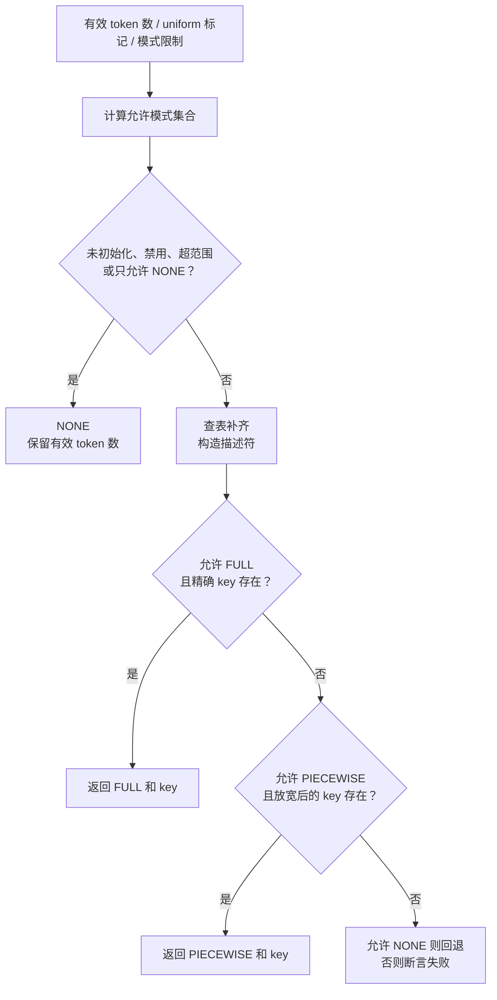

# CUDA Graph Dispatcher：从本轮 token 数选择执行形状

[`CudagraphDispatcher`](../../nanovllm/cudagraph_dispatcher.py) 负责将本轮 packed batch 的信息转换成 **具体运行模式和形状描述符**。整体捕获与回放生命周期见 [CUDA Graph 总览](overview.md)，实际图缓存、共享 pool 与输出生命周期见 [Graph Wrapper](cudagraphwrapper.md)。

例如，三个请求各 decode 一个 token，启动时规划了四槽位的完整图，本类可以返回：

```python
(CUDAGraphMode.FULL, BatchDescriptor(num_tokens=4, num_reqs=4, uniform=True))
```

这表示 Runner 应准备四行输入和四槽位 metadata，再把这个 key 传给模型执行链。**本类不会把三个 token 实际补成四行，也不创建、捕获或回放图。** 它只告诉后续组件可以采用哪套执行形状。

实现参考本地 [`vllm/v1/cudagraph_dispatcher.py`](../../../vllm/vllm/v1/cudagraph_dispatcher.py)，保留方法命名和主要流程，裁剪 LoRA、spec decode 和当前未接入的编译尺寸检查。

## Dispatcher 在推理链中的位置


Runner 负责理解真实请求以及准备 tensor，Dispatcher 负责匹配合法形状，ForwardContext 传递匹配结果。Wrapper 才持有实际 CUDA 图。当前新的 Runner 尚未调用本类，也尚未接入已实现的 Wrapper，因此独立分派成功不表示模型已经在回放。

## 输入里哪些数量容易混淆

| 名称 | 在本类中的含义 | 三个单 token decode 请求的例子 |
| --- | --- | --- |
| `num_tokens` | 本轮有效 packed token 数。 | 3。 |
| `uniform_decode` | 调用方是否确认每个有效请求都计算一个 decode token。 | True。 |
| `uniform_decode_query_len` | 每个有效 decode 请求的 query 长度。 | 当前只支持 1。 |
| `BatchDescriptor.num_tokens` | Graph 的执行 token 数，包含 padding。 | 4。 |
| `BatchDescriptor.num_reqs` | Graph 的请求槽位容量，受 `max_num_seqs` 限制。 | 4，包含 padding 槽位。 |
| `BatchDescriptor.uniform` | 描述符是否使用单独的 uniform key。 | FULL_DECODE_ONLY 下为 True。 |

**token 数不总等于请求数。** query 长度 `[3, 1]` 表示两个请求、本轮四个 token；`[1, 1, 1, 1]` 则表示四个请求、本轮也是四个 token。

Dispatcher 不接收真实请求数，也不读取 `query_start_loc`。`uniform_decode` 必须由 Runner 正确判断；把多 token prefill 错标为 True，本类无法自行识别。各请求的历史长度 `[128, 42, 7]` 不影响这个标记，只要本轮每个有效请求的 query 长度都为 1。

`BatchDescriptor` 是不可变、可哈希的数据类，因此可以作为集合元素和图缓存 key。它不保存请求 ID、token 值、KV 历史长度或 buffer 地址；这些约束和数据由后续执行链维护。

## 构造与初始化：状态怎样变化

### `__init__()`：只有配置引用和空集合

构造函数保存 `NanovllmConfig` 和其中的 `CompilationConfig`，然后设置以下状态：

| 成员 | 构造后 | 用途 |
| --- | --- | --- |
| `uniform_decode_query_len` | 1。 | 当前普通 decode 的固定 query 长度。 |
| `cudagraph_keys[PIECEWISE]` | 空集合。 | 分段图合法 key。 |
| `cudagraph_keys[FULL]` | 空集合。 | 完整图合法 key。 |
| `keys_initialized` | False。 | 防止尚未规划 key 就执行匹配。 |
| `cudagraph_mode` | NONE。 | 构造时不直接启用配置中的 Graph 策略。 |
| `_bs_to_padded_graph_size` | 尚未创建。 | 启用策略初始化时才生成查表数组。 |

即使配置中已经写了 `FULL_DECODE_ONLY`，刚构造出来的 Dispatcher 调用 `dispatch(3, True)` 仍返回 `(NONE, BatchDescriptor(3))`。

### `initialize_cudagraph_keys()`：建立合法形状集合

此接口必须在 Attention 后端能力解析后调用。例如当前 FA2 的能力为 `UNIFORM_BATCH`，配置解析可能把请求的 FULL 降为 `FULL_DECODE_ONLY`；Dispatcher 接收这个最终结果，不再次查询能力。

其流程为：

1. 当前只接受 `uniform_decode_query_len=1`，其他值明确报错。
2. 将参数策略写入 `self.cudagraph_mode`。
3. 策略为 NONE 时，只设置 `keys_initialized=True` 并返回。
4. 启用 Graph 时，创建 token 分档查表。
5. 根据 mixed 和 decode 路径分别登记 key。
6. 全部 key 就绪后，设置 `keys_initialized=True`。

同上游流程，这个对象按启动期一次初始化使用。接口不清空既有集合，不能把它当成支持热切换策略的重置接口；需要更改策略时应重新创建 Dispatcher，并协调已有图缓存。

### `_compute_bs_to_padded_graph_size()`：提前算出 padding 尺寸

假设配置已解析为：

```python
cudagraph_capture_sizes = [1, 2, 4, 8]
max_cudagraph_capture_size = 8
```

方法创建长度为 9 的列表，索引代表有效 token 数，值代表最小兼容捕获尺寸：

| 有效 token 数 / 索引 | 0 | 1 | 2 | 3 | 4 | 5 | 6 | 7 | 8 |
| --- | --- | --- | --- | --- | --- | --- | --- | --- | --- |
| 查表结果 | 0 | 1 | 2 | 4 | 4 | 8 | 8 | 8 | 8 |

以相邻分档 2 和 4 为例，循环处理 `[2, 4)`：2 保持为 2，3 向上补为 4。4 本身在下一段中处理，保持为 4。末尾的 `max_size + 1` 哨兵保证最大尺寸 8 也能写入。

在线调用不必每次遍历捕获列表寻找上界，直接通过 `_bs_to_padded_graph_size[num_tokens]` 查表。超过上限的输入在 `dispatch()` 中提前回退，避免查表越界。索引 0 虽保留为 0，但初始化不会创建零 token key。

前提是总配置已经将捕获尺寸排序，并使列表最大值等于配置上限。本类不重新推导、排序或过滤用户配置。

### `_create_padded_batch_descriptor()`：从 token 尺寸推导槽位容量

这个方法是纯描述符构造，不进行 tensor padding。

当前 query 长度为 1 时，其规则是：

| 情况 | `num_tokens` 字段 | `num_reqs` 字段 | `uniform` 字段 |
| --- | --- | --- | --- |
| uniform decode 且策略含 FULL | 查表得到的 padded token 数。 | `min(padded token 数, max_num_seqs)`。 | True。 |
| 其他情况 | 查表得到的 padded token 数。 | `min(padded token 数, max_num_seqs)`。 | False。 |

两条分支在当前 query 长度下得到相同的槽位数量，但 uniform 标记不同。保留分支是为了对齐上游语义；未来支持多 query decode 时，uniform 分支还需要除以 query 长度。

`num_reqs` 是执行容量。例如一般 FULL 形状包含 16 个 token、请求上限为 8，就得到 `BatchDescriptor(16, 8, False)`；不表示这 16 个 token 实际属于 16 个请求。

### `add_cudagraph_key()`：登记，不捕获

此方法仅执行集合插入。只能传具体模式 PIECEWISE/FULL，相同 key 自动去重，传 NONE 或组合策略会触发断言。

正常启动由 `initialize_cudagraph_keys()` 调用它。若外部自行登记额外 key，必须保证后续捕获计划及输入准备确实支持对应形状，不能把集合插入当成“图已经存在”。

## 不同策略会初始化哪些 key

以下以尺寸 `[1, 2, 4, 8, 16]`、请求容量 `max_num_seqs=8` 为例。

| 配置策略 | PIECEWISE 集合 | FULL 集合 |
| --- | --- | --- |
| NONE | 空。 | 空。 |
| FULL_DECODE_ONLY | 空。 | 1、2、4、8 对应的 `(T, T, True)`。 |
| PIECEWISE | 所有尺寸对应的 `(T, None, False)`。 | 空。 |
| FULL_AND_PIECEWISE | 所有尺寸对应的 `(T, None, False)`。 | 1、2、4、8 对应的 `(T, T, True)`。 |
| FULL | 空。 | 所有尺寸对应的 `(T, min(T, 8), False)`。 |

表中三元组顺序为 `(num_tokens, num_reqs, uniform)`。

**FULL_DECODE_ONLY 不会为 16 建立 FULL key。** 单 token decode 最多有 8 个有效请求，所以专用 decode 捕获尺寸不能超过 8。候选尺寸列表、Dispatcher 的合法 key、Wrapper 中实际捕获好的图，是三个不同阶段。

纯 FULL 使用一般形状 key，运行时即使是 decode，也会匹配 `uniform=False` 的 key；这表示采用可覆盖一般 batch 的计划，不表示真实请求不 uniform。当前 FA2 不能直接启用这条一般 FULL 路径，应先通过后端能力解析降级。

PIECEWISE key 将 `num_reqs` 设为 None，表示分段计算图不按 Attention 请求槽位数量区分；不是请求数等于零。当前编译和分段执行链尚未实现，本类能够生成这种 key，只用于保留分派规则。

## `dispatch()`：本轮执行怎样选择



FULL 的匹配优先级高于 PIECEWISE。禁止某模式只会影响本轮选择，不会删除已登记的 key，也不会改变 Dispatcher 的全局策略。

### 归一化 uniform 标记

`normalized_uniform = uniform_decode and self.cudagraph_mode.separate_routine()`。

- FULL_DECODE_ONLY 和 FULL_AND_PIECEWISE 分开处理 decode，保留调用方的 uniform 标记。
- 纯 FULL 使用一般 key，把标记归一为 False。
- 纯 PIECEWISE 最终统一匹配 `num_reqs=None、uniform=False` 的 key。

### 模式限制的具体语义

| 参数或状态 | 行为 |
| --- | --- |
| `valid_modes=None` | 默认允许 NONE、PIECEWISE、FULL。 |
| `valid_modes=set()` | 沿上游实现，同样表示使用默认全集。 |
| `valid_modes={NONE}` | 明确要求普通执行。 |
| `invalid_modes={FULL}` | 本轮排除 FULL，可能选择 PIECEWISE 或 NONE。 |
| 过滤后集合为空 | 断言失败，没有任何可选模式。 |
| 已进入 key 匹配、无 key 且 NONE 被禁止 | 断言失败，避免假装已找到可用图。 |

过滤使用新集合，不修改调用方传入的可变 set。

上游的早返回另有语义：未初始化、禁用、超范围时直接返回 NONE，即使 `valid_modes` 未包含 NONE。因而这个参数不能被当成覆盖所有早返回情况的严格执行保证；禁止普通执行的调用方还应检查返回模式。

## 贯穿例子：FA2 单 token decode

### 准备一个不加载模型的 CPU 示例

下面只构造 Dispatcher 会读取的配置入口，用真实 `CompilationConfig` 保存尺寸。`SimpleNamespace` 代替无关的模型配置，使例子无需模型目录和 CUDA；真实 Runner 应传入完整 `NanovllmConfig`。

```python
from types import SimpleNamespace
from typing import cast

from nanovllm.config import CompilationConfig, CUDAGraphMode, NanovllmConfig
from nanovllm.cudagraph_dispatcher import CudagraphDispatcher
from nanovllm.forward_context import BatchDescriptor

compilation_config = CompilationConfig(
    cudagraph_mode=CUDAGraphMode.FULL_DECODE_ONLY,
    cudagraph_capture_sizes=[1, 2, 4, 8, 16],
    max_cudagraph_capture_size=16,
)
config = cast(
    NanovllmConfig,
    SimpleNamespace(
        compilation_config=compilation_config,
        scheduler_config=SimpleNamespace(max_num_seqs=8),
    ),
)
dispatcher = CudagraphDispatcher(config)
assert dispatcher.dispatch(3, True) == (CUDAGraphMode.NONE, BatchDescriptor(3))

# 实际启动时应先解析 Attention 能力，再把最终策略交给 Dispatcher。
dispatcher.initialize_cudagraph_keys(CUDAGraphMode.FULL_DECODE_ONLY)

assert dispatcher.dispatch(3, True) == (
    CUDAGraphMode.FULL,
    BatchDescriptor(4, 4, True),
)
```

### 初始化带来的内部变化

| 状态 | 初始化前 | 初始化后 |
| --- | --- | --- |
| `cudagraph_mode` | NONE。 | FULL_DECODE_ONLY。 |
| `keys_initialized` | False。 | True。 |
| `_bs_to_padded_graph_size[3]` | 查表尚未创建。 | 4。 |
| `_bs_to_padded_graph_size[9]` | 查表尚未创建。 | 16。 |
| FULL 集合 | 空。 | `(1,1,True)`、`(2,2,True)`、`(4,4,True)`、`(8,8,True)`。 |
| PIECEWISE 集合 | 空。 | 仍为空。 |

16 仍是候选捕获尺寸和查表上界，但因请求容量为 8，不会生成 decode 专用的 16 槽位 key。

### 三个请求如何得到四槽位结果

本轮 A/B/C 的 query 长度是 `[1, 1, 1]`，历史长度可以各不相同。

| 阶段 | 数据变化 |
| --- | --- |
| 调用 | `dispatch(num_tokens=3, uniform_decode=True)`。 |
| 允许模式 | 缺省为 `{NONE, PIECEWISE, FULL}`。 |
| 查表 | 3 向上补到 4。 |
| 构造描述符 | `BatchDescriptor(4, 4, True)`。 |
| 查 FULL 集合 | key 存在。 |
| 返回 | `(FULL, BatchDescriptor(4, 4, True))`。 |

Dispatcher 的成员状态没有因为这次调用而改变。返回后，Runner 才将输入准备成四行；metadata 的 padding 约定、负 slot 防止 KV 写入以及有效 logits 行选择，见 [总览的 A/B/C 示例](overview.md#贯穿例子a-结束d-加入仍回放四槽位图)。

下一轮 A 结束、D 进入 decode，请求变成 B/C/D，仍是三个有效 token，就返回相同 key。这里不会按请求 ID 建立新的图。

### 相同候选列表下的其他输入

| 本轮输入 | 中间候选描述符 | 返回 | 原因 |
| --- | --- | --- | --- |
| 4 token，uniform=True | `(4,4,True)`。 | FULL，同一描述符。 | 无需 padding。 |
| 5 token，uniform=True | `(8,8,True)`。 | FULL，同一描述符。 | 使用八槽位计划。 |
| 3 token，uniform=False | `(4,4,False)`。 | NONE，`BatchDescriptor(3)`。 | 不匹配 decode 专用 key。 |
| 9 token，uniform=True | `(16,8,True)`。 | NONE，`BatchDescriptor(9)`。 | 查表存在，但 FULL 集合没有这个 key。 |
| 17 token，uniform=True | 不构造。 | NONE，`BatchDescriptor(17)`。 | 超过最大捕获尺寸，提前回退。 |
| 0 token | 无零尺寸 key。 | NONE，`BatchDescriptor(0)`。 | 零值不触发图命中；Runner 应自行处理空调度。 |

9 个普通 decode 请求超过当前请求容量，不应由真实 Scheduler 调度出来；这里用于展示查表有候选值和合法 key 存在之间的区别。

## 组合策略例子：FULL 优先，PIECEWISE 兜底

这个例子只演示 Dispatcher 的 CPU 规则。当前配置解析尚不允许实际启用 PIECEWISE，下面不能作为已支持分段推理的证明。

```python
# 沿用前例的尺寸和请求容量，新建对象，避免混入旧策略的 key。
combined = CudagraphDispatcher(config)
combined.initialize_cudagraph_keys(CUDAGraphMode.FULL_AND_PIECEWISE)

assert combined.dispatch(3, True) == (
    CUDAGraphMode.FULL,
    BatchDescriptor(4, 4, True),
)
assert combined.dispatch(3, False) == (
    CUDAGraphMode.PIECEWISE,
    BatchDescriptor(4, None, False),
)

allowed = {CUDAGraphMode.FULL, CUDAGraphMode.PIECEWISE, CUDAGraphMode.NONE}
assert combined.dispatch(3, True, allowed, {CUDAGraphMode.FULL}) == (
    CUDAGraphMode.PIECEWISE,
    BatchDescriptor(4, None, False),
)
assert CUDAGraphMode.FULL in allowed  # 本轮过滤没有修改调用方集合。
```

第三次调用本来能匹配 FULL，但调用方排除了它，因此放宽请求维度后匹配 PIECEWISE。下一轮若不再排除 FULL，仍然优先选择完整图。

如果策略只有 FULL_DECODE_ONLY，排除 FULL 后就没有 PIECEWISE key 可用，通常返回 NONE；若此时又禁止 NONE，进入匹配阶段后会断言失败。

## `get_capture_descs()`：从合法 key 生成启动计划

该方法把 set 复制成列表，先处理 PIECEWISE、再处理 FULL，各自按 `num_tokens` 降序排列。它不捕获图，也不查询图是否已经捕获。

对上面的组合策略示例，其返回顺序为：

| 返回分组 | 模式 | 描述符顺序 |
| --- | --- | --- |
| 第一组 | PIECEWISE。 | `(16,None,False)`、`(8,None,False)`、`(4,None,False)`、`(2,None,False)`、`(1,None,False)`。 |
| 第二组 | FULL。 | `(8,8,True)`、`(4,4,True)`、`(2,2,True)`、`(1,1,True)`。 |

真实捕获流程按这个计划准备 dummy 输入、预热并调用 Wrapper。大尺寸先捕获，有利于后续小尺寸计划复用图内存池；具体内存池复用由捕获环境和 Wrapper 完成。

未初始化、策略为 NONE 或没有登记任何 key 时，返回空列表。排序不会改变原来的 key 集合。

## 本次审查与验证

修复了移植时的三处接口问题，并保留上游分派流程：

- 当前 `CompilationConfig` 没有 `compile_sizes`，启用策略时访问它会报 AttributeError；暂时省略整个未支持的编译尺寸校验分支。
- 已裁剪 LoRA 描述符字段，循环仍使用 LoRA 解包并传入额外参数；改为每个捕获尺寸直接生成一个描述符。
- `allowed_modes -= invalid_modes` 可能修改调用方的可变 set；改为创建差集，避免本轮过滤影响下一轮。

此外，保留上游的 `uniform_decode_query_len` 参数，但当前明确拒绝非 1 值，避免未支持的 spec decode 产生错误 key。没有移植依赖编译后端的构造期检查；PIECEWISE 是否可真正执行，仍由配置解析和后续执行链保证。

后续新增 `compile_sizes` 时，还应恢复上游的 padding 校验：在捕获上限以内，专用编译尺寸必须不被补成另一个尺寸。例如捕获列表为 `[1, 2, 4, 8]`，编译尺寸 3 会被补为 4，上游会拒绝这个组合。当前整个编译尺寸功能尚未接入，不能只保留字段访问而没有相应配置和消费者。
