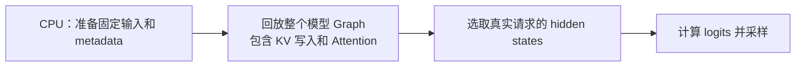
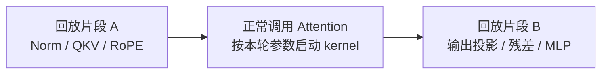
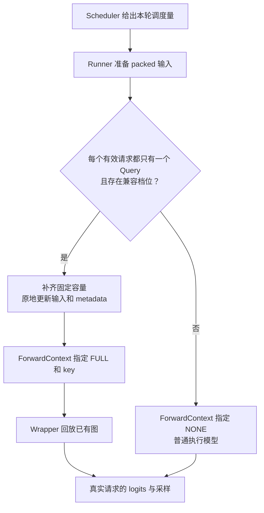

# FA2 连续批处理中的 CUDA Graph

本文按 GPU 的执行过程解释四件事：**捕获的图保存什么、FA2 如何为 packed batch 启动 kernel、单 token decode 为什么容易复用图，以及 FULL 与 PIECEWISE 分别捕获哪里。** 最后把这些概念对应到当前 Runner 的启动和推理流程。

当前项目已经跑通 **FA2 + 连续批处理 + FULL_DECODE_ONLY**：启动时捕获若干个 decode 档位，在线执行时，兼容的单 token decode batch 回放 FULL Graph，prefill 和混合 batch 回退 eager。PIECEWISE 保留了配置名称和 Wrapper 基础接口，模型切分与分段编译执行链尚未接入。

接口细节见 [Dispatcher](CudagraphDispatcher.md)、[Graph Wrapper](CUDAGraphWrapper.md)、[FlashAttention 后端](../attention/flash_attn.md) 和 [GPUModelRunner](../worker/gpu_model_runner.md)。

## 一张捕获的图究竟保存了什么

### 保存 GPU 操作及其依赖，不保存主机程序的重新执行过程

CUDA stream capture 会把捕获范围内提交的 GPU 工作记录为图节点，再由实例化后的图执行这些节点。节点可以是 kernel、内存复制或其他支持捕获的操作；节点之间保存执行依赖。

对于一个 kernel 节点，理解下面这些信息就足够了：

| 保存的信息 | 具体含义 | 在推理中的例子 |
| --- | --- | --- |
| kernel 函数 | 捕获时实际选择的 GPU 函数，包含已经选定的模板特化。 | 某个 dtype、head 维度、mask 和分页路径对应的 FA2 kernel。 |
| grid 和 block | 启动多少个 CTA，以及每个 CTA 使用多少线程。 | Query tile 数、请求数和 head 数决定的 grid。 |
| 动态共享内存大小 | 本次 kernel 启动申请的共享内存字节数。 | FA2 选定 tile 后需要的共享内存。 |
| 参数值 | 传给 kernel 的整数、浮点数、指针，以及参数结构体中的字段值。 | 长度上界、缩放系数、Q/K/V 和 metadata 的设备地址。 |
| 节点依赖 | 哪些操作完成后，哪些操作才能开始。 | KV 写入完成后，Attention 才读取更新后的缓存。 |

**指针值被记录，不代表指针指向的数据被保存成快照。** 同一个地址上的 token、位置、请求长度和分页映射，可以在每次回放前更新；kernel 执行时会读取更新后的内容。

捕获时，Python/C++ 仍会运行，用来选择 kernel、分配临时空间并提交工作。普通回放时不会重新运行这些主机代码，也不会重新执行其 `if`、计算 grid 或查询新的 tensor 形状。


回放重复的是已经确定的 GPU 操作。GPU kernel 内部仍然会执行循环、分支和对设备 metadata 的读取，并非所有动态行为都被禁止。

### 改主机变量，不会改变已经捕获的参数

下面是 CUDA API 示意，假设设备存储、stream 和图句柄已经创建：

```cuda
__global__ void scale(float* values, int count) {
    int index = blockIdx.x * blockDim.x + threadIdx.x;
    if (index < count) {
        values[index] *= 2.0f;
    }
}

int count = 1024;
cudaStreamBeginCapture(stream, cudaStreamCaptureModeGlobal);
scale<<<(count + 255) / 256, 256, 0, stream>>>(values, count);
cudaStreamEndCapture(stream, &graph);
cudaGraphInstantiate(&executable, graph, nullptr, nullptr, 0);

count = 512;
cudaGraphLaunch(executable, stream);
```

回放时依然使用 **`count=1024`、`grid.x=4` 和原来的 `values` 地址**。把主机变量改成 512，没有更新图节点。

CUDA 也提供节点参数更新和整图更新接口。但当前项目的 `CUDAGraphWrapper` 使用的是**缓存多种执行计划，再选择一张图回放**的方式，没有逐节点修改模型的启动参数。

### 把动态值放进固定地址的设备存储

如果 kernel 改为读取设备上的有效长度，就可以在固定容量内处理不同规模的数据：

```cuda
__global__ void scale_with_length(
    float* values, const int* active_count, int capacity) {
    int index = blockIdx.x * blockDim.x + threadIdx.x;
    if (index < capacity && index < *active_count) {
        values[index] *= 2.0f;
    }
}
```

捕获时用固定 `capacity` 计算 grid，并记录 `active_count` 的地址；回放前原地修改该地址中的长度。**容量和启动方案固定，有效范围由 GPU 每次读取。** FA2 的变长边界处理也使用了类似思路。

这解释了模型框架的“形状约束”：CUDA 不认识 PyTorch tensor 的 shape，但 shape 会影响 GEMM 维度、kernel 选择、grid、stride 和分配大小。改变 shape 如果改变了这些执行条件，原图就不能自动适配。

## FA2 怎样处理 packed batch 并设置启动参数

### packed 的是本轮 Query，历史 K/V 通过分页缓存读取

设请求 $i$ 本轮执行 $q_i$ 个 query，请求数为 $R$，packed Query 总行数为：

$$
T = \sum_{i=0}^{R-1} q_i
$$

这里的 query 可以来自整段 prefill、chunked prefill 或 decode。当前后端统一调用 paged varlen FA2，不按这三个标签分别调用不同的 Python Attention 接口。

例如 A 本轮执行 3 个 token，B 执行 1 个 token，C 执行 2 个 token：

| 数据 | 形状或取值 | 含义 |
| --- | --- | --- |
| `q` | `[6, Hq, D]` | A 的 3 行、B 的 1 行、C 的 2 行依次拼接。 |
| `cu_seqlens_q` | `[0, 3, 4, 6]` | 三个请求在 packed Query 中的起止边界。 |
| `max_seqlen_q` | 3 | 单个请求本轮 Query 数的上界，不是总 token 数 6。 |
| `seqused_k` | `[5, 9, 7]` | 每个请求本轮写入后可读取的 KV 长度，包含历史。 |
| `max_seqlen_k` | 普通执行时为 9 | KV 长度上界；捕获时使用覆盖后续回放的上界。 |
| `k` / `v` | `[num_blocks, page_size, Hkv, D]` | 分页 KV cache 视图，没有把所有历史重新拼成连续 K/V。 |
| `block_table` | `[3, max_blocks_per_req]` | 每请求逻辑页到物理页的映射。 |

后端先通过 `reshape_and_cache_flash()` 把本轮新 K/V 写入缓存，再调用 FA2 读取缓存。`slot_mapping` 用于写入；FA2 的读取使用 `block_table` 和 `seqused_k`，两者不要混淆。

### 从 Runner 字段到 C++ 参数

参数流对应以下三个入口：

1. [`GPUModelRunner._build_attention_metadata()`](../../nanovllm/worker/gpu_model_runner.py) 准备固定缓冲区和长度信息。
2. [`FlashAttentionImpl.forward()`](../../nanovllm/attention/backends/flash_attn.py) 把后端 metadata 映射为 FA 参数。
3. [`flash_attn_varlen_func()`](../../nanovllm/nanovllm_flash_attn/flash_attn_interface.py) 调用已安装的 `flash_attn_2_cuda.varlen_fwd()`。

| 后端字段 | FA 参数 | C++ / GPU 中的用途 |
| --- | --- | --- |
| `max_query_len` | `max_seqlen_q` | 主机侧 Query 长度上界，影响分支和 Query tile 数。适配层可能调整这个启动上界。 |
| `query_start_loc` | `cu_seqlens_q` | 保存每请求真实 Query 范围；C++ 记录指针，GPU 读取内容。 |
| `seq_lens` | `seqused_k` | 保存每请求真实 KV 长度；GPU 据此限定访问范围。 |
| `max_seq_len` | `max_seqlen_k` | 主机侧 KV 长度上界，参与执行参数和部分路径的调度选择。 |
| `block_table` | `block_table` | 保存物理页映射；其地址和行 stride 进入 kernel 参数。 |
| `causal` | `causal` | 整批 mask 语义，可能在 C++ 中进一步选择模板分支。 |

普通执行时，C++ 可以针对这一批数据重新做选择。捕获时这些选择也会执行一次；回放时则直接使用选择后的 kernel 节点。

### packed 不等于按总 token 数启动一个一维 grid

FA2 参考源码位于 [`flash-attention/csrc/flash_attn`](https://github.com/Dao-AILab/flash-attention/tree/v2.8.3.post1/csrc/flash_attn)。下面对照 `v2.8.3.post1` 标签的 `mha_varlen_fwd()` 和 `run_flash_splitkv_fwd()` 说明普通 paged、未启用多 split、未做 GQA 重排的路径；其他分支的 grid 需要单独分析。

C++ 首先从 tensor 形状和参数得到：

```cpp
const int batch_size = cu_seqlens_q.numel() - 1;
int num_heads = q.size(1);
const int head_size = q.size(2);

// 省略验证、布局设置和特殊分支。
params.b = batch_size;
params.h = num_heads;
params.seqlen_q = max_seqlen_q;
params.seqlen_k = max_seqlen_k;
```

当前使用分页缓存，FA2 会进入支持 paged KV 的 splitkv kernel 家族。**进入这个 kernel 家族，不等于实际启用了多 split。** 普通未重排的 paged 分支中，当前传入的 `num_splits=0` 不执行多 split 的自动调度；单 token GQA 特殊分支另有处理。

对于这里讨论的未启用多 split 的路径，启动关系是：

```cpp
const int num_m_block =
    (params.seqlen_q + Kernel_traits::kBlockM - 1) / Kernel_traits::kBlockM;

dim3 grid(num_m_block, params.b, params.h);
kernel<<<grid, Kernel_traits::kNThreads, smem_size, stream>>>(params);
```

| 启动维度 | 含义 |
| --- | --- |
| `grid.x` | 一个请求需要覆盖多少个 Query tile，由 Query 长度上界计算。 |
| `grid.y` | 请求槽位数，包含捕获布局中的 padding 槽位。 |
| `grid.z` | Query head 数；发生 GQA 重排时，其含义和数值会随重排变化。 |
| `block` | kernel 特化决定的线程数，不等于本请求的 token 数。 |
| `smem_size` | kernel 特化的共享内存用量，不会在 replay 时重新选择。 |

该版本的 splitkv 路径使用 `kBlockM=64`。对于 `D=128`，这里选择 `kBlockN=128`、4 个 warp，即 `block=128` 个线程；共享内存大小由这一组 kernel traits 确定。`kBlockN` 表示每次处理的 KV tile 宽度，也不等于 KV page 大小。

以 `Hq=16`、未做 GQA 重排为例：

| 每请求 Query 数 | `T` | `R` | `max_seqlen_q` | `grid` |
| --- | --- | --- | --- | --- |
| `[1, 1, 1, 1]` | 4 | 4 | 1 | `(1, 4, 16)`。 |
| `[3, 1, 2]` | 6 | 3 | 3 | `(1, 3, 16)`。 |
| `[1, 225]` | 226 | 2 | 225 | `(4, 2, 16)`。 |
| `[128, 128]` | 256 | 2 | 128 | `(2, 2, 16)`。 |

**总 token 数、请求数和最大 Query 长度影响不同的执行维度。** 总 token 数影响模型投影等操作的行数；Attention 还要按请求和 head 组织任务。因此不能仅凭 packed token 总数判断整张图是否兼容。

### GPU 再从前缀和读取真实边界

每个 CTA 根据请求下标 `bidb` 读取自己的范围。FA2 的 `BlockInfo` 中有如下关系，下面省略不相关分支：

```cpp
sum_s_q = params.cu_seqlens_q[bidb];
actual_seqlen_q = params.cu_seqlens_q[bidb + 1] - sum_s_q;
actual_seqlen_k = params.seqused_k[bidb];
```

kernel 还会跳过不属于真实 Query 范围的 tile：

```cpp
if (m_block * kBlockM >= binfo.actual_seqlen_q) {
    return;
}
```

以 `[1, 225]` 为例，两个请求都被分配了 4 个 Query tile。A 只有 1 个 query，后面三个 tile 可以直接退出；B 执行覆盖 225 个 query 的 tile，最后一个 tile 使用边界判断。

这正是 **主机按上界启动、设备按真实长度执行**。相同 grid 可以容纳多种真实长度分布，但前提是没有跨越捕获时的容量、布局和 kernel 语义约束。

这里的 CTA tile 也不是 KV cache 的物理 page：`kBlockM=64` 描述 Query 分块，`page_size=256` 描述 KV 存储分页，二者解决不同问题。

## 为什么当前只对单 token decode 使用 FULL Graph

### 每请求一个 Query，使布局和执行路径容易固定

普通 decode 的有效请求满足：

$$
q_i = 1, \qquad T_{\mathrm{actual}} = R_{\mathrm{actual}}
$$

请求的历史 KV 长度仍然可以不同，例如 `[128, 42, 7]`。统一的是**本轮每个有效请求的 Query 数**，不是历史上下文长度。

给定一个捕获档位，就能固定模型行数、请求槽位容量、metadata tensor 的形状和 Attention 的 Query 上界。各请求的真实 KV 长度、token 值和物理页映射保留在固定地址的 GPU tensor 中，每轮原地更新。

因此“`max_query_len=1` 容易捕获”描述的是一组容易维持的不变量，**并不是 CUDA 规定只有一个 Query 才能捕获**。即使 Query 数为 1，地址不稳定、布局不兼容或者执行链包含不支持捕获的操作，也不能直接安全回放。

### FA2 的单 token 优化还会改变计算解释

上游 [vLLM 的 FA2 能力声明](https://github.com/vllm-project/vllm/blob/b5adb027ad03c29b46181752ba3b1cb84eff1dd4/vllm/v1/attention/backends/flash_attn.py) 特别指出：按 `max_query_len=1` 捕获的图，不能直接用于混合 prefill/decode，因为 FA2 存在单 token packed-GQA 特殊处理。

GQA 的 Query head 数大于 KV head 数。令分组数 `G=Hq/Hkv`，在满足额外条件时，FA2 会把单 token 的 head 分组重排到类似 Query 维度的位置。例如原本的 `[R, 1, Hq, D]`，按 `[R, G, Hkv, D]` 的方式组织计算，内部 Query 上界变为 `G`、head 数变为 `Hkv`，并不再沿用普通 packed Query 前缀和路径。

这既改变布局解释，也可能引入不同的 split 调度。**捕获的是这个特殊执行方案，而不是一个回放时还会重新识别输入的通用 Attention 函数。** 把混合请求的前缀和写进同一个 tensor，不能让该图自动切回普通 varlen 分支。

另一个例子是因果 mask：没有 ALiBi 时，单个末尾 Query 本来就可以读取所有有效 KV，FA2 可以把这一情况按非 causal 特化执行。多 Query prefill 则需要限制较早 Query 访问本 chunk 的后续 token。若捕获了前一种特化，回放时更新长度也不会自动切换 mask 特化。

因此，本地 vLLM 对 FA2 使用 `AttentionCGSupport.UNIFORM_BATCH`，让普通 decode 使用 FULL，混合阶段通过其他路径处理。这是后端和当前捕获策略的兼容性声明，不是说 FA2 所有 prefill 调用都无法被捕获。

### 本项目还有 `kernel_max_seqlen_q=2` 的适配

阅读本项目时，需要区分三层数值：

| 层次 | 字段 | 含义 |
| --- | --- | --- |
| Runner / metadata | `max_query_len` | 本轮真实 Query 长度上界，普通 decode 为 1。 |
| Python FA2 适配层 | `kernel_max_seqlen_q` | 实际交给扩展的启动上界，部分 decode 布局会从 1 提高到 2。 |
| FA2 C++ 内部 | `params.seqlen_q` | 经过 C++ 特殊分支处理后的内部执行上界。 |

在 [`flash_attn_interface.py`](../../nanovllm/nanovllm_flash_attn/flash_attn_interface.py) 中，当 GQA 单 token 重排可能导致预分配 `out` 发生复制、无法正确写回原 buffer，或 LSE 次序不兼容时，会把扩展的 Query 上界提高到 2，以绕开该优化。

**提高启动上界不会把真实 Query 长度改成 2。** 真实边界仍来自 `cu_seqlens_q`，每请求可以继续只有 1 个 Query。以当前单卡 Qwen3-0.6B 的 `Hq=16、Hkv=8` 为例，多请求且提供预分配输出时会触发这个保护；不能据此认为当前 benchmark 一定执行了 packed-GQA 特殊分支。

项目仍沿用上游的保守能力等级和 decode 捕获计划。绕开一项优化，并不等于已经实现任意混合 batch 的 FULL Graph：还需要验证 Query 容量、请求容量、mask、固定地址、padding 和全部 kernel 参数的兼容性。

<a id="贯穿例子a-结束d-加入仍回放四槽位图"></a>

### 三个请求怎样回放四槽位图

假设捕获尺寸为 `[1, 2, 4, 8]`，A/B/C 三个请求本轮各执行一个 token。Dispatcher 可以选择：

```python
BatchDescriptor(num_tokens=4, num_reqs=4, uniform=True)
```

#### 描述符是执行计划的索引，完整参数保存在图里

**不是从这三个字段就能推导出模型的所有 kernel 参数，而是其他执行条件已经固定，这三个字段用来选择剩下的 batch 布局。** 在当前 Runner 的一个 FULL Wrapper 内，可以把缓存关系理解为：

```python
key = BatchDescriptor(num_tokens=4, num_reqs=4, uniform=True)
entry = wrapper.concrete_cudagraph_entries[key]
# entry.cudagraph 保存启动阶段按这个布局捕获的整张模型图。
```

同一个描述符只在相应 Wrapper 的缓存里查找。Wrapper 绑定的模型、设备、权重、dtype、head 数和 head 维度已经确定；KV 存储、页大小、最大上下文容量以及持久输入 buffer 也在正式捕获前准备好。这些条件无需全部重复放进 key，但不能在使用旧图时任意改变。

当前没有投机解码，`uniform=True` 对应每个有效请求本轮一个 Query。因此，`num_tokens=4` 和 `num_reqs=4` 选择的是“四行模型计算、四槽位 Attention”的捕获布局。**`uniform` 不直接作为 CUDA kernel 参数，也不表示 padding 槽位必须有一个真实 Query**；它用于区分 Dispatcher 的执行计划。

启动捕获与在线执行使用相同的计划约定：

1. 启动时，Dispatcher 给出这个 key，Runner 用 `_dummy_run()` 准备四行、四槽位的固定布局，Wrapper 捕获整张图并缓存到该 key。
2. 在线时，三个请求先匹配到同一个 key，Runner 把它们放进同一组固定 buffer 的前三行，并清理末行和末槽位。
3. `ForwardContext` 携带 `FULL` 和这个 key，Wrapper 找到之前的 `entry`，调用已有图的 `replay()`。

**回放时没有重新计算一组启动参数，再逐项与原图比较的过程。** 它直接使用原图保存的启动参数。Runner 的职责是把本轮输入准备成这些参数能正确处理的布局；只把一个相同的描述符传进去，不能代替这项准备工作。

#### 四槽位计划怎样让模型和 Attention 的参数对上

Runner 把模型输入补到四行，并保持捕获时的设备地址。**当前实现中，padding 请求使用零长度 Query，额外模型行不加入真实 Query 范围。**

| 数据 | 捕获四槽位 decode 图时 | 三个真实请求回放前 |
| --- | --- | --- |
| 模型输入 / 输出行数 | 4。 | 4，末行无效。 |
| `query_start_loc` | `[0, 1, 2, 3, 4]`。 | `[0, 1, 2, 3, 3]`，末槽位 Query 长度为 0。 |
| `seq_lens` | 合法的 dummy 长度。 | `[128, 42, 7, 0]`。 |
| `slot_mapping` | 全为 `-1`，dummy 不写入真实 KV。 | 例如 `[383, 553, 774, -1]`。 |
| `block_table` | 固定四行 buffer。 | 三行真实映射，末行填 `NULL_BLOCK_ID=0`。 |
| metadata 的 `max_query_len` | 1。 | 1。 |
| 图内 KV 长度上界 | `max_model_len`。 | 继续使用捕获时的上界。 |

这些 tensor 的**内容改变，地址不变**。这里的末槽位处理依赖当前变长路径支持零长度 Query，不能直接套用到不读取前缀和的特殊路径。

用当前单卡 Qwen3-0.6B 的 `Hq=16、Hkv=8、D=128` 进一步展开这个例子：

| 执行条件 | 启动捕获时怎样确定 | 三请求回放时为什么仍适用 |
| --- | --- | --- |
| 模型的 token 行数 | `num_tokens=4`，投影等操作按四行捕获。 | 实际仍执行四行，只在后续采样时忽略末行。 |
| FA2 的 `q` 形状 | `[4, 16, 128]`。 | 使用同一固定 buffer 布局，真实 Query 只占前三行。 |
| FA2 的请求数 `params.b` | `cu_seqlens_q` 有 5 项，所以是 4。 | tensor 仍有 5 项；把末项改成 3，不会把其形状改成四项或请求容量改成 3。 |
| FA2 的 Query 启动上界 | metadata 为 1；本例的适配层将扩展上界提高到 2，绕开 GQA 重排。 | 图内继续使用这个上界，三个真实请求均不超过它，末槽位长度为 0。 |
| FA2 的 Query head 数 | 未做 GQA 重排，`params.h=16`。 | 模型 head 配置没有变化。 |
| FA2 的 KV 长度上界 | 捕获时设置为 `max_model_len`。 | 本轮真实长度不超过该容量，kernel 从 `seq_lens` 读取有效范围。 |
| Q/K/V、输出与 metadata 地址 | 捕获节点记录实际使用的设备指针和 stride。 | 原地更新相同存储，不把图切换到新分配的 tensor。 |

在前文分析的 paged、未启用多 split 的路径中，这一组条件得到：

$$
\mathrm{grid}
= \left(\left\lceil\frac{2}{64}\right\rceil,\ 4,\ 16\right)
= (1,\ 4,\ 16)
$$

`block=128` 个线程，共享内存大小和 kernel 特化也已在捕获时选定。回放时仍然启动这组 CTA；每个 CTA 从固定地址读取更新后的 `query_start_loc=[0,1,2,3,3]`，前三个请求的真实 Query 长度为 1，第四个为 0，末槽位的 Query tile 直接退出。

这里同时使用了两种信息：**key 选择容量为四槽的图，设备 metadata 决定四槽中哪些数据有效。** 所以四个真实 decode 请求和三个真实 decode 请求可以共享这个执行计划，而无需为每组请求 ID 或每组历史长度重新捕获。

前三个 slot 分别表示物理 page 1 的 offset 127、page 2 的 offset 41、page 3 的 offset 6，使用 `page_size=256`。末行 `-1` 使 Triton KV 写入跳过 padding token。当前 KV manager 已永久保留 block 0，不会再把它分配给真实请求。

捕获使用 `max_seq_len=max_model_len`，所以后续实际长度从 `[128, 42, 7]` 增长到 `[129, 43, 8]` 时，图内参数不需要改变；kernel 从同一 `seq_lens` 地址读取新的真实范围。在线新建的 Python metadata 对象即使保存当前最大长度 129，也不会替换已有图里的捕获上界。

回放后，Runner 只取真实请求对应的 hidden states 来计算 logits 和采样，dummy 行不会生成一个额外请求的结果。图输出会复用存储，也不能当作每轮独立的历史快照。

### 为什么不能把混合 batch 直接塞进 decode 图

需要区分两种变化：

- **相同请求容量、Query 范围增大。** 例如从 `[1, 1]` 变成 `[1, 225]`，Query tile 数可能从 1 增加到 4；模型输入行数也变化。原图不会自动增加 CTA 或改变投影维度。
- **相同 token 总数、请求组织变化。** 例如四个 decode 请求 `[1, 1, 1, 1]` 与两个请求 `[3, 1]` 都有 4 个 token，但请求槽位、前缀和和 Attention 执行条件不同。只匹配 token 数不足以证明 FULL 图可复用。

即使两种长度恰好落在同一个 tile 上，也不能仅凭 grid 相同判断兼容；kernel 特化、布局解释、mask 和参数结构体还需要一致。

### prefill 也可以专门设计捕获方案

例如反复运行两个请求、每请求 128 个 Query 的固定布局，若输入地址、缓存、mask、临时空间和全部调用均满足捕获条件，就可以专门捕获 prefill 图。

还可以设计更通用的执行方案：固定容量与保守的 Query 上界，用 GPU metadata 表达不同的真实请求边界，并让 kernel 屏蔽多余 tile。这样不一定需要为每一种 Query 长度分布捕获一张图。

代价是更多无效计算、更多档位或更复杂的后端适配与验证。**当前项目尚未提供这套 mixed/prefill FULL 方案，不能只把能力枚举改为 `ALWAYS`，或只把 `max_query_len` 改大，就认为已经支持。**

## FULL 与 PIECEWISE 的区别在捕获边界

### FULL：把模型 forward 中的 Attention 一起捕获

当前 FULL Wrapper 包住整个模型调用。捕获范围包括 embedding、各 Transformer 层中的投影、Norm、RoPE、KV 写入、Attention 和 MLP 等 GPU 操作。



图内 Attention 的主机调度不再逐轮执行，因此其执行方案必须在不同回放之间保持兼容。当前模型 forward 返回 hidden states，后续 `compute_logits()` 和 sampler 位于 Wrapper 外，没有自动进入这张图。

FULL 主要减少 CPU 框架调用、驱动提交以及 kernel 之间因主机提交产生的空隙。模型的数学计算仍然执行；它本身不等于 kernel 融合，也不会消除所有 CPU 数据准备。

### PIECEWISE：绕开动态边界，回放其余计算片段

对于 FA2 的典型分段方案，可以把 Attention 留在 Graph 片段之外，让它每轮重新根据参数选择执行方式；其前后的计算片段分别捕获和回放。



这里的普通 Attention 调用仍然在 GPU 上计算，只是每轮保留其主机调用和 kernel 选择过程。具体切分位置由编译图和切分算子配置决定，KV 写入也可能作为独立切分边界，不是固定按每个 layer 手写两张图。

本地 vLLM 的默认 Attention 算子名称保存在 `CompilationConfig._attention_ops`，`splitting_ops` 决定编译图的切分边界。`split_graph()` 划分图，`wrap_with_cudagraph_if_needed()` 给需要捕获的片段安装 `runtime_mode=PIECEWISE` 的 Wrapper。

| 对比项 | FULL | 典型 Attention 分段 PIECEWISE |
| --- | --- | --- |
| 捕获范围 | 整个模型 forward。 | 可捕获的计算片段。 |
| Attention | 位于图内，使用捕获时的执行方案。 | 留在片段外，每轮按当前参数正常调用。 |
| 主机调用 | 图内逐算子的主机调用被省去。 | 仍需执行片段间控制流、Attention 调用和多次图提交。 |
| 动态请求边界 | 必须被图内 Attention 的执行方案兼容。 | 可以由图外 Attention 处理。 |
| 形状约束 | 模型和 Attention 的布局都需要兼容。 | 各个片段仍需兼容布局与固定地址，并非任意动态形状。 |
| 当前项目 | 已接入 FA2 单 token decode。 | 尚未接入模型切分与分段编译。 |

PIECEWISE 片段如果主要依赖 packed token 行数，Dispatcher 可以让 key 的 `num_reqs=None`，把请求维度交给图外 Attention。这表示片段不按请求数分档，不表示请求数没有影响 Attention，也不表示 GPU 计算不再需要 padding。

### 策略名称和本轮运行模式需要分开

| 配置策略 | 兼容的单 token decode | prefill / 混合 batch | 当前项目状态 |
| --- | --- | --- | --- |
| `NONE` | eager。 | eager。 | 支持；`enforce_eager=True` 会关闭 Graph。 |
| `FULL_DECODE_ONLY` | FULL。 | eager。 | 当前默认策略，已跑通。 |
| `FULL` | FULL。 | 请求 FULL。 | FA2 能力解析会将其降为 `FULL_DECODE_ONLY`。 |
| `PIECEWISE` | PIECEWISE。 | PIECEWISE。 | 当前配置解析明确拒绝。 |
| `FULL_AND_PIECEWISE` | FULL。 | PIECEWISE。 | 当前配置解析明确拒绝，尚待实现。 |

`FULL_DECODE_ONLY` 和 `FULL_AND_PIECEWISE` 是整体策略；真正传入 `ForwardContext` 的本轮模式是 `NONE`、`FULL` 或 `PIECEWISE`。能否选择 FULL，还取决于是否存在兼容的捕获档位。

本地 vLLM 可以让外层 FULL Wrapper 和内部 PIECEWISE Wrapper 共存，通过本轮模式决定谁工作。这里的 Python Wrapper 嵌套，不等于一定使用 CUDA API 的 child graph 节点。

## 什么时候捕获，什么时候回放

### 启动阶段：先稳定资源，再逐档捕获

当前 Worker 与 Runner 的主要顺序为：

1. 加载模型，按配置给模型安装 FULL Wrapper。
2. 进行模型内存 profiling；启用 Graph 时，`profile_cudagraph_memory()` 使用临时 KV 环境估算图内存，随后清理临时图和绑定。
3. 根据正式内存预算分配 KV cache，解析 Attention 能力，初始化 Dispatcher keys 和 metadata Builder。
4. `_compile_or_warm_up_model()` 预热相关 kernel，调用 `capture_model()`，按 Dispatcher 计划预热并捕获各个档位。
5. 关闭新增捕获许可，在线请求使用已经捕获的图或回退 eager。

`_dummy_run()` 准备合法的 dummy 输入和 metadata，`_warmup_and_capture()` 组织预热及捕获调用，真正的 `torch.cuda.graph()` 在 `CUDAGraphWrapper` 内部执行。各模式内按大尺寸到小尺寸捕获，使用共享 Graph pool；pool 是 PyTorch allocator 的分配复用机制，不是 CUDA Runtime 新增的一种图节点。

Wrapper 有“首次匹配 key 时捕获”的通用逻辑，但当前在线路径不应依赖它临时捕获任意新形状：启动阶段已经准备合法档位，新增捕获还受全局许可约束。

### 在线阶段：选择档位、原地更新，再发射



请求加入、结束、重排以及分页映射变化，都发生在执行前的数据准备阶段。只要保持固定地址和执行方案兼容，就不需要因为请求 ID 或上下文长度变化重新捕获。

假设三条 decode 请求使用四槽图，需要四行模型计算；下一轮两条请求通常会选两槽图。这就是 token 数影响选图的原因：**选择的是具有相应模型行数和请求容量的执行计划。** padding 不会把各请求的历史 KV 长度补成一样长，也不会创建一个真实的额外请求。

## 为什么长输入 benchmark 可能几乎没有 Graph 收益

例如活跃上限 32，每请求约 1024 token 输入、64 token 输出，每步 token budget 为 256。连续补充新请求时，很容易形成 31 个 decode token 加 225 个 prefill token 的混合 batch。

当前 `FULL_DECODE_ONLY` 对这一整批回退 eager，所以其中的 decode 请求也没有单独回放 Graph。**成功捕获了多少档位，与在线实际回放多少次，是两种统计。** 日志中的捕获进度 `7/7` 只说明准备了七个执行档位。

以一次实际运行的计数为例：`17029` 个 step、`4343623` 个 scheduled token，平均每步约 `255.07` 个 token，接近 256 的满预算。而在 32 请求上限下，能走 FULL 的单 token batch 最多只有 32 个真实 token。

若所有 step 的调度量均不超过 256，则还可以给出一个覆盖率上界：每个 Graph step 相对于满预算至少少调度 `256-32=224` 个 token；总缺口为 `17029*256-4343623=15801`，所以最多只有 `floor(15801/224)=70` 个 step 可能走 Graph，占比不超过约 `0.41%`。

这是基于预算和计数推导的上界，不是实际 replay 计数。它说明这组负载为何难以体现 decode Graph 的收益；准确分析还应统计 FULL 回放、混合 eager 和纯 prefill 的次数及耗时，并通过时间线检查主机提交与 GPU 执行。

## 源码阅读路径

项目链接指向当前实现；vLLM 参考链接固定到核对过的提交 `b5adb027ad03`，FA2 C++ 参考链接固定到 `v2.8.3.post1` 标签。阅读其他版本时，应重新核对接口与具体分支。

| 阅读目标 | 当前项目 | 参考源码与入口 |
| --- | --- | --- |
| 捕获、图缓存和回放 | [`compilation/cuda_graph.py`](../../nanovllm/compilation/cuda_graph.py)。 | [`vLLM cuda_graph.py`](https://github.com/vllm-project/vllm/blob/b5adb027ad03c29b46181752ba3b1cb84eff1dd4/vllm/compilation/cuda_graph.py)：`CUDAGraphWrapper.__call__()`。 |
| packed 参数和 KV 读写 | [`attention/backends/flash_attn.py`](../../nanovllm/attention/backends/flash_attn.py)。 | [`vLLM flash_attn.py`](https://github.com/vllm-project/vllm/blob/b5adb027ad03c29b46181752ba3b1cb84eff1dd4/vllm/v1/attention/backends/flash_attn.py)：FA2 能力注释、metadata 和 forward。 |
| Python 到 FA2 扩展 | [`nanovllm_flash_attn/flash_attn_interface.py`](../../nanovllm/nanovllm_flash_attn/flash_attn_interface.py)。 | [`FA2 flash_api.cpp`](https://github.com/Dao-AILab/flash-attention/blob/v2.8.3.post1/csrc/flash_attn/flash_api.cpp)：`mha_varlen_fwd()`、`set_params_fprop()`、`run_mha_fwd()`。 |
| grid、tile 和 kernel 启动 | 扩展内部实现。 | [`flash_fwd_launch_template.h`](https://github.com/Dao-AILab/flash-attention/blob/v2.8.3.post1/csrc/flash_attn/src/flash_fwd_launch_template.h)：`run_flash_splitkv_fwd()`、`run_mha_fwd_splitkv_dispatch()`。 |
| 设备上的真实 Query / KV 范围 | 固定的 `query_start_loc` 和 `seq_lens` buffer。 | [`block_info.h`](https://github.com/Dao-AILab/flash-attention/blob/v2.8.3.post1/csrc/flash_attn/src/block_info.h)、[`flash_fwd_kernel.h`](https://github.com/Dao-AILab/flash-attention/blob/v2.8.3.post1/csrc/flash_attn/src/flash_fwd_kernel.h)。 |
| 策略、捕获尺寸和 key | [`config/compilation.py`](../../nanovllm/config/compilation.py)、[`config/vllm.py`](../../nanovllm/config/vllm.py)、[`cudagraph_dispatcher.py`](../../nanovllm/cudagraph_dispatcher.py)。 | [`vLLM compilation.py`](https://github.com/vllm-project/vllm/blob/b5adb027ad03c29b46181752ba3b1cb84eff1dd4/vllm/config/compilation.py)、[`vLLM Dispatcher`](https://github.com/vllm-project/vllm/blob/b5adb027ad03c29b46181752ba3b1cb84eff1dd4/vllm/v1/cudagraph_dispatcher.py)。 |
| 启动捕获和每轮输入准备 | [`worker/gpu_model_runner.py`](../../nanovllm/worker/gpu_model_runner.py)、[`worker/gpu_worker.py`](../../nanovllm/worker/gpu_worker.py)。 | [`vLLM GPUModelRunner`](https://github.com/vllm-project/vllm/blob/b5adb027ad03c29b46181752ba3b1cb84eff1dd4/vllm/v1/worker/gpu_model_runner.py)：`capture_model()`、`_dummy_run()`、`execute_model()`。 |
| PIECEWISE 的切分与包装 | 尚未接入模型编译执行链。 | [`vLLM backends.py`](https://github.com/vllm-project/vllm/blob/b5adb027ad03c29b46181752ba3b1cb84eff1dd4/vllm/compilation/backends.py)：`split_graph()`、`wrap_with_cudagraph_if_needed()`；配置中的 `_attention_ops` 与 `splitting_ops`。 |

本文只讨论普通 decoder 的单卡 FA2 执行链，省略 FA3/FA4、spec decode、LoRA、多模态和多 rank 通信捕获。其他后端支持的 mixed FULL 方案，不能仅通过改一个枚举直接移植到当前路径。
