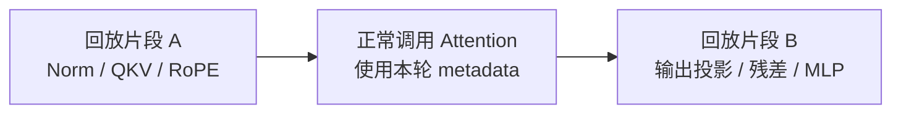
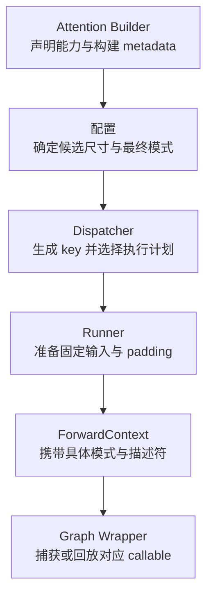
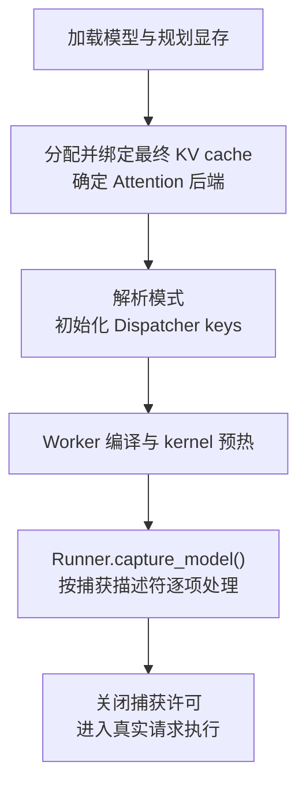
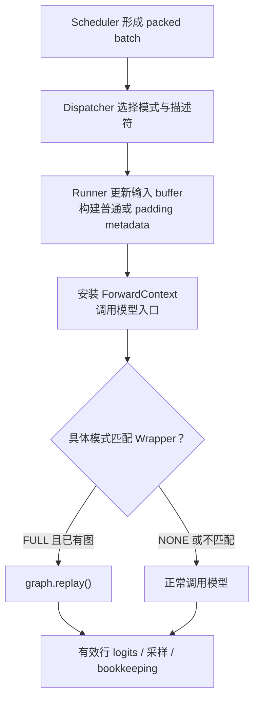

# FA2 连续批处理中的 CUDA Graph

本文从 CUDA Graph API 出发，沿本地 vLLM V1 的配置、捕获和回放路径，解释 nano-vLLM 的 FA2 连续批处理框架应该怎样使用 CUDA Graph。具体 Attention 参数流见 [FlashAttention 后端](../attention/flash_attn.md)，Runner 的输入组织见 [GPUModelRunner](../worker/gpu_model_runner.md)，形状分派的接口与逐步示例见 [Dispatcher](dispatcher.md)，图缓存、输出生命周期和共享池见 [Graph Wrapper](cudagraphwrapper.md)。

**CUDA Graph API 没有“所有张量必须拥有固定形状”这一独立规则。** 在普通回放中，已捕获的 GPU 操作使用捕获时确定的参数和地址；模型框架的张量形状会影响这些参数。vLLM 通过固定 buffer、捕获尺寸分档和 padding，让不断变化的请求复用兼容的执行计划。

**当前项目完成了配置、上下文、Dispatcher 和 FA2 后端的基础接口，新的 `GPUModelRunner` 尚未接通实际捕获与回放。** 下文先说明参考 vLLM 的目标流程，末尾逐项列出当前状态。`PIECEWISE` 会一起介绍，但其编译与执行链尚未实现。

## 从 CUDA Graph API 看“形状约束”

### 捕获的是 GPU 工作，不是 Python 函数

你熟悉的 `cudaStreamBeginCapture()`、`cudaStreamEndCapture()`、`cudaGraphInstantiate()` 和 `cudaGraphLaunch()`，分别对应记录工作、结束记录、实例化和提交执行。捕获 stream 上的 GPU 工作被记录为图节点，普通回放不会重新运行当初提交它们的主机代码。参见 [NVIDIA CUDA Graph 编程指南](https://docs.nvidia.com/cuda/cuda-programming-guide/04-special-topics/cuda-graphs.html)。

以一个 CUDA kernel 为例：

```cuda
__global__ void scale(float* values, int count) {
    int index = blockIdx.x * blockDim.x + threadIdx.x;
    if (index < count) {
        values[index] *= 2.0f;
    }
}

// 假设 stream、values、graph 和 executable 已声明，values 的存储已分配。
int count = 1024;
cudaStreamBeginCapture(stream, cudaStreamCaptureModeGlobal);
scale<<<(count + 255) / 256, 256, 0, stream>>>(values, count);
cudaStreamEndCapture(stream, &graph);
cudaGraphInstantiate(&executable, graph, nullptr, nullptr, 0);

count = 512;  // 只修改主机变量，不会修改已经捕获的 kernel 参数或 grid。
cudaGraphLaunch(executable, stream);
```

这里没有 tensor，也没有显式的 shape 检查，但已捕获的节点仍然使用原来的 `count=1024`、grid、block 和设备地址。如果你之前一直复用相同配置和设备存储，约束已经被满足，只是没有以“张量形状”的形式出现。

推理框架中的操作可能对应多次 kernel 提交或库调用。`hidden_states` 从 `[4, H]` 改成 `[8, H]`，可能改变 GEMM 的维度参数、选出的实现、临时内存大小或后续 kernel 的 grid。`graph.replay()` 不会自动重新执行 `torch.matmul()` 来发现这种变化。

### 固定地址中的数据可以改变

若把有效长度放进设备内存，kernel 可以在每次执行时读取新值：

```cuda
__global__ void scale_with_device_count(
    float* values, const int* active_count, int capacity) {
    int index = blockIdx.x * blockDim.x + threadIdx.x;
    if (index < capacity && index < *active_count) {
        values[index] *= 2.0f;
    }
}
```

以固定容量计算 grid，捕获时传入固定的 `values` 和 `active_count` 地址；回放前更新设备上的有效长度，就可以让相同节点处理不同数量的数据。这是一个自定义 kernel 的设计示例，不是当前模型的实际实现。

FA2 与 Triton KV 写入也使用这个思路：固定形状的 `seq_lens`、`block_table` 和 `slot_mapping` tensor 可以保存每轮不同的内容。是否允许某项动态变化，要看 kernel 是否从设备内存读取它，以及捕获时选择的执行路径能否覆盖这些值。

### CUDA 也允许更新节点，但 vLLM 这里采用缓存计划

CUDA 提供 `cudaGraphExecKernelNodeSetParams()` 和整图更新等机制，可以在满足更新约束时调整已实例化图的参数。因而“捕获后参数永远不能改”也不准确。参见 [NVIDIA 动态参数 CUDA Graph 示例](https://developer.nvidia.com/blog/constructing-cuda-graphs-with-dynamic-parameters/)。

本文讨论的 vLLM `CUDAGraphWrapper` 路径采用另一种策略：**预先捕获一组兼容的执行形状，推理时选中其中一张图，更新其输入 buffer，再回放。** 它不逐个修改模型中所有 CUDA 节点来适配任意新 shape。

## 连续批处理里有哪些“大小”

连续批处理允许请求逐轮加入、结束、抢占和重新排列；packed token 则把各请求本轮要计算的 query token 拼成一个输入。

设第 $i$ 个请求本轮计算 $q_i$ 个 token，则有效 packed token 数为：

$$
T_{\mathrm{actual}} = \sum_{i=0}^{R_{\mathrm{actual}}-1} q_i
$$

| 数量 | 含义 | 对 Graph 的影响 |
| --- | --- | --- |
| `T_actual` | Scheduler 本轮实际调度的 token 总数。 | 用于选择捕获尺寸，决定哪些结果有效。 |
| `T_padded` | 选中的执行计划包含的 token 行数。 | 模型的输入、中间计算和输出按这个尺寸执行。 |
| `R_actual` | 本轮实际参与执行的请求数。 | 用于准备请求映射及有效 metadata。 |
| `R_padded` | Graph 对应的请求槽位数。 | 决定 `seq_lens`、请求边界和 block table 的执行形状。 |
| `seq_lens[i]` | 第 $i$ 个请求包含本轮新增 token 后的总 KV 长度。 | 保存为 GPU tensor 的内容；不等于本轮 query 数。 |
| `max_query_len` / `max_seq_len` | 传给 Attention 的 Python 长度上界。 | 在捕获过程中影响 kernel 执行参数，普通回放不会重新选择它们。 |

**普通单 token decode 满足每个有效请求的 `q_i=1`，所以 `T_actual=R_actual`。** 这不要求各请求拥有相同的历史上下文长度。

例如 query 长度 `[1, 1, 1]`、总 KV 长度 `[128, 42, 7]` 是 uniform decode。query 长度 `[3, 1, 2]` 则是非 uniform 的 packed batch，即使总 token 数也恰好等于某个捕获尺寸，也不能直接拿纯 decode 的 FA2 图来执行。

## 为什么需要尺寸分档和 padding

### 每个分档对应一套执行形状

假设配置的捕获尺寸为 `[1, 2, 4, 8]`，普通单 token decode 可以按下表选择：

| 本轮有效请求数 / token 数 | 选择的执行尺寸 | padding 行数 |
| --- | --- | --- |
| 1 | 1 | 0 |
| 2 | 2 | 0 |
| 3 | 4 | 1 |
| 4 | 4 | 0 |
| 5～8 | 8 | 3～0 |
| 大于 8 | 无匹配计划，普通执行 | 不为此强行捕获新图 |

padding 使三个请求可以使用四行的执行计划。它不要求把每个请求的历史 KV 长度都补成相同长度，也不意味着给 Scheduler 创建一个真实的新请求。

默认候选尺寸由 [`NanovllmConfig._set_cudagraph_sizes()`](../../nanovllm/config/vllm.py) 推导：当前候选上限为 `min(max_num_seqs * 2, 512)`，再受 token 预算限制；小尺寸使用 `1、2、4`，随后按 8 和 16 的步长生成。实际最大值以最终列表为准。

候选尺寸列表还不是已捕获图的列表。上游 Dispatcher 在 `FULL_DECODE_ONLY` 下还会筛选 decode 可用的描述符；普通 decode 的请求数不能超过 `max_num_seqs`。

### 形状相同还不够，地址和执行路径也要兼容

| 条件 | 需要保持什么 | 每轮可以改变什么 |
| --- | --- | --- |
| 张量布局 | 捕获计划对应的维度、dtype、stride 和读取范围。 | 兼容布局下的 token、position、长度和分页映射内容。 |
| 设备地址 | 节点实际访问的输入、KV cache、输出和临时存储地址。 | 在这些地址上的数据内容。 |
| Attention 调度 | 捕获时选出的 kernel 路径和长度上界等主机参数。 | kernel 支持范围内的 GPU metadata 值。 |
| 操作依赖 | 输入更新先于回放，KV 写入先于 Attention 读取。 | 各请求映射到的有效物理 slot。 |

例如 `buffer[:4]` 可以每轮创建新的 Python view 对象，只要它仍指向捕获时使用的同一段存储，并满足相同的布局约束。反之，重新分配一个同形状 tensor，仅把新 tensor 传给 wrapper，不能让旧 Graph 自动转向新地址。

vLLM 的 Wrapper 本身不把运行时输入复制到固定 buffer。这个工作由 Runner 及对应执行链负责。KV cache 的物理页池也应在捕获前确定；请求的 block table 内容可以变化，捕获引用的缓存存储应保持有效。

## FA2 的 FULL 与 PIECEWISE 有什么区别

### FULL：捕获整个模型 forward

`FULL` 包含模型 forward 内的 embedding、各层计算、KV 写入和 Attention 等 GPU 工作。当前模型的 forward 返回 hidden states，Runner 后续的 logits 计算和采样不因包装模型而自动进入这张图。


CPU 在回放前准备数据，回放时提交整张模型图；每层的 Python `forward()` 不再逐层重新执行。图中的 kernel 仍然执行完整的 GPU 计算，CUDA Graph 主要减少主机提交和框架调用开销。

### FA2 为什么先采用 FULL_DECODE_ONLY

上游 [`FlashAttentionMetadataBuilder`](../../../vllm/vllm/v1/attention/backends/flash_attn.py) 对 FA2 使用 `AttentionCGSupport.UNIFORM_BATCH`。其单 token query 情况有 packed-GQA 专用路径，按 decode 捕获的图不能直接复用于混合 prefill/decode。

我们的 [`FlashAttentionMetadataBuilder`](../../nanovllm/attention/backends/flash_attn.py) 沿用这个能力等级，只支持 CUDA FA2。FA3 的 `ALWAYS`、AOT scheduler、固定 `scheduler_metadata` buffer 和相关 split 控制不在当前实现范围内。

| 配置策略 | 纯单 token decode | prefill / 混合 batch | 当前项目状态 |
| --- | --- | --- | --- |
| `NONE` | 普通执行。 | 普通执行。 | 当前 Runner 实际使用这条路径。 |
| `FULL` | 请求完整捕获。 | 也请求完整捕获。 | 当前配置解析遇到 FA2 能力会降为 `FULL_DECODE_ONLY`。 |
| `FULL_DECODE_ONLY` | 选择兼容的 `FULL` 图。 | 普通执行。 | 当前首个接入目标；默认配置策略。 |
| `PIECEWISE` | 回放可捕获的计算片段。 | 回放可捕获的计算片段。 | 编译与执行链尚未实现。 |
| `FULL_AND_PIECEWISE` | 使用 `FULL`。 | 使用 `PIECEWISE`。 | 后续目标。 |

表中的策略是配置意图，不保证每轮都能命中捕获图。例如 decode 的有效 token 数超过捕获范围时，仍需要普通执行。

### PIECEWISE：切分计算图，分别处理 Attention 边界

以一个简化的 Transformer 层为例，vLLM 默认以 Attention 等注册算子作为切分边界：



这个图展示默认分段路径的概念，具体切分位置由编译器和 `splitting_ops` 决定，不是为每个 layer 手写一张图。Attention 留在片段之外时，每轮仍会执行它的主机调用；其他片段通过 Graph 回放减少逐个 kernel 提交。

上游 `CompilationConfig._attention_ops` 保存注册到 PyTorch 的算子限定名称，例如 `vllm::unified_attention_with_output`。编译后端据此确定切分边界，为普通计算片段构建可运行函数，再包装 `runtime_mode=PIECEWISE` 的 Graph Wrapper。

`PIECEWISE` 仍有形状和地址约束，只是 Attention 的请求维度和动态执行路径可以留在 Graph 之外处理。上游 Dispatcher 对 PIECEWISE key 放宽为 `num_reqs=None、uniform=False`，因为这些片段主要依赖 packed token 维度；这不表示所有张量都变成任意动态形状。

还要区分 **编译器切图** 与 **CUDA Graph 的运行模式**。vLLM 即使保留了分段 FX 图结构，也可以从外层用 FULL Wrapper 捕获整个模型。外层 FULL 与内层 PIECEWISE Wrapper 根据 `ForwardContext.cudagraph_runtime_mode` 决定是否工作，不匹配时直接调用原函数。

这些 Python Wrapper 的嵌套不是要求使用 CUDA API 的 child graph 节点。当前项目先完成整模型 FULL，再接入 Attention custom op、图切分和分段编译。

## 从源码看对象如何分工



配置决定策略和候选计划，Dispatcher 决定某一轮使用哪套计划，Runner 把输入准备成该计划要求的布局。上下文传递结果，Wrapper 根据模式和 key 访问缓存的图。Builder 本身不创建 CUDA Graph。

| 对象 / 接口 | 输入 | 输出或状态变化 |
| --- | --- | --- |
| `_set_cudagraph_sizes()` | 用户配置、Scheduler 请求上限和 token 预算。 | 写入规范化尺寸列表及实际最大捕获尺寸。 |
| `post_init_cudagraph_sizes()` | 已解析的捕获尺寸。 | 排序并检查最大尺寸一致性。 |
| `get_cudagraph_support()` | 模型配置与 KV cache 规格。 | 返回后端的完整捕获能力。 |
| `resolve_cudagraph_mode_and_sizes()` | 所有 AttentionGroup 的最低能力及配置策略。 | 回写最终可用策略；当前单 token decode 路径不调整尺寸。 |
| `initialize_cudagraph_keys()` | 最终策略和候选尺寸。 | 生成可用 key；这里尚未创建 CUDA 图。 |
| `dispatch()` | 本轮有效 token 数、是否 uniform decode 等条件。 | 返回具体运行模式和 padding 后的 `BatchDescriptor`。 |
| `build_for_cudagraph_capture()` | 捕获用公共 metadata。 | FA2 默认调用普通 `build()`，保留 tensor 引用。 |
| `set_forward_context()` | 本轮 metadata、具体模式、描述符与 slot mapping。 | 在模型调用作用域内安装上下文，退出时恢复。 |
| `CUDAGraphWrapper.__call__()` | 被包装函数的参数与活动上下文。 | 普通调用、创建捕获条目，或回放已有图并返回输出访问入口。 |

`BatchDescriptor(num_tokens=4, num_reqs=4, uniform=True)` 描述四个请求槽位的 uniform 执行形状。它不保存请求 ID 或上下文长度。`FULL_DECODE_ONLY` 是组合配置策略；实际传进 `ForwardContext` 的模式应是已经选出的 `FULL` 或 `NONE`。

## 什么时候捕获：启动时准备，不用真实请求逐张试

### vLLM 的启动路径

捕获前应已绑定最终模型权重和 KV cache 存储，并完成 Attention 后端能力解析。随后 Worker 进入编译、kernel 预热和模型捕获阶段。



模型 profiling 可以出现在缓存预算规划阶段，用于估计计算峰值；它不是已经捕获好图的证明。正式捕获需要基于最终绑定的存储进行。

上游的重要调用关系是：

- `GPUWorker.compile_or_warm_up_model()`：完成额外编译预热与 `kernel_warmup()`，随后调用 Runner 的 `capture_model()`。
- `GPUModelRunner.capture_model()`：开启捕获许可，进入 `graph_capture()` 的 stream/通信环境，读取 Dispatcher 的捕获描述符。
- `_capture_cudagraphs()`：遍历描述符，调用 `_warmup_and_capture()`。上游每种模式内按尺寸从大到小处理，便于较小计划复用图内存池。
- `_warmup_and_capture()`：先以 `cudagraph_runtime_mode=NONE` 执行若干次 `_dummy_run()`，再用目标模式执行一次捕获用 dummy 调用。
- `CUDAGraphWrapper.__call__()`：发现对应条目尚无图且当前允许捕获时，进入 `torch.cuda.graph()`，调用被包装的函数以记录 GPU 操作，缓存图及输出信息。

`FULL` 的预热要实际执行 Attention。上游通过 `force_attention=True`，防止模式为 NONE 的 warmup 只走 Attention profiling 占位路径而漏掉 FA 初始化。

### 为什么 capture 前还要 warmup

- 首次调用可能触发 `torch.compile`、Triton JIT、动态库加载或库实现选择，应先在 capture 外完成这些初始化。
- 预热要覆盖正式捕获使用的形状、dtype、stride 和 Attention 分支；只预热另一种形状不一定足够。
- Graph 可能需要长期保留中间存储。捕获尺寸越多，启动耗时和显存开销通常越大，因此尺寸分档也在控制资源成本。

capture 期间主机仍会执行模型的 Python 调用来生成 GPU 工作，但被捕获 stream 上的工作是在构建图节点，不能将其视为完成了一轮真实请求计算。dummy 输入用于描述执行计划，不应推进 Scheduler 请求进度或生成真实输出 token。

上游 `_dummy_run()` 将 slot mapping 填为 `-1`，让缓存写入 kernel 跳过真实 KV 写入。临时 metadata 和输入准备仍要参与 stream 依赖及 pinned buffer 的复用协议。

### 捕获时要给 FA2 足够的调度上界

捕获纯 decode 时，`max_query_len=1`；历史长度通过 `seq_lens` 动态变化。捕获时的 `max_seq_len` 则应覆盖计划回放的长度范围。

上游 `_build_attention_metadata(for_cudagraph_capture=True)` 使用 `self.max_model_len` 作为 `max_seq_len`。这与“dummy 请求实际只需要很短的 KV”并不冲突：前者为捕获时的 kernel 路径提供上界，后者是 tensor 中当前实际读取的长度。

当前 FA2 适配层针对部分 GQA 输出布局会将传给扩展的 query 长度上界提升到 2，以保持预分配输出的正确写入；真实 query 边界仍由 `query_start_loc` 决定。这是 [`flash_attn_interface.py`](../../nanovllm/nanovllm_flash_attn/flash_attn_interface.py) 的 ABI 适配，不代表请求本轮生成两个 token。

### 不在在线请求里随意补捕获

Wrapper 的通用实现有“条目尚无图就捕获”的分支，但还会调用捕获许可检查。上游 `capture_model()` 完成后关闭许可，意外的在线捕获会报错；不能把缺少捕获条目理解为线上自动新建图的常规机制。

**候选尺寸、可用 key、已捕获图是三个阶段。** Dispatcher 选择 key 并不执行捕获；启动捕获流程才为相应 Wrapper 建立真正的条目。

## 什么时候发射：每轮选计划、更新输入、回放

### 正常推理路径



vLLM 的 `_determine_batch_execution_and_padding()` 先判断本轮是否 uniform decode，再调用 Dispatcher。Runner 把描述符要求的 `num_tokens_padded`、`num_reqs_padded` 用于输入及 Attention metadata，随后通过 `set_forward_context()` 传递具体模式与 key。

在普通 CUDA API 中，这一步对应 `cudaGraphLaunch()`；PyTorch 用 `CUDAGraph.replay()` 暴露提交入口。它是 GPU 工作提交，不代表 CPU 已等待全部计算完成；后续计算依赖要通过同一 stream 顺序或明确的同步关系维护。

输入 tensor 的 GPU 内容应在回放读取前更新完成。把 CPU 数组改成新值不等于 GPU buffer 已更新；异步 H2D 复制及 pinned CPU 存储复用都需要正确的生命周期和依赖关系。

## 贯穿例子：A 结束，D 加入，仍回放四槽位图

以下是按 vLLM 输入准备方式组织的**目标执行示例**，不表示当前 nano-vLLM Runner 已实现这一过程。设模型 hidden size 为 32、4 个 Query heads、2 个 KV heads、head size 为 8，page 大小为 256。

假设捕获列表为 `[1, 2, 4, 8]`，请求容量至少为 8，KV 页池有 16 个 page；本轮三个有效请求选择四槽位图。

### 本轮 A、B、C 各计算一个 token

| 请求 | token ID | 本轮 position | 执行后总 KV 长度 | 当前物理 page | 本轮写入 slot |
| --- | --- | --- | --- | --- | --- |
| A | 15 | 127 | 128 | 1 | `1 * 256 + 127 = 383` |
| B | 25 | 41 | 42 | 2 | `2 * 256 + 41 = 553` |
| C | 32 | 6 | 7 | 3 | `3 * 256 + 6 = 774` |

这时 `T_actual=3、R_actual=3`，选择的描述符为 `BatchDescriptor(num_tokens=4, num_reqs=4, uniform=True)`。

| 数据 | 执行视图形状 | 本轮内容或含义 |
| --- | --- | --- |
| `input_ids` | `[4]` | `[15, 25, 32, 0]`；最后一行不对应真实请求。 |
| `positions` | `[4]` | `[127, 41, 6, 0]`。 |
| `query_start_loc` | `[5]` | `[0, 1, 2, 3, 3]`；padding 请求的 query 长度为 0。 |
| `seq_lens` | `[4]` | `[128, 42, 7, 0]`。 |
| `block_table` | `[4, W]` | 前三行包含 A/B/C 的分页映射；padding 行使用合法的空映射约定。 |
| `slot_mapping` | `[4]` | `[383, 553, 774, -1]`。 |
| `query` | `[4, 4, 8]` | 模型按四行计算；最后一行的结果不提交给真实请求。 |
| 单层 `kv_cache` | `[16, 2, 256, 2, 8]` | 整个物理页池保持固定存储，K/V 共用一个 tensor。 |
| `hidden_states` | `[4, 32]` | 模型返回四行；只有前三行属于实际请求。 |

`W` 是固定的 block table 列宽。表格展示本次 Graph 使用的视图，不要求底层输入存储也只分配四行；Runner 可以从更大的固定 buffer 取这个前缀。

这里的 `num_actual_tokens` 在 Attention 公共 metadata 中可以是 `T_padded=4`，名称不能机械理解为三个有效 Scheduler token。上游在 `_build_attention_metadata()` 中使用 padded token 数创建它，而 `query_start_loc` 仍表达实际 query 分段。

**两种 padding 表达要分清：** 上游 Runner 填充前缀和尾部时重复最后一个有效边界，因此本例是 `[0, 1, 2, 3, 3]`。当前项目后端的独立测试还构造过 `[0, 1, 2, 3, 4]`，表示显式的单 query dummy 槽位。二者描述的 dummy query 数不同，不能当成同一份 metadata；接入 Runner 时应选定与实际 kernel 和捕获方案一致的约定，并验证真实回放。

### KV 写入和 Attention 都使用更新后的映射

Graph 内每层仍先执行 `do_kv_cache_update()`，再执行 Attention：

- Triton 从固定地址的 `slot_mapping` 读取 `383、553、774、-1`，把前三行 K/V 写进各自物理页，跳过负 slot。
- FA2 从固定地址的 `seq_lens` 和 `block_table` 读取本轮长度、分页映射，用本轮 Query 访问包含历史和新增 token 的 KV。
- padding 的 token 行可以参与部分模型计算，但不会成为真实 KV 写入或真实采样结果。其 metadata 必须保证读写合法。

这是动态请求数据驱动固定 GPU 执行计划，不是每轮重新捕获 Attention。

### 下一轮请求变成 B、C、D

假设 A 结束，D 已完成 prefill 并进入 decode。Runner 重新排列实际请求，原地更新四行 buffer：

| 数据 | 上一轮 | 下一轮 |
| --- | --- | --- |
| 有效请求顺序 | A、B、C | B、C、D |
| `input_ids` | `[15, 25, 32, 0]` | `[26, 33, 40, 0]` |
| `positions` | `[127, 41, 6, 0]` | `[42, 7, 3, 0]` |
| `seq_lens` | `[128, 42, 7, 0]` | `[43, 8, 4, 0]` |
| `slot_mapping` | `[383, 553, 774, -1]` | `[554, 775, 1027, -1]` |
| block table 有效首列 | `[1, 2, 3]` | `[2, 3, 4]` |
| Graph key | 四槽位 uniform decode | 同一个 key |

D 的当前 token 写在物理 page 4、offset 3，slot 为 `4 * 256 + 3 = 1027`。请求 ID 和分页映射变了，但缓存页池地址、执行形状和捕获的 GPU 操作保持兼容，所以可以回放同一张图。

如果下一轮只有 B、C 两个请求，按 `[1, 2, 4, 8]` 的最小兼容分档规则通常选择两槽位图。如果新增请求带来多 token prefill，当前 `FULL_DECODE_ONLY` 策略选择普通执行；总 token 数刚好等于 4 也不能改变 FA2 的执行路径约束。

### 回放后的采样仍按实际请求处理

本轮实际的 `logits_indices=[0, 1, 2]` 从 `[4, 32]` 的 hidden states 中选出三行，再得到三行词表 logits。dummy 行不能写回某个真实 Request。

Graph 输出通常复用固定存储，下一次回放可能覆盖其内容。需要长期保留结果时，应在相应依赖完成后复制或消费它，不能把同一输出 tensor 的引用当作每轮独立的历史快照。

## 源码阅读路径

以下 vLLM 链接指向与本项目同级的参考 checkout：`/home/huangxy/Projects/vllm`。方法名比固定行号更适合跟随源码变化。

| 阅读目标 | vLLM 文件和重要入口 |
| --- | --- |
| 尺寸如何推导 | [`vllm/config/vllm.py`](../../../vllm/vllm/config/vllm.py)：`_set_cudagraph_sizes()`。 |
| 后端能力如何改变策略 | [`vllm/config/compilation.py`](../../../vllm/vllm/config/compilation.py)：`CUDAGraphMode`、`post_init_cudagraph_sizes()`、`resolve_cudagraph_mode_and_sizes()`。 |
| Graph key 如何生成和匹配 | [`vllm/v1/cudagraph_dispatcher.py`](../../../vllm/vllm/v1/cudagraph_dispatcher.py)：`initialize_cudagraph_keys()`、`dispatch()`、`get_capture_descs()`。 |
| 捕获与回放的具体边界 | [`vllm/compilation/cuda_graph.py`](../../../vllm/vllm/compilation/cuda_graph.py)：`CUDAGraphWrapper.__call__()`。 |
| 启动和每轮推理怎样衔接 | [`vllm/v1/worker/gpu_model_runner.py`](../../../vllm/vllm/v1/worker/gpu_model_runner.py)：`_check_and_update_cudagraph_mode()`、`_determine_batch_execution_and_padding()`、`_build_attention_metadata()`、`_dummy_run()`、`capture_model()`、`_warmup_and_capture()`。 |
| 谁触发启动预热 | [`vllm/v1/worker/gpu_worker.py`](../../../vllm/vllm/v1/worker/gpu_worker.py)：`compile_or_warm_up_model()`。 |
| 上下文怎样传递模式与 key | [`vllm/forward_context.py`](../../../vllm/vllm/forward_context.py)：`BatchDescriptor`、`ForwardContext`、`set_forward_context()`。 |
| Attention 的能力和捕获 metadata | [`vllm/v1/attention/backend.py`](../../../vllm/vllm/v1/attention/backend.py) 与 [`flash_attn.py`](../../../vllm/vllm/v1/attention/backends/flash_attn.py)：`AttentionCGSupport`、Builder 的两个 Graph 入口及 FA2 能力分支。 |
| PIECEWISE 如何切分与包装 | [`vllm/compilation/backends.py`](../../../vllm/vllm/compilation/backends.py)：`split_graph()`、`wrap_with_cudagraph_if_needed()`；配置中的 `_attention_ops` 提供默认切分算子名称。 |
| 捕获 stream 和许可 | [`vllm/distributed/parallel_state.py`](../../../vllm/vllm/distributed/parallel_state.py)：`graph_capture()`；[`vllm/compilation/monitor.py`](../../../vllm/vllm/compilation/monitor.py)：捕获许可检查。 |

本文省略 FA3/FA4、spec decode、LoRA、DCP/DP、Mamba 和多模态等分支。普通 TP 配置已经存在，但多 rank Graph 捕获还需要相应的通信环境与顺序保证，不能由一个能力枚举替代。

## 当前完成度与接入顺序

以下状态针对新的 `nanovllm/worker/gpu_model_runner.py` 执行链，不把配置意图当作已启用的运行行为。

| 部分 | 当前状态 |
| --- | --- |
| [`config/compilation.py`](../../nanovllm/config/compilation.py)、[`config/vllm.py`](../../nanovllm/config/vllm.py) | 已有模式枚举、尺寸初始化和基本后端能力解析；缺省策略为 `FULL_DECODE_ONLY`。 |
| [`forward_context.py`](../../nanovllm/forward_context.py) | 已有不可变描述符、具体模式校验、模式与 key 传递，以及嵌套和异常恢复。 |
| [`attention/backend.py`](../../nanovllm/attention/backend.py) | 已有能力枚举、查询接口和捕获 metadata 默认入口。 |
| [`attention/backends/flash_attn.py`](../../nanovllm/attention/backends/flash_attn.py) | 已声明 FA2 `UNIFORM_BATCH`，普通与捕获构建共享 tensor 引用；KV 写入使用 Triton。 |
| [`Dispatcher`](../../nanovllm/cudagraph_dispatcher.py) | 已实现合法 key 生成、padding 尺寸分派和捕获计划；Runner 尚未接入。详见 [接口与示例](dispatcher.md)。 |
| [Graph Wrapper](cudagraphwrapper.md)、捕获许可和分布式捕获上下文 | 基础接口已实现，包含图缓存、共享 pool、输出弱别名与 capture/replay；尚未接入新 Runner。 |
| [`GPUModelRunner`](../../nanovllm/worker/gpu_model_runner.py) | `_dummy_run()`、`profile_run()`、`capture_model()` 仍为未实现入口；当前 `execute_model()` 没有传 Graph 模式和描述符，使用默认 NONE。 |
| [`GPUWorker`](../../nanovllm/worker/gpu_worker.py) 与平台 | 启动预热入口尚未执行捕获；平台的 `support_static_graph_mode()` 当前仍返回 False。 |

接入 FULL 时，先在 Runner 中接入 Dispatcher、已有 Wrapper 和捕获环境，再实现合法 dummy 输入、启动预热与捕获，最后让真实 `execute_model()` 使用选出的模式、padding 形状和固定 buffer。

padding 的空 block 表还需要明确约定。上游使用 `NULL_BLOCK_ID`；当前项目的 KV 管理器可以分配物理 block 0，不能未经处理就把 0 当作永不属于真实请求的保留空页。选择占位布局时，应同时检查 block 分配和 kernel 的读取约束。

FULL_DECODE_ONLY 跑通之后，再接入注册的 Attention custom op、编译图切分和 PIECEWISE Wrapper，使 `FULL_AND_PIECEWISE` 成为实际可执行的策略。这个过程保留连续批处理：动态的是请求和 buffer 内容，复用的是已经验证兼容的 GPU 执行计划。
