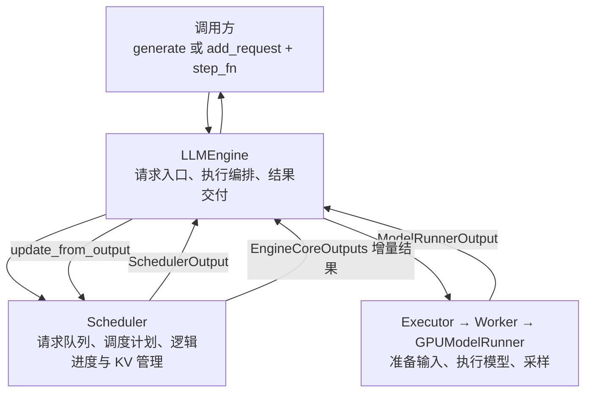
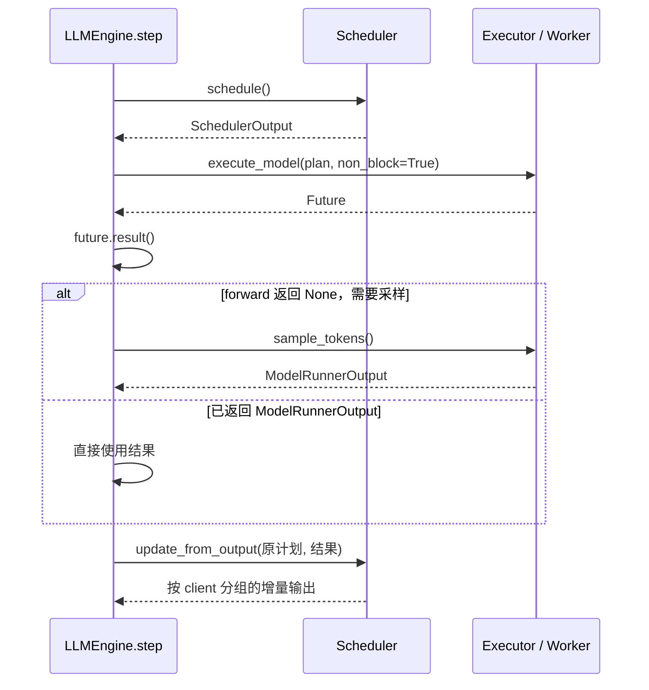
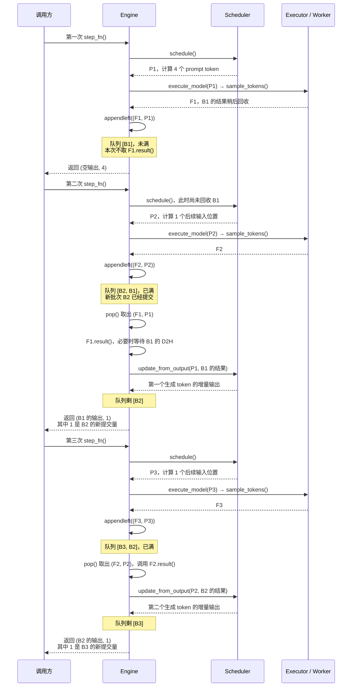
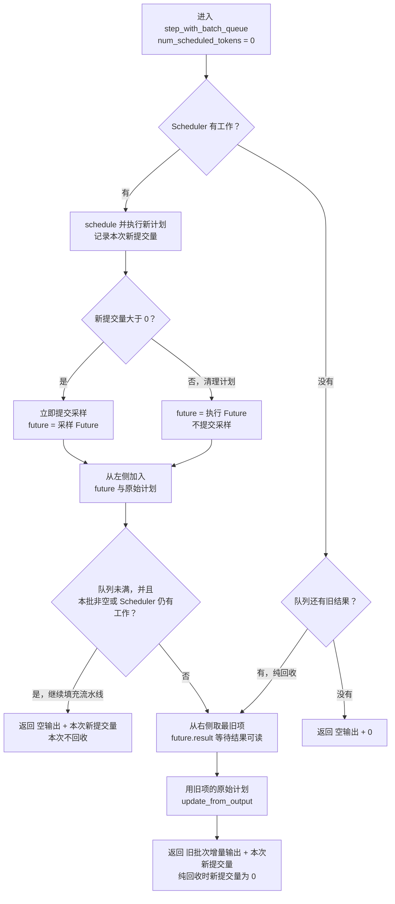
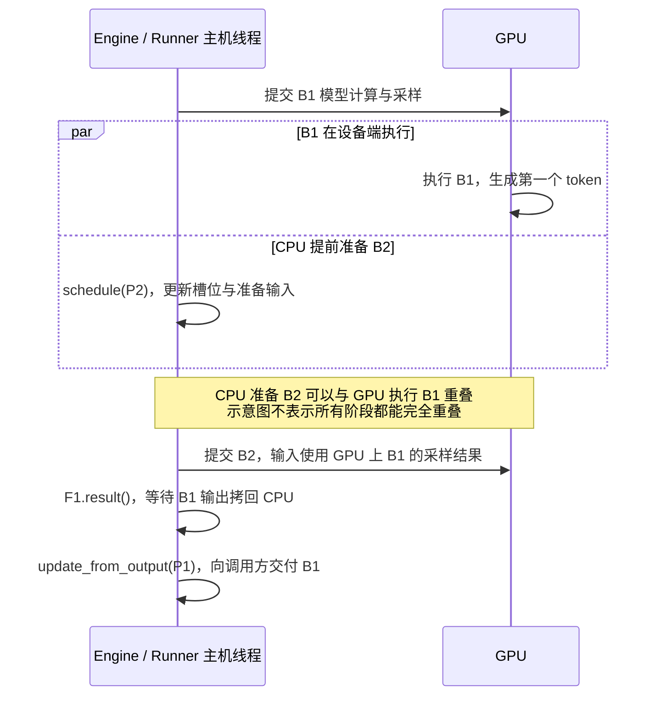
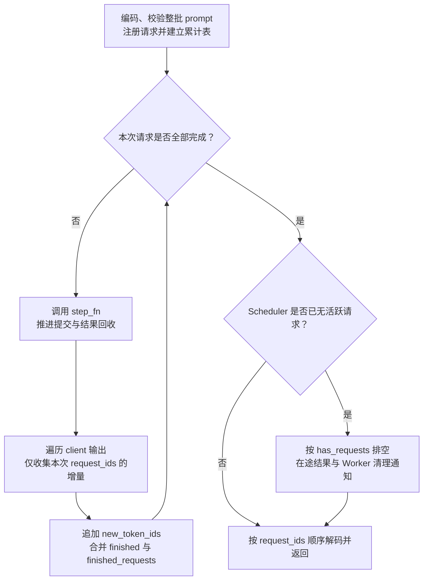

# LLMEngine：从请求入口到完整生成结果

`LLMEngine` 接收生成请求，驱动 Scheduler 和执行端逐轮处理，再把真实输出交给
调用方。源码位于 [`llm_engine.py`](../../nanovllm/engine/llm_engine.py)。对外使用的
[`LLM`](../../nanovllm/llm.py) 当前直接继承它，构造、`generate()` 和手动驱动接口
都来自 `LLMEngine`。

理解这一层时，可以沿着一个请求看三个阶段：**提交请求 → 反复推进执行 → 收集
输出与完成通知**。`generate()` 将整个循环封装起来；手动调用方则自己控制循环。

## Engine 在执行链中的位置



Engine 调用 Scheduler 得到计划，通过 Executor 执行，再把结果交回 Scheduler。
请求是否停止、真实 token 如何追加、KV block 何时释放，由 Scheduler 及其 Manager
处理；Engine 根据它返回的增量对象向外提供结果。

当前执行端为单 GPU、TP=1 的 `UniProcExecutor`。模型执行和 CUDA Graph 的分派
位于 Worker / Runner，Engine 的外部调用方式不随 eager、Graph 改变。

| 使用方式 | 入口 | 返回结果与适用场景 |
| --- | --- | --- |
| 整批生成 | `generate(prompts, sampling_params)` | 阻塞到本次提交的请求全部完成，按输入顺序返回完整 completion。 |
| 手动驱动 | `add_request()` + `step_fn()` | 每轮读取增量 token 和完成通知，适合 benchmark、逐轮观察及持续补充请求。 |

**异步调度是 Engine 内部的批次流水线。** 即使启用 `async_scheduling`，
`generate()` 也不会立即返回 Future；手动调用的 `step_fn()` 也可能等待旧结果。

## 创建 Engine：先确定资源，再开始调度

### 完整配置与最小调用

构造参数只有完整的 `NanovllmConfig`。调用方先组装子配置，Engine、Executor、
Worker 和 Scheduler 沿执行链使用同一个配置对象。

```python
from pathlib import Path

from nanovllm import LLM, SamplingParams
from nanovllm.config import (
    CacheConfig,
    ModelConfig,
    NanovllmConfig,
    SchedulerConfig,
)

config = NanovllmConfig(
    model_config=ModelConfig(
        model=str(Path.home() / "models/Qwen3-0.6B"),
        max_model_len=1024,
        enforce_eager=True,
    ),
    scheduler_config=SchedulerConfig(
        max_num_batched_tokens=1024,
        max_num_seqs=4,
        async_scheduling=False,
    ),
    cache_config=CacheConfig(gpu_memory_utilization=0.5),
)

llm = LLM(vllm_config=config)
try:
    results = llm.generate(
        ["Hello, Nano-vLLM.", "What is tensor parallelism?"],
        SamplingParams(temperature=0.6, max_tokens=16),
        use_tqdm=False,
    )
    for result in results:
        print(result["text"])
finally:
    llm.close()
```

这里传入的字符串直接由 `tokenizer.encode()` 编码，Engine 不自动添加聊天模板。
聊天模型所需的模板应由调用方先处理，也可以通过 `apply_chat_template(...,
tokenize=True)` 得到 token IDs 后提交。`results` 的 `text` 和 `token_ids` 只包含
生成部分，不包含输入 prompt。

将 `async_scheduling` 设为 `True` 可启用批次队列。是否使用 CUDA Graph 则由
`enforce_eager` 和编译配置控制，这两个选择相互独立，均应在创建 Engine 前确定。

### 初始化顺序为什么这样安排

| 阶段 | 主要调用或对象 | 完成后的状态 |
| --- | --- | --- |
| 选择执行端、加载 tokenizer | `Executor.get_class()`、`AutoTokenizer.from_pretrained()` | 确认支持的执行方式，将主 EOS ID 写入配置。 |
| 创建执行端 | `executor_class(vllm_config)` | Worker 已初始化设备并加载权重，正式 KV 尚未分配。 |
| 查询规格与显存预算 | `get_kv_cache_specs()`、`determine_available_memory()` | 得到模型 KV 规格及可用于 KV 的字节预算。 |
| 规划并初始化 KV | `get_kv_cache_configs()`、`initialize_from_config()` | 分配正式 KV，完成启动预热和配置要求的 Graph 捕获。 |
| 初始化前缀哈希 | `init_none_hash()`、`get_request_block_hasher()` | 使用最终 `block_size` 建立请求共享的逻辑 block 哈希规则。 |
| 创建调度器及执行入口 | `Scheduler` / `AsyncScheduler`、`step_fn` | Scheduler 获得确定的 KV 容量，Engine 可开始接收请求。 |

Scheduler 需要知道最终物理 KV 容量，才能做资源分配，因此在 KV 规划后创建。
Graph 捕获也要使用正式 KV 和输入 buffer 的地址，所以发生在执行端初始化阶段。
这部分展开见 [Executor](../executor/Executor.md) 和
[GPUModelRunner](../worker/gpu_model_runner.md)。

配置对象会在启动时回写 EOS、实际 KV block 数和编译统计等运行时信息。
**每个 Engine 应创建独立配置**，不要把一个已初始化实例的配置当作无状态模板复用。

### 后续执行会用到哪些成员

| 成员 | 语义 |
| --- | --- |
| `vllm_config`、`tokenizer` | 完整配置，以及字符串编码、最终 completion 解码所需的 tokenizer。 |
| `model_executor` | Engine 访问 Worker 的边界，负责执行端生命周期、模型执行及采样调用。 |
| `available_gpu_memory_for_kv_cache` | profiling 测得的 KV 字节预算，不是剩余显存的实时查询结果。 |
| `request_block_hasher` | 构造 Request 时使用的完整逻辑 block 哈希函数。 |
| `scheduler` | 请求队列、逻辑进度和 Scheduler 侧 KV 管理的所有者。 |
| `async_scheduling`、`batch_queue_size` | 初始化时确定的执行策略；当前同步容量记为 1，异步容量为 2。 |
| `batch_queue` | 异步时保存 `(结果 Future, 原始 SchedulerOutput)`；同步时为 `None`。 |
| `step_fn` | 已绑定的单步入口，选择 `step` 或 `step_with_batch_queue`。 |
| `_request_id_counter`、`_is_closed` | 自动请求 ID 计数器，以及拒绝关闭后继续执行的生命周期标记。 |

## 提交请求：`add_request()` 只负责注册

```python
request_id = llm.add_request(
    prompt="Hello!",
    sampling_params=SamplingParams(temperature=0.6, max_tokens=16),
    request_id="my-request",  # 可以省略，由 Engine 生成 request-N。
)
```

一次提交按以下顺序处理：

1. 检查 Engine 尚未关闭；字符串经 tokenizer 编码，`list[int]` 直接作为输入。
2. 校验 token 序列非空，且长度严格小于 `max_model_len`，给后续生成留出位置。
3. 使用外部 request ID，或生成当前 Scheduler 中未占用的自动 ID。
4. 用 `dataclasses.replace()` 复制采样参数，按 `ignore_eos` 绑定主 EOS。
5. 创建 `Request`，将其注册到 Scheduler 的请求表和等待队列。

**返回 ID 表示注册成功，模型计算由后续 `step_fn()` 推进。** 提交的 token ID
列表不会在入口复制，调用方此后不应原地修改它。`priority` 参数当前保留在请求中，
Scheduler 的默认策略仍为 FCFS（先到先服务）。

Request 保存逻辑输入、输出和进度；物理 KV 的分配通过 Scheduler / KVCacheManager
进行。这里先理解“请求进入等待队列”即可，逐轮计划的数据字段见
[SchedulerOutput](../core/sched/output-zh.md)。

## 单步入口：外部统一调用 `step_fn()`

### 三个名字怎样对应

| 名字 | 职责 |
| --- | --- |
| `step()` | 执行同步路径，本轮提交的结果在本轮回收并更新 Scheduler。 |
| `step_with_batch_queue()` | 执行队列路径，先提交新批次，再按 FIFO 回收旧结果。 |
| `step_fn` | 构造时选定的 bound method，供外部循环和 `generate()` 统一调用。 |

两条路径并列实现。`step()` 内部没有再次判断异步开关；启用异步后，外部仍应调用
`step_fn()`，让初始化时的绑定选择正确入口。

### 返回值分别描述提交与回收

```python
engine_core_outputs, num_scheduled_tokens = llm.step_fn()
```

| 返回值 | 具体含义 |
| --- | --- |
| `engine_core_outputs` | 本次结果回收后产生的 `dict[int, EngineCoreOutputs]`，键为 `client_index`。 |
| `num_scheduled_tokens` | 本次新提交的输入计算量，等于新计划的 `total_num_scheduled_tokens`；没有新提交时为 0。 |

**`num_scheduled_tokens` 不是本轮生成的 token 数。** 例如单请求处理 4-token
prompt 时，它可以是 4，而有效采样输出只有 1；chunked prefill 尚未完成时，
也可能没有有效输出。当前普通 decode 每请求通常计算一个输入位置，再采样一个输出。

在异步模式下，两个返回值还可能对应不同批次：新提交的是 B2，回收并交付的却是 B1。
因此，不能把空输出理解为没有执行，也不能用新提交量给旧结果标记批次。

### 从执行计划到对外增量

| 对象 | 所在边界 | 携带的内容 |
| --- | --- | --- |
| `SchedulerOutput` | Scheduler → 执行端 | 本批请求更新、逐请求输入计算量及 KV 等执行信息。 |
| `ModelRunnerOutput` | 执行端 → Scheduler | 本批请求 ID、输出行映射和已经回收的采样 token。 |
| `EngineCoreOutputs` | Scheduler → Engine 调用方 | 某个 client 的本轮增量集合、完成通知和可选统计。 |

遍历 `client_outputs.outputs` 得到单请求的 `EngineCoreOutput`：

- `request_id` 标识逻辑请求，外层字典的整数键并不是请求 ID。
- `new_token_ids` 是本次新接受的生成 token，不含 prompt，也不重复完整生成历史。
- `finish_reason` 非 `None` 时，`finished` 为 `True`；最后一条增量可以同时携带
  token 和完成标记。
- `finished_requests` 位于外层 `EngineCoreOutputs`，用于通知请求结束；主动取消等
  情况可能只有这个集合，没有对应的新增 token。它可能与 `output.finished` 重复，
  累计完成数时应按 request ID 去重。

prefill 中间轮、流水线填充或仅有辅助信息的轮次都可能没有 token 增量。
是否继续驱动，应结合请求和队列状态判断。

## 同步路径：本轮提交，本轮回收



`schedule()` 形成计划并推进已承诺的计算进度。Engine 随后提交执行，取得结果，
再让 `update_from_output()` 追加真实输出、检查停止条件并处理结束请求。

当前 UniProc 对非空 forward 通常返回 `None`：这表示模型阶段完成了主机侧调用，
需要紧接着消费暂存的 logits 并采样。零 token 清理计划则直接返回空
`ModelRunnerOutput`，无须采样。这就是 `step()` 先检查 `model_output is None`
再调用 `sample_tokens()` 的原因。

这里即使传了 `non_block=True`，同步路径也立即取 `future.result()`，随后完成
采样和 Scheduler 更新才返回。当前 UniProc 的普通 Future 只是结果包装，Worker
方法仍在本线程执行；不能从参数名推断它启动了后台线程。

Scheduler 完全没有请求或待发送通知时，`step()` 返回 `({}, 0)`。若仅有 Worker
清理通知，仍会下发一个零 token 计划，所以计算量为 0 不等于完全没有状态处理。

## 异步路径：把新提交与旧结果回收分开

启用异步后，`step_fn` 绑定 `step_with_batch_queue()`。先看连续三次调用：
**第二次调用先提交 B2，再交付 B1；第三次调用先提交 B3，再交付 B2。**

### 三次调用：提交哪一批，返回哪一批

假设只有一个请求，无 prefix cache 命中、没有抢占，prompt 长度为 4，允许继续
生成多个 token。B1 处理 prompt，B2、B3 各处理一个后续输入位置。
图中 `P1` 是 B1 的 `SchedulerOutput`，`F1` 是 B1 的采样结果 Future，后续编号同理。
队列写成 `[新, 旧]`，容量为 2。



沿着第二次调用看，`P2` 用来提交新计算，`P1` 用来回收旧结果。因此队列中的每一项
都必须同时保存 Future 和原始计划；执行 `update_from_output()` 时，两者必须同批。
图中合写的模型执行与采样都使用 `non_block=True`，表示提交后取得 Future，
GPU 工作可能仍在执行。

采样紧接本批 forward 提交，避免下一批覆盖暂存的执行状态和 logits。
延后到下一次调用的是 `F1.result()` 和 Scheduler 结果更新。

### 单次调用：填队列、回收与排空怎样选择

上图展示持续有非空计划的情况。下面补齐零 token 清理计划、纯回收和完全空闲时的
分支；对应代码中的 `scheduler.has_requests()`、队列长度判断和最后的 `pop()`。



有新批次时先入队，再决定是否回收；没有新工作时，队列里的旧结果仍要取完。
每次返回时保留至少一个提交空位，因此下一轮 `appendleft()` 不会触发有界
`deque` 自动丢弃旧项。**空输出只说明本次没有交付 token，不能据此结束驱动循环。**

### 异步发生在哪里

上面的时序图描述主机调用顺序，再将 CPU 与 GPU 分成两条线，就能看到重叠的位置：



第二次调用准备 B2 时，B1 的真实输出尚未写入 CPU Request 历史；内部占位与 GPU
token 回填允许这一步提前进行。B2 在设备上使用 B1 的 token 时仍要满足数据依赖，
相邻批次的模型计算不会因此任意并行。

当前 UniProc 的 forward 和采样主机调用仍在当前线程执行，`non_block=True`
不创建后台 Python 线程。异步输出由 `AsyncOutputFuture` 包装，首次 `result()`
才等待 D2H 并取得可读的 CPU 结果。

为支持“尚未回收也能继续调度”，系统还需要输出占位、GPU token 回填、输入 buffer
重用保护及延迟释放等处理。完整依赖关系见
[异步调度执行链](../core/sched/AsyncScheduler-zh.md)，实测重叠与延迟取舍见
[异步调度性能记录](../performance/async_schedule.md)。

## `generate()`：把多轮增量组织成完整答案

### 参数与本次调用的局部状态

`generate()` 接收一组字符串或一组 token ID 列表；采样参数可以是一个共享配置，
也可以是与 prompts 等长的参数列表。空 prompts 返回空列表；参数列表长度不符
会在提交请求前报错。

它先编码并校验全部 prompt，再调用 `add_request()` 注册，避免某个 prompt 无效时
前面的请求已经进入等待队列。随后建立本次调用的累计状态：

| 局部变量 | 保存的内容与用途 |
| --- | --- |
| `request_ids` | 本次提交请求的 ID 列表，顺序与输入一致，用于最终排列结果。 |
| `output_token_ids` | `request_id → 已累计的生成 token IDs`，每次收到增量后追加。 |
| `finished_request_ids` | 已观察到完成的本次请求 ID 集合，用于判断生成循环何时结束。 |
| `progress_bar` | 按完成请求推进进度；可显示本次新调度量除以单步耗时的速率。 |

累计表由本次 `generate()` 持有，因此请求完成后，即使 Scheduler 已移除其 Request，
仍能构造完整返回值。进度条中的调度 token 速率包含输入计算量，尤其在异步模式下，
不应将它直接视为本批已回收输出的 token/s。

### 主循环与完成判断



每轮可以同时返回多个请求的增量。`generate()` 遍历各个 client 的输出，对属于
本次调用的请求追加 token，并把完成 ID 加入集合。主动取消可能只通过
`finished_requests` 通知，代码也会识别并保留取消前已累计的输出。

循环条件是“本次提交的请求是否全部完成”，空输出不会终止循环。它可能对应
prefill 中间轮或异步队列填充轮，下一次仍应调用 `step_fn()`。

当本次请求完成、且 Scheduler 也没有其他活跃请求时，还会执行
`while self.has_requests(): self.step_fn()`，送达最后的清理通知并排空迟到结果。
若还有其他活跃请求，则由后续调用继续处理，收尾阶段不额外推进它们。

### 完成顺序与返回顺序可以不同

假设同步执行中 A、B 的初始 prefill 在同一轮完成，A 生成 3 个 token，B 生成
1 个 token，均忽略 EOS。以下 ID 仅说明累计关系：

| 结果回收轮次 | 本轮增量 | `output_token_ids` | `finished_request_ids` |
| --- | --- | --- | --- |
| 第一轮 | A 得到 `[101]`；B 得到 `[201]` 并结束。 | A：`[101]`；B：`[201]`。 | `{B}` |
| 第二轮 | A 得到 `[102]`。 | A：`[101, 102]`；B：`[201]`。 | `{B}` |
| 第三轮 | A 得到 `[103]` 并结束。 | A：`[101, 102, 103]`；B：`[201]`。 | `{A, B}` |

即使 B 先完成，只要输入顺序是 `[A, B]`，返回列表就先放 A、再放 B。
每项包含完整生成 `token_ids`，以及用 `skip_special_tokens=True` 解码的 `text`。
异步模式改变提交与回收的轮次关系，累计增量和按输入顺序返回的规则相同。

`generate()` 内部每轮处理的是 Scheduler 选中的一批请求，多个请求可以一起推进。
整批提交也不代表所有 prompt 必须在一次 forward 中完成，实际分批由调度预算和
资源情况决定。结束及停止条件通过 Scheduler 的结果更新处理，详见采样和调度代码。

## 手动驱动：自己消费增量和持续补位

在一个新建的 Engine 上，可以用下面的逻辑替换开头示例中的 `generate()` 调用；
保留外层 `try/finally`，由 `finally` 负责关闭 Engine。

```python
params = SamplingParams(temperature=0.6, max_tokens=16)
request_ids = [llm.add_request(prompt, params) for prompt in ["Hello!", "Explain TP."]]
token_ids = {request_id: [] for request_id in request_ids}
finished_request_ids = set()

# 既推进用户请求，也送达最后的 Worker 清理通知。
while llm.has_requests():
    client_results, num_scheduled_tokens = llm.step_fn()
    for client_output in client_results.values():
        for output in client_output.outputs:
            token_ids[output.request_id].extend(output.new_token_ids)
            if output.finished:
                finished_request_ids.add(output.request_id)
        finished_request_ids.update(client_output.finished_requests or ())

for request_id in request_ids:
    print(llm.tokenizer.decode(token_ids[request_id], skip_special_tokens=True))
```

这个例子在每轮取得增量后自行累计。调用方也可以在请求完成时提交下一条请求，
维持固定活跃并发；两个 benchmark 使用这种回放方式，见
[Benchmark 文档](../../benchmarks/README.md)。

## 完成、取消与资源关闭

### 用户请求完成后，为什么还可能有工作

| 接口 | 条件或动作 |
| --- | --- |
| `scheduler.is_finish()` | Scheduler 的 waiting、running 都为空，不考虑 Engine 在途队列和待发送清理通知。 |
| `LLMEngine.is_finished()` | Scheduler 已无活跃请求，且 Engine 在途队列为空。 |
| `LLMEngine.has_requests()` | 仍有活跃请求、待发送的 Worker 清理通知，或 Engine 在途结果。 |

因此，`is_finished()` 为 `True` 时，`has_requests()` 仍可能为 `True`：用户输出
已经完成，但最后的结束 ID 尚未送达 Worker。继续驱动后，零 token 计划会让 Worker
删除请求镜像等状态。需要完整排空时应使用 `has_requests()`，不能只看本轮是否有输出。

### `abort_request()` 与迟到结果

`abort_request(request_id)` 找到尚未结束的请求时返回 `True`，由 Scheduler 移除请求、
处理 KV 释放并登记结束通知；不存在或已结束时返回 `False`。

取消不会撤回已提交的 CUDA 工作。后续仍需回收在途批次，并通过执行计划通知 Worker
清理；已取消请求的迟到输出不会继续追加到其真实历史。手动驱动方应继续消费完成通知，
而不只是等待一个携带 token 的最终增量。

### `close()` 负责结束生命周期

`close()` 先设置 `_is_closed` 并注销退出回调，再依次等待队列中的 Future，取消
剩余请求，关闭执行端并清理分布式环境与设备缓存。等待旧结果时不再通过
`update_from_output()` 向用户交付生成结果，也不会提交新批次。

关闭具有幂等性。单个 Future 回收失败时会继续处理其他在途项，再传播首个结果异常；
执行端和全局清理通过 `finally` 尝试完成。关闭后，`add_request()`、`generate()`
及两条单步入口会拒绝继续执行。

成功创建 Engine 后会注册 `atexit` 回调，但正常调用仍应像示例一样在 `finally`
中显式 `close()`。这里的接口按调用方串行驱动使用，内部异步调度不提供多线程并发
调用的保证；`generate()` 的进度条清理也不替代 Engine 的资源关闭。
