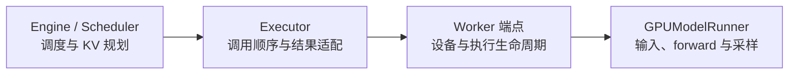
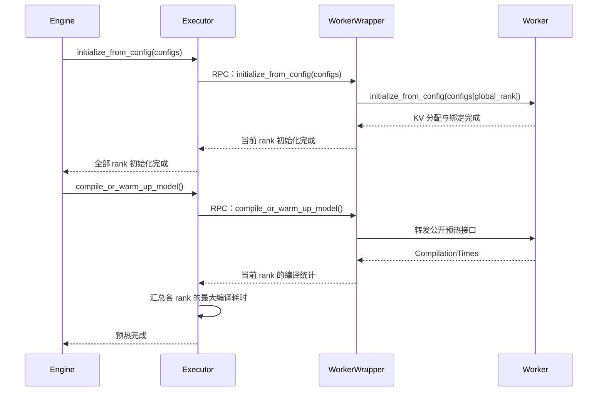

# Executor：Engine 与 Worker 之间的执行接口

[`Executor`](../../nanovllm/executor/abstract.py) 是 Engine 操作执行端的公共入口。Engine 通过它查询 KV 存储规格与显存预算、下发分配方案，再逐轮提交调度结果并取得采样输出。具体 Executor 创建 Worker 端点，负责把这些调用送到执行端并整理返回值。

一个 Executor 随 Engine 创建并持续使用。基类保存同一个 `vllm_config` 引用，构造时调用子类的 `_init_executor()` 建立执行环境；Worker 端点由子类持有。当前选择的 UniProcExecutor 在该阶段完成设备初始化和权重加载，随后 Engine 查询预算、规划正式 KV，再依次调用 `initialize_from_config()` 和 `compile_or_warm_up_model()`，完成缓存分配与执行准备。

基类主要组织调用顺序和结果。请求的权威进度由 Engine / Scheduler 保存，Worker / GPUModelRunner 保存执行侧请求镜像、输入 buffer、模型和 KV cache。每轮的 `SchedulerOutput` 与 `ModelRunnerOutput` 作为调用参数和返回值经过 Executor，供两侧同步进度。



Engine 给出要执行的内容，Executor 将调用交给 Worker，Worker 再组织 Runner 执行。本文介绍基类的约定与默认行为，子类的进程、通信和端点创建方式由各自文档说明。

## 调用结果怎样经过这个类

基类的普通 RPC 统一保留 Worker rank 这一层。例如只有 rank 0 时，显存预算返回 `[budget0]`，KV 规格返回 `[specs0]`。Engine 用同一位置的预算和规格生成该 Worker 的分配方案。

执行与采样入口进一步整理结果。普通 RPC 得到 `[model_output]` 后，基类默认取第 0 项，将单个输出交给 Engine；forward 返回 `[None]` 时，`execute_model()` 返回 None，Engine 随后调用 `sample_tokens()` 消费执行端暂存的 logits。

```python
# 普通查询保留 Worker rank 维度。
kv_cache_specs = executor.get_kv_cache_specs()
available_memory = executor.determine_available_memory()

# 每轮执行向 Engine 返回单个结果。
model_output = executor.execute_model(scheduler_output)
if model_output is None:
    model_output = executor.sample_tokens()
```

基类还保存 `is_sleeping` 与 `sleeping_tags` 两个休眠协议状态，构造完成时为 False 和空集合。它们由预留的休眠接口更新；当前正常启动是否完成，由前面的 Worker 创建、KV 初始化和预热调用顺序保证。

下面逐个介绍方法声明、输入、返回、状态变化与调用时机，随后用具体例子串起启动和一轮推理，最后概述默认处理逻辑。

## 创建执行器与查询能力

### get_class()：根据配置选择具体执行器类

```python
@staticmethod
def get_class(vllm_config: NanovllmConfig) -> type[Executor]:
    ...
```

**输入：** 已构造的总配置，当前根据 `parallel_config.tensor_parallel_size` 选择执行范围。

**返回：** TP size 为 1 时返回 UniProcExecutor 类；其他值触发 NotImplementedError。

**状态变化：** 读取配置并取得具体类。Worker 创建、设备初始化和权重加载发生在随后构造实例时。

**调用时机：** Engine 初始化的开始阶段，使用返回的类型创建执行器。

```python
executor_class = Executor.get_class(vllm_config)
executor = executor_class(vllm_config)
```

### __init__()：保存配置并触发子类初始化

```python
def __init__(self, vllm_config: NanovllmConfig) -> None:
    ...
```

**输入：** Engine 使用的完整配置，基类和执行端共享该配置引用。

**返回：** 构造表达式返回具体 Executor 实例，基类的 `__init__()` 返回 None。

**状态变化：** 保存 `self.vllm_config`，调用子类 `_init_executor()`；成功后设置 `is_sleeping=False`、`sleeping_tags=set()`。子类创建并保存 Worker 端点，当前构造完成时权重已加载，正式 KV 分配等待 Engine 规划。

**调用时机：** 具体 Executor 实例创建时。构造失败的异常沿调用栈向 Engine 传播。

### supports_async_scheduling()：查询调度重叠能力

```python
@classmethod
def supports_async_scheduling(cls) -> bool:
    ...
```

**输入：** 读取所调用执行器类的能力声明。

**返回：** 基类默认返回 False，当前 UniProcExecutor 也返回 False。

**状态变化：** 返回能力值，实例成员保持原值。

**调用时机：** 上层选择调度方式时使用。当前每轮按 forward、采样和状态提交的顺序推进。

```python
assert Executor.supports_async_scheduling() is False
```

Future 描述结果的交付形式；调度重叠还要求执行端支持输入、输出和请求状态的并行生命周期。当前 UniProcExecutor 在本线程完成调用后包装已完成的 Future，Engine 取出结果再推进后续步骤。

类属性 `supports_pp=False` 则声明当前公共执行链的流水线并行能力。

## Worker 调用的公共协议

### collective_rpc()：调用 Worker 并收集 rank 有序结果

```python
@abstractmethod
def collective_rpc(
    self,
    method: str | Callable[[WorkerBase], _R],
    timeout: float | None = None,
    args: tuple[Any, ...] = (),
    kwargs: dict[str, Any] | None = None,
    non_block: bool = False,
) -> list[_R] | Future[list[_R]]:
    ...
```

`_R` 表示目标方法单次返回值的类型。源码通过 overload 进一步标注同步与 Future 两种返回关系，上面的声明展示抽象实现入口的完整参数。

**输入：**

- `method` 为执行端方法名，或接收 Worker 端点作为首参的 callable。当前 UniProc 使用 WorkerWrapperBase 端点，再转发到具体 Worker。
- `args` 和 `kwargs` 为目标方法的位置参数和关键字参数，kwargs 缺省按空字典处理。callable 的端点首参由具体调用机制补入。
- `timeout` 为预留的秒数上限，当前 UniProc 保留该参数并按本地调用执行。
- `non_block` 选择普通返回或 Future 返回，具体执行与通信方式由子类实现。

**返回：** `non_block=False` 返回按 Worker rank 排列的 `list[_R]`；True 返回 `Future[list[_R]]`，调用 `result()` 后取得整份 rank 列表。

**状态变化：** Worker 执行目标方法产生相应状态变化，子类负责端点调用、结果和异常的交付。同步调用直接传播异常，当前 UniProc 的 Future 路径将目标异常保存到 Future，取结果时重新抛出。

**调用时机：** 基类的 KV 查询、初始化、执行和管理方法使用它访问 Worker。子类提供本地调用或其他调用机制。

例如单 Worker 返回 536870912 字节预算：

```python
budgets = executor.collective_rpc("determine_available_memory")
# budgets 的内容为 [536870912]，下标 0 对应 rank 0。
```

如果目标方法本身返回列表，RPC 还会保留外层 rank 列表。例如目标返回 `[10,20]`，单 Worker 的普通 RPC 结果为 `[[10,20]]`。

## KV 查询与正式初始化

### get_kv_cache_specs()：取得每个 Worker 的 KV 规格

```python
def get_kv_cache_specs(self) -> list[dict[str, KVCacheSpec]]:
    ...
```

**输入：** 调用时读取 Worker 已加载模型的 Attention 层信息。

**返回：** 按 rank 排列的规格列表，每项是 `layer_name → KVCacheSpec` 字典，描述对应层的 block 大小、KV head、head 维度和 dtype 等信息。单 Worker 形如 `[{layer_name: spec, ...}]`。

**状态变化：** 收集查询结果，KV 存储分配在后续初始化阶段完成。

**调用时机：** 权重加载完成后，Engine 进行 KV 规划前。基类内部调用 Worker 的单数方法 `get_kv_cache_spec`。

```python
specs_by_rank = executor.get_kv_cache_specs()
rank0_specs = specs_by_rank[0]
```

### determine_available_memory()：测量可用于 KV 的字节预算

```python
def determine_available_memory(self) -> list[int]:
    ...
```

**输入：** Worker 使用当前模型、设备状态和显存策略进行测量。

**返回：** 按 rank 排列的字节预算列表，与 `get_kv_cache_specs()` 的相同下标配对。例 `[536870912]` 表示 rank 0 有 512 MiB 的候选 KV 预算。

**状态变化：** Worker 执行模型、采样和可能的 CUDA Graph 内存 profiling，更新执行侧显存统计。Executor 收集测量结果，Engine 用它规划 KV 容量。

**调用时机：** 模型加载之后、正式 KV 分配之前。

```python
available_memory = executor.determine_available_memory()
rank0_budget_bytes = available_memory[0]
```

### initialize_from_config()：下发并分配正式 KV

```python
def initialize_from_config(
    self,
    kv_cache_configs: list[KVCacheConfig],
) -> None:
    ...
```

**输入：** Engine 已规划的 KVCacheConfig 列表，按全局 Worker rank 排列。Wrapper 按自身 global rank 选择本地配置，交给 Worker 初始化。

**返回：** None。

**状态变化：** 通过 RPC 下发正式 KV 方案，Worker 分配并绑定 KV、创建 Attention metadata Builder 和 Dispatcher keys。此接口不执行模型预热、Graph 捕获或编译耗时汇总。

**调用时机：** KV 规格查询、显存测量和 Engine KV 规划完成后。

### compile_or_warm_up_model()：预热并汇总编译耗时

```python
def compile_or_warm_up_model(self) -> None:
    ...
```

**调用时机：** Engine 等待 `initialize_from_config()` 在所有 Worker 上成功返回后，单独调用此接口。正式 KV 地址已确定，Worker 才能进行内核、模型、sampler 预热及配置要求的 Graph 捕获。

**返回与状态变化：** Worker 返回本 rank 的 `CompilationTimes`；Executor 收集按 rank 排列的结果，将 `language_model` 最大值写入 `vllm_config.compilation_config.compilation_time`，自身返回 None。任一 Worker 失败时异常继续向上传播。

```python
executor.initialize_from_config(kv_cache_configs)
executor.compile_or_warm_up_model()
```

例如各 Worker 分别返回 `CompilationTimes(language_model=0.25)` 和 `CompilationTimes(language_model=0.30)`，配置中的模型级编译时间回写为 0.30 秒。当前模型级编译统计通常为 0.0，整个预热和 Graph 捕获的墙钟耗时由 Engine 的初始化计时记录。



图中省略了每个 rank 的重复调用。两次 RPC 对应两个独立阶段：先分配正式 KV，再预热执行路径。Worker 的 `_compile_or_warm_up_model()` 是内部实现，Engine 和 Executor 均调用公开接口。

## 每轮模型执行与采样

### execute_model()：执行本轮调度并取得单结果

```python
def execute_model(
    self,
    scheduler_output: SchedulerOutput,
    non_block: bool = False,
) -> ModelRunnerOutput | None | Future[ModelRunnerOutput | None]:
    ...
```

**输入：** `scheduler_output` 保存本轮请求增删、KV block 更新和逐请求 token 调度量。基类默认路径使用 `non_block=False`；传入 True 时触发 NotImplementedError，Future 返回由子类覆盖适配。

**返回：** 默认路径取得普通 RPC 列表的第 0 项，返回单个 ModelRunnerOutput 或 None。当前 Runner 在有 token 的 forward 完成后返回 None，表示 logits 已准备好，调用方随后调用 `sample_tokens()`；零 token 的状态同步可直接返回空输出对象。

**状态变化：** Worker / Runner 更新执行侧请求镜像，准备输入，执行模型并写入 KV，必要时暂存待采样 logits。Engine 在执行与采样成功后提交 Scheduler 进度。

**调用时机：** 正式 KV 初始化和预热完成后，每轮取得 SchedulerOutput 时调用。取得待采样状态后，先消费本轮 logits，再提交下一轮 forward。

```python
model_output = executor.execute_model(scheduler_output)
if model_output is None:
    model_output = executor.sample_tokens()
```

### sample_tokens()：消费本轮 logits 并返回采样结果

```python
def sample_tokens(
    self,
    non_block: bool = False,
) -> ModelRunnerOutput | Future[ModelRunnerOutput]:
    ...
```

**输入：** Worker / Runner 中上一轮 forward 暂存的 logits。基类默认按 `non_block=False` 的同步列表协议处理，参数 True 的单结果 Future 适配由子类覆盖提供。

**返回：** 默认同步 RPC 返回 `[model_output]`，本方法取第 0 项，交给 Engine 一个 ModelRunnerOutput。输出包含 `req_ids`、`req_id_to_index` 和逐请求的 `sampled_token_ids`。

**状态变化：** Worker 消费待采样 logits、过滤本轮无效候选并更新 token 镜像；Engine 再用输出更新 Scheduler 和请求的生成结果。

**调用时机：** `execute_model()` 返回 None 后调用一次。

```python
model_output = executor.sample_tokens()
# 例如 req_ids 为 ["A", "B", "C"]，sampled_token_ids 为 [[16], [26], []]。
```

当前基类默认方法把 `non_block` 透传给 `collective_rpc()`，随后对返回对象执行 `[0]`。当 RPC 返回 Future 时，这一步会触发 TypeError。当前 UniProcExecutor 已覆盖执行与采样入口，将 Future 的结果整理为单个输出；Engine 使用该覆盖路径。

两种 Future 协议的结果分别是：

- 普通 RPC：`Future[list[_R]]`，`result()` 得到 rank 有序列表。
- 执行与采样入口：单结果 Future，`result()` 得到一个 ModelRunnerOutput 或待采样标记 None。

## 健康检查与关闭

### check_health()：执行具体执行器的健康检查

```python
@abstractmethod
def check_health(self) -> None:
    ...
```

**输入：** 子类维护的执行端点和运行状态。

**返回：** 检查成功返回 None，检查失败通过异常报告。

**状态变化：** 由子类定义具体检查方式。当前 UniProcExecutor 使用空检查，执行错误由实际调用或 Future 取结果时报告。

**调用时机：** 上层需要查询执行端健康状态时。

### shutdown()：请求 Worker 清理运行资源

```python
def shutdown(self) -> None:
    ...
```

**输入：** 当前执行端点，调用方先停止提交新任务。

**返回：** None，清理异常沿调用栈传播。

**状态变化：** 基类通过 RPC 调用 Worker 的 shutdown，具体资源清理由 Worker 组织。当前 UniProcExecutor 覆盖为本地端点委托，Engine.close() 在执行端清理后继续完成全局分布式环境清理。

**调用时机：** Engine 关闭和相应失败清理流程。

```python
executor.shutdown()
```

## 子类的初始化扩展点

### _init_executor()：创建执行端点并加载模型

```python
@abstractmethod
def _init_executor(self) -> None:
    ...
```

**输入：** 基类构造阶段已经保存的 `self.vllm_config`。

**返回：** None。

**状态变化：** 子类创建并保存 Worker 端点，组织设备初始化与权重加载；完成后执行端应能提供 KV 规格并进行显存 profiling。

**调用时机：** 基类 `__init__()` 在保存配置后自动调用。随后 Engine 通过查询接口规划正式 KV。

继承 Executor 时，子类实现这个钩子、`collective_rpc()` 和 `check_health()`，即可提供基类抽象接口要求的行为；若需要单结果 Future，还应覆盖执行与采样入口完成返回值适配。

## 预留的管理接口

以下接口保留了基类协议。当前正常推理使用前面的初始化、执行、采样和关闭流程；GPU Worker 的额外 dummy、性能 trace 与资源休眠能力留待接入。

### register_failure_callback()：提供故障通知的扩展入口

```python
def register_failure_callback(
    self,
    callback: FailureCallback,
) -> None:
    ...
```

**输入：** `FailureCallback` 为 `Callable[[],None]`，表示不可恢复故障发生时的无参通知函数。

**返回：** None。

**状态变化：** 当前基类调用后成员状态保持原值。需要故障监控的子类可覆盖此接口，保存并触发回调。

**调用时机：** 上层为具备故障通知机制的执行器注册处理函数时。当前单进程错误通过实际调用或 Future.result() 传回。

### execute_dummy_batch()：提交额外 dummy 执行命令

```python
def execute_dummy_batch(self) -> None:
    ...
```

**输入：** 调用时向 Worker 提交同名命令。

**返回：** 协议为 None。当前 GPU Worker 缺少同名实现，调用触发 NotImplementedError。

**状态变化：** 具体 dummy 执行行为由 Worker 扩展定义。

**调用时机：** 上层需要额外 dummy batch 时。当前正常启动的预热通过独立的 `compile_or_warm_up_model()` 完成。

### profile()：提交性能 trace 的开始或停止命令

```python
def profile(
    self,
    is_start: bool = True,
    profile_prefix: str | None = None,
) -> None:
    ...
```

**输入：** `is_start=True` 表示开始，False 表示停止；`profile_prefix` 为透传给 Worker 的可选输出前缀。

**返回：** 协议为 None，当前 GPU Worker 的目标方法待实现，调用触发 NotImplementedError。

**状态变化：** 基类向 Worker 转发参数，具体 profiler 生命周期由 Worker 定义。

**调用时机：** 性能 trace 的采集阶段。KV 显存预算测量使用 `determine_available_memory()`。

### sleep()：请求休眠并记录待恢复资源

```python
def sleep(self, level: int = 1) -> None:
    ...
```

**输入：** `level` 为交给 Worker 解释的休眠等级。

**返回：** None；已休眠时记录警告并返回。当前 GPU Worker 的休眠方法待实现，实际 RPC 调用触发 NotImplementedError。

**状态变化：** Worker 调用成功后，设置 `sleeping_tags={"weights","kv_cache"}`、`is_sleeping=True`。RPC 失败时，状态保留调用前的值。

**调用时机：** 执行端具备休眠能力后，上层希望暂时释放相关资源时。

### wake_up()：按标签恢复休眠资源

```python
def wake_up(
    self,
    tags: list[str] | None = None,
) -> None:
    ...
```

**输入：** `tags` 为待恢复的资源标签，调用方提供已登记且无重复的标签。None 或空列表在基类状态更新中表示恢复全部资源。

**返回：** None。处于休眠状态且标签有效时向 Worker 提交命令，其他状态或未知标签记录警告并返回。当前 Worker 的唤醒方法待实现。

**状态变化：** Worker 成功返回后，移除对应标签；剩余集合为空时，设置 `is_sleeping=False`。部分恢复后仍保留 True 和尚待恢复的标签。

**调用时机：** 配套休眠接口成功后，恢复全部或指定资源时。

例如具备相应 Worker 能力后，sleep 成功使状态成为 `True + {weights,kv_cache}`；先恢复 weights 后成为 `True + {kv_cache}`；再恢复 kv_cache 后成为 `False + 空集合`。

## 完整例子：从启动查询到一轮采样

### 启动：按 rank 配对预算和规格

假设只有 rank 0，配置已由调用方构造。启动的调用顺序为：

```python
from nanovllm.core.kv_cache_utils import get_kv_cache_configs
from nanovllm.executor.abstract import Executor

executor_class = Executor.get_class(vllm_config)
executor = executor_class(vllm_config)

specs_by_rank = executor.get_kv_cache_specs()
budgets_by_rank = executor.determine_available_memory()
kv_cache_configs = get_kv_cache_configs(
    vllm_config,
    specs_by_rank,
    budgets_by_rank,
)
executor.initialize_from_config(kv_cache_configs)
executor.compile_or_warm_up_model()
```

假设查询得到 `specs_by_rank=[specs0]`、`budgets_by_rank=[536870912]`。Engine 规划器用 rank 0 的层规格和 512 MiB 字节预算生成 `config0`，结果列表为 `[config0]`。

`initialize_from_config()` 把整份列表作为一个 RPC 参数传给端点，Wrapper 按 global rank 0 取出 config0，Worker 完成正式 KV 分配。Engine 随后单独调用 Executor 的 `compile_or_warm_up_model()`；Executor 收集 `[CompilationTimes(...)]` 并回写模型级编译时间。正式 Graph 捕获因此使用已经确定的 KV 存储地址。

### 推理：六个 Query 最后返回三行请求结果

假设 Scheduler 本轮安排 A 计算 3 个 Query、B 计算 1 个、C 计算 2 个，总量为 6。A 的这一块完成 prompt，B 正在 decode，C 的 prompt 还有后续 chunk。

基类同步默认路径中的值变化如下：

| 阶段 | 经过该接口的值 |
| --- | --- |
| Engine 提交执行。 | `SchedulerOutput` 中调度量为 A=3、B=1、C=2。 |
| Worker 完成 forward。 | 返回 None，Runner 暂存待采样 logits。 |
| 普通 RPC 收集执行结果。 | `[None]`。 |
| `execute_model()` 交给 Engine。 | None，进入采样步骤。 |
| Worker 完成采样与候选过滤。 | 返回一个 ModelRunnerOutput。 |
| 普通 RPC 收集采样结果。 | `[model_output]`。 |
| `sample_tokens()` 交给 Engine。 | 单个 model_output。 |

例如最后的结果为：

```python
from nanovllm.outputs import ModelRunnerOutput

model_output = ModelRunnerOutput(
    req_ids=["A", "B", "C"],
    req_id_to_index={"A": 0, "B": 1, "C": 2},
    sampled_token_ids=[[16], [26], []],
)
```

A、B 各有一个新 token，C 的结果行为空，因为 prompt 尚待后续 chunk。Executor 将这一份输出交给 Engine，Engine 再提交已计算进度、缓存完整 KV blocks，并将有效生成 token 追加到请求中。

当前 Engine 使用子类提供的 Future 执行入口：

```python
future = executor.execute_model(scheduler_output, non_block=True)
model_output = future.result()
if model_output is None:
    model_output = executor.sample_tokens()
```

这里的单结果 Future 由 UniProcExecutor 适配，取出后的 None / ModelRunnerOutput 继续遵守上面的执行与采样约定。

## 基类默认逻辑概述

基类的大部分接口把一个公共动作转换成同名或对应的 Worker RPC。KV 查询保留 rank 列表，执行与采样取列表第 0 项；正式初始化则串联“分配 KV → 预热执行端 → 汇总编译统计”。

具体 Worker 的创建和调用方式由子类实现。当前 Engine 按“调度 → 执行 → 必要时采样 → 提交状态”的顺序推进，执行异常沿返回协议传播，当前轮的 Scheduler 进度在成功取得输出后提交。


Executor 的接口把这条生命周期连接起来。Engine 负责规划与进度提交，Worker 负责设备执行和资源清理，两端通过稳定的参数与返回值约定协作。

## 源码阅读路径

- [`executor/abstract.py`](../../nanovllm/executor/abstract.py)：基类声明、默认 RPC 组合和结果适配。
- [`engine/llm_engine.py`](../../nanovllm/engine/llm_engine.py)：执行器选择、KV 初始化、一轮 step 和关闭顺序。
- [`worker/worker_base.py`](../../nanovllm/worker/worker_base.py)：Worker 端点、按 global rank 选取 KV 配置和 CompilationTimes。
- [`outputs.py`](../../nanovllm/outputs.py)、[`core/sched/output.py`](../../nanovllm/core/sched/output.py)：执行结果与调度输入的数据约定。
- [`executor/uniproc_executor.py`](../../nanovllm/executor/uniproc_executor.py)：当前子类对本地调用和单结果 Future 的适配。
- 上游 [`vllm/v1/executor/abstract.py`](https://github.com/vllm-project/vllm/blob/b5adb027ad03c29b46181752ba3b1cb84eff1dd4/vllm/v1/executor/abstract.py)：上游基类的接口组织。
