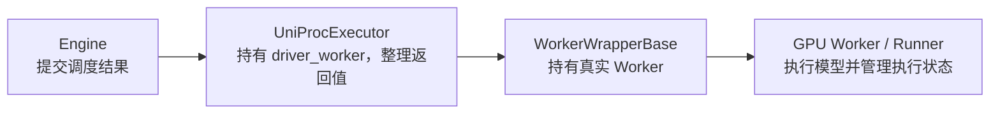

# UniProcExecutor：在当前进程中管理一个 GPU Worker

[`UniProcExecutor`](../../nanovllm/executor/uniproc_executor.py) 把 [Executor 基类](Executor.md) 的执行协议落实为本地对象调用。Engine 创建它时，它就在当前进程中创建唯一的 GPU Worker，初始化设备并加载模型；之后的 KV 查询、初始化、forward 和采样都交给这个 Worker。

这个类持续持有的执行端点是 `self.driver_worker`，类型为 `WorkerWrapperBase`。Wrapper 中的 `worker` 再指向真实 GPU Worker：Wrapper 负责构造参数选择和部分生命周期适配，GPU Worker 管理设备与 Runner，Runner 持有模型、KV cache、输入 buffer 和待采样状态。Executor 保存这条对象访问链，通过它连续执行多轮请求。



这些对象位于同一个进程，调用由当前 Python 线程逐层进入。这里沿用 `collective_rpc` 这个接口名，实际调用通过 `run_method()` 查找本地方法并执行。Worker 仍会建立 world / TP 通信组，供模型层统一查询并行状态。

唯一 Worker 的 `rpc_rank`、`global_rank` 和传给 Worker 的通信 `rank` 都是 0。`local_rank` 则来自配置中的 CUDA device index：例如配置 `cuda:1` 时，通信身份仍为 rank 0，使用的设备为当前进程可见的 GPU 1。`rpc_rank` 用于选择构造参数，`global_rank` 用于选择 KV 分配方案。

基类保存的 `vllm_config` 与 Worker 共享引用。每轮调度结果经过 Executor 传入，模型输出经过 Executor 返回；待采样 logits 保存在 Runner。`non_block=True` 创建的 Future 是本次调用的局部返回对象，Worker 的 Python 方法执行结束后就已经完成。

下面先介绍对外接口和返回约定，再用一轮推理展示数据变化，最后说明构造过程与内部调用方式。接口代码块只展示当前源码的声明。

## 对外接口

### collective_rpc()：调用本地端点并包装返回值

```python
def collective_rpc(
    self,
    method: str | Callable,
    timeout: float | None = None,
    args: tuple[Any, ...] = (),
    kwargs: dict[str, Any] | None = None,
    non_block: bool = False,
    single_value: bool = False,
) -> Any:
    ...
```

**输入：**

- `method` 为方法名或 callable。方法名先在 `driver_worker` 上查找；callable 会额外接收该 Wrapper 作为第一个参数。
- `args` 和 `kwargs` 是目标调用的位置参数和关键字参数，`kwargs=None` 时为本次调用创建空字典。callable 的 Wrapper 首参由 `run_method()` 补入。
- `non_block` 决定直接返回结果，还是通过 Future 交付结果。
- `single_value` 决定保留目标方法的原始返回值，还是在外层包装 rank 列表。它是本子类扩展的参数，默认 False。
- `timeout` 保留公共协议中的参数位置，当前实现接收该值，按本线程调用自然结束的时间返回。

**返回：** 设目标方法的原始返回值为 `result`，两项标记共同决定包装形式：

| `non_block` | `single_value` | 返回值 | 取得目标结果的方式 |
| --- | --- | --- | --- |
| False | False | `[result]` | `output[0]`。 |
| False | True | `result` | 直接使用 `output`。 |
| True | False | 已完成的 `Future`，内部为 `[result]`。 | `output.result()[0]`。 |
| True | True | 已完成的 `Future`，内部为 `result`。 | `output.result()`。 |

这层 rank 包装也适用于 None 和列表。目标返回 None 时，普通 RPC 返回 `[None]`，单结果调用返回 None；目标本身返回 `[10, 20]` 时，普通 RPC 返回 `[[10, 20]]`。

**状态变化：** 调用目标方法，由目标完成设备、请求或模型状态的更新。本方法创建外层列表或 Future，输出对象仍是目标返回的同一对象。同步路径直接传播异常；Future 路径把捕获到的 `Exception` 保存到已完成的 Future，调用 `result()` 时重新抛出。

**调用时机：** 基类的 KV 查询与初始化，以及本类的执行和采样入口，都通过它访问本地端点。普通管理调用保留 rank 列表；执行与采样显式使用 `single_value=True`。

例如，假设 Worker 测得的候选 KV 预算为 512 MiB：

```python
budgets = executor.collective_rpc("determine_available_memory")
# budgets == [536870912]，第 0 项对应 rank 0。
```

callable 示例可以直接观察 Wrapper 的编号：

```python
values = executor.collective_rpc(
    lambda endpoint, offset: endpoint.rpc_rank + offset,
    args=(10,),
)
assert values == [10]
```

这里 `endpoint` 就是 `executor.driver_worker`。使用字符串 `"execute_model"` 等方法名时，Wrapper 会通过属性转发取得 GPU Worker 的绑定方法。

`non_block=True` 的顺序是：先调用目标方法，再创建并填好 Future，最后返回 Future。因此调用耗时仍包含目标 Python 方法的执行时间，`timeout` 当前也没有超时中断逻辑。Future 的 `done()` 表示 Python 调用已返回或报错；具体 CUDA 工作的完成与同步由目标方法负责。

### execute_model()：执行本轮调度，返回单个结果

```python
def execute_model(
    self,
    scheduler_output: SchedulerOutput,
    non_block: bool = False,
) -> ModelRunnerOutput | None | Future[ModelRunnerOutput | None]:
    ...
```

**输入：** `scheduler_output` 包含本轮请求生命周期事件、KV 映射和各请求计划执行的 token 数。`non_block` 选择单结果或单结果 Future。

**返回：** 当前 GPU Worker 在成功 forward 后返回 None，表示 logits 已暂存、等待采样；总调度 token 数为 0 时返回空的 `ModelRunnerOutput`。`non_block=True` 时返回包含相同值的 Future，调用方通过 `result()` 取得 None 或输出对象。

**状态变化：** Worker / Runner 应用请求更新。有调度 token 时准备输入、执行 forward、写入 KV，并保存 `execute_model_state`。本类使用 `single_value=True` 交付原始结果。Future 路径还会检查已经完成的 Future，执行发生异常时立即通过 `result()` 抛出，调用者会在取得 Future 之前看到错误。

**调用时机：** Engine 每轮完成调度后调用，包括只携带结束请求清理通知的零 token 轮次。实际结果为 None 时，下一步调用一次 `sample_tokens()`，消费本轮状态后再提交新的 forward。

```python
future = executor.execute_model(scheduler_output, non_block=True)
model_output = future.result()
if model_output is None:
    model_output = executor.sample_tokens()
```

这也是当前 Engine 使用的顺序。模型采用 eager 还是 CUDA Graph，由 Runner 根据本轮布局分派。

### sample_tokens()：消费待采样状态，返回单个输出

```python
def sample_tokens(
    self,
    non_block: bool = False,
) -> ModelRunnerOutput | Future[ModelRunnerOutput]:
    ...
```

**输入：** 显式参数只有 `non_block`。本轮 logits、调度结果和请求槽位由上一次成功 forward 保存在 Runner 中。

**返回：** 单个 `ModelRunnerOutput`，或包含该对象的已完成 Future。输出包含 `req_ids`、`req_id_to_index` 与 `sampled_token_ids`；每行是一个有效 token 列表 `[token_id]`，或未完成 chunked prefill 对应的空列表 `[]`。

**状态变化：** Worker / Runner 消费待采样状态，执行采样、同步 CPU 结果、过滤无效采样行并更新执行侧 token 镜像。本类使用 `single_value=True` 保留单个输出。同步调用错误立即抛出；Future 路径将错误交给返回的 Future，在调用者执行 `result()` 时抛出。

**调用时机：** `execute_model()` 的实际结果为 None 后调用一次。Engine 取得输出后提交 Scheduler 的计算进度、更新 prefix cache 并追加生成 token。

```python
# 前提：本轮 execute_model() 已返回 None。
future = executor.sample_tokens(non_block=True)
model_output = future.result()
```

本方法直接返回 `collective_rpc()` 的结果；`execute_model()` 还包含一次已完成 Future 的错误检查。因此两个入口使用 Future 时，异常暴露的位置有所区别。

### check_health()：提供单进程健康检查入口

```python
def check_health(self) -> None:
    ...
```

**输入：** 无显式参数。

**返回：** None，当前方法直接返回。

**状态变化：** 保持执行器和 Worker 状态，当前实现的检查流程为空。实际调用错误由对应方法或 Future 的 `result()` 暴露。

**调用时机：** 上层通过公共 Executor 协议检查执行端时。当前执行端与 Engine 共享进程，设备问题由实际执行路径报告。

### shutdown()：将关闭请求交给 Worker

```python
def shutdown(self) -> None:
    ...
```

**输入：** 无显式参数，读取已创建的 `driver_worker`。

**返回：** 正常关闭返回 None；下游清理异常继续向上传播。

**状态变化：** 调用 Wrapper 的 `shutdown()`，由已创建的 GPU Worker 恢复 Python GC 扫描范围，并委托 Runner 清理模型执行资源。Wrapper 中真实 Worker 尚为 None 时，该委托可以直接结束。执行器保留 `driver_worker` 引用，重复调用的处理由下游决定。

**调用时机：** 停止提交模型任务、当前同步 step 返回后，由 `LLMEngine.close()` 调用；Worker 初始化异常的处理路径也会调用它。正常退出时，Engine 随后调用 `cleanup_dist_env_and_memory()` 收尾进程级通信状态。

本方法负责执行端的关闭委托。张量存储的实际回收还取决于其他引用和 allocator；启动失败时的额外分布式清理由 `_init_executor()` 组织。

### supports_async_scheduling()：声明逐轮推进的执行能力

```python
@classmethod
def supports_async_scheduling(cls) -> bool:
    ...
```

**输入：** 通过类读取能力声明。

**返回：** False。

**状态变化：** 返回能力值，实例状态保持原值。

**调用时机：** 上层选择调度方式时使用。当前按 forward、采样和状态提交逐轮推进，Runner 的固定输入 buffer 与待采样状态遵循这一顺序。

Future 提供统一的结果交付接口。当前实现的目标方法在本线程执行，调度与模型执行按上述顺序衔接。流水线并行能力则沿用基类的 `supports_pp=False`。

## 一个具体例子：A 生成一个 token，B 继续 prefill

假设 Engine 已完成正式 KV 初始化与预热。本轮有两个请求，Worker 的请求槽位顺序为 A、B：

- A 的 prompt 已完成，本轮执行 1 个 decode token，随后可以采样。
- B 的长 prompt 分块执行，本轮执行 3 个 prompt token，执行后仍有 prompt 未处理。

Scheduler 因而生成总计 4 个 token 的调度结果。下面跟踪这份 `scheduler_output` 经过 Executor 后，两侧的状态与返回值。

### 提交 forward

```python
future = executor.execute_model(scheduler_output, non_block=True)
assert future.done()
model_output = future.result()
assert model_output is None
```

调用返回前，Wrapper 已转发到 Worker，Runner 已执行本轮 forward，并保存待采样的 logits 和调度状态。这里 Future 内的值为 None，Engine 据此进入采样。

| 位置 | forward 前 | forward 成功后 |
| --- | --- | --- |
| Executor | 持有同一个 `driver_worker`。 | 仍持有该端点，返回单结果 Future。 |
| Runner | 上一轮待采样状态已消费。 | KV 已写入，保存本轮待采样状态。 |
| Scheduler | 保存执行前的权威计算进度。 | 等待本轮执行、采样成功后提交进度。 |

### 取得采样输出

```python
model_output = executor.sample_tokens()
```

假设 A 采样得到 token 16，返回对象的内容为：

```python
ModelRunnerOutput(
    req_ids=["A", "B"],
    req_id_to_index={"A": 0, "B": 1},
    sampled_token_ids=[[16], []],
)
```

A 的行保留 token 16，B 的行为空列表，表示本轮继续构建 prompt 的 KV。Worker 更新自己的 token 镜像并消费待采样状态；Engine 随后提交 A、B 的计算进度、缓存完整 KV blocks，再向 A 的权威 Request 追加 token 16。

整个过程中，Executor 负责将一次调用送到原来的 Worker，并把该输出直接交给 Engine。请求行序、有效采样判断和 KV 数据由 Worker / Runner 维护。

### 只清理请求的轮次

请求结束后，下一份调度结果可能只有清理通知，总 token 数为 0。Engine 仍调用 `execute_model()`，Runner 应用通知并返回空输出：

```python
ModelRunnerOutput(req_ids=[], req_id_to_index={}, sampled_token_ids=[])
```

此时 `future.result()` 得到这个对象，Engine 直接进入结果处理，采样分支只在实际结果为 None 时进入。

## 构造过程与内部辅助接口

UniProcExecutor 继承基类构造函数。调用 `UniProcExecutor(vllm_config)` 时，基类先保存总配置，再调用下面的 `_init_executor()`。

### _init_executor()：建立端点、初始化设备并加载权重

```python
def _init_executor(self) -> None:
    ...
```

**输入：** 使用基类已保存的 `self.vllm_config`。

**返回：** None；成功返回时 Wrapper、GPU Worker 和模型已建立，正式 KV cache 等待 Engine 规划后分配。

**状态变化：** 先创建并保存 rank 为 0 的 Wrapper；生成通信参数；随后依次调用 `init_worker(all_kwargs=[kwargs])`、`init_device()`、`load_model()`。Worker 构造、设备初始化或加载权重失败时，尝试关闭 Worker，再尝试清理进程级分布式环境，最后重新抛出原始异常。

**调用时机：** 构造执行器时由基类调用一次。它完成后，Engine 才查询 KV 规格、测量可用显存并下发正式 KV 方案。

以设备 `cuda:0`、会合地址 `tcp://127.0.0.1:29500` 为例，传入 Wrapper 的 `all_kwargs` 内容为：

```python
[
    {
        "vllm_config": vllm_config,
        "local_rank": 0,
        "rank": 0,
        "distributed_init_method": "tcp://127.0.0.1:29500",
        "is_driver_worker": True,
    }
]
```

Wrapper 按 `rpc_rank=0` 选择第 0 项，用它构造 GPU Worker。`init_device()` 随后绑定 CUDA device、建立通信组、采集显存基线并创建 Runner，`load_model()` 再加载权重。这里的地址与端口是示例，实际值由网络工具选择。

异常清理覆盖上述三个 Worker 调用，通信参数生成发生在该异常处理范围之前。清理过程中的普通异常会单独记日志，最后继续抛出触发初始化失败的原始异常。

构造成功之后，正式执行准备继续沿用 [Executor 的 KV 初始化协议](Executor.md)：

1. `get_kv_cache_specs()` 通过本地 RPC 收集 `[specs0]`。
2. `determine_available_memory()` 通过本地 RPC 测量并返回 `[budget0]`。
3. Engine 为 rank 0 规划 `config0`，调用 `initialize_from_config([config0])`。
4. Wrapper 选择 `config0` 交给 GPU Worker；基类随后调用预热入口，完成内核准备、按配置捕获图及采样预热。

这让正式图捕获使用最终分配的 KV 地址。构造与 KV 规划分为前后两个阶段，Engine 用真实加载后的预算决定可分配容量。

### _distributed_args()：生成通信身份与设备编号

```python
def _distributed_args(self) -> tuple[str, int, int]:
    ...
```

**输入：** 配置中的 `device_config.device`，以及网络工具读取的 `VLLM_HOST_IP`、`VLLM_PORT` 等环境设置。

**返回：** `(distributed_init_method, rank, local_rank)`。第一项是 TCP 会合 URI，第二项固定为 0，第三项为配置中的可见设备编号，未显式指定时为 0。

**状态变化：** 查询本机地址和当前可用端口，生成返回元组。网络工具可能创建短暂的探测 socket；CUDA 绑定和通信组创建在后续 `init_device()` 中进行。

**调用时机：** `_init_executor()` 已保存 Wrapper、准备构造真实 Worker 时。

例如设置 `VLLM_HOST_IP=127.0.0.1`，网络工具选到端口 29500，设备配置为 `cuda:1`，返回：

```python
("tcp://127.0.0.1:29500", 0, 1)
```

元组中的 0 是通信 rank，1 是进程可见的 CUDA device index；后者受 `CUDA_VISIBLE_DEVICES` 的映射影响。环境变量 `VLLM_PORT` 指定端口搜索起点，省略时由系统分配；TCP URI 工具还负责 IPv6 地址的方括号格式。

### _get_open_port()：保留的本地端口查询工具

```python
@staticmethod
def _get_open_port() -> int:
    ...
```

**输入：** 无显式参数，固定使用 IPv4 回环地址 `127.0.0.1`。

**返回：** 操作系统为 port 0 绑定分配的实际端口号。

**状态变化：** 临时创建 TCP socket，绑定后读取端口，退出时关闭 socket。端口随后处于可被其他进程申请的状态。

**调用时机：** 该静态 helper 保留在类中。当前启动路径由 `_distributed_args()` 调用导入的 `network_utils.get_open_port()`，后者提供环境变量和地址族处理。

## 内部怎样完成一次调用

`collective_rpc()` 的主体围绕一次 `run_method(self.driver_worker, ...)` 展开：先取得目标方法并执行，再按 `single_value` 决定外层 rank 包装，最后按 `non_block` 决定直接交付还是存入 Future。

字符串方法会触发 Python 属性查找。Wrapper 显式实现的 `init_device()`、`initialize_from_config()` 等入口负责配置作用域或列表参数适配；`execute_model()`、`sample_tokens()` 等通过 `__getattr__()` 取得 GPU Worker 的绑定方法，再由 Worker 委托 Runner。callable 则直接以 Wrapper 为首参执行。

基类的普通方法继续使用默认 rank 包装。UniProcExecutor 覆盖 `execute_model()` 与 `sample_tokens()`，在 RPC 内通过 `single_value=True` 完成单结果适配，所以这两个入口可以直接向 Engine 交付单个输出或 Future。

这种实现让 Engine 通过公共协议操作执行端，同时把设备生命周期留给 Worker、把模型与固定输入状态留给 Runner。理解后续 Worker 文档时，可以沿着 `driver_worker.worker.model_runner` 这条持有关系继续追踪。

## 源码位置

- [UniProcExecutor](../../nanovllm/executor/uniproc_executor.py)：本地端点创建、调用和结果包装。
- [Executor](../../nanovllm/executor/abstract.py)：公共生命周期和继承的 KV 初始化流程。
- [WorkerWrapperBase](../../nanovllm/worker/worker_base.py)：真实 Worker 引用、rank 选择与属性转发。
- [GPU Worker](../../nanovllm/worker/gpu_worker.py)：设备、模型及 Runner 生命周期。
- [run_method](../../nanovllm/serial_utils.py)：字符串与 callable 的调用方式。
- [网络工具](../../nanovllm/utils/network_utils.py)：IP、空闲端口和 TCP 会合 URI。
- [LLMEngine](../../nanovllm/engine/llm_engine.py)：初始化、逐轮执行和关闭的调用方。
