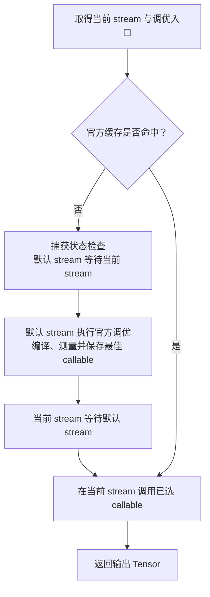

# SiluAndMul：CuTe DSL 实现思路

源码位于 [`nanovllm/kernels/cute/activation.py`](../../../../nanovllm/kernels/cute/activation.py)。实现使用 **一个 warp 处理一行、每个线程处理连续多个元素** 的布局，通过持久化网格遍历输入，并使用官方 `cutlass.cute.testing.autotune_jit` 搜索配置。

数学原理与模型中的位置见 [SiluAndMul 层](../../../model_executor/layers/activation.md)，后端性能记录见 [算子文档](../../../ir/ops/activation.md)，另一种线程布局的表达方式见 [Triton 实现](../../triton/activation/SiluAndMul.md)。本文围绕当前源码解释数据映射、访存和调优入口。

## 输入输出与入口约定

`silu_and_mul_cutedsl()` 注册为 IR 算子的 `cutedsl` 实现，通过 IR 调用时先检查支持条件：

- **输入**：连续 CUDA FP16、BF16 或 FP32 Tensor，形状为 `[..., 2H]`，最后一维为正偶数。每行前半部分是 gate，后半部分是 up。
- **输出**：独立的 `[..., H]` Tensor，设备与精度保持不变，输入内容保持原值。
- **行数**：将前导维度合并为 $T$，kernel 按输入 `[T, 2H]`、输出 `[T, H]` 计算线性地址。
- **空输入**：$T=0$ 时直接返回空输出，不转换 DLPack、不查询 SM 数，也不启动网格。一维输入 `[2H]` 则对应 $T=1$。

后端在模型层构造时绑定。单独测试可使用 `SiluAndMul(backend="cutedsl")`；完整模型通过 `kernel_config.silu_and_mul_backend` 选择实现。

## 用 DLPack 传递类型和布局

Python 入口将连续 Tensor 展平为一维 view，再通过 `from_dlpack()` 转换为 CuTe Tensor：

```python
input_alignment = min(16, x.data_ptr() & -x.data_ptr())
x_cute = from_dlpack(
    x.detach().view(-1), assumed_align=input_alignment,
).mark_layout_dynamic(0)
output_cute = from_dlpack(
    output.view(-1), assumed_align=16,
).mark_layout_dynamic(0)
```

- **共享原存储**：`view(-1)` 和 DLPack 转换不复制输入元素；CuTe 通过原设备地址读写数据。
- **从 Tensor 推导类型**：`from_dlpack()` 携带 dtype、shape 和 stride（步幅），无需维护 PyTorch 到 CUTLASS dtype 的手工映射表。kernel 写回时使用 `output.element_type`。
- **动态一维长度**：`mark_layout_dynamic(0)` 将一维布局长度标为动态，并保留第 0 维步幅为 1 的连续性约束。$H$ 由外层入口特化，$T$ 作为运行时参数传入。
- **区分实际对齐**：输入可能是带存储偏移的连续 view，不能统一声明 16 字节对齐。`ptr & -ptr` 取得地址的二进制对齐量，再将声明上限设为 16 字节；新分配的输出声明为 16 字节对齐。
- **推理用途**：`detach()` 与原输入共享存储，允许从带梯度标记的输入导出 DLPack；本 kernel 不建立反向传播关系。

例如 FP16 Tensor 从底层存储的第一个元素之后开始，地址可能只保证 2 字节对齐。它仍然连续，但可供编译器利用的向量访存对齐条件更弱。

## 一个 CTA 内怎样分配行与列

记 `rows_per_block` 为 $R$，`elements_per_thread` 为 $E$。每个 CTA（线程块）启动 $32R$ 个线程，即 $R$ 个 warp；每个 warp 在当前轮次负责一行：

```python
warp_id = thread_id // 32
lane_id = thread_id % 32
row = cutlass.Int64(block_id) * rows_per_block + cutlass.Int64(warp_id)
col = cutlass.Int32(lane_id) * elements_per_thread
```

**$R$ 表示每 CTA 的行数，$E$ 表示每个线程一次处理的连续元素数。** 两者分开控制行方向和列方向的工作量。

以 $R=4$、$E=8$ 为例，一个 CTA 有 128 个线程：

| 线程范围 | warp 编号 | 当前负责的行 |
| --- | ---: | --- |
| 0～31 | 0 | `block_id * 4` |
| 32～63 | 1 | `block_id * 4 + 1` |
| 64～95 | 2 | `block_id * 4 + 2` |
| 96～127 | 3 | `block_id * 4 + 3` |

同一个 warp 的 32 个 lane 分别领取该行相邻的连续分片：

| lane | 第一轮处理的列 | 第二轮处理的列 |
| ---: | --- | --- |
| 0 | 0～7 | 256～263 |
| 1 | 8～15 | 264～271 |
| … | … | … |
| 31 | 248～255 | 504～511 |

每轮一个 warp 覆盖 $32E$ 列，完成后执行 `col += 32 * elements_per_thread`。若 $H=4096$、$E=8$，每行需要 16 轮；同一 CTA 的四个 warp 分别遍历自己的行。

与 Triton 的 `[BLOCK_SIZE_M, BLOCK_SIZE_N]` 逻辑块相比，这里直接写出了 warp、lane 和元素之间的映射。`rows_per_block=4` 对应四个 warp 分别处理四行，每个线程在当前轮次属于其中一行。

## 持久化网格怎样遍历额外行

实际启动的 CTA 数量为：

$$
G = \min\left(\left\lceil \frac{T}{R} \right\rceil,\;4\times\mathrm{num\_sms}\right)
$$

CTA $b$ 中的 warp $w$ 从行 $bR+w$ 开始，完成整行后跨过整个网格负责的行数：

$$
r_k = bR+w+kGR,\qquad k=0,1,2,\ldots
$$

```python
while row < num_tokens:
    col = cutlass.Int32(lane_id) * elements_per_thread
    while col < hidden_size:
        # 读取本线程分片，计算并写回。
        col += 32 * elements_per_thread
    row += cutlass.Int64(num_blocks) * rows_per_block
```

例如设备有 24 个 SM，$T=4096$、$R=4$ 时，$G=96$，行步长为 384。CTA 0 的 warp 0 依次处理行 `0、384、768……3840`，warp 1 处理 `1、385、769……3841`。

- **覆盖不重叠**：每行由唯一的 CTA 和 warp 负责，不需要原子写入或跨 CTA 同步。
- **小批次减少空块**：$T$ 较小时按实际行块数启动，末块没有有效行的 warp 由 `row < num_tokens` 跳过。
- **大批次复用 CTA**：网格上限保持为四倍 SM，增加输入行数后通过行循环消化工作。
- **网格上限与驻留数量不同**：四倍 SM 描述总共启动多少 CTA，每个 SM 同时驻留几个 CTA 仍取决于线程、寄存器和硬件资源。

## 连续分片、地址计算与尾部 mask

每个线程创建长度为 $E$、步幅为 1 的布局，并在输入与输出地址上构造局部 Tensor view：

```python
layout = cute.make_layout(elements_per_thread)
gate_offset = row * (2 * hidden_size) + col
up_offset = gate_offset + hidden_size
output_offset = row * hidden_size + col

gate_view = cute.make_tensor(x.iterator + gate_offset, layout)
up_view = cute.make_tensor(x.iterator + up_offset, layout)
output_view = cute.make_tensor(output.iterator + output_offset, layout)
```

这些偏移以**元素**为单位。view 的第 $v$ 个元素对应输出坐标 $(row,col+v)$；布局只描述地址，不分配另一份全局内存。

### 完整分片与尾部保护

- **$H$ 能被 $E$ 整除**：进入列循环的每个分片都完整，使用 `mask=None`。源码通过 `cute.assume(offset, divby=E)` 告知编译器元素偏移的整除关系，帮助优化访存。
- **$H$ 不能被 $E$ 整除**：创建长度为 $E$ 的线程局部 Boolean Tensor，令 `valid[v] = col + v < H`，对 gate、up 的读取以及输出写回使用同一个 mask。
- **行边界**：由外层 `while row < num_tokens` 保护；同一 warp 的线程具有相同的行号。
- **大输入地址**：行号从初始计算起使用 `Int64`，避免在线性行偏移处进行 32 位乘法。

例如 $H=257$、$E=8$，第一轮覆盖列 0～255。第二轮只有 lane 0 的 `col=256` 进入循环，它的八个位置只有第一个有效；其余 lane 因 `col >= H` 跳过本轮。

`cute.assume()` 提供的是已满足的整除信息，不会补齐 Tensor 或改变原始指针对齐。输入地址对齐、行宽、偏移和 mask 会共同影响编译器最终生成的访存指令。

### 每线程元素数怎样随 dtype 变化

源码以 128 bit，也就是 16 字节，为一个候选基准：

```python
elements_per_128_bits = 16 // dtype.itemsize
```

| dtype | 每元素字节数 | 128 bit 对应元素数 | 搜索的 `elements_per_thread` |
| --- | ---: | ---: | --- |
| FP16 / BF16 | 2 | 8 | 4、8、16、32 |
| FP32 | 4 | 4 | 2、4、8、16 |

因此每个线程的一次逻辑分片都覆盖 64、128、256 或 512 bit 数据。**512 bit 是本线程处理的数据量，不保证生成单条 512 bit 访存指令。** 分片可能被拆成多条加载和存储；warp 的合并访存还取决于各 lane 的地址、对齐与有效 mask。

增大 $E$ 可以减少列循环次数，同时也增加每线程持有的数据与寄存器压力。因此 dtype 能静态确定候选元素数，最终选择仍通过实测调优完成。

## FP32 融合计算

gate 与 up 读入后转换为 FP32，在当前线程内计算：

$$
y = gate\times\frac{1}{1+\exp(-gate)}\times up
$$

```python
gate = gate_view.load(mask=mask).to(cutlass.Float32)
up = up_view.load(mask=mask).to(cutlass.Float32)
inv = cute.rcp(1.0 + cute.exp(-gate, fastmath=True), approx=True, ftz=True)
output_view.store((gate * inv * up).to(output.element_type), mask=mask)
```

- **融合中间结果**：SiLU 的输出直接参与乘法，不生成独立的全局内存中间 Tensor。
- **近似数学运算**：指数启用 `fastmath`，倒数启用近似与 `ftz`（将非正规数按零处理）。精度需要按 dtype 和测试容差验证，不承诺与逐算子计算逐位一致。
- **最终转换精度**：计算保持 FP32，写回前才转成输出 dtype。
- **线程内独立计算**：没有显式共享内存、warp 归约或 CTA 屏障。

每个输出逻辑上读取 gate、up 两个元素并写入一个元素，数据量为 $3THs$ 字节，$s$ 是每元素字节数。算子测试用它计算有效带宽；缓存复用与 Python 发射间隙会影响结果，该值不等同于显存物理带宽。

## 官方自动调优与两层缓存

`_get_autotuned_silu_and_mul()` 创建带官方装饰器的 `launch()`。闭包保存 $H$ 和设备相关参数，候选配置由装饰器传入：

```python
@autotune_jit(
    params_dict={
        "rows_per_block": [1, 2, 4, 8],
        "elements_per_thread": [
            elements_per_128_bits // 2, elements_per_128_bits,
            elements_per_128_bits * 2, elements_per_128_bits * 4,
        ],
    },
    update_on_change=["num_tokens"],
    warmup_iterations=5,
    iterations=30,
)
@cute.jit
def launch(
    x: cute.Tensor,
    output: cute.Tensor,
    num_tokens: cutlass.Int64,
    stream: CUstream,
    rows_per_block: cutlass.Constexpr[int] = 4,
    elements_per_thread: cutlass.Constexpr[int] = elements_per_128_bits,
) -> None:
    ...
```

每种 dtype 搜索 **4 × 4 = 16 个候选**。$R$ 同时决定 CTA 的行数、warp 数、线程数和网格尺寸，$E$ 决定列分片与循环步长，两者联合测量；SM 倍数固定为 4。

| 缓存层 | key | 保存内容 |
| --- | --- | --- |
| Python `lru_cache` 工厂 | `(device_index, dtype, hidden_size, input_alignment)` | 对应元数据特化的官方调优入口。 |
| 官方调优器 | `(num_tokens,)` | 该行数下选中的配置与已编译 callable。 |

- **元数据变化**：更换设备、精度、$H$ 或声明的输入对齐量，会取得另一份调优入口。
- **行数变化**：由 `update_on_change=["num_tokens"]` 触发该入口内部的新一轮候选测量。
- **仅地址变化**：地址本身不在 key 中，形状、精度和对齐条件相同时可复用 callable，并传入新的 Tensor 指针。
- **候选与运行时参数**：$R$、$E$ 是 `Constexpr`；Tensor、$T$、stream 在已编译调用中作为运行时参数传递。

当前安装版本的官方调优器遍历候选、调用 `cute.compile()`，每个候选预热 5 次、测量 30 次，使用冷 L2 计时。项目不自行实现候选搜索或计时器；热路径直接读取官方 `_best_kernel[key]` 并调用已选 callable。

`_best_kernel` 是装饰器的内部属性。项目将 CuTe DSL 依赖限定在 `>=4.8.1,<4.9`，升级时需要核对该缓存接口，以及调优计时器的 stream 行为。

## 首次调优与当前 stream 怎样衔接

当前安装版本的官方调优计时器默认使用 CUDA 默认 stream，项目因此将首次调优放在默认 stream 上，并显式衔接调用方：



这条等待链保证默认 stream 能读到调用方已准备的输入，也保证调优器最后一次异步执行完成后，当前 stream 再写同一输出。冷路径结束后还会在当前 stream 执行一次已选 callable；热路径只进行这一次正式调用，不再切换到默认 stream。

首次调用会包含编译、重复运行和计时同步。**CUDA Graph 捕获前必须先完成目标特化条件与行数的预热**；工厂或该行数的最佳 callable 尚未缓存时，入口会拒绝在捕获中调优。命中缓存后则使用传入的当前 stream 发射 kernel。

## 安装、验证与查看调优结果

在项目根目录、`nano-vllm` 环境中执行：

```shell
pip install -e ".[cutedsl]"
CUTE_DSL_LOG_AUTOTUNE=1 python tests/test_ops/test_silu_and_mul.py \
    --backends cutedsl --dtypes float16 bfloat16 float32
```

默认输入为 `(4096, 8192)`，输出为 `(4096, 4096)`。官方日志显示每个候选的时间和最佳配置；测试脚本通过原有 `layer(x)` 入口运行，检查 CPU FP64 参考值、输出元数据、独立存储及输入是否保持原值。

- **计时边界**：编译、调优、预热与数值检查位于正式计时之外；正式计时不捕获 CUDA Graph。
- **两种测量口径**：官方调优使用冷 L2，算子 benchmark 重复使用输入、允许缓存自然复用；两者测量范围和缓存状态不同，日志中的候选时间不应直接当作层入口的最终耗时。
- **边界输入**：检查实现时还需覆盖 $T$ 不能被 $R$ 整除、$H$ 不能被 $E$ 整除、带存储偏移的连续 view，以及非默认 stream；默认大输入测试不能代替这些边界验证。

横向性能记录统一维护在 [算子性能文档](../../../ir/ops/activation.md#实测结果)，本文不另复制一份性能表。
