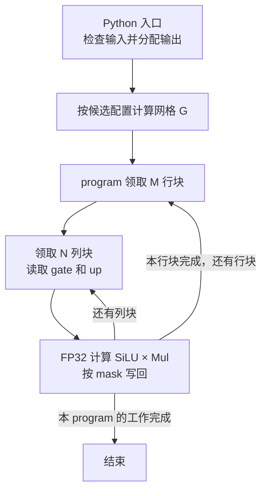

# SiluAndMul：Triton 实现思路

源码位于 [`nanovllm/kernels/triton/activation.py`](../../../../nanovllm/kernels/triton/activation.py)。实现将 SiLU 和乘法融合到同一个 kernel，用 **persistent kernel（持久化 kernel）** 限制网格规模，通过行块、列块两层循环处理大输入。

本篇说明线程块怎样领取工作、怎样计算地址，以及自动调优选择哪些参数。数学原理见 [SiluAndMul 层](../../../model_executor/layers/activation.md)，后端对比和性能记录见 [算子文档](../../../ir/ops/activation.md)。

## 输入输出与 Python 入口

[`silu_and_mul_triton()`](../../../../nanovllm/kernels/triton/activation.py) 注册为 `silu_and_mul` 的 `triton` 实现。通过 IR 调用时，先检查输入是连续的 CUDA FP16、BF16 或 FP32 Tensor，最后一维必须是正偶数。

- **输入**：`[..., 2H]`，每行前半部分为 gate，后半部分为 up。
- **输出**：独立分配的 `[..., H]`，与输入同设备、同精度，输入内容保持原值。
- **形状归一化**：连续的前导维度合并为 $T$ 行，kernel 将输入视为 `[T, 2H]`、输出视为 `[T, H]`。
- **空输入**：前导维度为空时直接返回空输出，不查询 SM 数，也不启动零尺寸网格。

```python
hidden_size = x.shape[-1] // 2       # H：单个 gate/up 分支的通道数。
num_tokens = x.numel() // x.shape[-1]  # T：合并前导维度后的行数。
```

连续布局保证这些视图可以直接用线性偏移访问，无需复制输入或额外传入 stride（步幅）。

## 持久化网格怎样分配行块

记 `BLOCK_SIZE_M` 为 $M$、`BLOCK_SIZE_N` 为 $N$，逻辑行块数和实际 program 数分别为：

$$
R = \left\lceil \frac{T}{M} \right\rceil,
\qquad
G = \min(R,\;4 \times \mathrm{num\_sms})
$$

这里一个 Triton program 对应一个 CUDA CTA（线程块）。Python 入口使用依赖候选配置的 `grid`，因此调优改变 $M$ 时，网格也会重新计算：

```python
grid = lambda meta: (
    min(triton.cdiv(num_tokens, meta["BLOCK_SIZE_M"]), num_sms * 4),
)
```

- **小批次**：按实际行块数启动 program，避免多余线程块。
- **大批次**：最多启动四倍 SM 数的 program，余下行块由同一批 program 循环处理。
- **并发上限**：四倍 SM 是整个网格的线程块数上限，实际每个 SM 同时驻留几个 CTA 仍由资源和调度决定。

kernel 通过 [`tl.program_id(0)`](https://triton-lang.org/main/python-api/generated/triton.language.program_id.html) 取得自己的 program 编号，通过 `tl.num_programs(0)` 取得网格大小：

```python
pid_m = tl.program_id(0)
num_programs_m = tl.num_programs(0)
num_blocks_m = tl.cdiv(num_tokens, BLOCK_SIZE_M)

for block_m in range(pid_m, num_blocks_m, num_programs_m):
    rows = (block_m * BLOCK_SIZE_M + row_offsets).to(tl.int64)
```

program $p$ 依次领取行块 $p,p+G,p+2G,\ldots$。**行块编号每次增加 $G$，对应的起始行增加 $G \times M$。**

例如 RTX 4060 Laptop GPU 有 24 个 SM，取 $T=4096$、$M=4$，则 $R=1024$、$G=96$。program 0 依次处理：

| 行块编号 `block_m` | 本次处理的行 |
| ---: | --- |
| 0 | 0～3 |
| 96 | 384～387 |
| 192 | 768～771 |
| … | … |
| 960 | 3840～3843 |

其余 program 从自己的编号开始执行同样的循环，完整覆盖全部 1024 个行块。

## 每个行块内部怎样遍历列

program 领取 $M$ 行后，以 $N$ 列为一块，依次遍历这几行的全部 $H$ 个通道。一次逻辑计算块的形状为 **`[M, N]`**：

```python
row_offsets = tl.arange(0, BLOCK_SIZE_M)
col_offsets = tl.arange(0, BLOCK_SIZE_N)

for block_n in range(tl.cdiv(hidden_size, BLOCK_SIZE_N)):
    cols = block_n * BLOCK_SIZE_N + col_offsets
    mask = (rows[:, None] < num_tokens) & (cols[None, :] < hidden_size)
```

- `rows[:, None]` 的形状为 `[M, 1]`，表示当前行块的绝对行号。
- `cols[None, :]` 的形状为 `[1, N]`，表示当前列块的绝对列号。
- 两者广播后生成 `[M, N]` 的地址与 mask，每个位置对应一个独立输出元素。

例如 $H=4096$、$N=256$，一个行块需要循环 16 次，依次覆盖列 0～255、256～511，直到 3840～4095。



一个 program 先完成当前行块的所有列块，再领取下一个行块。不同 program 负责的行块互不重叠，因此不需要原子写入或跨 program 同步。

## 地址计算与边界保护

对于输出坐标 $(r,c)$，输入行宽为 $2H$，输出行宽为 $H$。**下面的偏移以元素为单位**，字节地址由指针类型决定：

$$
\begin{aligned}
\mathrm{gate\_offset} &= r(2H)+c \\
\mathrm{up\_offset} &= r(2H)+c+H \\
\mathrm{output\_offset} &= rH+c
\end{aligned}
$$

```python
gate_offsets = rows[:, None] * (2 * hidden_size) + cols[None, :]
up_offsets = gate_offsets + hidden_size
gate = tl.load(input_ptr + gate_offsets, mask=mask, other=0).to(tl.float32)
up = tl.load(input_ptr + up_offsets, mask=mask, other=0).to(tl.float32)

activated = gate * tl.sigmoid(gate)
result = activated * up
output_offsets = rows[:, None] * hidden_size + cols[None, :]
tl.store(output_ptr + output_offsets, result, mask=mask)
```

- **行尾保护**：$T=5$、$M=4$ 时，第二个行块包含行 4～7，只有行 4 有效。
- **列尾保护**：$H=257$、$N=256$ 时，第二个列块包含列 256～511，只有列 256 有效。
- **读取和写入共用 mask**：无效位置读取时填 0，写入时直接跳过，避免越界和污染相邻行。
- **地址计算使用 64 位行号**：`rows` 在计算线性地址前转成 `tl.int64`，避免行号乘行宽时发生 32 位溢出。

## 融合计算减少什么开销

gate 和 up 加载后转为 FP32，在 program 内计算 `gate * sigmoid(gate) * up`，最终 store 时转回输出精度。

- **不写回独立的 SiLU 中间张量**：激活结果直接参与乘法，减少独立执行两个算子时的中间显存读写。
- **一次 kernel 完成两步计算**：减少独立算子的发射开销。
- **没有显式共享内存或同步**：每个输出只依赖同位置的 gate 和 up，中间值由线程局部持有。

每个输出逻辑上读取两个元素、写入一个元素。若每个元素占 $s$ 字节，则逻辑数据量为 $3THs$ 字节。benchmark 用它估算有效带宽；缓存复用和 host 发射间隙会影响测量，不能把它直接等同于显存物理带宽。

这里的融合收益是相对独立执行 SiLU 和乘法而言；项目性能对比中的 `torch` 后端已经使用 `torch.compile`，同样可能生成融合计算。

## 自动调优选择什么

当前 [`triton.autotune`](https://triton-lang.org/main/python-api/generated/triton.autotune.html) 对以下参数取笛卡尔积，共搜索 36 种候选，包含原先的三种配置：

| 参数 | 候选值 | 含义 |
| --- | --- | --- |
| `BLOCK_SIZE_M` | 1、2、4、8 | 每个 program 同时处理的行数 |
| `BLOCK_SIZE_N` | 256、512、1024 | 每次列循环处理的通道数 |
| `num_warps` | 2、4、8 | 每个 CTA 的 warp 数，对应 64、128、256 个线程 |

- **$M$ 控制行块大小**：增加 $M$ 会减少逻辑行块数，并改变一个 program 同时处理的行数。
- **$N$ 控制列块大小**：增加 $N$ 会减少列循环次数，同时增加每块持有的数据量和寄存器需求。
- **`num_warps` 控制线程数**：与行块、列块联合搜索，改变每线程承担的数据量及资源占用；网格上限仍固定为 SM 数的四倍。
- **显式调优 key 为 `num_tokens`、`hidden_size`**：首次遇到新的调优条件时测量候选，随后复用已选配置；调优会重复执行 kernel，因此输出采用完整覆盖写入，输入保持原值。

更多候选会增加首次调用的编译和调优耗时，后续命中缓存时只执行选中的配置。Triton 还会将输入 Tensor 的 dtype 纳入调优缓存 key，因此三种精度可以分别选取配置。

**$M$、$N$ 描述 program 的逻辑数据块，具体线程布局由 Triton 编译器决定。** 例如 $M=4$、$N=256$、`num_warps=4` 的块有 1024 个输出元素，均摊到 128 个线程是每线程 8 个元素；仅凭 $M=4$ 不能断言每个线程处理四行。

## 验证与查看调优结果

在项目根目录、`nano-vllm` 环境中执行：

```shell
TRITON_PRINT_AUTOTUNING=1 python tests/test_ops/test_silu_and_mul.py \
    --backends triton --dtypes float16 bfloat16 float32
```

该命令对默认输入 `(4096, 8192)` 运行 Triton 后端，打印实际选中的配置，并与 CPU FP64 参考值校验输出。正式计时通过原有层入口直接调用，编译、调优、预热和数值检查在计时之外，**不捕获 CUDA Graph**。

三种后端的横向实测、环境和完整复现参数统一记录在 [算子性能文档](../../../ir/ops/activation.md#实测结果)。
