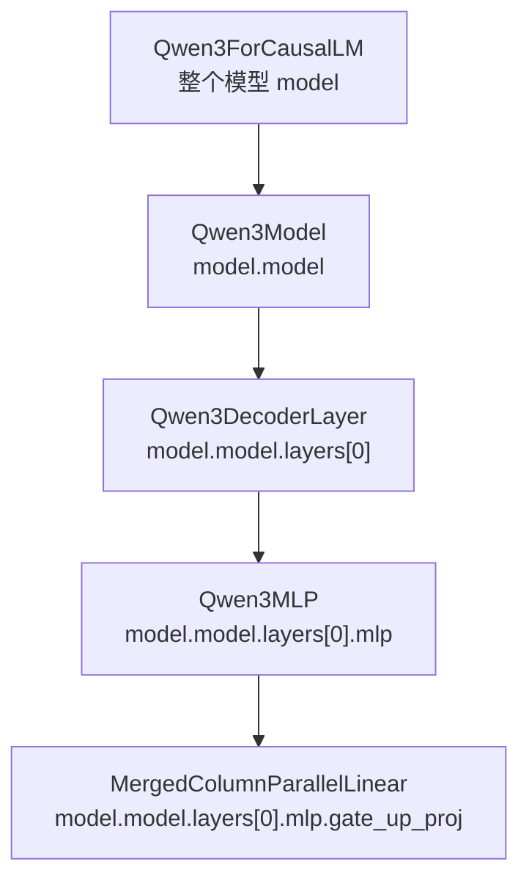
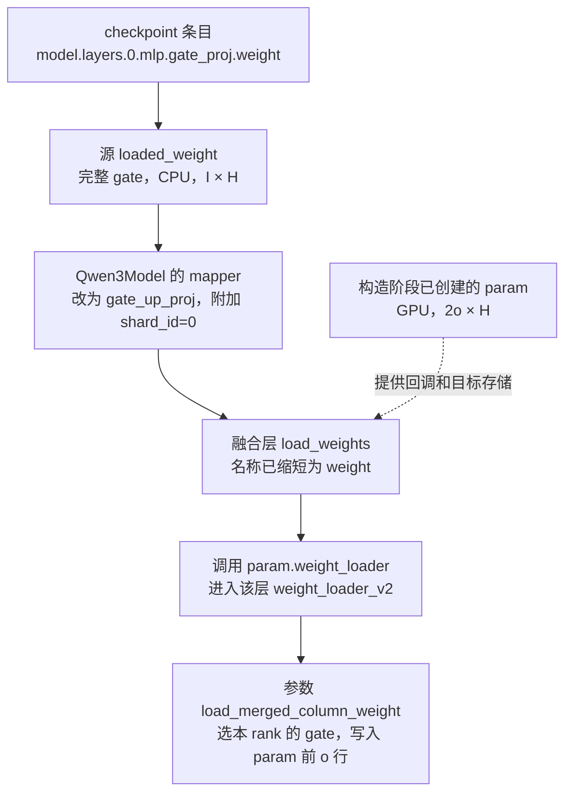

# Linear：权重布局、张量并行与加载

本文对应 [linear.py](../../../nanovllm/model_executor/layers/linear.py)。
先固定权重与矩阵乘的写法，再依次说明复制层、两种并行切分、融合投影，
最后对应参数创建、checkpoint 加载和 Qwen3 中的调用。

**全文的权重都按 PyTorch 的“输出维度 × 输入维度”保存。**
描述切分时明确说切权重的哪个轴，不根据类名中的 Row、Column 猜测方向。

## 统一约定：权重的行对应输出，列对应输入

令输入、权重和偏置分别为：

$$
\mathbf X\in\mathbb R^{T\times D_{\mathrm{in}}},
\qquad
\mathbf W\in\mathbb R^{D_{\mathrm{out}}\times D_{\mathrm{in}}},
\qquad
\mathbf b\in\mathbb R^{D_{\mathrm{out}}}
$$

线性变换始终写作：

$$
\mathbf Y=\mathbf X\mathbf W^{\mathsf T}+\mathbf b
\in\mathbb R^{T\times D_{\mathrm{out}}}
$$

偏置沿 token 轴广播。逐元素展开后，第 $j$ 个输出为：

$$
Y_{t,j}=\sum_{k=0}^{D_{\mathrm{in}}-1}X_{t,k}W_{j,k}+b_j
$$

没有创建偏置参数时，公式中的 $\mathbf b$ 取零。

因此，$\mathbf W$ 的一行包含计算一个输出特征所需的全部输入通道权重；
一列则描述某个输入特征对所有输出特征的贡献。

| 符号 | 对应成员或输入 | 含义 |
| --- | --- | --- |
| $T$ | 输入的前导维度展平后的行数。 | 本轮参与线性变换的 token 行数。 |
| $D_{\mathrm{in}}$ | `input_size`。 | 完整输入特征数。 |
| $D_{\mathrm{out}}$ | `output_size`。 | 完整输出特征数；QKV 复制布局的特例在后文说明。 |
| $P$ | `tp_size`。 | 当前线性层的 TP 分片数。 |
| $r$ | `tp_rank`。 | 当前 TP 组内编号，$0\le r<P$。 |

实际输入可以有多个前导维度，线性层只变换最后一维。下文用矩阵形式讨论。
先看三种基本布局：

| 类 | 本 rank 的 PyTorch 权重形状 | 切分含义 | 恢复完整输出的方式 |
| --- | --- | --- | --- |
| `ReplicatedLinear` | $D_{\mathrm{out}}\times D_{\mathrm{in}}$。 | 保存完整权重。 | 独立计算，无集合通信。 |
| `ColumnParallelLinear` | $(D_{\mathrm{out}}/P)\times D_{\mathrm{in}}$。 | 切权重行，即输出特征。 | 需要完整输出时做 AllGather 拼接。 |
| `RowParallelLinear` | $D_{\mathrm{out}}\times(D_{\mathrm{in}}/P)$。 | 切权重列，即输入特征。 | 需要完整输出时做 AllReduce 求和。 |

类名沿用传统并行线性层的命名约定。在本项目采用的 PyTorch 存储布局下，
**`ColumnParallelLinear` 切权重行，`RowParallelLinear` 切权重列**。
后面的推导始终使用同一个 $\mathbf W$ 布局。

## LinearBase：公共配置与返回约定

`LinearBase` 直接继承 `nn.Module`，保存尺寸、偏置策略、TP 信息并选择计算方法。
它不分配 `weight`、`bias`，也不实现 `forward()`；这些由具体子类组织。

### 全局尺寸与本地尺寸

普通线性层的 `input_size`、`output_size` 表示完整维度，参数只按本地尺寸分配。
例如，列并行的 `output_size` 仍为 $D_{\mathrm{out}}$，但本地权重只有
$D_{\mathrm{out}}/P$ 行。读取成员时，需要区分完整尺寸与 `*_per_partition`。

| 配置或成员 | 语义 |
| --- | --- |
| `bias` / `has_bias` | 是否创建偏置参数，形状由子类决定。 |
| `skip_bias_add` | 是否暂不加偏置，留给后续操作处理。 |
| `return_bias` | 是否返回 `(output, output_bias)` 二元组。 |
| `params_dtype` | 参数存储精度，缺省采用构造时的默认浮点精度。 |
| `quant_config` | 为该层选择参数存储与本地计算方法；缺省使用普通浮点方法。 |
| `prefix` | 模型中的层路径，供配置和加载使用。 |
| `disable_tp` | 本层按 $P=1,r=0$ 构造，保存完整权重并跳过 TP 通信。 |
| `tp_rank` / `tp_size` | 分片信息；基类和普通列并行层允许显式覆盖，未指定时查询当前 TP 组。 |

这些类消费已经建立的 TP 组，不创建进程或通信组。
显式覆盖 rank/size 也不会创建新组；执行集合通信时，分片布局必须与实际组一致。

### output_bias 表示待处理的偏置

先用普通完整投影说明返回约定。假设创建了偏置参数：

| `skip_bias_add` | `return_bias` | 返回内容 |
| --- | --- | --- |
| `False` | `True` | $(\mathbf X\mathbf W^{\mathsf T}+\mathbf b,\ \mathrm{None})$。 |
| `True` | `True` | $(\mathbf X\mathbf W^{\mathsf T},\ \mathbf b)$。 |
| `False` | `False` | 只返回 $\mathbf X\mathbf W^{\mathsf T}+\mathbf b$。 |
| `True` | `False` | 只返回 $\mathbf X\mathbf W^{\mathsf T}$，偏置需由调用方另行处理。 |

因此，`output_bias=None` 可以表示偏置已经加过，也可以表示根本没有偏置参数。
判断数值是否含偏置，需要结合构造选项。TP 子类还会进一步规定偏置如何切分、在哪个 rank 相加。

## ReplicatedLinear：各 rank 保存完整副本

每个 rank 都持有相同的完整参数：

$$
\mathbf W^{(r)}=\mathbf W,
\qquad
\mathbf b^{(r)}=\mathbf b
$$

各 rank 独立执行：

$$
\mathbf Y^{(r)}=\mathbf X^{(r)}\mathbf W^{\mathsf T}+\mathbf b
$$

如果输入相同，输出也相同；层本身不分发输入，也不汇集输出。
它适用于需要保留完整参数的投影，或者模型中没有进行 TP 切分的部分。

`weight_loader()` 校验完整形状后直接复制 checkpoint tensor。
`forward()` 通过 `quant_method.apply()` 执行本地投影，再处理公共的偏置返回约定。

## ColumnParallelLinear：切输出特征，结果按列拼接

### 权重按行切分，输入保持完整

令 $d_o=D_{\mathrm{out}}/P$。将权重沿输出轴（第 0 轴）分为：

$$
\mathbf W=
\begin{bmatrix}
\mathbf W^{(0)}\\
\vdots\\
\mathbf W^{(P-1)}
\end{bmatrix},
\qquad
\mathbf W^{(r)}\in\mathbb R^{d_o\times D_{\mathrm{in}}}
$$

各 rank 接收同一份完整输入 $\mathbf X$，计算自己负责的输出：

$$
\mathbf Y^{(r)}=\mathbf X(\mathbf W^{(r)})^{\mathsf T}+\mathbf b^{(r)}
\in\mathbb R^{T\times d_o}
$$

$\mathbf b^{(r)}$ 也按输出区间切分。源码对应的本地尺寸是：

$$
\texttt{input\_size\_per\_partition}=D_{\mathrm{in}},
\qquad
\texttt{output\_size\_per\_partition}=d_o
$$

### AllGather 拼接不同输出位置

每个 rank 算出的是不同输出位置上的完整值，因此完整输出是：

$$
\mathbf Y=[\mathbf Y^{(0)},\ldots,\mathbf Y^{(P-1)}]
\in\mathbb R^{T\times D_{\mathrm{out}}}
$$

- `gather_output=False`：返回本地输出 $\mathbf Y^{(r)}$，不进行输出拼接。
- `gather_output=True`：通过 AllGather 沿最后一维拼接，各 rank 都取得完整 $\mathbf Y$。

`forward()` 不会自动把输入从其他 rank 收集过来，完整输入是调用方需要满足的契约。
QKV 与 MLP 中的列并行投影通常保留本地输出，让后续操作继续处理分片。

`gather_output` 只拼接 `output`。当 `skip_bias_add=True` 时，额外返回的
`output_bias` 仍是本地偏置；调用方需要使偏置与后续输出布局匹配。

### checkpoint 取当前 rank 的输出行

普通完整 checkpoint 权重按下式加载：

$$
\mathbf W^{(r)}
=\mathbf W[rd_o:(r+1)d_o,:]
$$

对应 `output_dim=0`，偏置按相同输出区间取行。
参数在构造时就只分配本地大小，权重切片发生在加载阶段。

## RowParallelLinear：切输入特征，结果求和

### 权重按列切分，输入按相同区间切分

令 $d_i=D_{\mathrm{in}}/P$。权重沿输入轴（第 1 轴）切分，输入沿最后一维切分：

$$
\mathbf W=[\mathbf W^{(0)},\ldots,\mathbf W^{(P-1)}],
\qquad
\mathbf W^{(r)}\in\mathbb R^{D_{\mathrm{out}}\times d_i}
$$

$$
\mathbf X=[\mathbf X^{(0)},\ldots,\mathbf X^{(P-1)}],
\qquad
\mathbf X^{(r)}\in\mathbb R^{T\times d_i}
$$

每个 rank 使用对应区间计算部分和：

$$
\mathbf S^{(r)}
=\mathbf X^{(r)}(\mathbf W^{(r)})^{\mathsf T}
\in\mathbb R^{T\times D_{\mathrm{out}}}
$$

**本地结果的形状已经覆盖全部输出位置，但数值只包含部分输入通道的贡献。**
展开第 $j$ 个输出，更容易看到它缺少什么：

$$
S^{(r)}_{t,j}
=\sum_{k=rd_i}^{(r+1)d_i-1}X_{t,k}W_{j,k}
$$

### AllReduce 累加同一输出位置的贡献

完整线性变换需要覆盖全部输入通道，因此：

$$
\mathbf Y=\sum_{r=0}^{P-1}\mathbf S^{(r)}+\mathbf b
\in\mathbb R^{T\times D_{\mathrm{out}}}
$$

`reduce_results=True` 时执行 AllReduce 求和，各 rank 都取得完整输出。
`reduce_results=False` 时返回本地部分和，后续调用方需要继续处理归约。

这与列并行的区别在于结果含义：列并行需要把不同位置拼起来，
行并行需要把相同位置的贡献加起来。是否马上通信，由下游需要的布局决定。

### input_is_parallel 决定输入是否已经切好

| 配置 | 调用方传入的输入 | 本层处理 |
| --- | --- | --- |
| `input_is_parallel=True` | $\mathbf X^{(r)}\in\mathbb R^{T\times d_i}$。 | 直接使用本地输入，不再切分。 |
| `input_is_parallel=False` | 完整 $\mathbf X\in\mathbb R^{T\times D_{\mathrm{in}}}$。 | 沿最后一维选出本 rank 的输入区间。 |

Qwen3 的 `o_proj` 和 `down_proj` 接收前面已经形成的本地 head 或 MLP 特征，
因此使用已切分输入的路径。
`input_is_parallel=False` 在当前 rank 本地选择输入区间，不会替调用方分发完整输入。

### 偏置只能计入一次

各 rank 都保存完整偏置 $\mathbf b$，但求和前只由 rank 0 加入：

$$
\widetilde{\mathbf S}^{(r)}
=\mathbf S^{(r)}+\mathbb 1_{r=0}\mathbf b,
\qquad
\mathbf Y=\sum_{r=0}^{P-1}\widetilde{\mathbf S}^{(r)}
$$

这样偏置在最终输出中只出现一次。`skip_bias_add=True` 时，各 rank 都不加偏置，
按返回约定将完整偏置留给后续操作。

当前构造检查要求：设置 `reduce_results=False` 时，必须关闭 bias，
或同时设置 `skip_bias_add=True`，使部分和的归约与偏置相加由调用方统一组织。

普通完整 checkpoint 权重沿输入轴加载：

$$
\mathbf W^{(r)}
=\mathbf W[:,rd_i:(r+1)d_i]
$$

对应 `input_dim=1`。偏置没有输入轴，加载器复制完整偏置。

## MergedColumnParallelLinear：多个投影分别切分，再合并

该类继承 `ColumnParallelLinear`，让多个共享输入的独立投影用一次矩阵乘执行。
`output_sizes` 保存各逻辑投影的完整输出宽度，`forward()` 继承父类，主要区别在参数布局与加载。
下面先省略偏置，讨论权重和激活的融合布局。

### 本地布局保留每个投影的边界

设第 $j$ 个投影的权重为
$\mathbf W_j\in\mathbb R^{O_j\times D_{\mathrm{in}}}$。
每段分别按输出行切分，然后在当前 rank 内合并：

$$
\mathbf W_{\mathrm{merged}}^{(r)}
=
\begin{bmatrix}
\mathbf W_0^{(r)}\\
\vdots\\
\mathbf W_{m-1}^{(r)}
\end{bmatrix}
\in\mathbb R^{(\sum_jO_j/P)\times D_{\mathrm{in}}}
$$

$$
\mathbf Z^{(r)}
=\mathbf X(\mathbf W_{\mathrm{merged}}^{(r)})^{\mathsf T}
=[\mathbf Y_0^{(r)},\ldots,\mathbf Y_{m-1}^{(r)}]
$$

因此每个 $O_j$ 都必须能被 $P$ 整除，只有总输出宽度能整除还不够。
如果创建偏置，其布局也按相同逻辑投影排列。

以 gate/up 为例，完整权重按上下两段保存，正确的本地权重是：

$$
\mathbf W_{\mathrm{gate\_up}}^{(r)}
=\begin{bmatrix}
\mathbf W_{\mathrm{gate}}^{(r)}\\
\mathbf W_{\mathrm{up}}^{(r)}
\end{bmatrix}
$$

每个 rank 同时拿到对应区间的 gate 和 up，后续才能在本地计算
$\operatorname{SiLU}(\mathbf G^{(r)})\odot\mathbf U^{(r)}$。
将完整融合矩阵当作一整段直接均分，会破坏这两个分支的对应关系。

### 加载时区分源区间和目标区间

记第 $j$ 段本地宽度为 $o_j=O_j/P$，在本地融合参数中的起点为：

$$
a_j=\sum_{k<j}o_k
$$

从独立投影 checkpoint 加载时，对应复制关系为：

$$
\mathbf W_{\mathrm{merged}}^{(r)}[a_j:a_j+o_j,:]
\leftarrow
\mathbf W_j[ro_j:(r+1)o_j,:]
$$

`shard_id` 标识逻辑投影 $j$，`tp_rank` 标识从该投影选哪一份，两者作用不同。
若 checkpoint 已将全部投影融合，加载器先按各段完整宽度拆开源 tensor，
再逐段执行上述选择与装填。

### gather_output 不会自动重排逻辑投影

父类 AllGather 按 rank 顺序拼接输出。例如两个 rank 的 gate/up 会形成：

$$
[\mathbf G^{(0)},\mathbf U^{(0)},\mathbf G^{(1)},\mathbf U^{(1)}]
$$

它不会自动变成先全部 gate、再全部 up 的顺序。
Qwen3 中 `gate_up_proj` 保持 `gather_output=False`，直接在每个 rank 的本地两段上激活。

## QKVParallelLinear：按完整 head 切分三组投影

该类同样继承 `ColumnParallelLinear`，但加载边界由 Q/K/V head 决定，
并处理 KV head 数少于 TP rank 数时的复制。它固定 `gather_output=False`。

### 全局 head 与本地 head

设完整输入宽度为 $H$，Q head 数为 $N_q$，KV head 数为 $N_{kv}$，
Q/K 每个 head 的维度为 $d$，V 的 head 维度为 $d_v$。
本项目 Qwen3 使用 $d_v=d$，线性层接口也允许单独指定 `v_head_size`。

全局 checkpoint 中的投影形状为：

$$
\mathbf W_Q\in\mathbb R^{N_qd\times H},
\qquad
\mathbf W_K\in\mathbb R^{N_{kv}d\times H},
\qquad
\mathbf W_V\in\mathbb R^{N_{kv}d_v\times H}
$$

本地 head 数与 KV 副本数定义为：

$$
n_q=\frac{N_q}{P},
\qquad
n_{kv}=\max\left(1,\frac{N_{kv}}{P}\right),
\qquad
c=\max\left(1,\frac{P}{N_{kv}}\right)
$$

这些式子用于合法整除配置：$N_q$ 能被 $P$ 整除；KV heads 足够时均分，
不足时要求 $P$ 是 $N_{kv}$ 的整数倍。`num_kv_head_replicas` 对应 $c$。

### 本地融合参数和输出

$$
\mathbf W_{QKV}^{(r)}
=\begin{bmatrix}
\mathbf W_Q^{(r)}\\
\mathbf W_K^{(r)}\\
\mathbf W_V^{(r)}
\end{bmatrix}
\in\mathbb R^{(n_qd+n_{kv}d+n_{kv}d_v)\times H}
$$

一次投影生成：

$$
\mathbf Z_{QKV}^{(r)}
=\mathbf X(\mathbf W_{QKV}^{(r)})^{\mathsf T}+\mathbf b_{QKV}^{(r)}
=[\mathbf Q^{(r)},\mathbf K^{(r)},\mathbf V^{(r)}]
$$

三个本地宽度分别为 $n_qd$、$n_{kv}d$、$n_{kv}d_v$，彼此无需相等。
后续 Attention 只处理本地 heads，完整 head 内的 $d$ 或 $d_v$ 维保持在同一个 rank。

### Q 均分，KV 按复制组选择源权重

Q 的源 head 区间为：

$$
\mathcal H_Q^{(r)}=[rn_q,(r+1)n_q)
$$

KV 使用的源分片编号为 $\lfloor r/c\rfloor$，对应源 head 区间为：

$$
\mathcal H_{KV}^{(r)}
=\left[
\left\lfloor\frac rc\right\rfloor n_{kv},
\left(\left\lfloor\frac rc\right\rfloor+1\right)n_{kv}
\right)
$$

$c=1$ 时，各 rank 取不同的 KV 分片；$c>1$ 时，相邻 $c$ 个 rank 加载相同的 KV head。
因此继续增大 TP，并不总能让每个 rank 的 KV 权重与 KV cache 按 $1/P$ 缩小。

加载时 `shard_id` 为 `"q"`、`"k"` 或 `"v"`，用于选择本地融合参数的目标区域。
源 checkpoint 的融合边界使用全局 head 数，目标偏移使用本地 head 数；
加载器还要分别选择 Q 的 rank 与 KV 的复制组编号。

为复用父类逐段除以 $P$ 的构造方式，源码设置：

$$
\texttt{output\_sizes}
=[Pn_qd,\ Pn_{kv}d,\ Pn_{kv}d_v]
$$

当 KV 被复制时，这个列表以及其总和 `output_size` 包含副本占用的宽度，
不能将它直接当作 checkpoint 原始 Q/K/V 行数之和。

## LinearMethodBase：定义参数创建与本地计算协议

前面各个线性层决定如何切分输入、输出与权重，以及何时通信。
`LinearMethodBase` 描述这些层需要的另一组能力：**按给定布局创建参数，并使用这些参数完成本地计算。**
其共同基类、配置对象与方法选择关系见 [量化基类文档](quantization/base_config.md)。


### create_weights：接收已经确定的本地尺寸

`create_weights()` 是抽象接口。调用前，具体线性层已经决定当前 rank 的输入宽度、
各逻辑投影的输出宽度与加载入口，方法据此选择参数类型并注册存储。

| 参数 | 含义 |
| --- | --- |
| `layer` | 接收新参数的线性层对象；方法将创建的参数注册到它上面。 |
| `input_size_per_partition` | 当前 rank 的本地输入宽度。列并行保留完整输入，行并行只保留输入分片。 |
| `output_partition_sizes` | 每个逻辑投影在当前 rank 的输出宽度列表；普通线性层只有一项，融合层有多项。 |
| `input_size` | 层声明的完整输入宽度，供方法理解全局布局。 |
| `output_size` | 层声明的完整输出宽度；QKV 复制布局包含副本宽度。 |
| `params_dtype` | 参数存储精度。 |
| `extra_weight_attrs` | 传给参数的加载元信息，包括 `weight_loader` 等。 |

`output_partition_sizes` 表示**本地各投影的宽度**。例如 MergedColumn 中，
列表内每一项都已经除过 $P$，方法创建参数时不能再次做同样的 TP 除法。
完整尺寸与本地尺寸同时保留，使不同参数存储方法都能理解该层的布局。

接口返回 `None`，作用体现在对 `layer` 的修改：注册权重及方法需要的其他参数。
偏置仍由外层线性层根据 TP 布局创建。这里尚未读取 checkpoint，创建后还需要装填参数。

### apply：只完成当前 rank 的投影

另一个抽象接口为 `apply(layer, x, bias=None)`：

- `layer` 提供该层已经创建和加载的参数，以及可能需要读取的层状态。
- `x` 是调用方准备好的本地输入，其最后一维必须匹配本地权重的输入宽度。
- `bias` 是外层已经选定的偏置，可以是 `None`；方法直接使用传入值。
- 返回值 `output` 是本地计算结果，其分片语义由外层布局决定。

普通浮点实现的数学关系是：

$$
\mathbf Y_{\mathrm{local}}
=\mathbf X_{\mathrm{local}}\mathbf W_{\mathrm{local}}^{\mathsf T}
+\mathbf b_{\mathrm{selected}}
$$

列并行时，这是部分输出特征；行并行时，这是完整输出形状上的部分和。
`apply()` 不判断后面应当拼接还是求和，AllGather、AllReduce 仍由具体线性层的 `forward()` 组织。

### 加载后的处理接口来自父类

`LinearMethodBase` 将 `create_weights()`、`apply()` 声明为抽象方法，
并继承 `QuantizeMethodBase.process_weights_after_loading(layer)`。
Loader 在 checkpoint 装填后调用后处理接口，允许具体方法将存储布局调整为执行所需布局。

这样，生命周期的三个阶段分别是：

| 阶段 | 方法接口 | 参数处于什么状态 |
| --- | --- | --- |
| 构造。 | `create_weights()`。 | 已有本地存储和加载入口，尚未装填 checkpoint 数值。 |
| 装填后的准备。 | `process_weights_after_loading()`。 | 已加载权重，方法可以执行布局转换或其他准备。 |
| 推理。 | `apply()`。 | 使用已就绪的参数完成本地计算。 |

## UnquantizedLinearMethod：普通浮点参数与 GEMM

`UnquantizedLinearMethod` 实现上述协议，创建普通浮点权重，并将本地投影交给选定的 GEMM 函数。
`LinearBase.__init__()` 在没有 `quant_config` 时创建这个方法对象；配置了方法选择器时，
则通过 `quant_config.get_quant_method(layer, prefix)` 取得该层的方法。

### 构造时绑定本地计算函数

`__init__()` 先尝试读取当前模型构造上下文中的 `kernel_config.linear_backend`。
没有配置上下文时使用 `auto`，随后绑定：

```python
self._gemm_impl = dispatch_unquantized_gemm(linear_backend)
```

`_gemm_impl` 是一个接收 `(layer, x, weight, bias)` 的 callable。
配置读取和函数选择发生在方法构造时，之后每轮直接调用已绑定函数。
改变配置对象不会自动替换已构造方法中的 `_gemm_impl`。

当前 [GEMM 分派](../../../nanovllm/model_executor/layers/utils.py) 的 `auto`、`torch`
都返回 `default_unquantized_gemm`，内部调用 `F.linear(x, weight, bias)`。
这里的 `auto` 当前没有性能搜索，Triton/CuTe GEMM 也尚未接入这一分派。

### create_weights：由本地尺寸计算参数形状

记传入的本地输入宽度与各段输出宽度为：

$$
d_i=\texttt{input\_size\_per\_partition},
\qquad
(o_0,\ldots,o_{m-1})=\texttt{output\_partition\_sizes},
\qquad
d_o=\sum_{j=0}^{m-1}o_j
$$

则创建的权重统一为：

$$
\mathbf W_{\mathrm{local}}\in\mathbb R^{d_o\times d_i}
$$

同一个方法可以服务于前面不同的线性层，差别仅来自调用方传入的尺寸：

| 调用方 | $d_i$ | 输出宽度列表 | 创建的权重形状 |
| --- | --- | --- | --- |
| `ReplicatedLinear`。 | $D_{\mathrm{in}}$。 | $[D_{\mathrm{out}}]$。 | $D_{\mathrm{out}}\times D_{\mathrm{in}}$。 |
| `ColumnParallelLinear`。 | $D_{\mathrm{in}}$。 | $[D_{\mathrm{out}}/P]$。 | $(D_{\mathrm{out}}/P)\times D_{\mathrm{in}}$。 |
| `RowParallelLinear`。 | $D_{\mathrm{in}}/P$。 | $[D_{\mathrm{out}}]$。 | $D_{\mathrm{out}}\times(D_{\mathrm{in}}/P)$。 |
| `MergedColumnParallelLinear`。 | $D_{\mathrm{in}}$。 | $[O_0/P,\ldots,O_{m-1}/P]$。 | $(\sum_jO_j/P)\times D_{\mathrm{in}}$。 |
| `QKVParallelLinear`。 | $H$。 | $[n_qd,n_{kv}d,n_{kv}d_v]$。 | $(n_qd+n_{kv}d+n_{kv}d_v)\times H$。 |

普通浮点实现直接用本地尺寸分配存储；接口中的 `input_size`、`output_size`
保留了全局布局信息，但本实现不再用它们重新计算或切分参数。

### 将 tensor 包装为可加载的 ModelWeightParameter

创建参数的核心代码为：

```python
weight_loader = extra_weight_attrs.pop("weight_loader")
weight = ModelWeightParameter(
    data=torch.empty(
        sum(output_partition_sizes),
        input_size_per_partition,
        dtype=params_dtype,
    ),
    input_dim=1,
    output_dim=0,
    weight_loader=weight_loader,
    tp_rank=layer.tp_rank,
    tp_size=layer.tp_size,
)
set_weight_attrs(weight, extra_weight_attrs)
layer.register_parameter("weight", weight)
```

这段代码有四个作用：

- `torch.empty()` 分配未初始化的本地存储，精度由 `params_dtype` 指定，设备沿用模型构造上下文。
- [ModelWeightParameter](../../../nanovllm/model_executor/parameter.py) 将存储包装为推理参数，
  关闭梯度，并保存 `input_dim=1`、`output_dim=0` 与该层的 TP 状态。
- `weight_loader` 由具体线性层传入，用于后续装填 checkpoint；剩余元信息通过
  `set_weight_attrs()` 绑定，已有属性不能被重复覆盖。
- `register_parameter("weight", weight)` 将参数登记在当前层上，之后可以通过
  `layer.weight` 取得，并参与模型参数遍历与保存。

这里没有读取 checkpoint，也没有将完整权重先分配到本地再切开。
`ModelWeightParameter` 同时具备输入轴和输出轴的加载能力，
但由当前层选择调用哪一种 `load_*`，不会因此自动沿两个轴同时分片。
参数类的继承、源分片选择与原地装填过程见 [Parameter 文档](../parameter.md)。

`UnquantizedLinearMethod` 已登记在 `WEIGHT_LOADER_V2_SUPPORTED` 中，
所以行/列并行层为普通权重传入的是自己的 `weight_loader_v2`。
以列并行为例，随后加载权重时的调用链为：

$$
\texttt{param.weight\_loader}
\longrightarrow \texttt{layer.weight\_loader\_v2}
\longrightarrow \texttt{param.load\_column\_parallel\_weight}
$$

方法对象负责创建参数并接好入口；层与参数对象共同完成实际源分片选择和复制。

### apply：读取 layer.weight，再调用已绑定函数

该方法的计算入口只有：

```python
return self._gemm_impl(layer, x, layer.weight, bias)
```

按当前默认后端展开，调用链为：

$$
\texttt{layer.forward}
\longrightarrow \texttt{quant\_method.apply}
\longrightarrow \texttt{default\_unquantized\_gemm}
\longrightarrow \texttt{F.linear}
$$

对于本地输入 $\mathbf X_{\mathrm{local}}\in\mathbb R^{T\times d_i}$，
使用已经装填的 $\mathbf W_{\mathrm{local}}\in\mathbb R^{d_o\times d_i}$，得到：

$$
\mathbf Y_{\mathrm{local}}
=\mathbf X_{\mathrm{local}}\mathbf W_{\mathrm{local}}^{\mathsf T}
+\mathbf b_{\mathrm{selected}}
\in\mathbb R^{T\times d_o}
$$

当 `bias=None` 时只执行投影项。`apply()` 不重新读取 `skip_bias_add`、
`gather_output` 或 `reduce_results`；偏置选择与通信由外层处理：

- 列并行层传入本地偏置，或因 `skip_bias_add=True` 传入 `None`。
- 行并行层根据 rank 与偏置策略，只让 rank 0 在需要时传入偏置。
- 方法返回本地结果后，外层再按配置执行 AllGather、AllReduce 或直接返回。

因此，替换 `_gemm_impl` 可以改变本地矩阵乘实现，而保持前面的 TP 切分、偏置和通信流程。
当前默认 GEMM 函数直接使用传入的 `x`、`weight`、`bias`；`layer` 参数保留了读取层状态的入口。

### 普通浮点方法的加载后处理

`UnquantizedLinearMethod` 没有重写 `process_weights_after_loading()`，
沿用父类的空操作，权重继续保持普通 PyTorch 输出维度 × 输入维度的布局。
Loader 仍统一调用这个钩子，并在其后同步专用参数的 TP 状态，完整调用时机见下一节。

## 追踪 Qwen3 第一层 MLP 的权重加载

本节只追踪两个真实的 Qwen3 checkpoint 名称：

- `model.layers.0.mlp.gate_proj.weight`：完整 gate 投影。
- `model.layers.0.mlp.up_proj.weight`：完整 up 投影。

它们在本项目中共同装入一个目标参数：
`model.layers.0.mlp.gate_up_proj.weight`。
以下使用普通浮点方法、默认 GPU 加载配置和 TP 分片，
记隐藏宽度为 $H$，MLP 中间宽度为 $I$，TP 大小为 $P$，当前 rank 为 $r$，
每个投影的本地输出宽度为 $o=I/P$。

### 先区分三个对象：目标参数、源数值、加载回调

**本层参数先创建，checkpoint 数值后读取，再通过加载回调填入参数。**
这三个对象在后文始终使用不同名称：

| 名称 | 是什么 | 何时出现 |
| --- | --- | --- |
| `param`。 | 本地融合目标参数 `gate_up_proj.weight`，类型为 `ModelWeightParameter`，形状为 $2o\times H$。 | 构造模型时分配，最初尚未装填 checkpoint 数值。 |
| `loaded_weight`。 | 从文件取得的一个源 CPU tensor。例如完整 gate 权重，形状为 $I\times H$。 | 权重生成器被消费、读取对应条目时取得。 |
| `param.weight_loader`。 | 参数保存的 Python 回调，本例指向所属 MergedColumn 层的 `weight_loader_v2`。 | 创建目标参数时绑定，之后用来接收源 tensor。 |

`torch.empty()` 分配了存储，但不填入训练好的数值，也不保证初始值为零。
**`param` 已经存在，不代表它的权重已经就绪。**
本例的装填通过 `copy_()` 修改已有参数的存储，不把 `param` 替换成源 tensor。

### 创建整个模型，再定位到 gate_up_proj

入口在 [GPUModelRunner.load_model()](../../../nanovllm/worker/gpu_model_runner.py)。
它选择 Loader 并调用 `model_loader.load_model()`；
[BaseModelLoader](../../../nanovllm/model_executor/model_loader/base_loader.py) 先构造模型，再加载权重：

```python
model = initialize_model(
    vllm_config=vllm_config,
    model_config=model_config,
    prefix=prefix,
)
self.load_weights(model, model_config)
```

这里的 `model` 是整个 `Qwen3ForCausalLM`，其构造沿模块树到达第一层 MLP：



图中外层变量 `model` 是整个模型，内部的 `.model` 属性才是 decoder 主体。
Python 访问路径中的 `model.model.layers[0]`，
对应模型参数名称里的 `model.layers.0`；外层局部变量名不属于参数名称。

[Qwen3MLP.__init__()](../../../nanovllm/model_executor/models/qwen3.py) 创建融合投影：

```python
self.gate_up_proj = MergedColumnParallelLinear(
    hidden_size,
    [intermediate_size] * 2,
    bias=False,
    quant_config=quant_config,
    prefix=f"{prefix}.gate_up_proj" if prefix else "gate_up_proj",
)
```

第一层对应的 `prefix` 为 `model.layers.0.mlp.gate_up_proj`。
此时层掌握的尺寸为：

| 层成员 | 本例的值 |
| --- | --- |
| `input_size` / `input_size_per_partition`。 | $H$，每个 rank 保留完整输入特征。 |
| `output_sizes`。 | $[I,I]$，两段投影的完整输出宽度。 |
| `output_partition_sizes`。 | $[o,o]$，两段投影在当前 rank 的输出宽度。 |
| `tp_rank` / `tp_size`。 | $r$ / $P$。 |

为了缩短后文表达，约定以下阅读用别名；它们不表示再创建一层或再创建参数：

```python
linear = model.model.layers[0].mlp.gate_up_proj
param = linear.weight
```

### 创建本地参数，同时绑定加载回调

`MergedColumnParallelLinear` 把参数创建交给父类 `ColumnParallelLinear.__init__()`。
普通浮点方法已登记支持 v2，因此构造时选中：

```python
weight_loader = self.weight_loader_v2
```

此处的 `self` 仍然是 MergedColumn 层，Python 会取到它重写的
`MergedColumnParallelLinear.weight_loader_v2`。
没有调用括号，表示只保存绑定了该层的方法，尚未执行加载。

父类将这个方法通过 `weight_loader=weight_loader`
传给 `UnquantizedLinearMethod.create_weights()`。
后者拿到 `output_partition_sizes=[o,o]`、`input_size_per_partition=H`，创建并注册参数：

```python
weight = ModelWeightParameter(
    data=torch.empty(
        sum(output_partition_sizes), input_size_per_partition, dtype=params_dtype,
    ),
    input_dim=1,
    output_dim=0,
    weight_loader=weight_loader,
    tp_rank=layer.tp_rank,
    tp_size=layer.tp_size,
)
layer.register_parameter("weight", weight)
```

参数初始化时，`BasevLLMParameter` 把回调保存到 `self._weight_loader`，
`weight_loader` property 则对外返回它。

此时当前 rank 上的状态是：

| 对象或属性 | 当前状态 |
| --- | --- |
| `linear.weight`，即 `param`。 | 已分配 $2o\times H$ 的 GPU 存储，前 $o$ 行预留给 gate，后 $o$ 行预留给 up。 |
| `param.input_dim` / `param.output_dim`。 | `1` / `0`，仍采用 PyTorch 的输出维度 × 输入维度。 |
| `param.tp_rank` / `param.tp_size`。 | $r$ / $P$。 |
| `param.weight_loader`。 | 指向 `linear.weight_loader_v2` 的绑定方法。 |
| `loaded_weight`。 | 还没有读取本例的 checkpoint 条目。 |

这一步在整个模型构造期间完成。`initialize_model()` 返回后，
所有层都已经创建，才进入 Loader 的权重装填阶段。

### 从 checkpoint 读取一份完整 gate 权重

[DefaultModelLoader.load_weights()](../../../nanovllm/model_executor/model_loader/default_loader.py)
调用模型的入口：

```python
loaded_weights = model.load_weights(self.get_all_weights(model_config, model))
```

这里 `loaded_weights` 是最终返回的**已加载目标名称集合**，
而 `get_all_weights()` 提供 `(name, tensor)` 生成器。
模型消费生成器时，沿 `get_all_weights()`、`_get_weights_iterator()`
到达 [safetensors_weights_iterator()](../../../nanovllm/model_executor/model_loader/weight_utils.py)：

```python
with safe_open(st_file, framework="pt") as f:
    for name in f.keys():
        param = f.get_tensor(name)
        yield name, param
```

注意文件工具中的局部变量也叫 `param`，但它指的是文件中的源 tensor，
与前文 `linear.weight` 不是同一个对象。
后续层加载器用 `loaded_weight` 接收这个源 tensor。

只看 gate 条目，此时得到：

| 项目 | 内容 |
| --- | --- |
| checkpoint 名称。 | `model.layers.0.mlp.gate_proj.weight`。 |
| 源 `loaded_weight`。 | CPU tensor，形状为 $I\times H$，包含所有 TP rank 所需的完整 gate 权重。 |
| 目标 `param`。 | 仍是构造时分配的 GPU 参数，形状为 $2o\times H$，尚未写入该条目的数值。 |

当前各 TP worker 分别消费源权重流，并在自己的加载路径中选取所需分片。
文件按生成器惰性读取，不要求先把整个模型的源权重全部读入内存。

### 从整个 Qwen 到具体层：名称怎样逐级变化

最外层调用的是 `Qwen3ForCausalLM.load_weights()`。
它创建以整个模型为根的 `AutoWeightsLoader`；
后者按 `model` 前缀找到 decoder 主体，转交给 `Qwen3Model.load_weights()`。
主体创建自己的自动加载器，并传入 `hf_to_vllm_mapper`。

沿这条路径追踪同一个 gate 条目：

| 到达的位置 | 该层看到的名称 | 源 tensor 的变化 |
| --- | --- | --- |
| `Qwen3ForCausalLM.load_weights()`。 | `model.layers.0.mlp.gate_proj.weight`。 | 仍是完整 gate，$I\times H$。 |
| `Qwen3Model.load_weights()`。 | `layers.0.mlp.gate_proj.weight`。 | 只去掉外层模块路径前缀，数值不变。 |
| 主体的 `hf_to_vllm_mapper`。 | `layers.0.mlp.gate_up_proj.weight`。 | 附加 `loaded_weight.shard_id=0`，形状仍为 $I\times H$。 |
| 递归进入 `layers[0]`。 | `mlp.gate_up_proj.weight`。 | 源数值不变。 |
| 递归进入 `mlp`。 | `gate_up_proj.weight`。 | 源数值不变。 |
| `MergedColumnParallelLinear.load_weights()`。 | `weight`。 | 取到完整 gate 和它的 `shard_id=0`。 |

名称映射规则是 `.gate_proj → (.gate_up_proj, 0)`。
**改名用于找到融合目标参数；附加编号用于指出应写入 gate 区域。
这个过程没有把 gate 和 up 的源 tensor 拼接，也没有完成 TP 切片。**
递归路径与映射实现见 [models/utils.py](../../../nanovllm/model_executor/models/utils.py)。

下面的图只追踪这一条权重被消费后的数据去向：



源 tensor 沿权重流到达已有的融合层。层根据名称拿到已有的目标参数，
再通过这个目标参数保存的回调，把源数值复制进去。

### 执行回调：层算目标偏移，参数选源分片

`MergedColumnParallelLinear.load_weights()` 取出源 tensor 上的投影编号。
对于本例的 `name="weight"`，核心操作等价于：

```python
shard_id = getattr(loaded_weight, "shard_id", None)  # 本例为 0。
param = linear.weight
param.weight_loader(param, loaded_weight, shard_id)
```

因为回调已经绑定，所以最后一行进入：

```python
linear.weight_loader_v2(param, loaded_weight, loaded_shard_id=0)
```

这次调用中的 `self` 是层 `linear`，`param` 是目标参数，
`loaded_weight` 是完整 gate 源 tensor。
层知道逻辑投影的顺序，计算：

```python
shard_offset = sum(self.output_sizes[:loaded_shard_id]) // self.tp_size
shard_size = self.output_sizes[loaded_shard_id] // self.tp_size
```

gate 的 `loaded_shard_id=0`，所以目标偏移为 $0$，宽度为 $o$。
随后调用目标参数的方法：

```python
param.load_merged_column_weight(
    loaded_weight=loaded_weight,
    shard_id=0,
    shard_offset=0,
    shard_size=shard_size,
)
```

进入参数方法后，`self` 换成了参数对象。对于本例默认尚未按 TP 分片的源，
操作展开为：

```python
param_data = self.data.narrow(self.output_dim, shard_offset, shard_size)
loaded_weight = loaded_weight.narrow(
    self.output_dim, self.tp_rank * shard_size, shard_size,
)
assert param_data.shape == loaded_weight.shape
param_data.copy_(loaded_weight)
```

这里的两个 `narrow()` 分别作用于不同对象：

| 操作 | 作用对象 | 本例选中的区域 |
| --- | --- | --- |
| 目标 `narrow()`。 | 已有本地参数 `param.data`。 | 前 $o$ 行，即 gate 目标区域，形状为 $o\times H$。 |
| 源 `narrow()`。 | 完整 gate 源 `loaded_weight`。 | 第 $ro$ 到 $(r+1)o$ 行，形状为 $o\times H$。 |
| `copy_()`。 | 将源视图复制到目标视图。 | 写入本 rank 的 gate 数值；up 区域尚未由此条目装填。 |

源和目标的 `narrow()` 都先取得视图，`copy_()` 才写入目标存储。
默认 GPU 加载时，这一步也完成 CPU 源视图到 GPU 目标区域的复制：

$$
\mathbf W_{\mathrm{gate\_up}}^{(r)}[0:o,:]
\leftarrow
\mathbf W_{\mathrm{gate}}[ro:(r+1)o,:].
$$

### 再加载 up：复用同一个目标参数，写另一段

up 条目经过同样的路径，源名称改成
`model.layers.0.mlp.up_proj.weight`，映射规则为
`.up_proj → (.gate_up_proj, 1)`。

为便于展示，下面按先 gate、再 up 列出状态；实际条目先后顺序不影响这两个独立目标区域。
两次加载的关键值为：

| 项目 | gate 条目 | up 条目 |
| --- | --- | --- |
| 源 `loaded_weight`。 | 完整 gate，$I\times H$。 | 另一份完整 up，$I\times H$。 |
| 目标 `param`。 | `linear.weight`。 | 同一个 `linear.weight`，不重新创建。 |
| `loaded_shard_id`。 | `0`。 | `1`。 |
| 目标 `shard_offset`。 | $0$。 | $I/P=o$。 |
| 目标 `shard_size`。 | $o$。 | $o$。 |
| 源 TP 起点。 | $ro$。 | $ro$，在 up 源 tensor 内计算。 |
| 目标区间。 | $[0,o)$。 | $[o,2o)$。 |

第二次复制为：

$$
\mathbf W_{\mathrm{gate\_up}}^{(r)}[o:2o,:]
\leftarrow
\mathbf W_{\mathrm{up}}[ro:(r+1)o,:].
$$

至此，同一个本地参数在本例中的状态依次变为：

| 时刻 | 前 $o$ 行 | 后 $o$ 行 |
| --- | --- | --- |
| 参数创建完成。 | 已分配，尚未装填 gate。 | 已分配，尚未装填 up。 |
| gate 条目装填完成。 | 本 rank 的 gate。 | 尚未装填 up。 |
| up 条目装填完成。 | 本 rank 的 gate。 | 本 rank 的 up。 |

融合层的 `load_weights()` 每成功装填一个条目就 `yield name`，
因此这里两次产出的都是 `"weight"`。
外层自动加载器补回路径并汇总为集合，最终包含
`model.layers.0.mlp.gate_up_proj.weight`。
`weight_loader_v2()` 和参数的 `load_merged_column_weight()` 自身都返回 `None`，
实际结果保存在已修改的目标参数中。

### 加载完成后：前向直接使用本地参数

整个模型的权重装填完成后，Loader 调用后处理并切换到 `eval()`。
普通浮点方法的后处理为空操作，本例参数继续保持 $2o\times H$ 的布局。
`update_param_tp_status()` 会同步专用参数的 rank/size；
它更新元信息，不切分 tensor，也不执行集合通信。

推理到达第一层 MLP 时，调用：

```python
gate_up, _ = self.gate_up_proj(x)
x = self.silu_and_mul(gate_up)
x, _ = self.down_proj(x)
```

融合层通过 `quant_method.apply()` 直接读取已经装填好的 `linear.weight`：

$$
\mathbf Z^{(r)}
=\mathbf X\left(\mathbf W_{\mathrm{gate\_up}}^{(r)}\right)^{\mathsf T}
=[\mathbf G^{(r)},\mathbf U^{(r)}]
\in\mathbb R^{T\times 2o}.
$$

**前向不会再次打开 checkpoint、重新创建参数或再次调用权重加载回调。**
后续激活消费本地 gate/up，down 投影再按行并行规则归约结果。

## 对照加载接口：在上述主线中各自负责什么

### load_weights 处理权重流，weight_loader 处理一份源 tensor

| 接口 | 输入与职责 | 返回或产出 |
| --- | --- | --- |
| `DefaultModelLoader.load_weights(model, model_config)`。 | 根据配置提供源权重流，调用模型入口，检查目标参数加载集合。 | 返回 `None`。 |
| `Qwen3ForCausalLM.load_weights(weights)`。 | 以整个语言模型为根分派。 | 已加载目标名称集合。 |
| `Qwen3Model.load_weights(weights)`。 | 以 decoder 主体为根分派，加入名称与投影编号映射。 | 相对于主体的已加载名称集合。 |
| `AutoWeightsLoader.load_weights(weights, mapper=...)`。 | 应用映射和过滤，按模块路径递归，转交给子模块专用入口或参数回调。 | 相对于当前根模块的已加载名称集合。 |
| MergedColumn、QKV 的 `load_weights(weights)`。 | 消费该层的权重流，找到目标参数，将源 tensor 的 `shard_id` 传给参数回调。 | 逐条 `yield name`，遍历生成器时才装填。 |
| 层的 `weight_loader()` / `weight_loader_v2()`。 | 接收目标参数和一份源 tensor；融合层还接收投影编号，组织这一次装填。 | 返回 `None`，原地修改目标参数。 |

普通 Column、Row 和 Replicated 层没有独立的 `load_weights()` 权重流入口。
自动加载器定位到其参数后，直接取得 `param.weight_loader`，
以 `(param, loaded_weight)` 调用。融合层提供专用入口，是为了额外传递投影编号。

### weight_loader 与 weight_loader_v2 的分工

两者都是层的方法，区别在于实际分片、复制放在哪里：

| 路径 | 参数接口 | 分工 |
| --- | --- | --- |
| `weight_loader`。 | 普通 `nn.Parameter`，可附加轴与布局属性。 | 层读取属性、计算源/目标视图，并直接检查、复制。 |
| `weight_loader_v2`。 | 提供 `load_*()` 方法的 `BasevLLMParameter` 子类。 | 层解释投影结构，参数的方法执行实际分片与复制。 |

本例属于第二条路径：层知道 gate/up 的顺序和宽度，
参数知道自己的输出轴、rank 和存储方式。
**`param.weight_loader` 这个属性可以保存其中任一种方法，具体在参数创建时决定。**

| 层 | v2 调用的参数方法 | 层额外提供的信息 |
| --- | --- | --- |
| `ColumnParallelLinear`。 | `load_column_parallel_weight()`。 | 普通列分片的轴、rank 已保存在参数上。 |
| `RowParallelLinear`。 | `load_row_parallel_weight()`。 | 普通行分片的轴、rank 已保存在参数上。 |
| `MergedColumnParallelLinear`。 | `load_merged_column_weight()`。 | 投影编号、本地目标偏移与宽度。 |
| `QKVParallelLinear`。 | `load_qkv_weight()`。 | Q/K/V 编号、本地目标偏移与宽度、KV 副本数。 |

当前普通浮点方法已登记支持 v2，所以 TP 层的普通 `weight` 走 v2。
普通 `bias` 仍绑定传统加载器；`ReplicatedLinear` 也直接使用自己的传统完整复制入口。
v2 依赖参数实现对应方法，不会在执行失败时自动回退传统路径。
参数类的具体实现见 [Parameter 文档](../parameter.md)。

### _load_fused_module_from_checkpoint 处理另一种源布局

前面的常规 HF checkpoint 分别保存 gate 和 up，映射器已经给出 `0/1` 编号，
所以直接进入 `weight_loader_v2()` 的单段分支，**不会经过这个辅助方法**。

如果一个 checkpoint 条目已经把完整 gate/up 保存为一个 tensor，源形状变为
$2I\times H$，且没有单段编号，`loaded_shard_id=None`。
对于本例的普通 `ModelWeightParameter`，v2 此时调用：

```python
self._load_fused_module_from_checkpoint(param, loaded_weight)
```

它不打开文件，只拆分已经读出的源 tensor。MergedColumn 的接口额外允许
`output_sizes` 参数，缺省使用 `self.output_sizes`。
本例取完整宽度 $[I,I]$，处理过程为：

| 辅助方法的操作 | 重新进入的单段调用 |
| --- | --- |
| 从融合源取 $[0,I)$ 行，得到完整 gate。 | `self.weight_loader_v2(param, loaded_weight_shard, 0)`。 |
| 从融合源取 $[I,2I)$ 行，得到完整 up。 | `self.weight_loader_v2(param, loaded_weight_shard, 1)`。 |

之后就接回前面的 gate/up 单段加载过程。**先拆逻辑投影，再在每个投影内选择 TP 分片。**

源码中的 `current_shard_offset` 累加各投影的完整宽度。
`shard_offsets` 保存 `(shard_id, shard_offset, shard_size)`，
这里的偏移和长度属于**源融合 tensor**；
单段回调中再次计算的偏移和长度则属于**本地目标参数**。
MergedColumn 还接受 tuple 形式的投影编号，由对应分支选择本次源宽度列表。

QKV 单独实现这个辅助方法，按真实全局 head 数拆开三段：

| 投影 | 融合源的起点 | 源宽度 | 本地目标的起点 | 本地宽度 |
| --- | --- | --- | --- | --- |
| Q。 | $0$。 | $N_qd$。 | $0$。 | $n_qd$。 |
| K。 | $N_qd$。 | $N_{kv}d$。 | $n_qd$。 | $n_{kv}d$。 |
| V。 | $(N_q+N_{kv})d$。 | $N_{kv}d_v$。 | $(n_q+n_{kv})d$。 | $n_{kv}d_v$。 |

拆出的 Q/K/V 分别以 `"q"/"k"/"v"` 编号进入单段 v2。
层通过 `_get_shard_offset_mapping()`、`_get_shard_size_mapping()`
取得本地目标区域，参数再选择 Q 的 rank 或 KV 的复制组。
参数接口的 `num_heads` 实际接收 `num_kv_head_replicas`。
拆源不能用含 KV 副本的 `self.output_sizes` 代替真实 checkpoint 行数。

传统 `weight_loader` 也支持完整融合源，但在自己的方法内部拆段并再次调用传统单段分支；
这个辅助方法服务于 v2 路径。

### 源是否已按 TP 分片，是另一个独立条件

前面的示例默认源投影完整。若 `param.is_sharded_weight=True`，
则表明传入的源已经按 rank 切好，参数加载方法跳过再次 TP 源切片，
仍要定位目标区域、检查形状并复制。

`loaded_shard_id` 说明“这是 gate 还是 up”，
`is_sharded_weight` 说明“这份源是否已经按 rank 切好”，两者不能互相替代。
源融合 tensor 是否还需拆成投影，仍由层入口判断。

传统加载器中没有输入轴或输出轴的参数按复制语义装填。
v2 的 Merged/QKV 入口对类型恰为 `BasevLLMParameter` 或 `RowvLLMParameter`
的参数也有完整复制分支；本例 `ModelWeightParameter` 走上述列分片路径。
标量兼容分支单独处理，普通矩阵加载仍严格检查源与目标视图形状。

## 为什么列并行和行并行经常成对出现

设第一层权重 $\mathbf W_1\in\mathbb R^{F_1\times H}$，第二层权重
$\mathbf W_2\in\mathbb R^{H\times F_2}$，先省略偏置。中间操作 $\phi$ 在本地将
$T\times(F_1/P)$ 的特征变换为 $T\times(F_2/P)$，无需读取其他 rank 的特征。
第一层按输出行切分，第二层按对应输入列切分，则：

$$
\mathbf Z^{(r)}=\mathbf X(\mathbf W_1^{(r)})^{\mathsf T},
\qquad
\mathbf A^{(r)}=\phi(\mathbf Z^{(r)})
$$

$$
\mathbf Y
=\sum_{r=0}^{P-1}\mathbf A^{(r)}(\mathbf W_2^{(r)})^{\mathsf T}
$$

中间不必先 AllGather 出完整特征，第二层直接消费本地分片，最后一次 AllReduce
恢复完整隐藏状态。对于 gate/up 融合投影，$F_1=2I,F_2=I$，
门控激活要保证对应 gate/up 特征在同一 rank；
Attention 则要保证完整 heads 及其对应 KV 分组可在本地处理。

在 [Qwen3](../models/qwen3.md) 中，对应关系为：

| 调用位置 | 切分与本地处理 | 恢复完整隐藏状态的位置 |
| --- | --- | --- |
| `qkv_proj` → Q/K Norm → RoPE → Attention → `o_proj`。 | QKV 按 head 切输出，各 rank 独立处理本地 heads。 | `o_proj` 的 AllReduce。 |
| `gate_up_proj` → `silu_and_mul` → `down_proj`。 | gate/up 分别切输出，本地执行门控乘法。 | `down_proj` 的 AllReduce。 |

RMSNorm 和残差路径因此可以继续处理完整隐藏维度。
输出词表投影也属于按输出特征切分：原始权重为 $V\times H$，
没有 padding 时每个 rank 持有 $(V/P)\times H$；有 padding 时按补齐后的词表行数均分。
当前通过 AllGather 拼接分数，再裁去尾部 padding。
它由 `ParallelLMHead` 与 `LogitsProcessor` 组织，具体计算见 Qwen3 文档的词表投影部分。
