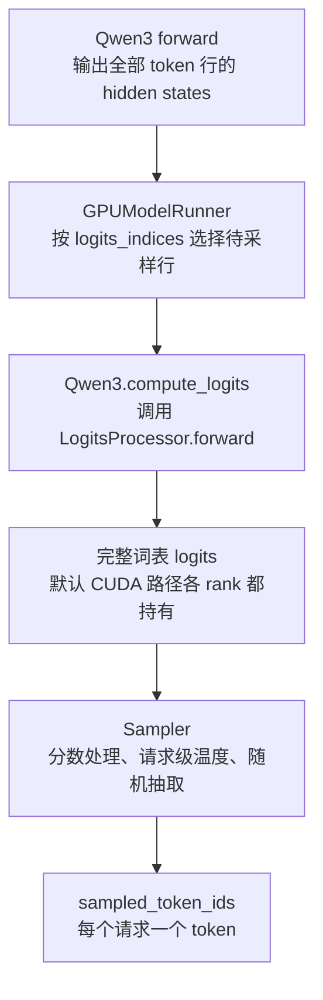
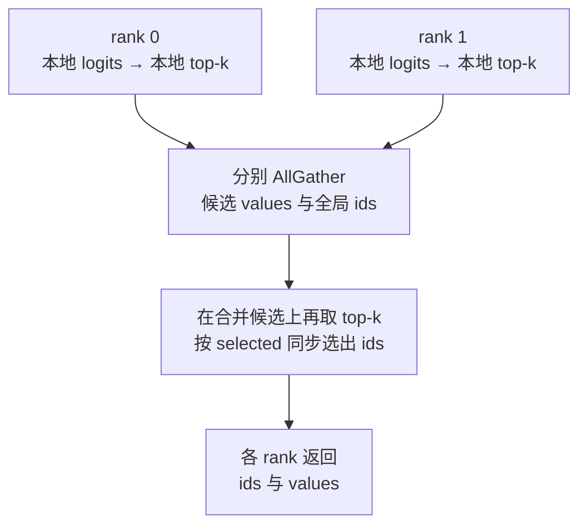

# LogitsProcessor：词表分数、采样与 TP 候选选择

本文对应 [logits_processor.py](../../../nanovllm/model_executor/layers/logits_processor.py)。
理解本类之前，先把生成下一个 token 的几步分开：**模型给每个 token 打分，
按策略调整分数，再决定选择哪个 token。** 这些工作由多个类配合完成。

`LogitsProcessor` 负责词表投影、分数变换和 TP 汇集，也提供直接查询 argmax/top-k 的接口。
默认引擎通过它取得完整分数，再交给 `Sampler` 随机采样。
最后一节用一个 6-token 词表，把两条路径中的中间变量具体算出来。

## 先分清 hidden states、logits、概率和 token ID

设 Runner 选出 $B$ 行待采样的 hidden states，每行宽度为 $H$。
原始词表大小为 $V$，输出头权重始终采用 PyTorch 的输出维度 × 输入维度布局：

$$
\mathbf X\in\mathbb R^{B\times H},\qquad
\mathbf W_{\mathrm{lm}}\in\mathbb R^{V\times H},\qquad
\mathbf L=\mathbf X\mathbf W_{\mathrm{lm}}^{\mathsf T}+\mathbf b
\in\mathbb R^{B\times V}.
$$

这里的 $L_{b,j}$ 是第 $b$ 行对全局 token ID $j$ 的 **logit（未归一化分数）**。
一行中的 token 对应同一个请求在当前生成位置上的不同候选。

| 对象 | 典型形状 | 表示什么 |
| --- | --- | --- |
| `hidden_states`。 | `[B, H]`。 | 模型对当前上下文的隐藏表示，最后一维不是词表。 |
| `lm_head.weight`。 | 完整布局为 `[V, H]`，TP 时只保存本地词表行。 | 把隐藏表示映射到各 token 分数的参数。 |
| `logits`。 | `[B, V]`。 | 各 token 的分数，允许为负数，不要求总和为 1。 |
| `probs`。 | `[B, V]`。 | 用 softmax 得到的概率，每行总和为 1。 |
| `sampled_token_ids`。 | 采样函数返回 `[B]`，Sampler 对外组织为 `[B, 1]`。 | 每行最终选中的一个全局 token ID。 |

**一个 token 的 logit 为 6，不意味着它有 60% 概率。**
概率取决于它与这一行所有其他 token 分数的相对关系：

$$
p_{b,j}=\frac{e^{L_{b,j}}}{\sum_{u=0}^{V-1}e^{L_{b,u}}}.
$$

给一行所有 logits 加上相同常数，不改变 softmax 概率；
因此分数的绝对零点没有直接的概率含义。

## 为什么生成路径要拆成多个步骤

### 最大分数与随机采样是不同的选择方式

Greedy（贪心选择）每次取分数最高的 token：

$$
j_b^*=\operatorname*{argmax}_j L_{b,j}.
$$

softmax 保持分数大小顺序，所以 greedy 不必先计算概率。
随机采样则按 $p_{b,j}$ 抽取一个 token：高分 token 更常被选中，低分 token 仍可能被选中。
它需要保留概率分布的信息，不能直接用 argmax 替代。

温度 $\tau_b>0$ 在 softmax 前调整每行分数：

$$
p_{b,j}(\tau_b)
=\frac{e^{L_{b,j}/\tau_b}}{\sum_u e^{L_{b,u}/\tau_b}}.
$$

- 温度小于 1，分数差距被放大，概率更集中。
- 温度大于 1，分数差距被缩小，概率更分散。
- 正温度不改变分数排序，但会改变随机采样的分布。
- 温度趋近于零时，分布趋向最高分位置；当前 `SamplingParams` 不接受 `temperature=0`，还没有引擎级 greedy 分支。

### 候选筛选、分数处理和随机抽取各有用途

| 操作 | 解决什么问题 | 当前项目的接入情况 |
| --- | --- | --- |
| 输出头投影。 | 将 hidden states 转成每个 token 的分数。 | `LogitsProcessor` 通过参数方法执行。 |
| 固定 `scale`、`soft_cap`。 | 按模型要求调整输出分数。 | 本类已支持，Qwen3 当前使用默认值。 |
| 请求级温度。 | 改变随机采样分布的集中程度。 | `Sampler` 已接入。 |
| 查询 top-k。 | 只取得最高分的 k 个 token 及其分数。 | 本类提供词表并行候选接口。 |
| top-k 随机采样。 | 只在 top-k 候选内重新归一化并抽取 token。 | 当前 Sampler 尚未接入。 |
| top-p 随机采样。 | 按累计概率选择候选集合，再归一化并抽取。 | 当前尚未接入。 |
| 请求级 logits processor。 | 根据请求状态调整或屏蔽分数，例如特定限制。 | 已有容器和调用顺序，默认没有具体处理器。 |

**`get_top_k_tokens()` 只查询候选，没有完成“候选内随机抽取”。**
复杂之处来自功能组合、请求差异和多卡通信，而不只是 softmax 本身。

### 本类处于默认执行路径的哪个位置



行选择在本类之外完成。`LogitsProcessor` 不判断某行属于 prefill 还是 decode，
也不决定请求是否结束。相关调用见 [Qwen3](../models/qwen3.md)、
[GPUModelRunner](../../../nanovllm/worker/gpu_model_runner.py) 和
[Sampler](../../../nanovllm/sample/sampler.py)。

另外，`nanovllm.sample.logits_processor` 中的同名接口是请求级分数处理器，
与本文这个模型层类不同。本文类并不接收 `SamplingMetadata`，也不遍历请求级处理器。

## 构造参数：这些选项分别改变什么

| 参数或成员 | 默认值 | 作用 |
| --- | --- | --- |
| `vocab_size`。 | 必填。 | 模型声明的词表大小。 |
| `org_vocab_size`。 | 缺省采用 `vocab_size`。 | 普通完整输出保留的原始词表范围；当前构造使用 `org_vocab_size or vocab_size`。 |
| `scale`。 | `1.0`。 | 分数缩放系数，所有请求共享。 |
| `logits_as_input`。 | `False`。 | 输入已经是 logits 时，跳过输出头投影与汇集。 |
| `soft_cap`。 | `None`。 | 可选的软截断参数 $c$，正常使用时取正数。 |
| `use_all_gather`。 | 由平台决定，当前 CUDA 为 `True`。 | 普通路径汇集完整词表时，用 AllGather 还是 Gather。 |

padding 后的物理词表行数来自 `lm_head`，不是 `vocab_size` 自动改变后的值。
`org_vocab_size` 也不负责分配或重新切分输出头参数。

Qwen3 当前构造 `LogitsProcessor(config.vocab_size)`：
不使用 soft cap，scale 为 1，输入是 hidden states，普通路径返回完整原始词表分数。

### scale 和温度都能缩放，但配置位置不同

普通输出的缩放为 $L'_{b,j}=sL_{b,j}$，其中 $s=\texttt{scale}$。
随后 Sampler 再根据每个请求的温度除以 $\tau_b$。
没有其他变换时，两者组合相当于：

$$
L''_{b,j}=\frac{s}{\tau_b}L_{b,j}.
$$

但 `scale` 属于模型输出层，温度属于请求采样参数；一个 batch 中可以有不同温度。
本类的两个候选接口要求正 `scale`，保证筛选最高分候选时不反转分数顺序。
普通 `forward()` 没有这个候选筛选限制。

### soft_cap 不是 softmax

给定正数 $c$，soft cap 为：

$$
C_c(x)=c\tanh(x/c).
$$

它逐元素处理 logits，不把它们变成概率：

- 靠近零的分数变化较小。
- 绝对值很大的分数逐渐接近 $c$ 或 $-c$，缓和极端值。
- 实数运算下它保持大小顺序，但改变概率差距；有限精度下也可能出现饱和并列。

`soft_cap` 和 `scale` 的顺序会影响数值，不能随意交换。

## 普通输出路径：逐个理解五个方法

默认调用为：

```python
logits = processor(lm_head, hidden_states, embedding_bias=None)
```

先用下表定位各方法，随后按实际数据处理顺序逐个展开：

| 方法 | 工作 | 返回内容 |
| --- | --- | --- |
| `_apply_head()`。 | 调用 `lm_head.quant_method.apply(lm_head, hidden_states, bias=embedding_bias)`。 | 本地词表分数，包含 padding。 |
| `_gather_logits()`。 | 按 `use_all_gather` 汇集词表分片。 | 包含 padding 的完整物理词表分数，或 Gather 非目标 rank 的 `None`。 |
| `_get_logits()`。 | 组织投影、可选汇集与裁剪。 | 本地或完整 logits。 |
| `forward()`。 | 选择输入路径，最后按顺序执行 soft cap、scale。 | 处理后的 logits，或 `None`。 |
| `extra_repr()`。 | 展示词表大小、scale、输入模式。 | 对象打印时使用的字符串，不参与计算。 |

### _apply_head：使用本地输出头参数计算分数

这是普通路径的计算起点。它接收三个对象：

| 参数 | 本次调用中提供什么 |
| --- | --- |
| `lm_head`。 | 已经构造并加载权重的输出头，包含 `weight` 和 `quant_method`。 |
| `hidden_states`。 | 已经由 Runner 选好的 `[B, H]` 隐藏表示，各 TP rank 持有相同的完整输入特征。 |
| `embedding_bias`。 | 可选的本地词表偏置，长度匹配本地词表行数；`None` 表示本次不加偏置。 |

函数主体只有一条分派：

```python
return lm_head.quant_method.apply(lm_head, hidden_states, bias=embedding_bias)
```

`lm_head` 第一次出现是为了取得它的参数方法，第二次出现则作为参数传给方法，
让方法读取这层的权重。默认的 `UnquantizedEmbeddingMethod.apply()` 最终执行普通 GEMM，
计算 `hidden_states @ lm_head.weight.T + embedding_bias`。
这里使用的是调用者传入的 bias，不会自动改成读取 `lm_head.bias`。

设补齐后的词表大小为 $\widetilde V$，TP 大小为 $P$，
每个 rank 分配 $v=\widetilde V/P$ 行权重：

$$
\mathbf W^{(r)}\in\mathbb R^{v\times H},\qquad
\mathbf L^{(r)}=\mathbf X(\mathbf W^{(r)})^{\mathsf T}+\mathbf b^{(r)}
\in\mathbb R^{B\times v}.
$$

因此 `_apply_head()` 返回的 `logits` 是 `[B, v]`：
它只覆盖当前 rank 的词表分片，并且保留 padding 行对应的分数。
它不执行词表通信，也不做 soft cap、scale、softmax 或 token 选择。
本类不在这里创建、加载权重，参数工厂与加载职责可对照 [Linear 文档](linear.md)。

例如后文的 $B=1,H=2,V=6,\widetilde V=8,P=2$：
rank 0 返回 `[[1,2,3,4]]`，rank 1 返回 `[[5,6,0,0]]`。
rank 1 的 0 来自补齐权重，此时还没有被裁掉。

### _gather_logits：只拼接物理词表分片

这个方法接收 `_apply_head()` 产生的本地 `logits`，根据成员 `use_all_gather` 选择通信：

```python
if self.use_all_gather:
    logits = tensor_model_parallel_all_gather(logits)
else:
    logits = tensor_model_parallel_gather(logits)
return logits
```

每个 rank 的行对应不同 token ID，因此结果沿词表轴拼接：

$$
\widetilde{\mathbf L}
=[\mathbf L^{(0)},\ldots,\mathbf L^{(P-1)}]
\in\mathbb R^{B\times\widetilde V}.
$$

例如两卡分别提供 `[[1,2,3,4]]`、`[[5,6,0,0]]`，
拼接结果就是 `[[1,2,3,4,5,6,0,0]]`，形状从各卡的 `[1,4]` 变成 `[1,8]`。
**这里还保留两个 padding 位置；汇集不等于已经取得可直接采样的有效词表。**

| `use_all_gather` | TP rank 0 的返回值 | 其他 TP rank 的返回值 |
| --- | --- | --- |
| `True`。 | `[B, tilde_V]` 的完整物理词表分数。 | 同样的完整分数。 |
| `False`。 | `[B, tilde_V]` 的完整物理词表分数。 | `None`。 |

Gather 返回 `None` 只表示本 rank 没有接收完整结果，不表示模型算错。
所有 rank 仍须参与相应 collective，不能因为自己不接收结果就跳过调用。
这里不使用 AllReduce 求和，因为各 rank 算的是不同 token 位置。

当前引擎默认使用 AllGather。虽然本类保留 Gather 接口，
Runner 的全 rank 采样路径不能仅靠切换这个成员就变成单 rank 采样。

### _get_logits：组织投影、提前返回和裁剪

它接收 `hidden_states`、`lm_head`、`embedding_bias` 和 `skip_gather`，
把前两个辅助方法组合起来。主体代码为：

```python
logits = self._apply_head(lm_head, hidden_states, embedding_bias)
if skip_gather:
    return logits
if lm_head.tp_size > 1:
    logits = self._gather_logits(logits)
if logits is not None:
    logits = logits[..., :self.org_vocab_size]
return logits
```

按顺序看，每个分支保护的是不同的返回契约：

1. 先计算本地分数，得到 `[B, v]`，包含 padding。
2. `skip_gather=True` 时立即返回；不仅跳过通信，后面的裁剪也不会执行。
3. 未提前返回且 TP 大于 1 时，汇集得到 `[B, tilde_V]` 或 `None`。
4. 只对非 `None` 结果执行 `[..., :org_vocab_size]`，保留有效词表范围。

在默认词表配置中：

$$
\mathbf L
=\widetilde{\mathbf L}[:,:\texttt{org\_vocab\_size}]
\in\mathbb R^{B\times V}.
$$

继续前面的例子，`org_vocab_size=6`，裁剪后的结果是 `[[1,2,3,4,5,6]]`，
形状为 `[1,6]`。如果 `skip_gather=True`，rank 1 返回的仍是 `[[5,6,0,0]]`，
不会裁剪成本地有效的两项。

TP=1 时不需要调用 `_gather_logits()`，但未提前返回时仍会裁去单卡参数中的 padding。
Gather 的非目标 rank 则保持 `None`，不会对它做 tensor 切片。
本方法到此只组织了原始分数，soft cap 和 scale 仍留给 `forward()`。

### forward：选择输入路径，再执行分数变换

调用 `processor(lm_head, hidden_states, ...)` 时，PyTorch 会进入 `forward()`。
它先区分输入到底是隐藏表示，还是调用者已经算好的 logits：

```python
if self.logits_as_input:
    logits = hidden_states
else:
    logits = self._get_logits(hidden_states, lm_head, embedding_bias, skip_gather)
if logits is not None:
    if self.soft_cap is not None:
        logits = torch.tanh(logits / self.soft_cap) * self.soft_cap
    if self.scale != 1.0:
        logits *= self.scale
return logits
```

默认 `logits_as_input=False`，所以进入 `_get_logits()`，通常取得 `[B, V]`。
若为 `True`，这里的变量虽然仍叫 `hidden_states`，内容却必须是已有 logits；
本方法直接使用它，不再读取输出头权重，也不再汇集、裁剪。

取得非 `None` 的 logits 后，固定顺序是先 soft cap，再 scale。
例如一项输入分数为 4，`soft_cap=3`、`scale=2`，它会变成
$2\times3\tanh(4/3)\approx5.2204$。这些都是逐元素运算，不改变 tensor 的形状。
若 Gather 分支给当前 rank 返回 `None`，整个变换块被跳过，最终仍返回 `None`。

**`forward()` 返回的是分数，不会做 softmax 或随机抽取 token。**
下面把它和两个旁路的行为放在一起比较：

| 调用方式 | 投影 | 汇集与裁剪 | soft cap、scale |
| --- | --- | --- | --- |
| 默认 `forward()`。 | 执行。 | TP 多 rank 时汇集，再裁至原始词表。 | 执行已配置的变换。 |
| `skip_gather=True`。 | 执行。 | 全部跳过，返回本地分片，保留 padding。 | 仍执行。 |
| `logits_as_input=True`。 | 跳过，直接把输入作为 logits。 | 全部跳过，`skip_gather` 不再改变此路径。 | 仍执行。 |

`skip_gather=True` 的最后一维使用本地索引；若要解释为 token ID，需要结合 shard 起点。
`logits_as_input=True` 则要求调用者已经准备好所需的布局和有效词表范围。
只有 scale、没有 soft cap 时，`forward()` 的 `logits *= scale` 可能原地修改直接传入的 logits。

候选方法使用另一组入口，按 `lm_head.shard_indices` 屏蔽物理 padding，
不会套用 `_get_logits()` 的 `org_vocab_size` 切片。
因此实际使用时应使处理器与输出头的原始词表范围一致。

### extra_repr：打印对象时展示配置

它没有 tensor 输入，也不执行输出头计算。源码读取几个已有成员并返回字符串：

```python
return (
    f"vocab_size={self.vocab_size}, org_vocab_size={self.org_vocab_size}, "
    f"scale={self.scale}, logits_as_input={self.logits_as_input}"
)
```

`LogitsProcessor` 继承 `nn.Module`。执行 `print(processor)` 或打印包含它的模型时，
PyTorch 的对象展示逻辑会调用 `extra_repr()`，把这段字符串放进类名后的括号里。
例如：

```python
processor = LogitsProcessor(6)
print(processor)
# LogitsProcessor(vocab_size=6, org_vocab_size=6, scale=1.0, logits_as_input=False)
```

这有助于确认对象构造时采用了哪些配置。当前展示不包含 `soft_cap`、
`use_all_gather` 或 `lm_head.tp_size`；检查这些信息仍需读取相应属性。
它不改变配置或参数，也不参与一次正常 `processor(...)` 的分数计算。

## get_top_tokens：只汇集每张卡的冠军

这个接口返回每行最高分的全局 token ID，形状为 `[B]`，类型为 `int64`。
它调用 `_apply_head()` 计算完整本地分数，再做 soft cap、scale 和 padding 屏蔽，
并不是把分数计算也缩减为一个 token。

数学依据是：

$$
\max_j L_{b,j}
=\max_r\left(\max_{j\in\mathcal V_r}L_{b,j}\right),
$$

其中 $\mathcal V_r$ 是 rank $r$ 的有效词表区间。
全局冠军必然也是某张卡的本地冠军，所以只交换这些冠军就够了。

### 源码变量与形状

| 变量 | 形状 | 含义 |
| --- | --- | --- |
| `logits`。 | `[B, v]`。 | 本地投影结果，候选选择前将尾部 padding 设为负无穷。 |
| `local_max_vals`。 | `[B]`。 | 每行本地最高分。 |
| `local_max_indices`。 | `[B]`。 | 本地最高分所在的行号，从 0 开始。 |
| `vocab_start`。 | 标量。 | 当前 shard 有效词表的全局起点。 |
| `global_indices`。 | `[B]`。 | `local_max_indices + vocab_start`。 |
| `local_pair`。 | `[B, 2]`。 | 打包为 FP32 的“候选分数、全局 ID”。 |
| `gathered`。 | 先是 `[B, 2P]`，再变成 `[B, P, 2]`。 | 所有 rank 的候选，最后一维分别存分数与 ID。 |
| `max_rank_idx`。 | `[B, 1]`。 | 每行冠军来自哪个 rank。 |
| `top_tokens`。 | 内部为 `[B, 1]`，返回时压成 `[B]`。 | 选中冠军对应的全局 ID。 |

TP=1 时，在得到 `global_indices` 后直接返回，不执行候选通信。
多 rank 使用一次 AllGather 打包候选，**不受普通路径 `use_all_gather` 的选择影响**。
这些 collective 要求同组 rank 按一致顺序调用，不能只在其中一个 worker 上查询。

FP32 打包避免 BF16 保存 token ID 时的舍入；FP32 能精确表示到 $2^{24}$ 的所有整数，
当前 Qwen 词表处于这个范围。方法按二维 `[B, H]` 输入组织候选张量。

## get_top_k_tokens：从各卡候选中再选一次

设每张卡先保留本地 top-k 集合 $C_r$。全局 top-k 可以从
$C_0\cup\cdots\cup C_{P-1}$ 中取得：
一个 token 若连本卡的 top-k 都进不去，本卡已经有至少 k 个分数不低于它的候选。
并列分数的具体 ID 次序沿用底层 top-k，不承诺固定的并列顺序。



每张卡都执行本地投影。减少的是候选阶段的通信量，而非词表 GEMM 的计算量。
图中只有两个 rank，更多 rank 时逻辑相同。

### 两次 top-k 中的索引含义不同

内部 `_topk(scores, k)` 当前直接调用 `torch.topk(scores, k, dim=-1)`，
返回顺序为 `(values, ids)`。整个公开方法最终返回的顺序则是 **`(ids, values)`**。

| 阶段 | `values` | `ids` 或 `selected` |
| --- | --- | --- |
| 本地 `_topk(logits, k)`。 | `[B, k]` 的本地最高分。 | `ids` 是本地词表行号。 |
| 加上 shard 起点。 | 不变。 | `ids` 转为 `int64` 全局 token ID。 |
| 分别 AllGather。 | `[B, Pk]` 的候选分数。 | 同样顺序的 `[B, Pk]` 全局 ID。 |
| 合并候选上再做 `_topk(values, k)`。 | `[B, k]` 的全局最高分。 | `selected` 是合并候选数组中的位置，不是 token ID。 |
| `ids.gather(-1, selected)`。 | 不变。 | 取出这些位置对应的全局 token ID。 |

本实现沿用本地 vLLM：每个 rank 直接取 k 项，不自动改为 `min(k, v)`。
使用时应满足 $1\le k\le\min(V,v)$；超过本地分配宽度，`torch.topk` 会报错。
本地有效词表少于 k 时可以先带上负无穷 padding 候选，只要全局有足够有效 token，
合并选择后就会排除它们；概率有限的正常输入下，最终选出的应是有效 token。

### return_log_probs：分母必须来自整个有效词表

默认 `return_log_probs=False`，返回 FP32 候选分数。
设用于概率计算的最终分数为 $\widehat L_{b,j}$，log-prob 为：

$$
\log p_{b,j}
=\widehat L_{b,j}-\log\sum_{u=0}^{V-1}e^{\widehat L_{b,u}}.
$$

不能只在选出的 k 项中做 softmax，否则得到的是“已知 token 落在这些候选内”的条件概率。
为了得到原始全词表概率，每个 rank 先计算本地 log-partition：

$$
a_b^{(r)}
=\operatorname{logsumexp}_{j\in\mathcal V_r}\widehat L_{b,j}.
$$

再汇集各 rank 的这个数，计算：

$$
\log Z_b
=\operatorname{logsumexp}_r a_b^{(r)}
=\log\sum_r\sum_{j\in\mathcal V_r}e^{\widehat L_{b,j}}.
$$

源码中的 `log_partition` 先是 `[B, 1]`，临时汇集为 `[B, P]`，
再次 `logsumexp` 后恢复 `[B, 1]`。最终对选出的分数做 `values - log_partition`。
局部归一化不需要将完整词表分数传给其他 rank。

padding 先设为负无穷，使其指数为零，不参与分母。
一个 shard 全是 padding 时，本地 log-partition 为负无穷，仍可与其他有效 shard 合并。
这里计算的是该接口自身变换后的概率，**没有自动应用 Sampler 的请求级温度或其他请求级处理器**。

### 三个入口的变换顺序要按源码区分

令原始分数为 $L$，固定缩放为 $s$，soft cap 为 $C_c$。
当前本地上游的流程如下，本项目保留其顺序：

| 入口 | 操作顺序 | 返回的分数含义 |
| --- | --- | --- |
| `forward()`。 | soft cap → scale。 | $sC_c(L)$。 |
| `get_top_tokens()`。 | soft cap → scale → argmax。 | 返回 ID，不返回分数。 |
| `get_top_k_tokens(return_log_probs=False)`。 | 原始分数上选候选 → 转 FP32 → scale → soft cap。 | $C_c(sL)$。 |
| `get_top_k_tokens(return_log_probs=True)`。 | 完整本地分数做 soft cap → scale → 屏蔽 padding → 全局归一化并选候选。 | 对 $sC_c(L)$ 计算的 log-prob。 |

未配置的变换视为恒等操作。**普通 top-k 返回值不总等于 `forward()` 返回分数的 top-k 值。**
例如 $L=4,s=2,c=3$：先 soft cap 再 scale 约为 $5.2204$，反过来约为 $2.9712$。
正 scale 和正 soft cap 在实数运算下都保持排序，但二者组合的分数和概率并不相同。
Qwen3 当前的 $s=1$、无 soft cap，不存在这项数值差异。

### 通信节省在哪里

以下比较的是每个请求汇集后的元素规模，未计算 collective 实现的精确网络流量：

| 路径 | 汇集内容 | 元素规模 |
| --- | --- | --- |
| 完整 logits。 | 每个 rank 的全部词表分数。 | $\widetilde V$。 |
| argmax。 | 每个 rank 的一个分数和一个 ID。 | $2P$。 |
| top-k。 | 每个 rank 的 k 个分数和 k 个 ID。 | $2Pk$。 |
| top-k 与 log-prob。 | 上述候选，额外加每个 rank 的一个 log-partition。 | $2Pk+P$。 |

分数和 ID 的 dtype 不完全相同，所以元素数不能直接当作字节数。
候选路径依然要计算本地词表投影、局部最大值或 top-k；它是否更快，
还受词表大小、k、batch 和通信调用开销影响，不意味着所有场景都必然提速。

## Sampler 最终怎样按概率抽取 token

当前引擎没有自动调用上述候选接口，仍向
[Sampler](../../../nanovllm/sample/sampler.py) 提供完整 logits。
Sampler 转为 FP32，依次执行已有请求级处理器、温度缩放和后续处理器，
最后调用 [compiled_random_sample()](../../../nanovllm/sample/ops/topk_topp_sampler.py)。

其核心代码是：

```python
probs = logits.softmax(dim=-1, dtype=torch.float32)
q = torch.empty_like(probs)
q.exponential_()
return probs.div(q).argmax(dim=-1).view(-1)
```

这里最后虽然也使用 `argmax`，取最大值的对象却变成了**受独立噪声扰动的概率**。
设 $q_j\sim\operatorname{Exp}(1)$，则：

$$
\operatorname*{argmax}_j\frac{p_j}{q_j}
=\operatorname*{argmin}_j\frac{q_j}{p_j}.
$$

对正概率 $p_j$，$q_j/p_j$ 是 rate 为 $p_j$ 的指数随机变量。
这些独立“到达时间”中最先到达者为 j 的概率是
$p_j/\sum_u p_u=p_j$，因此得到所需的分类分布；零概率位置不会胜出。
这解释了为何代码没有调用 `multinomial`，仍然是在随机采样。

`get_top_tokens()` 直接比较模型分数，没有加入这种噪声，不能据此替代当前随机采样。
当前也不输出请求级 logprobs，不支持每请求独立随机种子。

## 具体例子：6 个 token、两个 rank，逐步追踪

下面使用演示尺寸，与实际 Qwen 配置无关：

| 配置 | 值 |
| --- | --- |
| 待采样行数 $B$。 | `1`。 |
| hidden size $H$。 | `2`。 |
| 有效词表大小 $V$。 | `6`，token ID 为 `0` 到 `5`。 |
| padding 后大小 $\widetilde V$。 | `8`，补齐 2 行。 |
| TP 大小 $P$。 | `2`，每卡分配 4 行。 |
| `scale` / `soft_cap`。 | `1.0` / `None`。 |
| `embedding_bias`。 | `None`。 |

选中的 hidden state 为 $\mathbf X=[1,1]$，完整有效输出权重为：

$$
\mathbf W_{\mathrm{lm}}
=\begin{bmatrix}
0&1\\
1&1\\
1&2\\
2&2\\
2&3\\
3&3
\end{bmatrix}.
$$

本地参数在加载 checkpoint 时已创建并装填，补齐的权重行清零。
因此输出分数为 `[1, 2, 3, 4, 5, 6]`，分片情况如下：

| 项目 | rank 0 | rank 1 |
| --- | --- | --- |
| `lm_head.weight.shape`。 | `[4, 2]`。 | `[4, 2]`。 |
| `org_vocab_start_index`。 | `0`。 | `4`。 |
| `org_vocab_end_index`。 | `4`。 | `6`。 |
| `num_org_vocab_padding`。 | `0`。 | `2`。 |
| `_apply_head()` 返回的 `logits`。 | `[[1, 2, 3, 4]]`。 | `[[5, 6, 0, 0]]`。 |

rank 1 的最后两个 0 属于 padding，不是 token ID 6、7 的真实候选。
清零 padding 权重也不能代替候选屏蔽：如果真实 logits 都为负数，未屏蔽的 0 就可能胜出。

### 普通 forward：先拼接，再裁剪

各 rank 的 AllGather 结果为：

$$
\widetilde{\mathbf L}=[[1,2,3,4,5,6,0,0]].
$$

`_get_logits()` 执行 `logits[..., :self.org_vocab_size]`，返回：

$$
\mathbf L=[[1,2,3,4,5,6]]\in\mathbb R^{1\times6}.
$$

这仍然是分数，不是概率，也没有选出最终 token。
若使用 `skip_gather=True`，两张卡直接返回前表中的各自 4 项，连 padding 都保留。

### get_top_tokens：怎样把 local index 变成 token ID

候选方法先屏蔽 padding，rank 1 的分数变成 `[[5, 6, -inf, -inf]]`。

| 变量 | rank 0 | rank 1 |
| --- | --- | --- |
| `local_max_vals`。 | `[4]`。 | `[6]`。 |
| `local_max_indices`。 | `[3]`。 | `[1]`。 |
| `vocab_start`。 | `0`。 | `4`。 |
| `global_indices`。 | `[3]`。 | `[5]`。 |
| `local_pair`。 | `[[4, 3]]`。 | `[[6, 5]]`。 |

一次汇集后，`gathered` 先为 `[[4, 3, 6, 5]]`，
再按 `[B, P, 2]` 解释为 `[[[4, 3], [6, 5]]]`。
比较每对中的分数 4、6，`max_rank_idx=[[1]]`；
取该 rank 对应的 ID 得到内部 `top_tokens=[[5]]`，最后返回 `int64` tensor `[5]`。

这里的本地最大行号 `1`、冠军 rank `1` 和最终 token ID `5`，是三个不同概念。

### get_top_k_tokens：k=2 时 selected 是什么

本地筛选并换成全局 ID 后：

| 变量 | rank 0 | rank 1 |
| --- | --- | --- |
| 本地 `values`。 | `[[4, 3]]`。 | `[[6, 5]]`。 |
| `_topk` 的本地 `ids`。 | `[[3, 2]]`。 | `[[1, 0]]`。 |
| 加上 shard 起点后的 `ids`。 | `[[3, 2]]`。 | `[[5, 4]]`。 |

分别汇集后，各卡都得到：

```python
values = torch.tensor([[4., 3., 6., 5.]])
ids = torch.tensor([[3, 2, 5, 4]])
```

在 `values` 上再选 top-2，结果为 `values=[[6,5]]`、`selected=[[2,3]]`。
`selected` 指向候选数组的第 2、3 项，于是 `ids.gather(-1, selected)` 得到 `[[5,4]]`。
公开接口返回：

```python
ids = torch.tensor([[5, 4]])
values = torch.tensor([[6., 5.]])
```

它查询到两个候选，并未在 token 5、4 中随机选择一个。

### 请求 log-prob：为什么不能只归一化 6 和 5

本地 log-partition 分别是：

$$
a^{(0)}=\log(e^1+e^2+e^3+e^4)\approx4.440190,
\qquad
a^{(1)}=\log(e^5+e^6)\approx6.313262.
$$

汇集为 `[[4.440190, 6.313262]]` 后，再做 `logsumexp`：

$$
\log Z=\log\sum_{j=1}^{6}e^j\approx6.456193.
$$

所以 top-2 的返回值为：

| token ID | logit | `return_log_probs=True` 返回的值 | 全词表概率 |
| --- | --- | --- | --- |
| `5`。 | `6`。 | $6-\log Z\approx-0.456193$。 | $0.633691$。 |
| `4`。 | `5`。 | $5-\log Z\approx-1.456193$。 | $0.233122$。 |

这两个概率之和约为 $0.866813$，剩下的概率属于其他四个 token。
若只对 `[6,5]` 做 softmax，会得到约 `[0.731059,0.268941]`，
那是 top-2 内重新归一化的概率，不是这个接口承诺的全词表概率。

### 默认 Sampler：同样的分数不一定选 token 5

把完整 logits 送给 Sampler，不同温度下的概率为：

| token ID | logit | 温度 1 的概率 | 温度 0.5 的概率 |
| --- | --- | --- | --- |
| `0`。 | `1`。 | `0.004270`。 | `0.000039`。 |
| `1`。 | `2`。 | `0.011606`。 | `0.000290`。 |
| `2`。 | `3`。 | `0.031550`。 | `0.002143`。 |
| `3`。 | `4`。 | `0.085761`。 | `0.015837`。 |
| `4`。 | `5`。 | `0.233122`。 | `0.117020`。 |
| `5`。 | `6`。 | `0.633691`。 | `0.864670`。 |

greedy 在这组分数下选择 token 5。随机采样更常选择 token 5，但仍可能选择其他 token。
例如温度 1 时，假设某次指数噪声为 `[1,1,1,0.01,1,1]`，
则 token 3 的 `probs / q` 约为 $8.5761$，超过 token 5 的 $0.633691$，这次会选择 token 3。
这里的噪声仅用于展示一次可能的比较过程，不是固定随机种子的输出。

