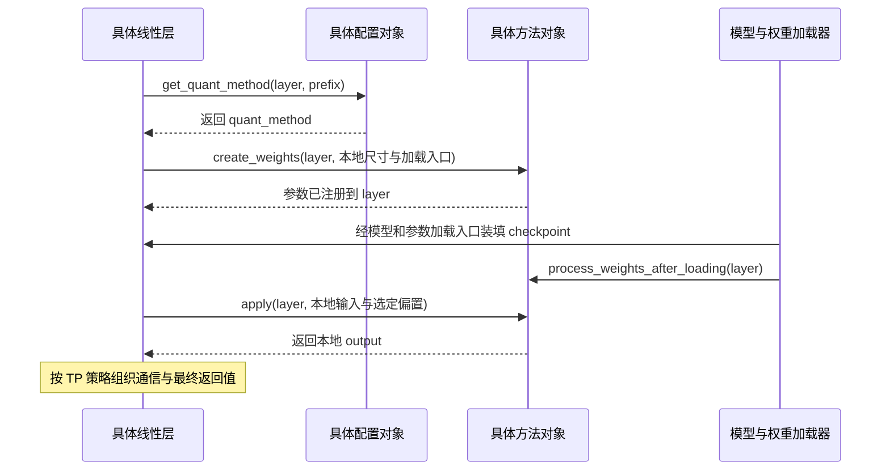
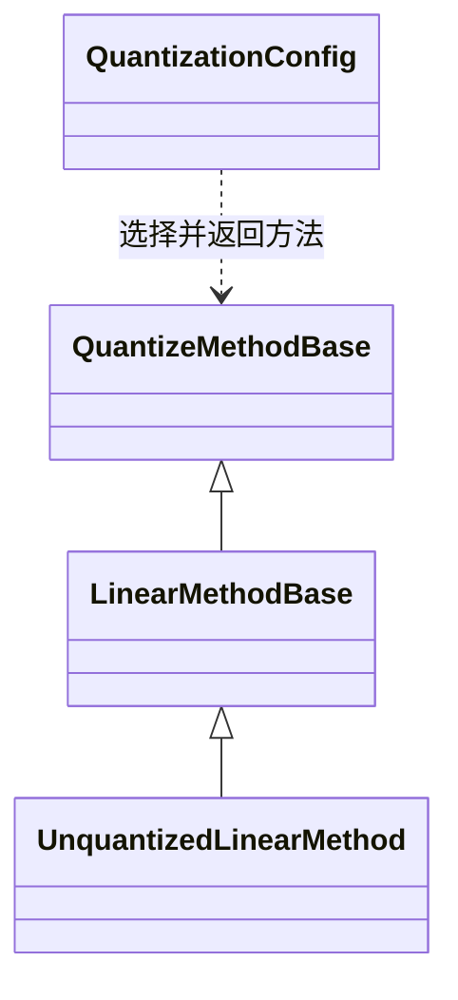

# 量化基类：方案配置与执行方法

[base_config.py](../../../../nanovllm/model_executor/layers/quantization/base_config.py)
定义两套相互配合的接口：

- **`QuantizationConfig` 描述方案，并为一个具体模型层选择执行方法。**
- **`QuantizeMethodBase` 描述该层的参数如何创建、加载后如何准备，以及如何执行计算。**

它们是两个独立的抽象基类，不是彼此的父类与子类。
可以先把一次方法选择理解为：

$$
(\text{方案配置},\ \text{具体层},\ \text{层路径})
\xrightarrow{\texttt{get\_quant\_method}}
\text{执行方法对象}
$$

例如，线性层负责确定 TP 分片与通信，方法对象负责这些本地分片的存储与计算。
普通浮点实现 `UnquantizedLinearMethod` 也需要这两项能力，因此同样遵守方法协议。
名称中的 Quantize 沿用 vLLM，具体是否量化由实际选中的方法决定。


## QuantizeMethodBase：一层参数的存储与执行协议

### create_weights：先建立可加载的参数

接口接收 `layer`、层提供的位置参数 `weight_args` 和额外元信息 `extra_weight_attrs`，
用于在 `layer` 上创建、注册参数，返回 `None`。
本基类不限定每种层的完整尺寸参数，`LinearMethodBase` 再将它细化为线性层需要的签名。

这一步需要解决：

- 根据调用方提供的本地尺寸，确定要分配哪些参数及其形状。
- 设置参数存储精度、输入/输出轴、TP 状态与 checkpoint 加载回调。
- 将参数注册到 `layer` 上，让模型加载器能定位并装填它们。

对普通浮点线性层，逻辑权重与实际存储都采用 PyTorch 的布局：

$$
\mathbf W\in\mathbb R^{D_{\mathrm{out}}\times D_{\mathrm{in}}},
\qquad
\mathbf Y=\mathbf X\mathbf W^{\mathsf T}+\mathbf b
$$

具体量化方法可以为同一个逻辑权重注册压缩参数、缩放参数等，实际存储格式由子类定义。
`create_weights()` 本身没有要求从完整浮点权重现场执行量化；它首先建立后续加载与计算需要的参数。

当前普通浮点方法分配的是未初始化存储，checkpoint 装填完成后才能用于推理。
其形状推导与 `ModelWeightParameter` 的创建过程见 [Linear 文档](../linear.md)。

### apply：消费已就绪参数，返回本地结果

`apply(layer, *args, **kwargs)` 是第二个抽象接口，返回该层的计算结果 `output`。
不同层可以约定不同输入，所以本基类只保留通用参数形式。
在线性层中，它被细化为 `apply(layer, x, bias=None)`。

调用方负责准备输入，并按层的策略传入偏置；具体方法使用 `layer` 中已经加载、处理好的参数完成运算。
TP 层得到本地结果后，再决定执行 AllGather、AllReduce，或者继续保留本地分片。

因此，方法对象的计算结果不一定是整个模型层的最终输出。
例如行并行层的方法返回部分和，外层还需按输入分片贡献求和。

### process_weights_after_loading：加载与执行之间的准备

该方法的默认实现直接返回，不修改参数。需要转换 checkpoint 存储布局的具体方法可以重写它。
调用时机是：

$$
\text{创建参数}
\longrightarrow \text{装填 checkpoint}
\longrightarrow \text{加载后处理}
\longrightarrow \text{推理执行}
$$

这里区分了两个阶段：checkpoint 已经写入参数，不代表这些参数一定已经符合实际 kernel 的执行布局；
后处理可以完成重排、预处理或执行所需的其他准备。
当前 `UnquantizedLinearMethod` 直接继承空操作，保留普通浮点布局。

`requires_device_loading` 决定 **Loader 调用该后处理时，是否进入目标设备的参数搬运上下文**：

| 属性值 | 当前 Loader 的处理 |
| --- | --- |
| `True`，基类默认值。 | 在 `device_loading_context(layer, target_device)` 中调用后处理。 |
| `False`。 | 直接调用后处理，不额外进入该搬运上下文。 |

这个属性针对后处理所需的参数设备位置，不负责选择整个模型的执行后端。
相关代码见 [加载后处理入口](../../../../nanovllm/model_executor/model_loader/utils.py)。

### embedding、tie_weights 与 dequantize_weight

这些是其他参数使用方式的扩展入口，各自有不同默认行为：

| 接口 | 默认行为 | 如何理解 |
| --- | --- | --- |
| `embedding(layer, ...)` | 抛出 `NotImplementedError`。 | 如果某种方法支持通过自身参数布局进行查表，就实现此接口。 |
| `tie_weights(layer, embed_tokens)` | 令 `layer.weight = embed_tokens.weight`，返回 `layer`。 | 让输出层与输入 embedding 共享同一个参数对象；特殊存储布局可重写。 |
| `dequantize_weight(layer)` | 抛出 `NotImplementedError`，包含具体方法类名。 | 为需要取得还原权重的调用方提供入口，具体还原规则由子类实现。 |

`dequantize_weight()` 的返回类型允许 tensor 或两个 tensor 的元组，
本基类没有规定元组各项的含义，使用时应查看具体子类的约定。
`apply()` 也没有规定必须先调用这个接口、显式还原完整权重，具体计算路径由方法决定。

当前词表层通过 `UnquantizedEmbeddingMethod.embedding()` 查表，
输出头通过方法的 `apply()` 投影，Qwen3 的权重共享也通过 `tie_weights()` 分派。
普通方法最终调用 `F.embedding`、普通 GEMM 和参数赋值；特殊布局可以重写这些入口。

## QuantizationConfig：描述方案，并为层选择方法

`QuantizationConfig` 是配置与方法选择的基类。
具体算法可以在子类中保存位宽、分组大小、匹配规则等；
本基类的 `__init__()` 只初始化一份独立的 `packed_modules_mapping` 字典。

### get_quant_method：配置对象如何变成方法对象

核心接口是：

```python
quant_method = quant_config.get_quant_method(layer, prefix)
```

它接收两个维度的信息：

- `layer` 是当前层对象，具体配置可以据此识别层类型、本地尺寸和其他属性。
- `prefix` 是当前层的完整模型路径，例如 `model.layers.<层号>.self_attn.qkv_proj`，
  可用于按路径应用规则。

同一配置对象可以传给许多层，各层分别选择并持有自己的方法引用。
具体子类可以针对不同层返回不同方法，包括为某些线性层明确选择 `UnquantizedLinearMethod`。
配置基类本身不实现这些匹配规则。

当前 `LinearBase` 对返回结果的约定需要分清：

| 情况 | 当前线性层的行为 |
| --- | --- |
| `quant_config is None`。 | 直接构造 `UnquantizedLinearMethod`。 |
| 已提供配置，返回有效的方法对象。 | 将其保存为 `layer.quant_method`，用于创建参数和前向执行。 |
| 已提供配置，返回 `UnquantizedLinearMethod` 对象。 | 该层显式采用普通浮点实现。 |
| 已提供配置，返回 `None`。 | 抛出 `ValueError`，表示配置没有为该线性层提供方法。 |

**配置为 `None` 与方法选择返回 `None` 的含义不同。**
如果具体配置希望某个线性层保持普通精度，应返回相应方法对象。

### 方案名称、激活类型与硬件约束

以下接口是具体配置必须实现的方案描述：

| 接口 | 形式 | 返回内容及含义 |
| --- | --- | --- |
| `get_name()` | 实例方法。 | 方案标识字符串。返回名字本身不执行算法注册。 |
| `get_supported_act_dtypes()` | 实例方法。 | 支持的输入激活 dtype 列表，描述输入类型，不是权重存储格式。 |
| `get_min_capability()` | 类方法。 | 最低 CUDA 计算能力，编码为主版本乘十加次版本。 |
| `get_config_filenames()` | 静态方法。 | 该方案使用的配置文件名列表。 |
| `from_config(config)` | 类方法。 | 从字典构造该具体配置子类的实例。 |

类方法接收 `cls`，适合描述方案级约束或构造具体子类；
静态方法不需要实例状态；实例方法可以读取已经解析的配置字段。
这些形式不同，但都可以通过抽象接口约定子类必须提供的能力。

当前项目尚未接入按方案名称发现算法、查找配置文件、调用 `from_config()` 并统一校验
激活类型与硬件能力的自动入口。现有接线接收的是已经构造好的具体 `QuantizationConfig` 实例。
这些描述接口为后续配置发现与校验提供协议。

### override_quantization_method：识别阶段的替代建议

该类方法接收 Hugging Face 量化配置字典 `hf_quant_cfg`、用户选择 `user_quant`
和可选模型配置 `hf_config`，返回建议采用的方案名称，或返回 `None`。

基类默认返回 `None`，表示不提出替代方案。
它面向方案识别阶段，与按层返回方法对象的 `get_quant_method()` 属于不同层次。
当前项目尚未自动调用这一识别入口。

### get_from_keys：兼容配置中的字段别名

`get_from_keys(config, keys)` 按 `keys` 的顺序查找，返回第一个**存在于字典中**的字段值。
所有字段都不存在时，抛出 `ValueError`。
`get_from_keys_or(config, keys, default)` 则在全部不存在时返回默认值。

例如只为说明查找规则，取一个字典：

```python
config = {"bits": None, "w_bit": 4}
```

| 调用 | 结果 |
| --- | --- |
| `get_from_keys(config, ["bits", "w_bit"])`。 | 返回 `None`，因为 `bits` 已存在。 |
| `get_from_keys(config, ["w_bit", "bits"])`。 | 返回 `4`，优先级由候选顺序决定。 |
| `get_from_keys(config, ["group_size"])`。 | 抛出 `ValueError`。 |
| `get_from_keys_or(config, ["group_size"], default=None)`。 | 返回默认值 `None`。 |

显式的 `None`、`False` 或零值都会被保留；`get_from_keys_or()` 只在候选字段全部缺失时使用默认值。

## 融合模块与 checkpoint 名称如何适配

### packed_modules_mapping：保留原投影与融合层的关系

Qwen3 在构造时，将如下结构更新到具体量化配置中：

```python
{
    "qkv_proj": ["q_proj", "k_proj", "v_proj"],
    "gate_up_proj": ["gate_proj", "up_proj"],
}
```

这里的 packed 描述多个逻辑投影合并为一个模块，例如原来的 Q/K/V 投影对应一个
`qkv_proj`。具体配置可以利用这个关系，将针对原始投影的规则匹配到融合层。
基类只保存映射，匹配逻辑需要具体配置实现。

它与模型的 `WeightsMapper` 分工不同：

| 信息 | 用途 |
| --- | --- |
| `packed_modules_mapping`。 | 供方法选择规则理解融合层包含哪些原始投影。 |
| Qwen3 的投影名称映射。 | 将 checkpoint 参数名改为融合参数名，并附加 Q/K/V 或 gate/up 的投影标识。 |
| 层与参数的加载器。 | 计算融合区域偏移、选择 TP 分片并复制参数。 |

本字典不进行权重切片，也不描述低位整数的位打包格式。

### get_cache_scale_mapper：统一缓存相关参数名

该静态方法返回一个 `WeightsMapper`，把 checkpoint 中不同的 scale/zero point 命名
转换为 Attention 包装层下的参数路径。例如：

| 源名称 | 转换后的名称 |
| --- | --- |
| `model.layers.<层号>.self_attn.k_proj.k_scale`。 | `model.layers.<层号>.self_attn.attn.k_scale`。 |
| `model.layers.<层号>.self_attn.v_cache.scale`。 | `model.layers.<层号>.self_attn.attn.v_scale`。 |

已经包含标准 `.attn` 路径的通用 scale/zero point 名称不会重复添加这一段。
映射只修改名称，不创建参数，也不实现缓存的量化或反量化。

### get_checkpoint_weight_mapper：过滤兼容元数据

基类返回的映射器将 `.g_idx` 后缀条目映射为 `None`，使其从加载流中过滤掉。
这是既定的 checkpoint 兼容规则；若后续具体方法确实依赖该元数据，
则需要在相应实现中提供符合其加载需求的映射。

### _ignore_unexpected_suffixes：允许忽略不存在的兼容参数

基类列出 Q/K/V 的 scale 与 zero point 后缀。
自动加载器对名称转换后的条目，只有在模型没有对应模块或参数时才按这些规则忽略；
若参数确实存在，仍正常装填。

`AutoWeightsLoader` 取得非空配置后，会合并它提供的两个 mapper，并加入这些可忽略后缀。
相关处理见 [模型加载工具](../../../../nanovllm/model_executor/models/utils.py)。
这些兼容规则本身不能替代实际 Attention/KV cache 的量化实现。

## 放回当前项目的完整调用链

`NanovllmConfig.quant_config` 保存可选的具体配置实例，Qwen3 将它传给 decoder 中的线性层。
提供配置时，构造、加载与执行的关系如下：



配置对象负责选择方法；方法创建的参数属于模型层；Loader 负责装填并触发后处理；
层在前向中调用方法取得本地结果，再处理 TP 通信。
没有配置对象时，线性层直接创建 `UnquantizedLinearMethod`，后续仍走相同生命周期。

继承关系则是另一件事：



实线表示方法类之间的继承，虚线表示配置通过接口选择方法。
`LinearMethodBase` 将通用方法协议细化为线性层接口，`UnquantizedLinearMethod` 提供当前普通浮点实现。
详细尺寸与 GEMM 调用见 [Linear 文档](../linear.md)。

## 当前已经接入哪些能力

当前项目已经接通方法选择、参数创建、checkpoint 名称映射与装填、加载后处理、
本地执行这些接口，但尚未提供内置的具体量化配置或算法注册表。

- 普通路径使用 `quant_config=None`，由线性层选择已有的普通浮点方法。
- 具体配置需要实现六个抽象接口，包括方案描述、配置构造与按层选择方法；
  具体方法至少实现参数创建和本地计算，其他钩子按实际能力重写。
- 定义配置和方法之后，仍要保证参数布局、checkpoint 加载与计算 kernel 相互匹配。
  填好名称、dtype 或硬件约束接口，并不会自动生成量化算法。
- 当前 `quant_config` 已传给 Qwen3 decoder 线性层、embedding 和 LMHead。
  词表层未选择到方法时使用 `UnquantizedEmbeddingMethod`，输入 embedding 要求方法实现查表接口；
  词表加载器保留上游的打包轴偏移协议，但具体量化算法与打包参数工厂尚未实现；
  KV cache 仍使用已有精度路径。

阅读这个文件时，应先对应“配置选择方法、方法操作层参数”这两个关系，
再按实际算法需要理解存储、映射、后处理与执行的扩展点。
