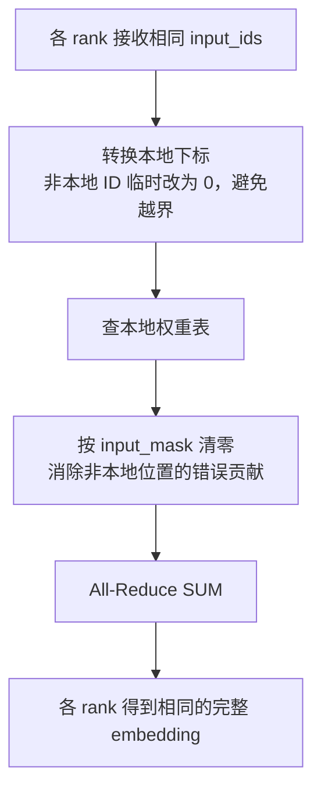
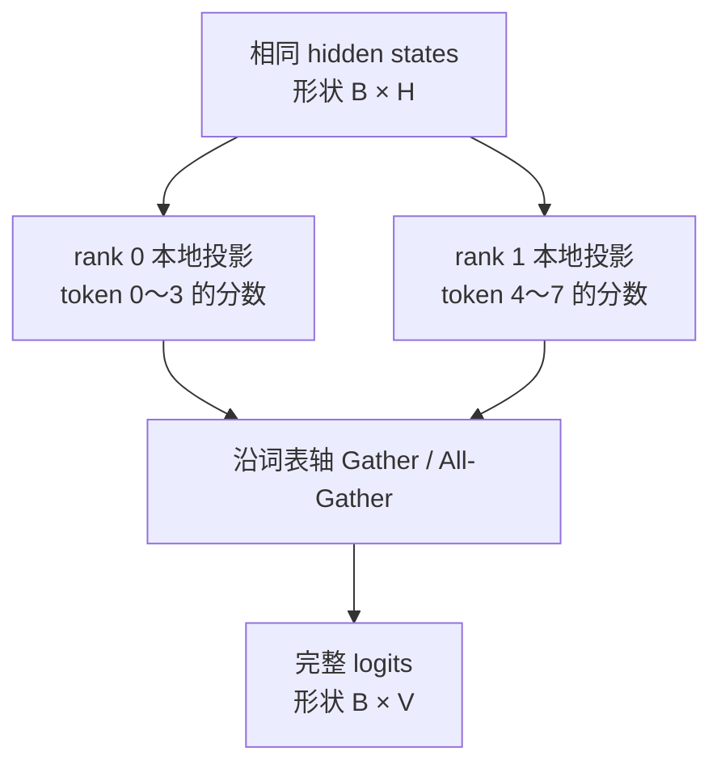
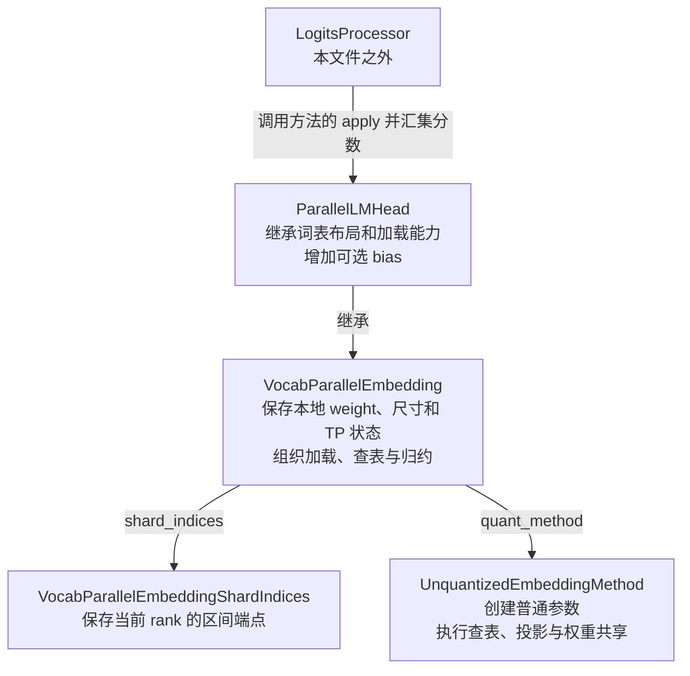
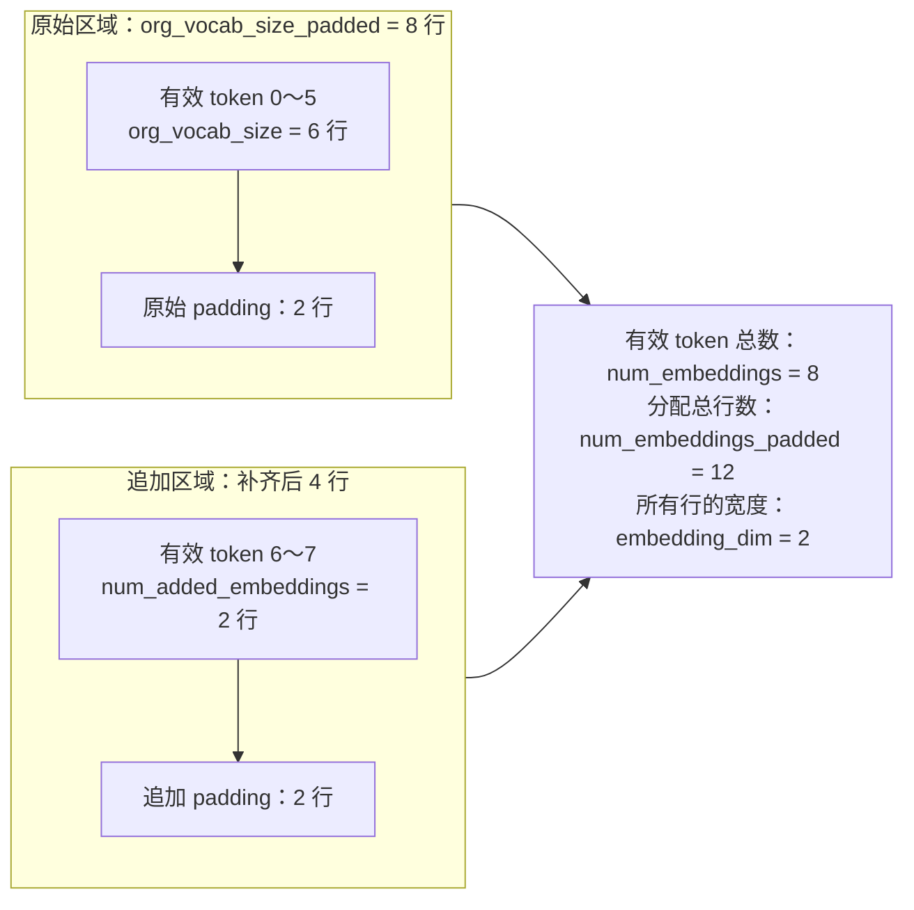
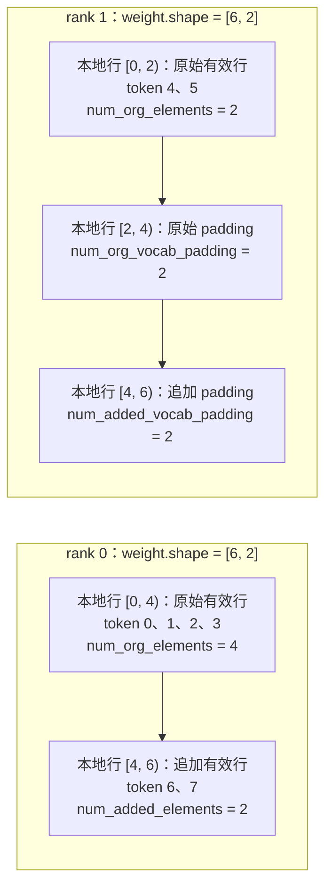
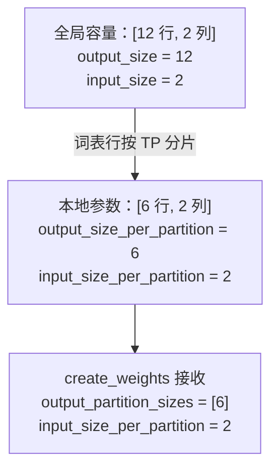
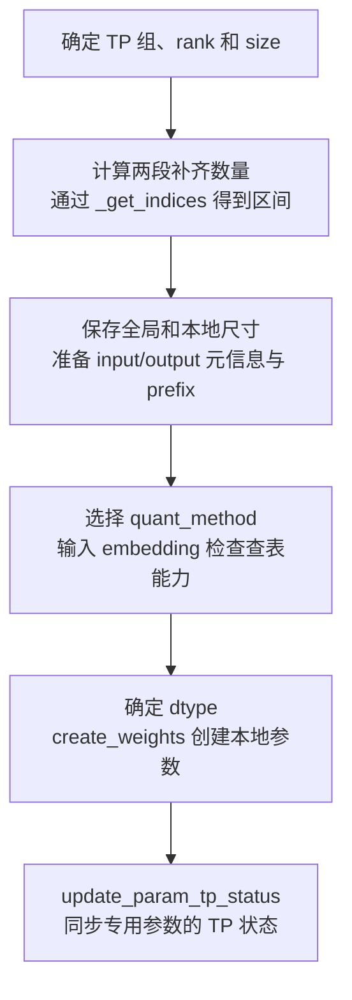
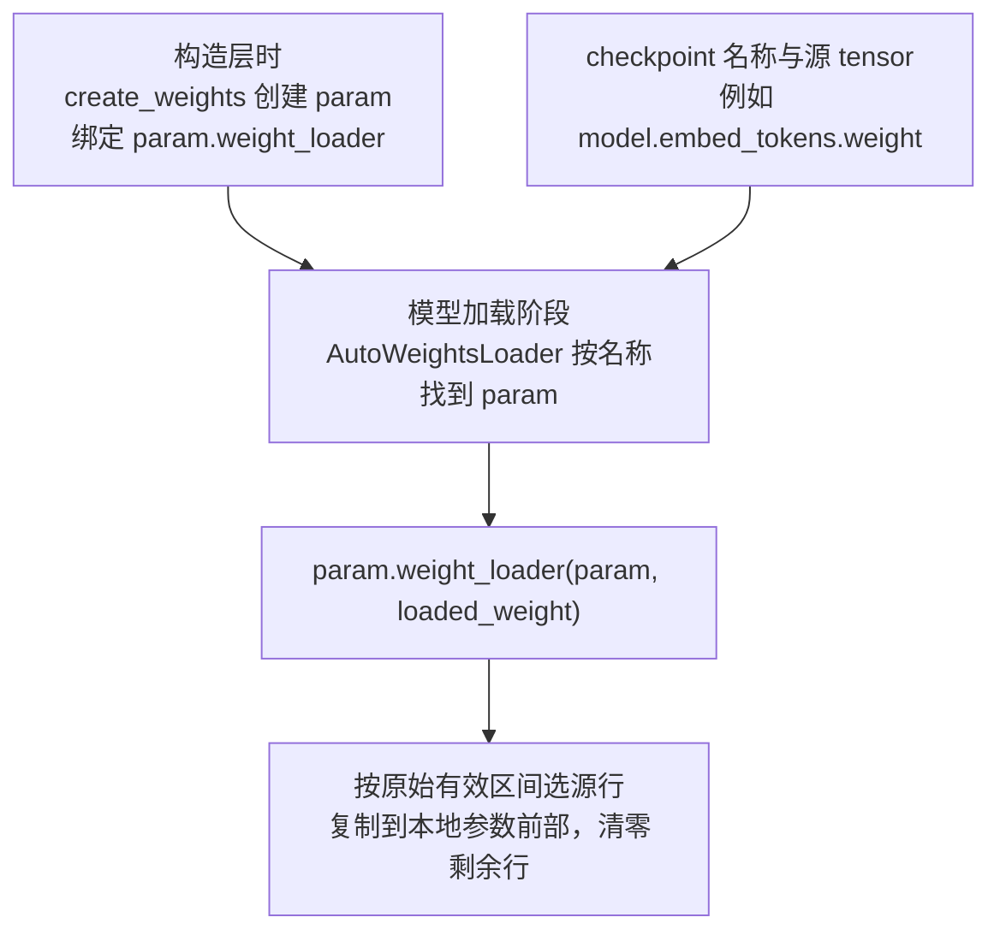
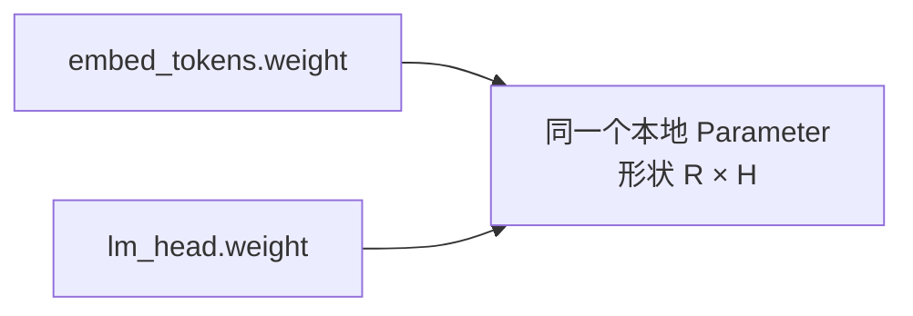
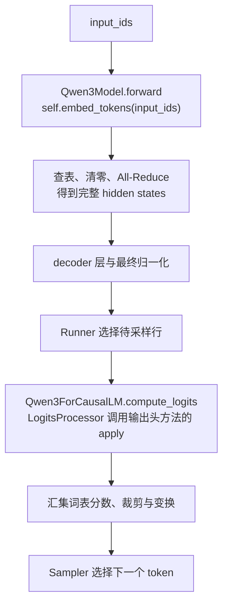

# 词表并行：查表、输出投影与类的设计

本文对应 [vocab_parallel_embedding.py](../../../nanovllm/model_executor/layers/vocab_parallel_embedding.py)。
先讲两个方向的计算与通信，再看权重如何分区，最后逐个解释类维护的状态和接口。

这里把 **token ID → embedding** 称为输入查表，把 **hidden states → 词表分数** 称为输出投影。
它们都是推理过程中的前向计算；输出投影并不是训练中的梯度反向传播，也不是查表的数学逆运算。

## 原理：同一类词表布局，两种不同的计算

### 一行对应一个 token，一列对应一个隐藏特征

设词表有 $V$ 个 token，每个向量包含 $H$ 个元素。权重采用 PyTorch 的输出维度 × 输入维度布局：

$$
\mathbf W\in\mathbb R^{V\times H}.
$$

| 观察方向 | 对应什么 | 例子 |
| --- | --- | --- |
| 沿行向下数 | 有多少个 token | $V=8$，ID 为 0～7 |
| 沿列向右数 | 每个 token 的向量有多宽 | $H=2$，每行两个元素 |

输入查表取出某些行，输出投影计算 hidden states 与各行的内积。
输入 embedding 与输出头可以各有一份权重；配置权重共享时才使用同一个参数对象。
下面为了方便手算，两种计算使用同一组示例数值。

### TP 切词表行，每个 token 的向量完整保留

先不引入 padding 或追加词表。取 $V=8$、$H=2$、TP 大小 $P=2$：

| 全局 token ID | 向量 | 保存在哪个 rank | 本地行号 |
| --- | --- | --- | --- |
| 0 | `[1, 2]` | 0 | 0 |
| 1 | `[3, 4]` | 0 | 1 |
| 2 | `[5, 6]` | 0 | 2 |
| 3 | `[7, 8]` | 0 | 3 |
| 4 | `[9, 10]` | 1 | 0 |
| 5 | `[11, 12]` | 1 | 1 |
| 6 | `[13, 14]` | 1 | 2 |
| 7 | `[15, 16]` | 1 | 3 |

每个 rank 保存 `[4, 2]` 的本地权重。token 6 的两个元素都在 rank 1，
其全局 ID 是 6，本地行号却是 2。这是后面必须转换索引的原因。

### 输入方向：各卡查自己的行，用 All-Reduce 恢复完整 embedding

对于输入 ID $t_i$，目标是：

$$
\mathbf E_{i,:}=\mathbf W_{t_i,:}.
$$

两卡收到相同的 `input_ids=[1, 6]`。rank 0 拥有 token 1，rank 1 拥有 token 6。
如果直接对本地表执行 `weight[input_ids]`，第 6 行会越界；
而 rank 1 的本地第 1 行对应 token 5，也不是 token 1。

因此各 rank 必须先转换本地下标，处理不属于自己的位置，再通信：

| 阶段 | rank 0 | rank 1 |
| --- | --- | --- |
| 全局输入 ID | `[1, 6]` | `[1, 6]` |
| `masked_input`：安全本地下标 | `[1, 0]` | `[0, 2]` |
| `input_mask`：需要清零的位置 | `[False, True]` | `[True, False]` |
| 安全查表的结果 | `[[3, 4], [1, 2]]` | `[[9, 10], [13, 14]]` |
| 清零非本地位置后 | `[[3, 4], [0, 0]]` | `[[0, 0], [13, 14]]` |

这里有两个不能省略的操作：

- **`get_masked_input_and_mask()` 保证能安全查表。** 本地 token 转成本地下标，非本地 token 临时映射到第 0 行，同时返回清零标记。
- **`masked_fill_()` 消除临时读到的错误向量。** 第 0 行是正常权重，临时查到它并不等于得到了零向量；必须把这些位置再清零。

清零后，各 rank 的结果具有相同的 `[2, 2]` 形状，输入位置也对齐。
逐元素求和即可恢复正确结果：

$$
\underbrace{\begin{bmatrix}3&4\\0&0\end{bmatrix}}_{\text{rank 0}}
+\underbrace{\begin{bmatrix}0&0\\13&14\end{bmatrix}}_{\text{rank 1}}
=\begin{bmatrix}3&4\\13&14\end{bmatrix}.
$$

`All-Reduce SUM` 将这个结果交给每个 rank，所以通信后两卡都持有完整 embedding。
**All-Reduce 只执行求和，不知道 token 属于谁。** 若省略清零，错误结果将是 `[[12, 14], [14, 16]]`。



这张图中的通信对象是本次输入的查表结果。权重仍然分散保存在各卡，查表时没有汇集整张词表。

### 输出方向：各卡计算不同 token 的分数，用 Gather 拼接词表列

设待投影的 hidden states 为 $\mathbf X\in\mathbb R^{B\times H}$，先忽略偏置：

$$
\mathbf L=\mathbf X\mathbf W^{\mathsf T}\in\mathbb R^{B\times V}.
$$

每个 rank 收到相同的 $\mathbf X$，用本地完整隐藏宽度的权重行计算：

$$
\mathbf L^{(r)}=\mathbf X\bigl(\mathbf W^{(r)}\bigr)^{\mathsf T}
\in\mathbb R^{B\times(V/P)}.
$$

仍用前面的权重，令 `hidden_states=[[1, 1]]`。每个分数就是对应权重行的两个元素之和：

| rank | 本地分数 | 这些列对应的 token |
| --- | --- | --- |
| 0 | `[[3, 7, 11, 15]]` | 0、1、2、3 |
| 1 | `[[19, 23, 27, 31]]` | 4、5、6、7 |

每个 token 的分数已经计算完整，完整词表分数应是沿最后一维拼接：

$$
\mathbf L=\operatorname{Concat}_{\text{词表轴}}
\bigl(\mathbf L^{(0)},\mathbf L^{(1)}\bigr)
=\begin{bmatrix}3&7&11&15&19&23&27&31\end{bmatrix}.
$$

此时求和会把 token 0 的分数与 token 4 的分数混起来，所以普通完整 logits 路径使用 Gather：

- `All-Gather`：每个 rank 都得到完整词表分数。
- `Gather`：只有目标 rank 得到完整分数，本项目该分支的非目标 rank 返回 `None`。



汇集和后续分数处理由 [LogitsProcessor](logits_processor.md) 负责。
投影得到的是分数，选出 token 还需要采样；不能将输出投影视作恢复输入 token 的逆变换。

| 比较项 | 输入查表 | 输出投影 |
| --- | --- | --- |
| 输入 | 同样的 token ID | 同样的 hidden states |
| 局部结果 | 同一输入位置上的有效向量或零向量 | 不同 token 对应的分数列 |
| 合并操作 | 对齐位置求和 | 沿词表列拼接 |
| 通信后形状 | `[N, H]` | `[B, V]`，此处忽略 padding |

**两种通信的差异来自局部结果的含义。** 虽然都按词表行切权重，但查表贡献需要相加，词表分数需要拼接。

## 类的分工：谁保存权重，谁描述布局，谁执行计算

源码中的四个类围绕同一份本地词表参数协作：



`weight` 注册在层对象上，`shard_indices` 描述这些行对应哪些 token。
普通方法对象本身不维护另一份权重，也不记录 rank 或索引区间；它通过参数 `layer` 使用层上的权重。

## 先画出权重区域，再认识 size、num 和 dim

### 两个轴：词表行数与隐藏宽度

每个 rank 的真实参数始终是一张二维表：

$$
\mathbf W^{(r)}=
\left.
\underbrace{\begin{bmatrix}
w_{0,0}&\cdots&w_{0,H-1}\\
w_{1,0}&\cdots&w_{1,H-1}\\
\vdots&\ddots&\vdots\\
w_{R-1,0}&\cdots&w_{R-1,H-1}
\end{bmatrix}}_{\text{列数 }H=\texttt{embedding\_dim}}
\right\}\;\text{本地行数 }R=\texttt{num\_embeddings\_per\_partition}.
$$

`embedding_dim` 是每一行有多少元素。下面的各种 `num_*` 主要在数行，只是统计范围不同：
可能数全局或本地，也可能只数有效行或把 padding 一起算进去。

还要区分参数上的轴编号：`weight.output_dim=0` 表示沿第 0 轴切词表，
`weight.input_dim=1` 表示隐藏维度在第 1 轴。**这两个值是轴编号；`embedding_dim=H` 才是轴的长度。**

### padding：实际 token 数与分配行数可以不同

padding 是没有对应有效 token 的补齐行。`padding_size=A` 表示向上补到 $A$ 的倍数：

$$
\operatorname{pad}_A(n)=A\left\lceil\frac nA\right\rceil.
$$

例如原始词表有 6 行，`padding_size=4`，补齐后为 8 行；TP=2 时各卡分配 4 行。
rank 0 的四行都有效，rank 1 保存 token 4、5 和两行 padding。
补齐让参数与通信具有规整形状，但各分配区域仍须能整除 TP 大小，源码通过 `divide()` 检查。

`padding_size=4` 并不是“固定增加 4 行”，也不是“每张卡分配 4 行”。默认值为 64，本文使用 4 便于画图。

### added：与原始词表分开安排的扩展区域

`org` 表示原始词表，`added` 表示在原始词表之外追加的真实 token。
这套双区域布局沿用上游为适配器新增 token 准备的协议。当前普通 Qwen 构造时不传 `org_num_embeddings`，因此追加数量为 0。

为了说明全部状态，**从这里开始换用布局例子**：原始 6 个 token、追加 2 个 token，
隐藏宽度 2，补齐倍数 4，TP=2。它与前面的无补齐原理例子分开看。

$$
V_o=6,\quad V_a=2,\quad V=V_o+V_a=8,\quad H=2,\quad A=4,\quad P=2.
$$

源码先补齐原始区域，再加入追加 token，最后补齐总量：

$$
\widetilde V_o=\operatorname{pad}_4(6)=8,\qquad
\widetilde V=\operatorname{pad}_4(8+2)=12,\qquad
\widetilde V_a=12-8=4.
$$



图中是在统计两个区域的全局容量，不表示每张卡都存储完整的 12 行。
两个区域**分别均分**：原始区域每卡 4 行，追加区域每卡 2 行，随后在本地接起来。

### 分片后：各成员到底数的是哪一段



每个子图从上到下表示本地存储顺序，箭头表示接着存放的区域，不是一次计算流程。
rank 0 的原始/追加 padding 都为 0；rank 1 的有效追加行数为 0。
两卡的有效 token 数不同，但分配总行数相同，都是 6。

| 层上的尺寸成员 | 本例的值 | 图中对应区域 |
| --- | --- | --- |
| `org_vocab_size` | 6 | 全局原始有效行；由构造参数 `org_num_embeddings` 得到 |
| `num_added_embeddings` | 2 | 全局追加有效行，等于 `num_embeddings - org_vocab_size` |
| `num_embeddings` | 8 | 两种有效行之和，不含 padding |
| `org_vocab_size_padded` | 8 | 全局原始区域，包含原始 padding |
| `num_embeddings_padded` | 12 | 两个区域的全局分配总数 |
| `num_embeddings_per_partition` | 两卡均为 6 | 本地两个区域的总行数，包含 padding |
| `num_org_embeddings_per_partition` | rank 0 为 4，rank 1 为 2 | 本地有效原始行 |
| `num_added_embeddings_per_partition` | rank 0 为 2，rank 1 为 0 | 本地有效追加行 |
| `embedding_dim` | 2 | 每一行的宽度 |

**不能单凭 `per_partition` 判断是否包含 padding**：它只说明统计的是本地分片，具体还要看该成员数的是有效行还是分配行。

### 为什么还有 input_size、output_size

参数工厂沿用线性层协议，按输出投影 $\mathbf X\mathbf W^{\mathsf T}$ 命名：
输入特征宽度为 $H$，输出特征数量为词表分配行数。



全局容量是说明形状的概念，实际创建的是本地 `[6, 2]` 参数。
这些名称不是按“查表输入整数、输出向量”命名，也不表示本次请求的 token 数。

$$
\begin{aligned}
\texttt{input\_size}&=\texttt{input\_size\_per\_partition}=\texttt{embedding\_dim},\\
\texttt{output\_size}&=\texttt{num\_embeddings\_padded},\\
\texttt{output\_size\_per\_partition}&=\texttt{num\_embeddings\_per\_partition}.
\end{aligned}
$$

`output_partition_sizes` 是参数工厂要求的列表，此处只有一个元素 `[6]`。
虽然本地分成原始和追加两段，这个接口仍将整个词表分片作为一个输出分区，参数行数由列表元素之和决定。

## VocabParallelEmbeddingShardIndices：记录当前 rank 拥有哪些 token

### 保存的是八个区间端点

这个数据类不保存 tensor，也不通信。它保存**原始/追加 × 补齐/有效**四组区间，每组有起点和终点。
所有区间均左闭右开；例如 `[4, 6)` 包含 4、5，`[8, 8)` 为空。

继续使用原始 6、追加 2 的布局例子：

| 字段 | rank 0 | rank 1 |
| --- | --- | --- |
| `padded_org_vocab_start_index` | 0 | 4 |
| `padded_org_vocab_end_index` | 4 | 8 |
| `org_vocab_start_index` | 0 | 4 |
| `org_vocab_end_index` | 4 | 6 |
| `padded_added_vocab_start_index` | 6 | 8 |
| `padded_added_vocab_end_index` | 8 | 10 |
| `added_vocab_start_index` | 6 | 8 |
| `added_vocab_end_index` | 8 | 8 |

这些端点与前面的本地存储图属于不同坐标系。例如 rank 0 的追加有效区间 `[6, 8)` 表示 token 6、7，
它们在本地参数中却存放于行 `[4, 6)`。

`padded_added_*` 使用原始有效词表大小 6 作为偏移。rank 1 分到概念上的 `[8, 10)` 两个位置，
截到有效 token 末尾 8 后变成 `[8, 8)`，说明这两行全部是 padding。
原始 padding 的概念位置 6、7 与追加 token ID 6、7 数字相同，但属于两个区域，不能当成同一块存储。

### num 属性根据端点计算数量

| 属性 | 计算含义 | rank 0 | rank 1 |
| --- | --- | --- | --- |
| `num_org_elements` | 有效原始终点减起点 | 4 | 2 |
| `num_added_elements` | 有效追加终点减起点 | 2 | 0 |
| `num_org_elements_padded` | 原始分配终点减起点 | 4 | 4 |
| `num_added_elements_padded` | 追加分配终点减起点 | 2 | 2 |
| `num_org_vocab_padding` | 原始分配数量减有效数量 | 0 | 2 |
| `num_added_vocab_padding` | 追加分配数量减有效数量 | 0 | 2 |
| `num_elements_padded` | 两段分配数量之和 | 6 | 6 |

这些是属性，访问时根据八个端点计算，不会另存七份可以独立变化的计数。
它们分别对应存储图中的有效块、padding 块和整个本地表。

`__post_init__()` 在构造后检查端点顺序、有效数量不超过分配数量等约束。
纯 padding shard 的两个有效端点会一起截到词表末尾，因此有效空区间的起点可能小于分配起点。

## UnquantizedEmbeddingMethod：创建参数并执行本地计算

### 维护的状态：权重放在 layer 上

这个类继承 `QuantizeMethodBase`，当前实现没有自己的实例状态。
`quant_method` 是上游沿用的统一名称，普通浮点实现也通过这个协议执行。
它接收 `layer`，读写 `layer.weight`，不决定 token 归属，也不发起 TP 通信。

### create_weights：分配空参数并绑定加载回调

本地参数形状由两个参数决定：

$$
\texttt{weight.shape}=
\bigl[\operatorname{sum}(\texttt{output\_partition\_sizes}),\;
\texttt{input\_size\_per\_partition}\bigr].
$$

在布局例子中是 `[6, 2]`。方法创建 `requires_grad=False` 的普通 `nn.Parameter`，
注册到 `layer.weight`，然后附上 `input_dim=1`、`output_dim=0` 和传入的 `weight_loader` 回调。

**创建时使用 `torch.empty`，尚未加载 checkpoint 数值。**
`input_size`、`output_size` 保留全局尺寸协议，但当前普通工厂依据本地尺寸分配存储。

### embedding、apply 与 tie_weights

| 接口 | 输入与操作 | 返回内容 |
| --- | --- | --- |
| `embedding(layer, input_)` | 用已经转换好的本地 ID 调用 `F.embedding(input_, layer.weight)` | 形状为 `input_.shape + [H]` 的局部查表结果 |
| `apply(layer, x, bias)` | 计算 `x @ layer.weight.T + bias`，当前分派最终调用 `F.linear` | 本地词表分数，包含 padding 对应的列 |
| `tie_weights(layer, embed_tokens)` | 执行 `layer.weight = embed_tokens.weight` | 完成共享的 `layer` |

`embedding()` 不会替调用者屏蔽非本地位置；清零是外层 `forward()` 的职责。
`apply()` 也不会汇集各卡分数；通信由 `LogitsProcessor` 组织。
`tie_weights()` 共享同一个 Parameter 对象，不是只复制一次数值。

## VocabParallelEmbedding：持有状态，组织加载与查表

### 除尺寸以外，还维护哪些状态

前面的尺寸表已经对应了所有 `size/num/dim` 成员。其余状态决定用哪个组、哪种参数方法，以及是否归约：

| 状态 | 含义 |
| --- | --- |
| `tp_rank`、`tp_size` | 当前通信组内的编号与分片总数；编号从 0 开始 |
| `disable_tp` | 为 `True` 时本层按 rank 0、size 1 构造 |
| `parallel_group` | 指定时由该组提供 rank/size，并执行查表结果的归约；否则使用默认 TP 组 |
| `reduce_results` | 是否将各卡局部贡献求和；默认 `True` |
| `padding_size` | 行数向上补齐的倍数 |
| `shard_indices` | 当前 rank 的四组区间，类型是上面的数据类 |
| `params_dtype` | 本地参数元素类型；构造参数为 `None` 时采用 PyTorch 默认浮点类型 |
| `prefix` | 模型中的层路径，用于参数方法选择等操作 |
| `quant_method` | 负责参数创建和本地运算的方法对象 |
| `weight` | 方法注册的本地权重参数 |
| `use_fused_embedding` | 当前固定为 `False`，使用普通张量查表分支 |

`quant_config` 是这个基类的构造输入，用于选择方法；此处没有保存为 `self.quant_config`。
`org_num_embeddings` 同样是输入参数，原始有效行数最终保存在 `self.org_vocab_size`。

### __init__：建立布局，选择方法，创建参数



方法选择发生在尺寸元信息准备好之后：先使用显式传入的 `quant_method`；
没有则调用 `quant_config.get_quant_method(self, prefix)`；仍为 `None` 时使用 `UnquantizedEmbeddingMethod`。
输入 embedding 要求方法覆盖基类 `embedding()`，通过 `method_has_implemented_embedding()` 检查。
输出头只需投影，因此 `ParallelLMHead` 不要求方法具有查表能力。

构造返回后，存储已经存在，权重数值还要由后续的模型加载阶段装填。

### _get_indices：从全局容量算出本卡的四组区间

这个类方法接收全局有效/补齐数量和 `tp_rank/tp_size`，返回 `VocabParallelEmbeddingShardIndices`。
它不切 tensor，只计算整数边界。

令每卡原始分配行数 $q_o=\widetilde V_o/P$，每卡追加分配行数 $q_a=(\widetilde V-\widetilde V_o)/P$。
rank $r$ 的两组分配区间为：

$$
\text{padded org}=[rq_o,(r+1)q_o),\qquad
\text{padded added}=[V_o+rq_a,V_o+(r+1)q_a).
$$

原始端点分别取 `min(endpoint, org_vocab_size)`，追加端点分别取 `min(endpoint, num_embeddings)`，得到有效区间。
所以布局例子的 rank 1 原始分配范围 `[4, 8)` 被截为 `[4, 6)`，追加分配范围 `[8, 10)` 被截为空区间。

两个辅助函数提供基本计算：

- `vocab_range_from_per_partition_vocab_size(q, rank, offset)` 返回 `[rank*q + offset, (rank+1)*q + offset)`。
- `vocab_range_from_global_vocab_size(total, rank, world_size, offset)` 先检查并计算 `q=total/world_size`，再调用前者。
- `pad_vocab_size(n, pad_to)` 则负责前面定义的向上补齐运算。

### weight_loader：把 checkpoint 中的原始词表行写入本地参数

区分两个对象：`param` 是已经分配的本地目标参数，`loaded_weight` 是 checkpoint 读出的源 tensor。
普通浮点路径要求源的词表行数等于 `org_vocab_size`，然后仅复制属于本 rank 的原始有效行。

继续使用原始 6、追加 2 的例子，源 tensor 为 `[6, 2]`：

| 中间变量或操作 | rank 0 | rank 1 |
| --- | --- | --- |
| `param.shape` | `[6, 2]` | `[6, 2]` |
| `output_dim` | 0 | 0 |
| `start_idx` | 0 | 4 |
| `shard_size` | 4 | 2 |
| `loaded_weight.narrow(0, start_idx, shard_size)` | 源行 `[0, 4)` | 源行 `[4, 6)` |
| 复制到目标 | `param[0:4]` | `param[0:2]` |
| 将剩余目标清零 | `param[4:6]` | `param[2:6]` |

基础加载器会把追加区域也清零，后续若使用扩展 token，需要另行装填。
不能传入包含全部追加行的 `[8, 2]` 源 tensor，就期待本方法自动识别两个区域。



加载发生在生成之前，不会每次查表都执行。Qwen 的 `load_weights()` 通过自动加载器分派到这个回调，
具体调用链见 [模型加载工具](../../../nanovllm/model_executor/models/utils.py) 和 [Linear 的权重加载说明](linear.md)。

另外两类加载分支保留了通用参数协议：没有 `output_dim` 时检查形状后完整复制，兼容标量到单元素向量；
`packed_dim == output_dim` 时按打包因子换算源偏移和长度。当前普通词表参数走上述浮点分片路径。

### forward：将安全查表、清零与归约连起来

这个接口输入全局 token ID，默认返回完整 embedding。输出形状为 `input_.shape + [embedding_dim]`。

多卡情况下，核心操作依次为：

```python
masked_input, input_mask = get_masked_input_and_mask(
    input_,
    self.shard_indices.org_vocab_start_index,
    self.shard_indices.org_vocab_end_index,
    self.shard_indices.num_org_vocab_padding,
    self.shard_indices.added_vocab_start_index,
    self.shard_indices.added_vocab_end_index,
)
output_parallel = self.quant_method.embedding(self, masked_input.long())
output_parallel.masked_fill_(input_mask.unsqueeze(-1), 0)
```

`input_mask=True` 的输入位置需要整条向量清零。输入 mask 为 `[N]` 时，`unsqueeze(-1)` 使其成为 `[N, 1]`，
广播到 `[N, H]` 的查表结果。`masked_fill_` 的下划线表示原地修改。

若 `reduce_results=True`，随后调用指定 `parallel_group.all_reduce()` 或默认 `tensor_model_parallel_all_reduce()`。
若为 `False`，返回清零后的局部贡献，调用方负责后续合并。
`tp_size==1` 则直接查表返回，省略映射、mask 和通信。
末尾 `output_dtype` 与 `view(output_dtype)` 在当前普通浮点路径保留原 dtype，不改变向量宽度。

### get_masked_input_and_mask：追加区域也要转换成本地下标

开头已经说明它为什么必须存在。双区域布局下，原始 token 和追加 token 使用不同偏移。
记有效原始区间为 $[s_o,e_o)$，有效追加区间为 $[s_a,e_a)$，原始 padding 数为 $p_o$。
本地原始区域共占 $q_o=e_o-s_o+p_o$ 行，于是：

$$
\operatorname{local}(t)=
\begin{cases}
t-s_o,&s_o\le t<e_o,\\
q_o+t-s_a,&s_a\le t<e_a,\\
0,&\text{不属于当前 rank，随后清零}.
\end{cases}
$$

布局例子中，rank 0 的 token 6 存放于本地行 $4+6-6=4$。
源码将追加分支写成 `t - added_offset`，其中 `added_offset = s_a - q_o = 2`。
这个 offset 是要减去的数，不是追加区域的本地起始行号。

| 临时变量 | 作用 |
| --- | --- |
| `org_vocab_mask` | 判断输入是否落在有效原始区间 |
| `added_vocab_mask` | 判断输入是否落在有效追加区间 |
| `valid_offset` | 按命中的区域选择原始起点或 `added_offset` |
| `vocab_mask` | 两个有效 mask 的或，表示属于本 rank |
| 返回的 `input_` | 安全的本地下标，调用方命名为 `masked_input` |
| 返回的 `~vocab_mask` | 非本地位置的清零标记，调用方命名为 `input_mask` |

函数使用 `torch.compile(dynamic=True)` 编译这些逐元素表达式。
mask 的职责是区分本地贡献；调用方仍需保证输入为合法全局 ID，它不是完整的输入校验接口。

### get_sharded_to_full_mapping：把汇集后的物理顺序变回 token 顺序

在双区域例子中，按 rank 拼接局部权重行或局部 logits 列后，顺序为：

| 物理位置 | 0 | 1 | 2 | 3 | 4 | 5 | 6 | 7 | 8 | 9 | 10 | 11 |
| --- | --- | --- | --- | --- | --- | --- | --- | --- | --- | --- | --- | --- |
| 内容 | token 0 | token 1 | token 2 | token 3 | token 6 | token 7 | token 4 | token 5 | 原始 pad | 原始 pad | 追加 pad | 追加 pad |

直接取前 8 列不会恢复正确的 token ID 顺序。这个方法遍历各 rank，
将有效原始位置、有效追加位置和 padding 位置分别收集，返回以下重排列表：

```python
base_embeddings = [0, 1, 2, 3, 6, 7]
added_embeddings = [4, 5]
padding = [8, 9, 10, 11]
ret = [0, 1, 2, 3, 6, 7, 4, 5, 8, 9, 10, 11]
```

循环中的 `range_start = num_embeddings_per_partition * tp_rank` 是当前 rank 在汇集数组中的物理起点，
本例分别为 0、6；`range_end` 分别为 6、12。
`ret[4]=6` 表示新的第 4 个位置应读取旧数组第 6 个位置。

执行 `gathered_weight[ret]` 或 `gathered_logits[..., ret]` 后，前 8 个位置才依次对应 token 0～7。
方法本身只返回索引列表，不通信、不改参数；`tp_size<2` 时返回 `None`。
当前普通 Qwen 没有追加区域，生产调用链未使用这个重排方法。

### update_param_tp_status 与 extra_repr

`update_param_tp_status()` 遍历层参数，仅给 `BasevLLMParameter` 同步 `tp_rank/tp_size`，
保证专用参数的加载逻辑使用所属层的 TP 状态。当前普通词表工厂创建 `nn.Parameter`，不会进入该分支。

`extra_repr()` 返回打印层对象时附加的字符串，包括有效 token 总数、本地分配行数、隐藏宽度、
原始词表大小、全局分配行数和 TP 大小。它不执行计算；要查看具体端点，可以同时打印 `layer.shard_indices`。

## ParallelLMHead：继承词表参数布局，交给处理器执行输出投影

### 维护的状态：沿用 weight，增加可选 bias

这个类继承 `VocabParallelEmbedding`，沿用 TP 状态、尺寸、区间、参数方法以及加载回调。
它增加以下成员：

| 成员 | 含义 |
| --- | --- |
| `has_bias` | 是否创建输出投影偏置 |
| `quant_config` | 保存传入的量化配置对象 |
| `bias` | 开启时为 `[num_embeddings_per_partition]` 的本地参数，否则注册为 `None` |

偏置与本地词表行一一对应，布局例子中每卡有 6 个偏置元素：

$$
\mathbf X_{B\times H}\bigl(\mathbf W^{(r)}_{R\times H}\bigr)^{\mathsf T}
+\mathbf b^{(r)}_{R}
=\mathbf L^{(r)}_{B\times R}.
$$

偏置沿 batch 轴广播，每一列使用对应 token 行的偏置。

### 构造与 _register_bias：给输出列准备偏置参数

`__init__()` 先保存 `has_bias`，调用父类建立本地词表权重，再保存 `quant_config` 并决定是否创建偏置。
`_register_bias()` 创建与 `params_dtype` 相同的一维参数，设置 `output_dim=0`，
绑定同一个 `weight_loader`。因此偏置也按原始有效词表区间从 checkpoint 中切片并清零剩余位置。

### tie_weights：让输出头使用输入 embedding 的参数对象

调用层接口 `lm_head.tie_weights(embed_tokens)` 后，实际工作交给参数方法的 `tie_weights()`。
普通方法使两者的 `weight` 指向同一对象，并返回输出头。



图中两个属性共享参数存储，但输入仍执行查表，输出仍执行投影。
共享要求布局相容；`tie_weights()` 不会自动重新分片，也不共享输出头的 bias。

### forward：为什么直接调用输出头会报错

本类的 `forward()` 直接抛出异常，因为正常接口由 `LogitsProcessor` 组织：

```python
# Qwen3ForCausalLM.compute_logits 内部。
logits = self.logits_processor(self.lm_head, hidden_states)

# LogitsProcessor._apply_head 内部。
local_logits = lm_head.quant_method.apply(
    lm_head, hidden_states, bias=embedding_bias
)
```

处理器取得本地分数后，执行词表汇集、padding 裁剪与分数变换。
输出头保存 bias 也不代表处理器会自动读取；这条接口通过 `embedding_bias` 显式传给方法。
当前 Qwen 使用无偏置输出头。

## 在 Qwen 调用链中对应哪些位置



输入和输出两端使用同一种词表分片布局，但分别调用 `embedding()` 与 `apply()`，并执行不同通信。
具体模型见 [Qwen3](../models/qwen3.md)，输出分数与候选选择见 [LogitsProcessor](logits_processor.md)。

当前追加词表主要保留布局和索引协议，尚未接入完整适配器加载、输出重排及候选 ID 处理。
尤其单卡 `forward()` 直接按 ID 查表，若原始 padding 与追加行之间存在位置差异，还需要额外处理。
因此不能仅设置 `org_num_embeddings` 就认为追加 token 已可端到端生成。
当前也没有接入融合查表扩展和具体量化算法；普通参数方法的基类协议见 [量化基类](quantization/base_config.md)。

相关验证在 [test_vocab_parallel.py](../../../tests/test_layers/test_vocab_parallel.py)：
包括单/双 rank 的普通查表与词表分数、参数方法与共享，以及独立的追加区域布局检查。
