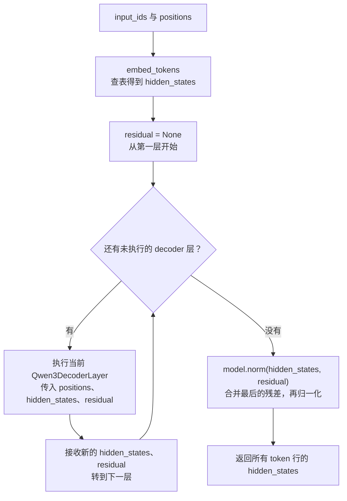
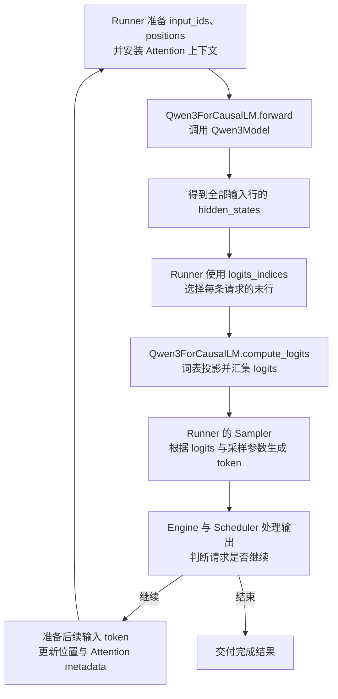

# Qwen3：模型架构与前向执行

本文对应 [qwen3.py](../../../nanovllm/model_executor/models/qwen3.py) 中的稠密 Qwen3 实现。
按模块的组合关系，从基础计算开始，依次说明 `Qwen3Attention`、`Qwen3MLP`、
`Qwen3DecoderLayer`，最后组合成 `Qwen3Model` 与 `Qwen3ForCausalLM`。
各投影使用的权重布局、TP 切分和通信方式，可先阅读 [Linear 文档](../layers/linear.md)。

## 符号约定

结构参数统一用符号表示，不绑定某个模型尺寸：

| 符号 | 对应配置或输入 | 含义 |
| --- | --- | --- |
| $H$ | `hidden_size`。 | 模型隐藏维度。 |
| $I$ | `intermediate_size`。 | MLP 中 gate、up 分支各自的完整宽度。 |
| $N_q$ | `num_attention_heads`。 | 全局 Query head 数。 |
| $N_{kv}$ | `num_key_value_heads`。 | 全局 Key/Value head 数。 |
| $d$ | `head_dim`。 | 每个 Q/K/V head 的维度。 |
| $L$ | `num_hidden_layers`。 | decoder 层数。 |
| $V$ | `vocab_size`。 | 词表大小。 |
| $\epsilon$ | `rms_norm_eps`。 | RMSNorm 的数值稳定项。 |
| $\theta$ | `rope_theta`。 | RoPE 的频率基数。 |
| $M$ | `max_position_embeddings`。 | 本实现预计算 RoPE 位置表时使用的容量。 |
| $P$ | `tensor_parallel_size`。 | TP rank 数。 |
| $T$ | `input_ids` 的长度。 | 本轮送入模型的 token 行数。 |
| $R$ | Runner 本轮选择的请求行数。 | 送入词表投影的隐藏状态行数。 |

矩阵用粗体表示，例如 $\mathbf X\in\mathbb R^{T\times H}$。
线性层权重采用 PyTorch 的 $[\text{输出维度},\text{输入维度}]$ 布局，因此前向写成
$\mathbf X\mathbf W^{\mathsf T}$。其中标量 $V$ 是词表大小，粗体 $\mathbf V$ 是 Attention 的 Value。

`positions` 记为 $\mathbf p=(p_0,\ldots,p_{T-1})$，表示每行 token 在所属请求中的
逻辑位置。不同请求可以拼在同一个 token 轴上，位置与注意力边界仍按请求分别处理。
下文公式描述有效 token，CUDA Graph 的补齐行由 Runner 与 Attention metadata 管理。

## 基础计算：RMSNorm

[RMSNorm](../../../nanovllm/model_executor/layers/layernorm.py) 对最后一维做均方根归一化。
对于 $\mathbf x\in\mathbb R^D$，定义：

$$
\mathcal N_{\boldsymbol\gamma}(\mathbf x)
=
\frac{\mathbf x}
{\sqrt{\frac{1}{D}\sum_{j=0}^{D-1}x_j^2+\epsilon}}
\odot\boldsymbol\gamma,
\qquad \boldsymbol\gamma\in\mathbb R^D
$$

$\boldsymbol\gamma$ 是逐通道的可学习权重。RMSNorm 不减去均值，也不改变形状；
作用于矩阵或更高维 tensor 时，各个前导位置独立计算。

- decoder 层的归一化取 $D=H$，处理每个 token 的完整隐藏向量。
- Q/K Norm 取 $D=d$，处理每个 token 的每个 head。
- 不同归一化模块各有自己的 $\boldsymbol\gamma$，不共享一套缩放权重。

源码还提供双输入形式，将残差相加合并到归一化路径。忽略浮点舍入时，其语义为：

$$
\mathcal A_{\boldsymbol\gamma}(\mathbf X,\mathbf S)
=
\left(
\mathcal N_{\boldsymbol\gamma}(\mathbf X+\mathbf S),
\mathbf X+\mathbf S
\right)
$$

返回值分别是归一化结果和未归一化的残差和。后面的 `Qwen3DecoderLayer` 会用到这个接口。

## Qwen3Attention：从隐藏状态到注意力输出

输入为隐藏状态 $\mathbf X\in\mathbb R^{T\times H}$ 和位置 $\mathbf p$，
输出仍为 $\mathbb R^{T\times H}$。内部按投影、逐 head 归一化、旋转位置编码、
因果注意力、输出投影的顺序计算。

### 确定本地 head 数与投影宽度

`Qwen3Attention` 先根据 TP 配置确定当前 rank 的 head 数：

$$
n_q=\frac{N_q}{P},
\qquad
n_{kv}=\max\left(1,\frac{N_{kv}}{P}\right)
$$

该式用于满足源码整除约束的 TP 配置：$N_q$ 必须能被 $P$ 整除；当 $N_{kv}\ge P$
时要求 $N_{kv}$ 能被 $P$ 整除，否则要求 $P$ 是 $N_{kv}$ 的整数倍。
前者均分 KV heads，后者让多个 rank 复制同一个 KV head。单卡时取 $P=1$。
Attention 后端还要求 $n_q/n_{kv}$ 为整数，使本地 Query heads 能组成完整的 KV 分组。

源码中的两个切分宽度为：

$$
\texttt{q\_size}=n_qd,
\qquad
\texttt{kv\_size}=n_{kv}d
$$

$d$ 优先取显式配置的 `head_dim`，缺省时才从 $H/N_q$ 推导，
因此不能预先假定 $H=N_qd$。

### QKV 投影：一次计算，拆成三组 head

本地三组权重的形状为：

$$
\mathbf W_Q\in\mathbb R^{n_qd\times H},
\qquad
\mathbf W_K,\mathbf W_V\in\mathbb R^{n_{kv}d\times H}
$$

`qkv_proj` 将它们沿输出轴合并：

$$
\mathbf W_{QKV}
=
\begin{bmatrix}
\mathbf W_Q\\
\mathbf W_K\\
\mathbf W_V
\end{bmatrix},
\qquad
\mathbf Z_{QKV}
=\mathbf X\mathbf W_{QKV}^{\mathsf T}+\mathbf b_{QKV}
\in\mathbb R^{T\times(n_q+2n_{kv})d}
$$

偏置沿 token 轴广播；没有启用 `attention_bias` 时，$\mathbf b_{QKV}$ 取零。
沿最后一维按 $n_qd,n_{kv}d,n_{kv}d$ 切分，再把最后一维拆成 head 数与 head 维度：

$$
\mathbf Q\in\mathbb R^{T\times n_q\times d},
\qquad
\mathbf K,\mathbf V\in\mathbb R^{T\times n_{kv}\times d}
$$

这对应 `qkv_proj()`、`split()` 和三个 `view()`。Q/K/V 仍有各自独立的权重，
合并后可以用一次线性层调用生成三段输出。

### Q/K Norm：逐 head 归一化

`q_norm` 与 `k_norm` 分别对 Q、K 的最后一维应用 RMSNorm：

$$
\overline{\mathbf Q}_{t,h,:}
=\mathcal N_{\boldsymbol\gamma_q}(\mathbf Q_{t,h,:}),
\qquad
\overline{\mathbf K}_{t,g,:}
=\mathcal N_{\boldsymbol\gamma_k}(\mathbf K_{t,g,:})
$$

其中 $\boldsymbol\gamma_q,\boldsymbol\gamma_k\in\mathbb R^d$。
每个 token、每个 head 独立统计均方，同一个归一化模块的缩放权重在其各个 head 间复用。
Q、K 的形状保持不变，V 不经过这一步。

### RoPE：按序列位置旋转 Q、K

[当前 RoPE 实现](../../../nanovllm/model_executor/layers/rotary_embedding.py) 对整个 head
应用旋转，并将前后半维配成一对。对 $j\in[0,d/2)$，定义频率与位置角度：

$$
\omega_j=\theta^{-2j/d},
\qquad
\phi_{t,j}=p_t\omega_j
$$

对一个 head 向量 $\mathbf x$，位置 $p_t$ 对应的旋转为：

$$
\begin{bmatrix}
x'_j\\
x'_{j+d/2}
\end{bmatrix}
=
\begin{bmatrix}
\cos\phi_{t,j}&-\sin\phi_{t,j}\\
\sin\phi_{t,j}&\cos\phi_{t,j}
\end{bmatrix}
\begin{bmatrix}
x_j\\
x_{j+d/2}
\end{bmatrix}
$$

将这一变换记为 $\mathcal R_{\mathbf p}$，则：

$$
\widehat{\mathbf Q}=\mathcal R_{\mathbf p}(\overline{\mathbf Q}),
\qquad
\widehat{\mathbf K}=\mathcal R_{\mathbf p}(\overline{\mathbf K})
$$

源码通过 `get_rope()` 获取位置范围内的 cos/sin 表，再执行
`self.rotary_emb(positions, q, k)`。V 不旋转；缓存中保存的是
$\widehat{\mathbf K}$ 与 $\mathbf V$，Q 只用于本轮注意力计算。
当前路径是普通全 head RoPE，没有通用位置缩放分派；$M$ 表示位置表容量，
实际可运行的上下文还受 Engine 配置和 KV cache 容量限制。

### 因果 GQA：每个 Query head 聚合可见的 Value

GQA（分组查询注意力）使多个 Query head 共享一组 KV。对本地 Query head $h$，
其对应的本地 KV head 为：

$$
g(h)=\left\lfloor\frac{h}{n_q/n_{kv}}\right\rfloor,
\qquad 0\le h<n_q
$$

考虑第 $t$ 行 token 所属的请求，当前位置为 $p_t$。下式中的缓存下标 $j$
表示该请求内的逻辑位置，不是 packed tensor 的行号。先计算注意力分数：

$$
s_{t,h,j}
=\frac{
\left\langle
\widehat{\mathbf Q}_{t,h,:},
\mathbf K^{\mathrm{cache}}_{j,g(h),:}
\right\rangle}{\sqrt d},
\qquad 0\le j\le p_t
$$

然后在可见位置之间归一化，并对 Value 加权求和：

$$
\alpha_{t,h,j}
=\frac{\exp(s_{t,h,j})}{\sum_{u=0}^{p_t}\exp(s_{t,h,u})},
\qquad
\mathbf O_{t,h,:}
=\sum_{j=0}^{p_t}\alpha_{t,h,j}\mathbf V^{\mathrm{cache}}_{j,g(h),:}
$$

求和只覆盖当前及更早的位置，体现因果约束；不同请求由 metadata 隔离。
源码中的 `self.scaling` 对应 $1/\sqrt d$，`self.attn(q, k, v)` 完成上述缓存读写与计算。
后端处理 head 分组，模型层不需要把 K/V 显式复制到与 Q 相同的 head 数。

输出 $\mathbf O\in\mathbb R^{T\times n_q\times d}$ 将本地 heads 拼接为
$\mathbf C\in\mathbb R^{T\times n_qd}$，作为 `o_proj` 的输入。

### 输出投影：恢复完整隐藏维度

对 TP rank $r$，`o_proj` 持有：

$$
\mathbf W_O^{(r)}\in\mathbb R^{H\times n_qd},
\qquad
\mathbf Y^{(r)}=\mathbf C^{(r)}(\mathbf W_O^{(r)})^{\mathsf T}
\in\mathbb R^{T\times H}
$$

各 rank 的结果是完整输出的部分和，`RowParallelLinear` 将它们归约：

$$
\operatorname{Attention}(\mathbf X,\mathbf p)
=\sum_{r=0}^{P-1}\mathbf Y^{(r)}
\in\mathbb R^{T\times H}
$$

因此无论本地有多少个 Query head，子层输出都会恢复为隐藏维度 $H$。
单卡时求和只有一项，TP 时对应一次 AllReduce。

`Qwen3Attention` 组织上述运算；内部的
[Attention 包装层](../../../nanovllm/model_executor/layers/attention/attention.py) 持有缓存，
Runner 提供 `ForwardContext`，后端据此读取请求长度、block table 和 slot mapping。
分页布局与具体 kernel 调用见 [Attention 后端文档](../../attention/backend.md)。

## Qwen3MLP：SwiGLU 门控前馈网络

MLP 对每个 token 独立变换特征，输入、输出均为 $\mathbb R^{T\times H}$。
与 Attention 不同，它不聚合其他 token 的信息。

### gate/up 投影：生成两个中间分支

记本地中间宽度为 $i=I/P$，要求 $I$ 能被 $P$ 整除。当前 rank 的两组权重为：

$$
\mathbf W_{\mathrm{gate}}^{(r)},\mathbf W_{\mathrm{up}}^{(r)}
\in\mathbb R^{i\times H}
$$

输入 $\mathbf X\in\mathbb R^{T\times H}$ 经过两个独立投影：

$$
\mathbf G^{(r)}=\mathbf X(\mathbf W_{\mathrm{gate}}^{(r)})^{\mathsf T},
\qquad
\mathbf U^{(r)}=\mathbf X(\mathbf W_{\mathrm{up}}^{(r)})^{\mathsf T}
\in\mathbb R^{T\times i}
$$

`gate_up_proj` 使用 `MergedColumnParallelLinear` 将它们合并为一次投影：

$$
\mathbf Z^{(r)}=[\mathbf G^{(r)},\mathbf U^{(r)}]
\in\mathbb R^{T\times 2i}
$$

### SiluAndMul：对 gate 激活，再与 up 相乘

`self.silu_and_mul(gate_up)` 对合并输出执行：

$$
\operatorname{SiLU}(x)=\frac{x}{1+e^{-x}},
\qquad
\mathbf A^{(r)}
=\operatorname{SiLU}(\mathbf G^{(r)})\odot\mathbf U^{(r)}
\in\mathbb R^{T\times i}
$$

gate 与 up 在相同 token、相同通道位置相乘，输出宽度由 $2i$ 变为 $i$。
`SiluAndMul` 本身没有可学习参数，三个 kernel 后端都实现这一语义。
具体实现入口见 [SiluAndMul 文档](../layers/activation.md)。

### down 投影：归约各 rank 的部分和

`down_proj` 持有本地权重 $\mathbf W_{\mathrm{down}}^{(r)}\in\mathbb R^{H\times i}$，
先投影回隐藏维度，再由 `RowParallelLinear` 做归约：

$$
\operatorname{MLP}(\mathbf X)
=\sum_{r=0}^{P-1}
\mathbf A^{(r)}(\mathbf W_{\mathrm{down}}^{(r)})^{\mathsf T}
\in\mathbb R^{T\times H}
$$

gate、up、down 投影都不带 bias。源码中的 `gate_up_proj`、`silu_and_mul`、
`down_proj` 依次对应投影、门控乘法、投影归约这三步。

## Qwen3DecoderLayer：组合 Attention、MLP 与残差

每层采用 **Pre-Norm（子层前归一化）**。设完整层输入为
$\mathbf X_l\in\mathbb R^{T\times H}$，Attention 与 MLP 各自有一条残差路径。

### Attention 子层

先用 `input_layernorm` 归一化，再计算 Attention 并加回原输入：

$$
\mathbf A_l
=\operatorname{Attention}_l\left(
\mathcal N_{\boldsymbol\gamma_{1,l}}(\mathbf X_l),\mathbf p
\right),
\qquad
\mathbf U_l=\mathbf X_l+\mathbf A_l
$$

### MLP 子层

`post_attention_layernorm` 位于 Attention 之后、MLP 之前：

$$
\mathbf M_l
=\operatorname{MLP}_l\left(
\mathcal N_{\boldsymbol\gamma_{2,l}}(\mathbf U_l)
\right),
\qquad
\mathbf X_{l+1}=\mathbf U_l+\mathbf M_l
$$

各项形状均为 $T\times H$，两个归一化的宽度均为 $H$，可以沿残差路径逐元素相加。
每层结构相同，但其投影权重与归一化权重各自独立。

### 源码如何延迟最后一次残差相加

接口传入与返回的是 `hidden_states`、`residual`，并不直接把
$\mathbf X_{l+1}$ 作为一个 tensor 返回。本层的两个返回值为：

$$
(\texttt{hidden\_states},\texttt{residual})
=(\mathbf M_l,\mathbf U_l)
$$

下一层的 `input_layernorm` 用双输入形式先相加，再归一化：

$$
\mathcal A_{\boldsymbol\gamma_{1,l+1}}(\mathbf M_l,\mathbf U_l)
=
\left(
\mathcal N_{\boldsymbol\gamma_{1,l+1}}(\mathbf X_{l+1}),
\mathbf X_{l+1}
\right)
$$

按源码的覆盖顺序，对应关系为：

| 执行位置 | `hidden_states` | `residual` |
| --- | --- | --- |
| 首层 `input_layernorm` 之后 | $\mathcal N_{\boldsymbol\gamma_{1,0}}(\mathbf X_0)$。 | $\mathbf X_0$，由 embedding 输出直接保存。 |
| 后续层 `input_layernorm` 之后 | $\mathcal N_{\boldsymbol\gamma_{1,l}}(\mathbf X_l)$。 | 上层两项相加得到的 $\mathbf X_l$。 |
| `self_attn` 之后 | $\mathbf A_l$。 | $\mathbf X_l$。 |
| `post_attention_layernorm` 之后 | $\mathcal N_{\boldsymbol\gamma_{2,l}}(\mathbf U_l)$。 | $\mathbf U_l$。 |
| `mlp` 之后，也就是本层返回 | $\mathbf M_l$。 | $\mathbf U_l$。 |

首层入口的 `residual` 为 `None`，因此先保存 embedding 输出，再做单输入 RMSNorm。
之后每层都通过双输入 RMSNorm 合并上层的两个返回值。
**延迟相加改变的是操作的组织方式，完整层输出仍然满足 $\mathbf X_{l+1}=\mathbf U_l+\mathbf M_l$。**

## Qwen3Model：查表、逐层循环与最终归一化

`Qwen3Model` 持有输入 embedding、$L$ 个 `Qwen3DecoderLayer` 和最终 RMSNorm。
它返回本轮全部 token 行的隐藏状态。

### embedding 与层递推

设 token ID 为 $\mathbf z\in\{0,\ldots,V-1\}^T$，完整 embedding 权重为
$\mathbf E\in\mathbb R^{V\times H}$。查表得到：

$$
\mathbf X_0[t,:]=\mathbf E[z_t,:],
\qquad \mathbf X_0\in\mathbb R^{T\times H}
$$

`VocabParallelEmbedding` 按词表行保存分片，各 rank 只提供所属 token 的贡献，
TP 时用 AllReduce 得到完整的 $\mathbf X_0$。

设上一节的完整 decoder 变换为 $\mathcal F_l$，则模型主体的数学递推为：

$$
\mathbf X_{l+1}=\mathcal F_l(\mathbf X_l,\mathbf p),
\qquad l=0,\ldots,L-1
$$

所有层完成后，再执行最终 RMSNorm：

$$
\mathbf Y=\mathcal N_{\boldsymbol\gamma_f}(\mathbf X_L)
\in\mathbb R^{T\times H}
$$

### 对应源码中的循环

循环传递的是每层返回的两个 tensor；最后一次 `model.norm` 才将
$\mathbf M_{L-1}+\mathbf U_{L-1}=\mathbf X_L$ 相加，并执行最终归一化。
因此退出循环时的 `hidden_states` 仍不能直接当作模型最终输出。

模型保持 packed token 的行顺序。每层的 Attention 使用同一批位置与请求边界，
但各自拥有独立的权重和 KV cache。prefill 与 decode 复用这套层循环，
差别在本轮输入长度和可读取的历史 K/V。

### checkpoint 投影映射

`Qwen3Model.load_weights()` 通过 `WeightsMapper` 将 checkpoint 的独立投影
映射到本项目的融合投影，再交给 `AutoWeightsLoader` 分派：

| checkpoint 投影 | 本项目投影 | 目标区域 |
| --- | --- | --- |
| `q_proj`、`k_proj`、`v_proj`。 | `qkv_proj`。 | 分别对应 Q、K、V。 |
| `gate_proj`、`up_proj`。 | `gate_up_proj`。 | 分别对应 gate、up。 |

模型负责名称与区域映射，具体线性层加载器负责向融合参数装填当前 TP rank 的切片。
加载细节见 [模型加载工具](../../../nanovllm/model_executor/models/utils.py)
和 [线性层实现](../../../nanovllm/model_executor/layers/linear.py)。

## Qwen3ForCausalLM：对外提供隐藏状态与词表分数

顶层模型持有 `model`、`lm_head`、`logits_processor`。
`forward(input_ids, positions)` 委托给 `Qwen3Model`，返回 $\mathbf Y$；
`compute_logits(hidden_states)` 则单独执行词表投影。

### 选择需要预测的位置

对第 $a$ 条请求，记本轮输入段的最后一行索引为 $\ell_a$。
Runner 在模型输出中选取：

$$
\mathbf Y_{\mathrm{sel}}[a,:]=\mathbf Y[\ell_a,:],
\qquad
\mathbf Y_{\mathrm{sel}}\in\mathbb R^{R\times H}
$$

这对应 `hidden_states[logits_indices]`。行选择发生在 Runner 中，
`Qwen3ForCausalLM.compute_logits()` 只计算调用方已经选好的行。

### LMHead 与词表分数

设完整输出权重为 $\mathbf W_{\mathrm{lm}}\in\mathbb R^{V\times H}$，则：

$$
\mathbf Z
=\mathbf Y_{\mathrm{sel}}\mathbf W_{\mathrm{lm}}^{\mathsf T}
\in\mathbb R^{R\times V}
$$

`ParallelLMHead` 持有权重，
[LogitsProcessor](../../../nanovllm/model_executor/layers/logits_processor.py)
通过 `lm_head.quant_method.apply()` 执行本地矩阵乘。
令补齐后的词表大小为 $\widetilde V$；没有尾部 padding 时 $\widetilde V=V$。
TP 时，各 rank 分配 $\widetilde V/P$ 行词表权重，先得到本地分数：

$$
\mathbf Z^{(r)}
=\mathbf Y_{\mathrm{sel}}(\mathbf W_{\mathrm{lm}}^{(r)})^{\mathsf T}
\in\mathbb R^{R\times(\widetilde V/P)}
$$

当前 CUDA 路径使用 AllGather，按词表区间拼回：

$$
\widetilde{\mathbf Z}
=[\mathbf Z^{(0)},\ldots,\mathbf Z^{(P-1)}]
$$

汇集后裁去尾部 padding，得到 $\mathbf Z=\widetilde{\mathbf Z}[:,:V]$。
各 rank 均获得完整词表分数，要求补齐后的 $\widetilde V$ 能被 $P$ 整除。
普通温度采样继续使用这条路径。`LogitsProcessor` 另提供词表并行 argmax/top-k 接口，
先屏蔽本地 padding，再汇集候选；当前 Runner 尚未自动选择这些候选接口。
这些接口与随机采样的区别、参数语义和具体数值例子见 [LogitsProcessor 文档](../layers/logits_processor.md)。

如果启用 `tie_word_embeddings`，则：

$$
\mathbf W_{\mathrm{lm}}=\mathbf E
$$

源码通过 `lm_head.tie_weights(model.embed_tokens)` 调用参数方法，
普通方法令两者的 `weight` 指向同一个 `Parameter`。
输入侧用 token ID 查表，输出侧用隐藏状态与词表权重点积；关闭共享时两者独立。

### 与 Runner、采样和下一轮输入的关系

图中的模型前向与词表投影属于 `Qwen3ForCausalLM` 接口；选行、采样、请求状态推进
由外部执行路径组织。logits 是未归一化的词表分数，模型类本身不选择下一个 token。
采样后得到的新 token 要到后续作为输入执行时，才会产生它自己的 K/V。

chunked prefill 的中间段也可能计算末行 logits，结果是否参与有效输出还要由 Runner
检查请求进度。异步调度与 CUDA Graph 改变提交、回收或回放方式，模型仍执行上述计算。
这些外部细节见 [GPUModelRunner](../../worker/gpu_model_runner.md)。

`Qwen3ForCausalLM.load_weights()` 是外层加载入口：先由自动加载器沿模块树分派，
再由 `Qwen3Model` 处理融合投影映射；共享 embedding 的别名也由加载器识别。
当前文件实现的是稠密、全注意力的 Qwen3 路径，每个 TP Worker 持有全部层的本地分片。
