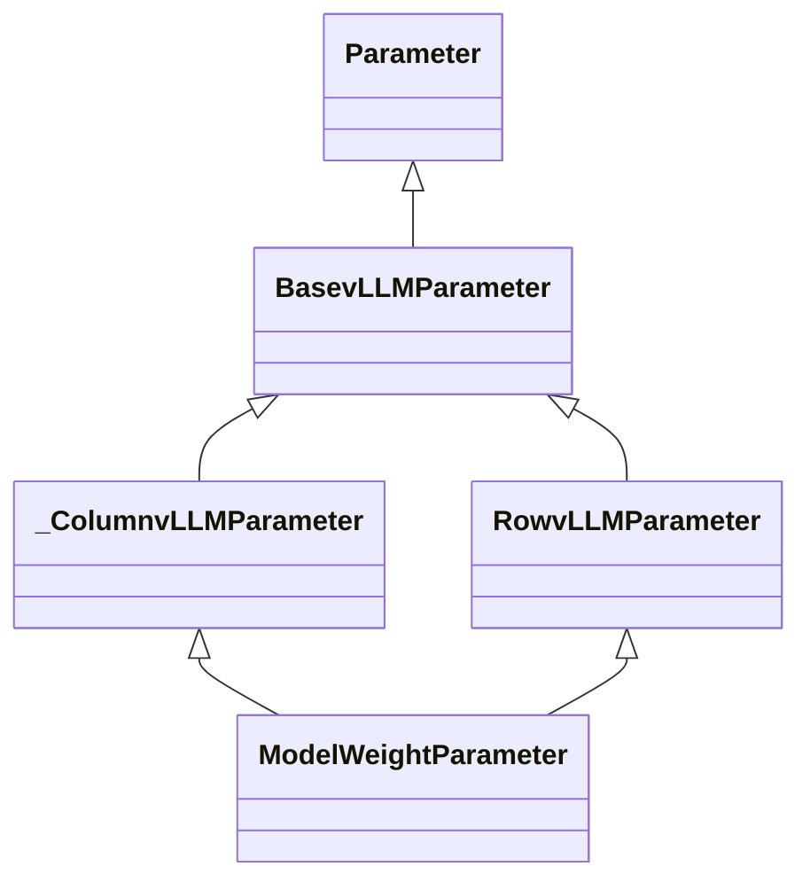
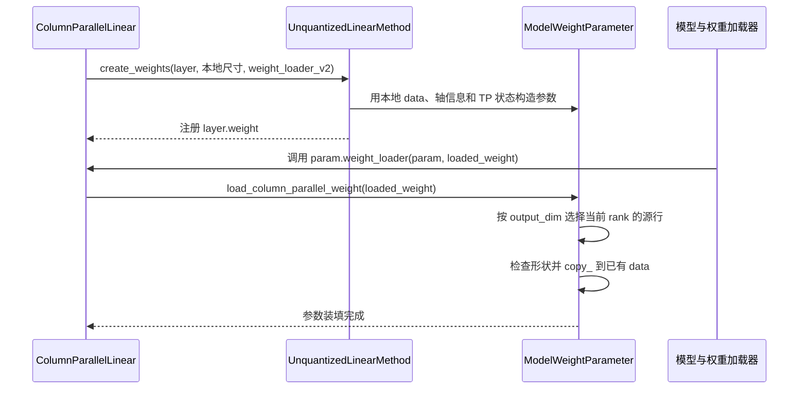

# Parameter：权重参数与 TP 分片加载

[parameter.py](../../nanovllm/model_executor/parameter.py) 为普通推理权重提供带加载能力的
`nn.Parameter` 子类。它们既保存 tensor 数据，也记录如何从 checkpoint 选出当前 rank
需要的源分片，并将其写入已经分配好的本地存储。

这里的类负责**参数装填**。前向中的矩阵乘、AllGather、AllReduce 仍由方法对象和具体线性层组织。
权重统一按 PyTorch 的“输出维度 × 输入维度”理解：

$$
\mathbf W_{\mathrm{src}}\in\mathbb R^{D_{\mathrm{out}}\times D_{\mathrm{in}}},
\qquad
\mathbf Y=\mathbf X\mathbf W_{\mathrm{src}}^{\mathsf T}+\mathbf b
$$

其中 $\mathbf W_{\mathrm{src}}$ 表示 checkpoint 中的完整逻辑权重。
参数对象的 `data` 是目标本地权重 $\mathbf W_{\mathrm{dst}}^{(r)}$，
其形状已由线性层与权重方法确定。$P$ 表示 TP size，$r$ 表示 TP 组内 rank。

## 参数对象在线性层中处于什么位置

| 对象 | 决定什么 | 具体例子 |
| --- | --- | --- |
| 线性层。 | 本地尺寸、融合投影偏移、KV 复制数，以及前向通信策略。 | `ColumnParallelLinear`、`QKVParallelLinear`。 |
| 权重方法。 | 根据尺寸创建哪种参数，以及如何执行本地矩阵乘。 | `UnquantizedLinearMethod`。 |
| 参数对象。 | 根据自身轴信息和调用参数，选择源 tensor 的区间、校验并复制。 | `ModelWeightParameter`。 |

普通浮点方法先分配本地 tensor，再将其包装成 `ModelWeightParameter` 并注册为 `layer.weight`。
因此，参数对象拿到的存储从一开始就是本地大小，加载时不需要再次缩小目标存储。
构造与 GEMM 的关系见 [Linear 文档](layers/linear.md)。

本文件的继承关系为：



图中的 `Parameter` 是 PyTorch 的 `nn.Parameter`。
`_ColumnvLLMParameter` 提供输出轴加载能力，`RowvLLMParameter` 提供输入轴加载能力，
`ModelWeightParameter` 将它们组合到同一个参数对象中。
前导下划线表示 `_ColumnvLLMParameter` 是模块内部的辅助类；其余三个类由本模块导出。

## BasevLLMParameter：保存数据、加载回调与 TP 状态

### __new__ 创建参数，__init__ 保存元信息

`BasevLLMParameter` 继承 `nn.Parameter`，先在 `__new__()` 中创建参数对象：

```python
return super().__new__(cls, data=data, requires_grad=False)
```

参数与传入的 `data` 共享底层存储，并关闭梯度；构造时没有读取 checkpoint。
它仍是普通的 PyTorch 参数，可以注册到 `nn.Module`，也可以直接交给 `F.linear` 使用。

之后 `__init__()` 保存加载元信息：

| 成员 | 含义 |
| --- | --- |
| `data`、`shape`。 | 参数已有的本地 tensor 及其形状，实际数值由加载器装填。 |
| `tp_rank`。 | 选择源分片时使用的 TP 组内 rank，不是全局进程编号。 |
| `tp_size`。 | 参数所属层的分片数。 |
| `weight_loader`。 | 模型加载器调用的回调，通常绑定到具体层的加载方法。 |

rank/size 显式传入时使用传入值，否则查询当前 TP 组。
构造函数只记录信息，不创建通信组，也不执行集合通信。
线性层及 Loader 还可以通过 `update_param_tp_status()` 将参数的 TP 状态同步为所属层的设置。

### weight_loader 是指向层加载器的入口

`weight_loader` 通过 property 暴露，内部保存在 `_weight_loader` 中。
普通 v2 加载路径下，它保存的是层的绑定方法，例如 `layer.weight_loader_v2`。
调用方取得回调后，需要显式传入目标参数：

```python
loader = param.weight_loader
loader(param, loaded_weight)
```

此时回调的 `self` 是层对象，`param` 才是要装填的参数。
层解释当前投影布局后，会反过来调用该参数的 `load_*` 方法，真正执行源分片选择与复制。

property 支持读取、赋值和删除：

- 赋值可以替换加载回调。
- 删除时将 `_weight_loader` 设为 `None`，权重数据仍保留。
- 删除后读取会抛出 `AttributeError`，使
  `getattr(param, "weight_loader", default_weight_loader)` 可以使用默认加载器。

### _assert_and_load：检查形状后原地装填

正常情况下，目标存储与待复制的源视图必须形状完全一致：

$$
\operatorname{shape}(\mathbf W_{\mathrm{dst}}^{(r)})
=\operatorname{shape}(\mathbf W_{\mathrm{selected}})
$$

检查通过后执行：

```python
self.data.copy_(loaded_weight)
```

这会更新已有参数的内容，保留参数对象身份。
形状检查避免把错误的 TP 区间通过广播复制进去。
唯一显式兼容的是目标为单元素一维 tensor、源为零维标量；`_is_1d_and_scalar()` 判断这一情况。

### 基类的 load_* 默认都是完整复制

`BasevLLMParameter` 定义了统一加载入口，但自己没有输入轴或输出轴的切分规则：

| 基类方法 | 基类默认行为 |
| --- | --- |
| `load_column_parallel_weight()`。 | 完整校验并复制。 |
| `load_row_parallel_weight()`。 | 完整校验并复制。 |
| `load_merged_column_weight()`。 | 完整校验并复制，不解释融合区域。 |
| `load_qkv_weight()`。 | 完整校验并复制，不解释 Q/K/V。 |

这些是具体的默认实现，不是抽象方法；调用后返回 `None`，通过原地修改 `data` 完成装填。
子类通过重写相应方法增加轴语义。**调用名字里带 parallel 的方法，不代表基类会自动分片。**

## _ColumnvLLMParameter：沿输出轴加载

该类保存 `output_dim`，普通线性矩阵中取 `output_dim=0`，即权重的输出行轴。
它提供普通列并行、融合多投影和 QKV 三种加载方式。

### load_column_parallel_weight：选择当前 rank 的输出行

令本地输出宽度为：

$$
d_o=\texttt{self.shape[output\_dim]}
$$

加载完整 checkpoint 时，从源权重选取：

$$
\mathbf W_{\mathrm{selected}}
=\mathbf W_{\mathrm{src}}[rd_o:(r+1)d_o,:]
\in\mathbb R^{d_o\times D_{\mathrm{in}}}
$$

再由 `_assert_and_load()` 将它写入本地参数。
这里的 $d_o$ 来自**目标参数的本地形状**，不是读取全局宽度后再除一次 $P$。
具体行区间对应 `loaded_weight.narrow(output_dim, r * d_o, d_o)`。

`narrow(dim, start, length)` 按指定轴取得连续视图，分别指定切分轴、起始位置与长度；
实际写入仍发生在后续 `copy_()`。

### load_merged_column_weight：选择源分片，写入融合目标区域

融合参数包含多个逻辑投影。例如 gate/up 的本地布局为：

$$
\mathbf W_{\mathrm{merged}}^{(r)}
=\begin{bmatrix}
\mathbf W_{\mathrm{gate}}^{(r)}\\
\mathbf W_{\mathrm{up}}^{(r)}
\end{bmatrix}
$$

一次调用只加载其中一个原始投影。此时 `loaded_weight` 是这个投影的完整权重，
层通过 `kwargs` 提供目标位置：

| 字段 | 含义 |
| --- | --- |
| `shard_offset` | 当前投影在本地融合参数输出轴上的起点。 |
| `shard_size` | 当前投影的本地输出宽度。 |
| `shard_id` | 逻辑投影编号；该普通参数实现直接使用层算好的偏移与宽度，不再用编号计算布局。 |

对第 $j$ 个投影，记目标起点为 $a_j$，本地宽度为 $o_j$，复制关系为：

$$
\mathbf W_{\mathrm{merged}}^{(r)}[a_j:a_j+o_j,:]
\leftarrow
\mathbf W_{j,\mathrm{src}}[ro_j:(r+1)o_j,:]
$$

源码先用 `self.data.narrow(output_dim, shard_offset, shard_size)` 获取**目标视图**，
再对 `loaded_weight` 取得**源分片**。检查两者形状后，只覆盖该投影的目标区域。
加载 gate 不会覆盖已经装填的 up，反之亦然。

目标偏移 $a_j$ 与源起点 $ro_j$ 不是同一个概念：前者回答写到哪里，后者回答从哪里取。
若 checkpoint 原本就包含完整融合矩阵，线性层需要先按全局投影边界拆开，
再逐投影调用参数接口；这个参数方法不自行解析完整融合格式。

### load_qkv_weight：KV 分片编号可能不同于 rank

QKV 加载同样先定位本地融合目标，再选取当前投影的源分片。
它接收 `shard_offset`、`shard_size`、`shard_id`，以及名为 `num_heads` 的参数。

**这里的 `num_heads` 实际表示 `num_kv_head_replicas`：共享同一个 KV head 的相邻 rank 数。**
这是层传入的 KV 副本数，记为 $c$，不是 Query head 数或本地 head 数。

当前投影采用的源分片编号为：

$$
\rho_j=
\begin{cases}
r,&j=Q\\
\lfloor r/c\rfloor,&j=K\text{ 或 }V
\end{cases}
$$

对投影 $j$，记层传入的本地宽度、目标偏移分别为 $o_j$、$a_j$，则：

$$
\mathbf W_{QKV}^{(r)}[a_j:a_j+o_j,:]
\leftarrow
\mathbf W_{j,\mathrm{src}}[\rho_jo_j:(\rho_j+1)o_j,:]
$$

当 $c=1$ 时，Q/K/V 都按 rank 取不同分片；当 $c>1$ 时，相邻 $c$ 个 rank
加载同一份源 K/V，而 Q 仍按各自 rank 选择。
这支持 KV head 数少于 TP rank 数时的复制布局。

本参数方法只使用已经传入的 $c$、$a_j$、$o_j$。
全局与本地 head 数、Q/K/V 在融合矩阵中的偏移，仍由 `QKVParallelLinear` 计算。
源码还要求投影标识属于 `q/k/v` 且 $c>0$，并严格检查源视图与目标视图的形状。

## RowvLLMParameter：沿输入轴加载

该类保存 `input_dim`，普通线性矩阵中取 `input_dim=1`，即权重的输入列轴。
令本地输入宽度为：

$$
d_i=\texttt{self.shape[input\_dim]}
$$

`load_row_parallel_weight()` 从完整 checkpoint 选择对应输入列：

$$
\mathbf W_{\mathrm{selected}}
=\mathbf W_{\mathrm{src}}[:,rd_i:(r+1)d_i]
\in\mathbb R^{D_{\mathrm{out}}\times d_i}
$$

对应 `loaded_weight.narrow(input_dim, r * d_i, d_i)`，再调用 `_assert_and_load()` 写入。
本地权重保留所有输出行，只保存部分输入列。
这与 `RowParallelLinear` 前向中使用输入分片、最后求和的布局相匹配。

这里也只是加载权重，调用本方法本身不会执行 AllReduce。

## ModelWeightParameter：组合两种轴加载能力

这个类的定义只有继承声明：

```python
class ModelWeightParameter(_ColumnvLLMParameter, RowvLLMParameter):
    ...
```

它继承了两个轴属性与相应方法，具体使用哪一种加载方式由层决定：

| 层的加载入口 | 参数上被调用的方法 | 本次装填的含义 |
| --- | --- | --- |
| `ColumnParallelLinear.weight_loader_v2()`。 | `load_column_parallel_weight()`。 | 从源权重选择输出行。 |
| `RowParallelLinear.weight_loader_v2()`。 | `load_row_parallel_weight()`。 | 从源权重选择输入列。 |
| `MergedColumnParallelLinear.weight_loader_v2()`。 | `load_merged_column_weight()`。 | 选择一个投影的输出行，写入本地融合区域。 |
| `QKVParallelLinear.weight_loader_v2()`。 | `load_qkv_weight()`。 | 按 Q/K/V 和 KV 复制组选择源分片。 |

**同时保存 `input_dim` 与 `output_dim`，表示同一类参数可服务于不同线性布局。**
某一层选择对应的方法，不会因为多继承而自动沿两个轴同时切分。

### 多继承中的 super 怎样传递参数

`ModelWeightParameter` 没有自己的 `__init__()`，相关初始化顺序为：

$$
\texttt{ModelWeightParameter}
\longrightarrow \texttt{\_ColumnvLLMParameter}
\longrightarrow \texttt{RowvLLMParameter}
\longrightarrow \texttt{BasevLLMParameter}
$$

这是 Python 方法解析顺序在此处的作用：

1. `_ColumnvLLMParameter.__init__()` 取出 `output_dim`，保存输出轴，其余参数交给 `super()`。
2. `RowvLLMParameter.__init__()` 取出 `input_dim`，保存输入轴，继续向后传递。
3. `BasevLLMParameter.__init__()` 保存加载回调和 TP 状态。

tensor 参数对象已经在此前的 `__new__()` 阶段创建，这条初始化链为同一个对象填充元信息。
因此一次构造可以同时传入 `input_dim`、`output_dim`、`data`、`weight_loader` 与 rank/size。

## is_sharded_weight：源数据是否已经按 rank 切好

各轴加载方法通过 `getattr(self, "is_sharded_weight", False)` 读取这个可选属性。
它描述的是**源 checkpoint tensor 的状态**：

| 属性值 | 对源 tensor 的处理 |
| --- | --- |
| `False` 或未设置。 | 根据 rank、目标本地宽度与布局，从完整逻辑投影中选择源分片。 |
| `True`。 | 将传入 tensor 当作已经选好的本地源分片，跳过再次 TP 源切分。 |

融合加载仍然需要选择目标区域，所有路径仍然进行形状检查和复制。
这个开关不表示目标参数免于装填，也不会自行替源数据补全缺少的融合布局信息。

`tp_size` 记录参数的分片状态；当前这些切片计算主要使用 `tp_rank` 与本地 `shape`，
不会把已经分配好的本地宽度再除一次 $P$。

## 把构造与实际加载串起来

以下以普通浮点列并行为例：



加载器通过参数保存的回调进入层，层将具体布局交给参数方法处理。
同一次加载里，“参数回调 → 层加载器 → 参数的切片方法”是两个不同入口，
不是在反复调用同一个函数。

后续 `UnquantizedLinearMethod.apply()` 直接读取 `layer.weight` 完成本地矩阵乘，
不再走这条 checkpoint 装填链。计算与通信的完整过程见 [Linear 文档](layers/linear.md)，
方法对象的共同协议见 [量化基类文档](layers/quantization/base_config.md)。
