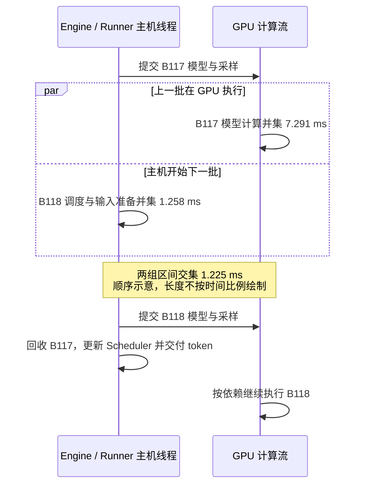

# 异步调度的性能与 CPU/GPU 重叠

本次分别在 eager 与 decode CUDA Graph 下，对比同步和异步调度。先使用原有
吞吐、延迟 benchmark 测量端到端结果，再用 Nsight Systems 查看跨批次重叠。
**性能数字来自未启用 profiler 的运行，重叠数字来自独立的诊断运行。**

测试日期为 **2026-10-24**。负载沿用 [CUDA Graph 性能记录](cuda_graph.md)，
同步基线在本轮重新测量，不直接引用较早测试的结果。


## 环境与固定配置

| 项目 | 本次配置 |
| --- | --- |
| GPU | RTX 4060 Laptop，标称 8 GB 显存，24 SM，计算能力 8.9。 |
| CPU / 系统 | Intel Core i7-14700HX，WSL2，Linux 6.6.114.1。 |
| Python / PyTorch | Conda `nano-vllm`，Python 3.10.20，PyTorch 2.5.1+cu121。 |
| 推理依赖 | FlashAttention 2.8.3.post1，Triton 3.1.0，Transformers 5.15.0。 |
| 诊断工具 | Nsight Systems 2026.1.3.425；PyTorch CUDA runtime 12.1。 |
| 模型 | 本地 Qwen3-0.6B，BF16，单进程、单 GPU，TP=1。 |
| 算子后端 | 默认 `torch`，保留局部 `torch.compile`，不切换自定义激活 kernel。 |
| 数据集 | Alpaca 本地 Parquet，按文件顺序取前 128 条有效输入。 |
| 对话模板 | user 模板，`add_generation_prompt=True`，关闭 Qwen3 thinking。 |
| 请求与并发 | 总请求数 128，最大活跃请求数 16，结束后持续补位。 |
| 输入 | 含模板最多 256 token，允许中部截断；本轮实际没有跳过或截断。 |
| 输出 | 每条固定 128 token，`ignore_eos=True`。 |
| 采样 | `temperature=0.6`，`seed=0`。 |
| 调度预算 | `max_model_len=1024`，`max_num_batched_tokens=1024`。 |
| KV cache | `block_size=256`，`gpu_memory_utilization=0.5`，按启动 profiling 分配。 |

每次完成 128 条请求，输入共 **3,737 token**，输出共 **16,384 token**。
输入长度为 18～115，均值 29.195 token。两种调度都使用同一份输入，固定输出长度
用于控制工作量，不要求随机采样文本逐字一致。GPU 未锁频，也未调整功耗限制。

### 四种组合

| 执行方式 | 调度 | `enforce_eager` | `async_scheduling` | Engine 单步入口 |
| --- | --- | --- | --- | --- |
| eager | 同步 | `True` | `False` | `step_fn` 绑定 `step()`。 |
| eager | 异步 | `True` | `True` | `step_fn` 绑定 `step_with_batch_queue()`。 |
| CUDA Graph | 同步 | `False` | `False` | `step_fn` 绑定 `step()`。 |
| CUDA Graph | 异步 | `False` | `True` | `step_fn` 绑定 `step_with_batch_queue()`。 |

异步模式启用 `AsyncScheduler`、输出占位、GPU token 回填与容量为 2 的批次队列。
Graph 仍为 `FULL_DECODE_ONLY`：只捕获 uniform 单 token decode，prefill 走 eager。
异步执行链的实现说明见 [异步调度笔记](../core/sched/AsyncScheduler-zh.md)。

## 正式测试方法

两个 benchmark 各测四种组合，每种重复 3 次，总共 **24 次独立进程运行**。
每次创建并关闭自己的 Engine，顺序使用 GPU，没有并行运行多个 benchmark。

| 轮次 | 吞吐入口顺序 | 延迟入口顺序 |
| --- | --- | --- |
| 1、3 | eager 同步 → eager 异步 → Graph 异步 → Graph 同步。 | Graph 同步 → Graph 异步 → eager 异步 → eager 同步。 |
| 2 | Graph 同步 → Graph 异步 → eager 异步 → eager 同步。 | eager 同步 → eager 异步 → Graph 异步 → Graph 同步。 |

计时沿用两个原始脚本：包含入队、调度、输入准备、模型计算、采样、结果回收及
循环内统计；不包含数据预处理、模型加载、启动 profiling、kernel 预热、Graph
捕获、最终 Worker 清理和报告写入。正式测试没有插入额外真实请求预热。

吞吐使用三次输出 token/s 的算术平均，同时给出总体标准差。延迟从三次原始请求
时间戳合并计算，每种执行方式和调度组合各有 384 条请求、48,768 个 ITL 间隔；
P99 重新由合并样本计算，不平均三次的 P99。

TTFT 从 `add_request()` 前计至用户可见的首 token，ITL 是相邻 token 的可见时间差。
异步模式的 token 可能已在 GPU 上生成，但尚未被 Engine 回收；本地可见延迟包含
这一等待。首批与后续请求的 GPU 状态也可能不同，不能只用总均值推断原因。

## 吞吐结果

单位为输出 token/s，平均值与标准差均由三次独立运行计算；标准差不是置信区间。

| 入口 | 执行方式 | 调度 | 第 1 次 | 第 2 次 | 第 3 次 | 平均值 ± 标准差 |
| --- | --- | --- | ---: | ---: | ---: | ---: |
| 吞吐 | eager | 同步 | 564.3 | 504.1 | 552.7 | 540.4 ± 26.1 |
| 吞吐 | eager | 异步 | 573.8 | 563.0 | 572.9 | 569.9 ± 4.9 |
| 吞吐 | CUDA Graph | 同步 | 1583.3 | 1685.3 | 1650.6 | 1639.8 ± 42.3 |
| 吞吐 | CUDA Graph | 异步 | 1885.6 | 1845.4 | 1886.2 | 1872.4 ± 19.1 |
| 延迟 | eager | 同步 | 551.0 | 512.4 | 567.5 | 543.6 ± 23.1 |
| 延迟 | eager | 异步 | 580.3 | 558.7 | 573.4 | 570.8 ± 9.0 |
| 延迟 | CUDA Graph | 同步 | 1599.9 | 1613.5 | 1632.4 | 1615.3 ± 13.3 |
| 延迟 | CUDA Graph | 异步 | 1890.6 | 1841.6 | 1897.4 | 1876.5 ± 24.9 |

| 执行方式 | 吞吐入口的异步提升 | 延迟入口的异步提升 |
| --- | ---: | ---: |
| eager | +5.46% | +5.00% |
| CUDA Graph | +14.19% | +16.17% |

提升按同一入口内的异步 TPS 均值除以同步 TPS 均值、再减一计算。Graph 下三轮都
观察到提升；eager 的平均提升较小，且同步结果的运行间波动与提升幅度同量级，
不能把这里的百分比推广为其他负载或机器上的固定收益。

24 次的实际输入计算量全部为 **19,993 token**。同步每次计时循环调用 1,024 次；
异步吞吐入口为 1,034 次，延迟入口为 1,032 次。额外调用涉及队列回收与空计划，
不是额外生成了输出 token。两个入口对结束及排空的计时边界不同，所以调用次数分开记录。

## 延迟结果

以下合并三次原始样本，单位为 ms。变化按异步 / 同步 - 1 计算，负值表示下降。

| 执行方式 | 指标 | 同步均值 | 异步均值 | 均值变化 | 同步 P99 | 异步 P99 |
| --- | --- | ---: | ---: | ---: | ---: | ---: |
| eager | TTFT | 37.381 | 60.773 | +62.58% | 74.885 | 86.777 |
| eager | TPOT | 29.423 | 27.779 | -5.59% | 33.987 | 29.904 |
| eager | ITL | 29.423 | 27.779 | -5.59% | 40.686 | 37.564 |
| eager | E2EL | 3774.094 | 3588.655 | -4.91% | 4353.924 | 3852.152 |
| CUDA Graph | TTFT | 39.943 | 38.315 | -4.08% | 97.246 | 73.999 |
| CUDA Graph | TPOT | 9.668 | 8.292 | -14.23% | 11.170 | 9.564 |
| CUDA Graph | ITL | 9.668 | 8.292 | -14.23% | 13.918 | 13.886 |
| CUDA Graph | E2EL | 1267.771 | 1091.368 | -13.91% | 1486.863 | 1283.789 |

eager 的异步调度改善了平均生成间隔，但 TTFT 明显升高。Graph 下平均 ITL 下降，
ITL P99 则变化很小；不能把平均吞吐提升等同于所有延迟指标都按相同比例改善。

### 首批与后续请求

每组分别合并首批 48 条请求和后续 336 条请求，TTFT 均值如下：

| 执行方式 | 调度 | 首批 TTFT | 后续请求 TTFT |
| --- | --- | ---: | ---: |
| eager | 同步 | 61.414 | 33.948 |
| eager | 异步 | 82.744 | 57.635 |
| CUDA Graph | 同步 | 85.119 | 33.490 |
| CUDA Graph | 异步 | 70.379 | 33.734 |

本轮不剔除首批数据。动态频率和首次调用会影响首批 TTFT；eager 异步模式的
后续请求也更慢，因此还需要看队列先提交下一批、再交付上一批结果的时间线。

## Nsight 怎样测量重叠

### 独立诊断负载与标签

使用同一模型和配置，将正式采集缩短为前 **32 条请求、每条输出 64 token**。
每种组合各采一次 trace。采集前先完成 16 条真实请求、每条生成 128 token 的
预热，再恢复 RNG；这一额外预热只用于诊断，不进入上面的性能表。
这些输入加预热输出仍不足 256 token，不会形成完整的可复用前缀缓存块。

使用 [profile_engine_overlap.py](../../benchmarks/profile_engine_overlap.py)
复用原有吞吐回放，在采集窗口安装临时 NVTX 包装。标签携带同一计划的 batch ID：

| 标签 | 含义 |
| --- | --- |
| `schedule` | CPU 创建本批调度计划并承诺计算进度。 |
| `prep_state`、`prep_inputs`、`prep_slots`、`prep_metadata` | 本批 CPU 端槽位更新、输入与 metadata 准备，包括其中的 CUDA API 调用。 |
| `forward`、`logits`、`sample` | 提交模型、词表投影和采样。结合 CUDA correlation ID 关联实际 GPU kernel。 |
| `execute`、`sample_tokens` | 粗粒度提交范围，用于关联本批输入操作及结果 D2H。 |
| `reclaim` | 回收该批异步输出，含读取前的完成事件等待。 |
| `update` | 用该批原始计划把结果提交给 Scheduler。 |

启动、预热和 Graph 捕获都在 `cudaProfilerStart()` 之前。阶段之间不插入同步，
保留原来的计算流、拷贝流和事件依赖。临时包装退出后恢复，不改变执行接口。

### 重叠的定义

对相邻的非空计划 B 与 B+1，令：

- **CPU 准备区间 C(B+1)**：该批 `schedule` 与四个 `prep_*` 主机范围的并集。
  输入准备入口之前的 `prepare_inputs_event.synchronize()` 不计入准备工作。
- **GPU 计算区间 G(B)**：通过 CUDA correlation ID 归属到该批 `forward`、
  `logits`、`sample` 的真实 kernel 区间并集，不把 kernel 之间的空隙算为计算。
- **跨批次重叠**：`C(B+1) ∩ G(B)` 的总时长。不同区间先求并集，避免重复计数。

这里有意排除“CPU 提交本批时 GPU 也在执行本批”的重叠；后者在同步模式下也会
发生，不能证明异步调度提前准备了下一批。

主表只统计**相邻两批都为 16 请求、每请求一个 query token 的 decode**，排除
prefill、零 token 清理计划和请求数变化的批次。CPU 准备是主机调用经过时间，
包含其中的 API 开销，不代表采样得到的 CPU 指令活跃时间或 CPU 利用率。

### 实测重叠：Graph 让更多准备工作藏到 GPU 后面

每组有 128 个非空计算批次、127 对相邻批次，其中 124 对符合上述稳态条件。
四组 trace 的全部 kernel 都能关联到批次；模型计算进一步由细阶段标签筛选。
以下总量只覆盖这 124 对，单位为 ms。

| 执行方式 | 调度 | CPU 准备总量 | 与上一批 GPU 重叠 | 平均每对重叠 | 准备时间重叠比例 |
| --- | --- | ---: | ---: | ---: | ---: |
| eager | 同步 | 142.346 | 0.000 | 0.000 | 0.00% |
| eager | 异步 | 148.138 | 45.744 | 0.369 | 30.88% |
| CUDA Graph | 同步 | 155.855 | 0.000 | 0.000 | 0.00% |
| CUDA Graph | 异步 | 157.023 | 153.025 | 1.234 | 97.45% |

Graph 异步模式下，CPU 的下一批调度和输入准备大部分发生在上一批 GPU 计算期间。
eager 也有跨批次重叠，但 CPU 到达下一轮准备时，上一批的 GPU 工作常已接近尾声。
**这里的 97.45% 是准备时间被重叠的比例，不是端到端性能提升。**

再观察整个诊断回放窗口，以及稳态每批 `forward + logits + sample` 的主机范围：

| 执行方式 | 调度 | 窗口长度 | GPU 活动并集 | GPU 忙碌覆盖率 | 每批 CPU 计算提交范围均值 |
| --- | --- | ---: | ---: | ---: | ---: |
| eager | 同步 | 4352.284 | 1220.122 | 28.03% | 30.884 |
| eager | 异步 | 4243.097 | 1133.449 | 26.71% | 30.776 |
| CUDA Graph | 同步 | 1288.034 | 989.645 | 76.83% | 1.364 |
| CUDA Graph | 异步 | 1075.627 | 994.490 | 92.46% | 1.327 |

GPU 忙碌覆盖率按窗口内所有 kernel、memcpy 和 memset 的时间并集计算，包含
prefill；它不是 SM occupancy，也不是 `nvidia-smi` 的利用率。这里没有 GPU
性能计数器采样，不能用它判断带宽或计算单元是否饱和。

eager 在本 trace 中每批的主机计算提交范围仍约 31 ms；Graph 缩短到约 1.3 ms，
CPU 因而能更早开始下一批准备。Graph 下 GPU 活动总量接近，窗口缩短、空隙减少，
与正式测试中更大的异步收益一致。eager 的忙碌覆盖率没有升高，单条诊断 trace
也不能证明每一项时间都变好。

### 一对真实批次的顺序

取 Graph 异步 trace 中 B117 → B118：它的重叠时长最接近 124 对样本的中位数，
并非刻意挑选最大重叠。B117 的模型 GPU 计算并集为 **7.291 ms**，B118 的 CPU
准备并集为 **1.258 ms**，两者交集为 **1.225 ms**。



重叠的是 **B118 的 CPU 准备与 B117 的 GPU 计算**。四组 trace 中，相邻批次的
模型 GPU 计算交集都为 0；同一请求下一 token 仍依赖上一个采样结果。

### 同步点与 eager 的 TTFT 代价

输入 staging buffer 重用前要等待 `prepare_inputs_event`，读取 CPU 输出前要
等待输出完成事件。异步模式将等待放到各自资源真正需要使用的位置，没有消除依赖。
下表事件等待是全部回放批次的主机 `cudaEventSynchronize` 经过时间，单位为 ms：

| 异步执行方式 | 输入准备事件等待总量 | 输出事件等待总量 | D2H 设备拷贝总量 | D2H 完成到开始回收的平均间隔 |
| --- | ---: | ---: | ---: | ---: |
| eager | 0.516 | 1.589 | 0.176 | 31.804 |
| CUDA Graph | 0.692 | 549.164 | 0.113 | 0.036 |

最后一列对 128 个输出批次计算 `max(0, reclaim 开始 - D2H 完成)` 的均值。
Graph 中很多批次在 D2H 完成前已经进入回收，所以间隔记 0，并在输出事件上等待；
不能把等待累计值大理解为异步实现失效。同步模式可能阻塞在输出拷贝或 `.tolist()`
内部，未出现这些显式事件等待也不表示同步模式没有等待。

eager 异步模式则常在结果已经就绪之后继续提交下一批。原因对应
[`step_with_batch_queue()`](../../nanovllm/engine/llm_engine.py) 的顺序：
先 `execute_model()`、`sample_tokens()` 并入队，队列满后才 `future.result()`，
随后 `update_from_output()`。本机 UniProc 的 eager forward 是当前线程中的 Python
调用；其 CUDA kernel 可在后台执行，但 CPU 仍需逐个提交后续操作。

这解释了正式测试里 eager 后续请求 TTFT 也从 33.948 ms 升至 57.635 ms：
**生成结果可以更早完成，用户看到它却要等下一批提交。** 上面的 31.804 ms 来自
更短、已预热且开启 profiler 的负载，不能直接当成正式 TTFT 的增加量。

两种异步 trace 中，D2H 与下一批模型计算的交集均为 0；本负载真正测到的收益主要
来自 CPU 准备与上一批计算重叠。采集开启 CUDA/NVTX 跟踪及 Graph node 跟踪，会
放大提交开销，因此不能用这些 trace 的总耗时替代前面的无 profiler TPS，也不能
把 153.025 ms 直接换算为正式回放节省的时间。

## 复现

### 正式吞吐与延迟

在仓库根目录执行，模型和数据集路径按本机调整。下面复现 24 次运行的交错顺序，
每次结果写入新目录。`common` 不带执行方式与请求规模，便于后面的诊断负载复用。

```shell
conda activate nano-vllm
result_dir="benchmark_results/async_schedule_recheck"
mkdir -p "$result_dir"

common=(
  --model-path /home/huangxy/models/Qwen3-0.6B
  --dataset-name alpaca
  --dataset-path /home/huangxy/datasets/alpaca/data/train-00000-of-00001-a09b74b3ef9c3b56.parquet
  --max-active 16
  --temperature 0.6
  --ignore-eos
  --seed 0
  --max-model-len 1024
  --max-num-batched-tokens 1024
  --gpu-memory-utilization 0.5
  --max-prompt-tokens 256
  --long-prompt-policy truncate
)

case_flags() {
  case_args=()
  if [[ "$1" == eager_* ]]; then
    case_args+=(--enforce-eager)
  fi
  if [[ "$1" == *_async ]]; then
    case_args+=(--async-scheduling)
  else
    case_args+=(--no-async-scheduling)
  fi
}

for repetition in 1 2 3; do
  order=(eager_sync eager_async graph_async graph_sync)
  if [[ "$repetition" == 2 ]]; then
    order=(graph_sync graph_async eager_async eager_sync)
  fi
  for name in "${order[@]}"; do
    case_flags "$name"
    python benchmarks/benchmark_engine_throughput.py \
      "${common[@]}" --num-prompts 128 --max-tokens 128 "${case_args[@]}" \
      --result-path "$result_dir/throughput_${name}_r${repetition}.json"
  done
  for ((index = ${#order[@]} - 1; index >= 0; index--)); do
    name="${order[index]}"
    case_flags "$name"
    python benchmarks/benchmark_engine_latency.py \
      "${common[@]}" --num-prompts 128 --max-tokens 128 "${case_args[@]}" \
      --result-path "$result_dir/latency_${name}_r${repetition}.json"
  done
done
```

完整指标定义与原始时间戳格式见 [Benchmark 文档](../../benchmarks/README.md)。
本次仓库仅保留精简统计，逐 token 原始报告和大型 trace 没有入库。

### Nsight 采集与交集分析

沿用上一段的 `common` 和 `case_flags`，另开诊断目录。这里使用额外真实请求预热，
并通过 `cudaProfilerStart/Stop` 仅采回放窗口；不要把该入口用于正式性能排名。

```shell
trace_dir="$result_dir/nsys"
mkdir -p "$trace_dir"

for name in eager_sync eager_async graph_sync graph_async; do
  case_flags "$name"
  nsys profile \
    --force-overwrite=true \
    --trace=cuda,nvtx \
    --sample=none \
    --cpuctxsw=none \
    --cuda-graph-trace=node \
    --capture-range=cudaProfilerApi \
    --capture-range-end=stop \
    --output "$trace_dir/$name" \
    python benchmarks/profile_engine_overlap.py \
      "${common[@]}" --num-prompts 32 --max-tokens 64 "${case_args[@]}" \
      --result-path "$trace_dir/$name.json"
  nsys export --type sqlite --force-overwrite=true \
    --output "$trace_dir/$name.sqlite" "$trace_dir/$name.nsys-rep"
done

python benchmarks/analyze_engine_overlap.py "$trace_dir"
```

[`analyze_engine_overlap.py`](../../benchmarks/analyze_engine_overlap.py) 只依赖 Python
标准库，读取 SQLite 与同名 `.trace.json`，输出 `overlap_summary.json`。它通过
`NVTX_EVENTS` 找到主机阶段，再将 `CUPTI_ACTIVITY_KIND_RUNTIME.correlationId`
与 kernel、memcpy 表关联，计算区间并集和交集；不会只用每批首尾时间近似 GPU 工作。
分析器固定使用本次的 **16 并发**稳态口径，修改诊断并发时也应同步调整筛选条件。

在 Nsight GUI 打开 `.nsys-rep` 后，可搜索 `schedule|118`、`prep_inputs|118` 和
`forward|117` 等标签，结合 CUDA API → GPU 的关联检查对应批次。`.trace.json`
保存批次布局与观测入口源码哈希，须与同次 trace 一起保留。
