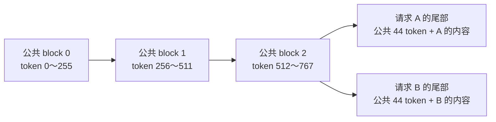

# 前缀缓存的收益：聊天模板与共享 system 提示词

本次使用原有吞吐、延迟 benchmark，对比前缀缓存开关。测试于 **2026-10-25**
采集，模型为 Qwen3-0.6B，GPU 为 RTX 4060 Laptop。

现有 benchmark 已使用 Qwen 聊天模板，但原始短输入没有完整块可以复用。加入
固定长 system 后，每个后续请求可复用 768 token，吞吐入口三次平均提高
**29.88%**，延迟入口平均 TTFT 降低 **43.14%**。

## 已经使用 Qwen 模板，但角色标记不足以命中缓存

两个入口都经共享 runner 调用
[`BenchmarkDataset.sample()`](../../benchmarks/datasets/base.py)，公共编码层执行：

```python
chat_prompt = tokenizer.apply_chat_template(
    messages,
    tokenize=False,
    add_generation_prompt=True,
    enable_thinking=False,
)
prompt_ids = tokenizer.encode(chat_prompt, add_special_tokens=False)
```

原有 Alpaca 输入只提供 user 消息。Qwen3 会添加 user/assistant 角色标记和关闭
thinking 时的空思考段。本次前 128 条有效记录的完整输入为 18～115 token，从头
开始相同的 token 只有 **3 个**，解码为 `<|im_start|>user` 加换行。

当前 `block_size = scheduler_block_size = hash_block_size = 256`，只复用完整块。
因此原负载没有可复用的完整前缀。位于可变 user 内容后面的相同 assistant 标记
属于相同后缀，无法跳过前面的差异形成前缀命中。

## 对照负载：相同问题，加上固定 system 指令

公共参数 `--system-prompt` 直接接收共享文本，去除首尾空白后构造 `system → user`
消息。省略时保持原来的单 user 模板。模板构造和编码均在推理计时之外，长度
截断只作用于 user，保留完整 system；本轮使用 `error`，没有跳过或截断。

共享内容包含固定的技术问答规范，全文内嵌在本文复现部分。两组都按相同顺序
读取同一 Alpaca Parquet 的前 128 条有效问题，不将参考答案放入输入。

2026-10-25 采集时通过文件提供这段文本；2026-10-26 清理目录后改为直接传参，
共享内容保持不变。下表保留原始测量结果，未因入口调整重新采集性能。

| 负载 | 消息结构 | 输入长度范围 | 逻辑输入总量 | 全体共同前缀 | 可复用完整块 |
| --- | --- | ---: | ---: | ---: | ---: |
| 仅聊天模板 | user → assistant 提示。 | 18～115 | 3,737 | 3 token | 0。 |
| 共享 system | system → user → assistant 提示。 | 827～924 | 107,289 | 812 token | 3 块，共 768 token。 |

共享 system 每条请求增加 809 个输入 token。812 个公共 token 中，最后 44 个与
变化的 user 内容落在同一块，当前实现仍需计算这个尾部。



后续请求复用前三个完整块的 KV，从剩余位置继续 prefill。decode 仍然需要读取
这些 KV 做 Attention；前缀缓存减少的是重复前缀的计算量。

这是固定长 system 的受控负载。真实应用也可能共享长文档、工具定义或多轮历史，
但能命中多少取决于开头的 token 是否一致，本结果不代表任意聊天模板都有同样收益。

## 环境与固定配置

| 项目 | 本次配置 |
| --- | --- |
| GPU | NVIDIA GeForce RTX 4060 Laptop，约 8 GB，24 SM，计算能力 8.9。 |
| CPU / 系统 | Intel Core i7-14700HX，WSL2，Linux 6.6.114.1。 |
| Python / PyTorch | Conda nano-vllm，Python 3.10.20，PyTorch 2.5.1+cu121。 |
| 其他依赖 | FlashAttention 2.8.3.post1，Triton 3.1.0，Transformers 5.15.0，PyArrow 25.0.1。 |
| 模型与精度 | 本地 Qwen3-0.6B，BF16，单 GPU、TP=1，默认 torch 算子后端。 |
| 执行方式 | CUDA Graph 开启，FULL_DECODE_ONLY；prefill 和不适合完整捕获的批次走 eager。 |
| 调度 | 同步调度，async_scheduling=False，watermark=0.0。 |
| 请求 | 128 条，闭环最大活跃数 16，结束后继续补充。 |
| 输出与采样 | 每请求固定 128 token，忽略 EOS，temperature=0.6，seed=0。 |
| 上下文与预算 | max_model_len=2048，max_num_batched_tokens=1024。 |
| 缓存 | block_size=256，未显式设置 prefix_match_unit，GPU 显存预算比例 0.5。 |

代码以 `df14b6e` 为基点，包含工作区的前缀缓存配置接线和本轮 system 输入选项。
GPU 未锁频，未修改功耗限制，没有并行运行其他 GPU benchmark。

## 测试方法与计时边界

两种负载 × 缓存开关 × 两个入口，每种重复 3 次，共 **24 次独立进程运行**。
每次重新创建 Engine，逻辑前缀缓存初始为空，建立公共前缀的代价包含在结果中。
没有额外真实请求预热，也没有在计时前预先填充 system 缓存。

启动时的权重加载、显存 profiling、kernel 预热和 Graph 捕获不进入回放计时。
回放包含入队、调度、输入准备、模型计算、采样、回收和循环内统计；最终清理与
报告保存沿用原脚本的边界。不启用 profiler，不插入额外 CUDA 同步。

为减少固定顺序的影响，采用交错顺序，A/B 分别表示仅模板/共享 system：

| 轮次 | 吞吐入口顺序 | 延迟入口顺序 |
| --- | --- | --- |
| 1、3 | A 关 → A 开 → B 开 → B 关。 | B 关 → B 开 → A 开 → A 关。 |
| 2 | B 关 → B 开 → A 开 → A 关。 | A 关 → A 开 → B 开 → B 关。 |

吞吐给出三次输出 token/s 的算术平均与总体标准差；延迟由三次原始时间戳合并
计算，每组 384 条请求、48,768 个 ITL 间隔，P99 不取三次 P99 的平均。
TTFT 从 add_request() 前计至首 token 在本地 Engine 可见，包含提交后的等待，
尚未补充提交的样本等待不计入每请求延迟，也不包含 HTTP 和文本解码。完整口径见
[Benchmark 文档](../../benchmarks/README.md)。

**缓存开关只在同一负载内比较。** 增加 system 改变了上下文长度及 decode 的
Attention 工作量，不能把长输入与原始短输入的 TPS 差直接当作缓存收益。

## 实际命中与减少的计算量

`num_input_tokens` 记录逻辑输入，命中缓存也不会减少；`num_scheduled_tokens`
累计 Scheduler 实际提交的输入位置，不包含 CUDA Graph padding。

每请求生成 128 个输出，最后一个输出不再作为下一步输入，因此 decode 部分是
`128 × (128 - 1) = 16,256` 个计算位置。总调度量减去它，就得到实际计算的
prefill token 数。本轮没有观察到超出这一账目的抢占重算。

| 负载 | 缓存 | 逻辑输入 | 实际 prefill | decode 输入位置 | num_scheduled_tokens |
| --- | --- | ---: | ---: | ---: | ---: |
| 仅聊天模板 | 关。 | 3,737 | 3,737 | 16,256 | 19,993 |
| 仅聊天模板 | 开。 | 3,737 | 3,737 | 16,256 | 19,993 |
| 共享 system | 关。 | 107,289 | 107,289 | 16,256 | 123,545 |
| 共享 system | 开。 | 107,289 | 9,753 | 16,256 | 26,009 |

共享 system 的差值为 `123,545 - 26,009 = 97,536 = 127 × 768`，对应首条
请求建立公共前缀、其余 127 条各复用 3 块。节省了逻辑输入的 **90.91%**，或
包含 decode 后总调度量的 **78.95%**。这两个百分比的分母不同。

这里根据调度计数核对实际节省量，没有把逻辑输入缩短，也没有将末尾相同的
assistant 标记计作命中。缓存还可以在同一调度批次内建立共享块关系，后续请求
不必等首条请求生成结束；GPU 按已有执行顺序写入并使用对应 KV。

## 吞吐与延迟结果

输出吞吐以实际生成的 16,384 token 除以回放耗时。下表单位为 **输出 token/s**，
均值与总体标准差由同一入口的三次独立测量计算。延迟入口多做逐 token 观察，
因此两种入口分别比较缓存开关。

| 入口 | 负载 | 缓存 | 第 1 次 | 第 2 次 | 第 3 次 | 平均 ± 标准差 |
| --- | --- | --- | ---: | ---: | ---: | ---: |
| 吞吐 | 仅聊天模板 | 关。 | 1,567.02 | 1,614.12 | 1,461.89 | 1,547.68 ± 63.63 |
| 吞吐 | 仅聊天模板 | 开。 | 1,512.49 | 1,601.87 | 1,593.48 | 1,569.28 ± 40.30 |
| 吞吐 | 共享 system | 关。 | 686.92 | 698.48 | 664.43 | 683.28 ± 14.14 |
| 吞吐 | 共享 system | 开。 | 887.77 | 893.83 | 880.70 | 887.43 ± 5.36 |
| 延迟 | 仅聊天模板 | 关。 | 1,605.74 | 1,605.58 | 1,561.95 | 1,591.09 ± 20.61 |
| 延迟 | 仅聊天模板 | 开。 | 1,619.71 | 1,559.13 | 1,553.92 | 1,577.59 ± 29.86 |
| 延迟 | 共享 system | 关。 | 696.50 | 663.43 | 676.09 | 678.67 ± 13.62 |
| 延迟 | 共享 system | 开。 | 886.01 | 839.23 | 874.15 | 866.46 ± 19.86 |

| 入口 | 负载 | 开启缓存后的平均 TPS 变化 | 回放平均耗时：关 → 开 |
| --- | --- | ---: | ---: |
| 吞吐 | 仅聊天模板 | +1.40% | 10.604 → 10.447 s |
| 吞吐 | 共享 system | +29.88% | 23.989 → 18.463 s |
| 延迟 | 仅聊天模板 | -0.85% | 10.299 → 10.389 s |
| 延迟 | 共享 system | +27.67% | 24.151 → 18.919 s |

以下延迟均来自延迟入口，单位为 **ms**。TTFT 是首 token 等待，TPOT 是
每请求首尾输出之间的平均间隔，ITL 是单个相邻输出间隔，E2EL 是整条请求耗时。
各项 P99 从三轮合并样本计算；本轮输出长度一致，所以 TPOT 与 ITL 的均值相同。

| 负载 | 指标 | 缓存关：平均 | 缓存开：平均 | 缓存关：P99 | 缓存开：P99 |
| --- | --- | ---: | ---: | ---: | ---: |
| 仅聊天模板 | TTFT | 49.18 | 52.14 | 206.54 | 218.80 |
| 仅聊天模板 | TPOT | 9.75 | 9.81 | 11.14 | 10.89 |
| 仅聊天模板 | ITL | 9.75 | 9.81 | 11.93 | 11.66 |
| 仅聊天模板 | E2EL | 1,287.18 | 1,298.44 | 1,551.35 | 1,529.72 |
| 共享 system | TTFT | 147.44 | 83.83 | 1,044.07 | 389.91 |
| 共享 system | TPOT | 22.33 | 17.95 | 23.38 | 19.23 |
| 共享 system | ITL | 22.33 | 17.95 | 62.11 | 21.87 |
| 共享 system | E2EL | 2,982.87 | 2,364.02 | 3,920.42 | 2,694.44 |

## 结果解释与适用范围

- **原来的聊天模板负载没有稳定收益。** 吞吐入口变化 +1.40%，延迟入口变化
  -0.85%，计算量完全相同。两种入口方向不一致，且差值小于本轮运行间波动，
  不能归因于前缀复用。TTFT 也没有改善；三次重复不足以区分小幅开销与噪声。
- **固定长 system 获得了明显收益。** 吞吐入口由 683.28 提升到 887.43 token/s，
  提高 29.88%，平均回放耗时减少 23.04%；延迟入口 TPS 提高 27.67%。
- **长前缀的重复 prefill 减少后，首 token 与尾延迟一起改善。** 平均 TTFT 从
  147.44 降到 83.83 ms，减少 43.14%；TTFT P99 减少 62.65%。ITL P99 从
  62.11 降到 21.87 ms，减少 64.78%；每请求平均 E2EL 减少 20.75%。

计算量下降不会等比例变成端到端加速。固定 128-token 输出仍需逐步执行模型，
Attention 仍读取长前缀 KV；CPU 调度、采样和结果回收也保留。命中缓存还会改变
prefill 与 decode 的批次组织，因此 ITL 的改善包含减少混合计算和等待的作用，
不能解读为纯 decode kernel 本身变快。

本例用于测量应用本来就需要的公共长指令能省多少重复计算。主动给短问题添加
长 system 会增加逻辑输入与后续 Attention 成本；应在同一任务内比较缓存开关。
相同前缀是否达到完整块长度、重复请求数量、输出长度，以及复用前缓存是否被
驱逐，都会影响收益。本次没有覆盖多种 system 长度或显存压力下的驱逐场景。

采样种子、temperature 和输出预算固定，但缓存开关改变批次组织后，随机数与
浮点计算路径可能变化，因此没有要求两组输出文本逐字一致。

## 复现

在项目根目录使用 `nano-vllm` 环境。下面沿用本轮模型、数据集和配置，分别调用
原来的两个入口。结果保存位置可自行调整。

<details>
<summary>共享 system 全文：先执行此段设置变量</summary>

这里保留采集时的完整文本，避免更换内容后仍引用原来的共同前缀长度。

```shell
system_prompt=$(cat <<'PROMPT'
You are a careful assistant who explains technical subjects and helps readers reason about unfamiliar problems. Follow this shared response policy for every question. The user's message contains the specific task; this policy provides consistent guidance about presentation, evidence, examples, and scope.

1. Identify the user's immediate objective before choosing an explanation. Give the central answer early, then supply the background needed to understand it. Use familiar language and introduce specialized terms when they become necessary for the argument.

2. Separate facts provided by the user from assumptions needed to continue. When information is missing, state a reasonable assumption clearly. Explain how a different assumption could change the answer when that distinction matters for the task.

3. Explain cause and effect in a concrete order. Describe the starting conditions, the action taken, and the resulting state. Connect each step to the next so that a reader can follow the reasoning without reconstructing hidden transitions.

4. Use short examples to illustrate abstract concepts. Keep the example small enough to inspect manually, and label its inputs and outputs. Explain which details are essential to the concept and which details simply make the example convenient.

5. Preserve the meaning of names, units, and dimensions throughout an answer. If a quantity represents bytes, requests, tokens, elements, or elapsed time, make that meaning explicit. Avoid using the same symbol for unrelated quantities in different paragraphs.

6. When discussing a function, explain what the caller provides and what the caller receives. Mention meaningful side effects such as changes to persistent state, resource ownership, or pending work. Distinguish a submitted operation from an operation whose result is ready.

7. When comparing approaches, use the same workload and accounting boundaries. Identify the variable being changed, the quantities being measured, and the conditions held constant. Explain why a result from one workload may differ from a result obtained elsewhere.

8. Present measurements with enough context to interpret them. State the relevant hardware, software configuration, input size, and repetition count when available. Separate observations from explanations, and describe uncertainty without claiming that one measurement establishes a universal rule.

9. For a calculation, show the important relationship and substitute values with their units. Check whether the magnitude is plausible. If rounding changes a displayed result, identify the rounded value rather than presenting it as an exact equality.

10. For code examples, prefer a direct implementation with descriptive variables. Explain the invariant protected by a check and the condition represented by a branch. Keep examples focused on the behavior being discussed so that extra machinery does not obscure the idea.

11. For questions involving concurrency, identify which work runs on each participant. Explain when data becomes available and what dependency must hold before another operation can use it. Treat ordering, completion, and visibility as separate concepts when the implementation requires it.

12. For resource management, describe who owns a resource and when ownership changes. Explain when a resource becomes available for reuse and whether its previous contents remain meaningful. Connect cleanup behavior to actual references or completion conditions rather than vague timing assumptions.

13. For a long task, organize the answer around meaningful milestones. Make the result of each milestone concrete and explain how it enables the next one. Keep the explanation proportional to the user's question and their apparent familiarity with the subject.

14. When a proposed optimization moves work between stages, account for the whole execution path. Consider whether preparation, communication, computation, or result delivery becomes the limiting stage. A reduction in one stage does not guarantee the same proportional reduction in total elapsed time.

15. Finish an explanation with the information the user needs to apply it. Provide relevant constraints, a clear interpretation of the result, and a useful connection to the original question. Keep recommendations tied to the evidence and assumptions already established in the answer.

16. When describing a reusable result, explain the conditions that make reuse valid. Identify which inputs must remain identical and which inputs may vary. If the result has a limited lifetime, describe the operation that invalidates it and the resources that remain available afterward.
PROMPT
)
```

</details>

```shell
conda activate nano-vllm

common=(
  --model-path /home/huangxy/models/Qwen3-0.6B
  --dataset-name alpaca
  --dataset-path /home/huangxy/datasets/alpaca/data/train-00000-of-00001-a09b74b3ef9c3b56.parquet
  --num-prompts 128 --max-active 16
  --max-tokens 128 --temperature 0.6 --ignore-eos --seed 0
  --max-model-len 2048 --max-num-batched-tokens 1024
  --gpu-memory-utilization 0.5 --block-size 256 --watermark 0
  --no-async-scheduling --long-prompt-policy error
)

run_case() {
  local entry="$1" workload="$2" cache="$3" repetition="$4"
  local extra=()
  if [[ "$workload" == shared_system ]]; then
    extra+=(--system-prompt "$system_prompt")
  fi
  if [[ "$cache" == on ]]; then
    extra+=(--enable-prefix-caching)
  else
    extra+=(--no-enable-prefix-caching)
  fi
  python "benchmarks/benchmark_engine_${entry}.py" \
    "${common[@]}" "${extra[@]}" \
    --result-path "benchmark_results/prefix_cache_recheck/${entry}_${workload}_${cache}_r${repetition}.json"
}

for repetition in 1 2 3; do
  cases=(template_only:off template_only:on shared_system:on shared_system:off)
  if [[ "$repetition" == 2 ]]; then
    cases=(shared_system:off shared_system:on template_only:on template_only:off)
  fi
  for case in "${cases[@]}"; do
    run_case throughput "${case%:*}" "${case#*:}" "$repetition"
  done
  for ((index=${#cases[@]}-1; index>=0; index--)); do
    case="${cases[index]}"
    run_case latency "${case%:*}" "${case#*:}" "$repetition"
  done
done
```

未传 `--enforce-eager`，所以使用默认的 CUDA Graph 配置。若更换模型 tokenizer、
共享文本或 block_size，应重新统计共同前缀及可命中块数，不能直接沿用 812/768。
