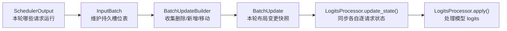

# `BatchUpdateBuilder`：持久 Batch 的状态变更协议

## 要解决的问题

`InputBatch` 不是每一轮都重新创建的临时 batch，而是一块长期存在的 GPU/CPU
槽位表。一个槽位下标对应一个正在运行的请求，例如：

```text
槽位下标:  0    1    2    3
请求:     A    B    C    D
```

模型前向时，第 `i` 行 logits 属于第 `i` 个槽位的请求。未来的 logits processor
也会维护相同布局的状态，例如：

- `token_counts[i]`：请求 `i` 已生成 token 的出现次数，用于 repetition penalty。
- `min_tokens_state[i]`：请求 `i` 是否尚未达到最小生成长度。
- `grammar_state[i]`：请求 `i` 当前 grammar 自动机状态。

因此，请求完成、加入，或在槽位之间移动时，**不仅 `InputBatch` 要更新，所有
logits processor 的状态也必须做完全相同的更新**。如果 processor 仍把 `D` 的
状态放在槽位 `3`，但 `InputBatch` 已把 `D` 移到了槽位 `1`，下一次 `apply()`
就会对错误的请求处理 logits。

`BatchUpdateBuilder` 的职责就是：

1. 在一个 engine step 内收集槽位的删除、新增和移动事件。
2. 让 `InputBatch` 能即时取得最小空槽位并复用它。
3. 在模型前向前构造一个 `BatchUpdate`，一次性交给所有 processor 同步状态。

它位于 [nanovllm/sample/logits_processor/state.py](../../nanovllm/sample/logits_processor/state.py)，通信协议定义在 [interface.py](../../nanovllm/sample/logits_processor/interface.py)。当前 `InputBatch` 已记录槽位事件，在 `refresh_metadata()` 中将其交给 processor；`Sampler` 已保留 processor 的执行入口，默认容器为空。

## 三个对象的分工



- **`InputBatch`**：真正保存请求对应的 token、位置、block table、采样参数等张量或元数据。它决定槽位最终长什么样。
- **`BatchUpdateBuilder`**：只保存“本轮和上一轮相比发生了什么”。它不保存完整请求表，也不执行 logits 运算。
- **`BatchUpdate`**：由 builder 在本轮即将前向时交付给 processor 的事件包。
- **`LogitsProcessor`**：拥有自己的逐槽位状态。它先根据 `BatchUpdate` 调整状态布局，随后才可以对对应行的 logits 做处理。

这里的 batch 是**持久 batch（persistent batch）**：请求 `A` 在连续 decode 的十个 step 中，通常一直保留在同一个槽位。只有布局改变时才产生 `BatchUpdate`；纯 decode step 返回 `None`。

## 数据结构

### `MoveDirectionality`

```python
class MoveDirectionality(Enum):
    UNIDIRECTIONAL = auto()
    SWAP = auto()
```

| 值 | 事件形式 | 含义 |
| --- | --- | --- |
| `UNIDIRECTIONAL` | `(source_index, target_index, UNIDIRECTIONAL)` | 将源槽位请求单向搬到目标槽位。源槽位之后为空或落在逻辑 batch 之外。 |
| `SWAP` | `(index_a, index_b, SWAP)` | 交换两个仍然存活的槽位。两个请求的 processor 状态也必须同时交换。 |

当前最常见的是 `UNIDIRECTIONAL`：一个中间请求完成后，把末尾仍活跃的请求搬到中间，令活跃请求继续占据 `[0, batch_size)` 这个连续前缀。`InputBatch.swap_states()` 也会记录 `SWAP`，但常规槽位压缩使用单向移动。

### 事件类型

```python
RemovedRequest = int
AddedRequest = tuple[int, SamplingParams, list[int], list[int]]
MovedRequest = tuple[int, int, MoveDirectionality]
```

| 类型 | 元素 | 语义 |
| --- | --- | --- |
| `RemovedRequest` | `index` | 一个旧请求从该槽位移除。 |
| `AddedRequest` | `(index, sampling_params, prompt_token_ids, output_token_ids)` | 一个新请求写入该槽位；其中 `output_token_ids` 是请求运行中输出列表的**引用**。 |
| `MovedRequest` | `(source_index, target_index, directionality)` | 一个存活请求及其 processor 状态要在槽位间移动。 |

`AddedRequest.output_token_ids` 不能是副本。假设请求 `E` 初始输出为 `[]`，随后
模型生成 `[151, 42]`；processor 通过同一个列表对象就能看到 `[151, 42]`，无需每轮
重新传完整请求状态。

### `BatchUpdate`

```python
@dataclass(frozen=True)
class BatchUpdate:
    batch_size: int
    removed: Sequence[RemovedRequest]
    added: Sequence[AddedRequest]
    moved: Sequence[MovedRequest]
```

`BatchUpdate` 是一次布局变更的交付物。processor 必须严格按下面顺序应用事件：

```text
removed -> added -> moved
```

这个顺序不是装饰。例如槽位 `1` 的旧请求被删除，槽位 `3` 的请求随后移动到 `1`：
若先移动再删除，就会把刚移动进来的状态又清掉。

`frozen=True` 只禁止重新赋值 `batch_update.removed = ...`；它**不会深度冻结**其中的
列表。Builder 交付后不会再修改这些旧列表，而是换成新的空列表，因此 processor 在
本次前向期间可以安全读取它们。

## `BatchUpdateBuilder` 的成员与不变量

| 成员 | 类型 | 含义 |
| --- | --- | --- |
| `_removed` | `list[int]` | 本轮登记、但尚未被立即复用的删除槽位。第一次读取时按降序排序。 |
| `_is_removed_sorted` | `bool` | 标记 `_removed` 是否已经排序。排序后禁止再追加删除，避免破坏槽位复用顺序。 |
| `added` | `list[AddedRequest]` | 本轮新写入槽位的请求事件。 |
| `moved` | `list[MovedRequest]` | 本轮槽位压缩或交换事件。 |
| `batch_changed` | `bool` | 供特殊路径快速记录 batch 是否改变的辅助标记。当前正确性仍以三个事件列表是否为空为准。 |

删除列表之所以要**降序**排列，是为了让 `list.pop()` 能在 $O(1)$ 时间得到最小槽位：

```text
原始删除顺序: [5, 2, 7]
降序排序后:   [7, 5, 2]
pop() 返回:    2
```

最小槽位通常是最希望优先复用的位置。这样 batch 更容易保持紧凑，后续张量切片也能只处理一个连续前缀。

### 重要约束

同一个 engine step 内必须先收集**所有删除**，再第一次调用以下任一接口：

- `removed`
- `peek_removed()`
- `pop_removed()`

第一次读取会触发排序，此后调用 `removed_append()` 会抛出 `RuntimeError`。这是刻意的 fail-fast 保护：若允许排序后继续追加，`pop_removed()` 就不能保证继续返回最小空槽位。

## 接口语义

### `removed_append(index)`

登记一个完成、取消或被抢占的请求槽位。

```python
builder.removed_append(5)
builder.removed_append(2)
builder.removed_append(7)
```

此时尚未排序：

```text
_removed = [5, 2, 7]
_is_removed_sorted = False
batch_changed = True
```

### `peek_removed()` 与 `pop_removed()`

`peek_removed()` 的名字容易让人误以为它只是无副作用地“看一眼”。实际并非如此：

1. 第一次 `peek_removed()` 会调用 `_ensure_removed_sorted()`，把 `_removed` 按降序排序。
2. 随后 `_is_removed_sorted` 变成 `True`，本轮删除收集阶段结束。
3. 此后再调用 `removed_append()` 会抛出 `RuntimeError`；只能读取 `removed`、继续
   `peek_removed()`，或用 `pop_removed()` 取走最小空槽位。

因此，所有本轮要删除的请求都必须先 `removed_append()` 完，再开始查询空槽位。

```python
builder.peek_removed()  # 返回 2，但保留该元素
builder.pop_removed()   # 返回 2，并从 _removed 删除
```

第一次调用会产生：

```text
_removed = [7, 5, 2]
_is_removed_sorted = True
```

调用 `pop_removed()` 后：

```text
_removed = [7, 5]
```

注意：被 `pop_removed()` 取走的槽位通常会在同一轮被新请求立即覆盖。因此它不再需要出现在最终 `BatchUpdate.removed` 中；processor 只需通过 `added` 在同一槽位直接初始化新状态。

### `get_and_reset(batch_size)`

在 `InputBatch` 完成所有增删移动、但模型前向和 processor `apply()` 之前调用。

```python
batch_update = builder.get_and_reset(batch_size=4)
```

- 若 `removed`、`added`、`moved` 都为空，返回 `None`。这就是连续 decode 的最快路径：processor 不需要重排状态。
- 若存在任意事件，返回 `BatchUpdate`，然后 builder 把自己的三个列表替换为新的空列表，开始收集下一 step。
- 这里**不能**对旧列表调用 `clear()`；`BatchUpdate` 仍引用它们，清空会让 processor 错过本轮变更。

### `reset()`

直接丢弃本轮收集的事件，并返回清空前的 `batch_changed`。正常推理路径应优先使用 `get_and_reset()`；`reset()` 只适合确认本轮不需要通知任何 processor 的特殊控制路径。

## 完整样例一：完成请求的槽位被新请求立即覆盖

这一轮开始前，持久 batch 有四个活跃请求：

```text
batch_size = 4

槽位下标:  0    1    2    3
请求:     A    B    C    D
```

请求 `B` 完成，调度器又决定让新请求 `E` 进入 batch。`InputBatch` 的伪代码如下：

```python
builder = BatchUpdateBuilder()

# 1. 先登记本轮所有完成请求。
builder.removed_append(1)

# 2. 复用数值最小的空槽位。
slot = builder.pop_removed()
assert slot == 1

# 3. InputBatch 把 E 的 token、block table、采样参数等真正写入第 1 行。
input_batch.add_request(request_e, slot)

# 4. 同步记录供 logits processor 使用的新增事件。
builder.added.append(
    (
        slot,
        request_e.sampling_params,
        request_e.prompt_token_ids,
        request_e.output_token_ids,
    )
)

batch_update = builder.get_and_reset(batch_size=4)
```

每一步的 builder 状态如下：

| 时刻 | `_removed` | `added` | `moved` | 说明 |
| --- | --- | --- | --- | --- |
| 创建后 | `[]` | `[]` | `[]` | 本轮还没有布局变化。 |
| `removed_append(1)` 后 | `[1]` | `[]` | `[]` | `B` 待删除。 |
| `pop_removed()` 后 | `[]` | `[]` | `[]` | 槽位 `1` 被取走，准备马上复用。 |
| `added.append(E)` 后 | `[]` | `[(1, E.params, E.prompt, E.outputs)]` | `[]` | `E` 已经覆盖槽位 `1`。 |
| `get_and_reset(4)` 返回值 | `[]` | `[(1, ...)]` | `[]` | 交付给 processor 的更新。 |

最终 `InputBatch`：

```text
槽位下标:  0    1    2    3
请求:     A    E    C    D
```

最终 `BatchUpdate`：

```python
BatchUpdate(
    batch_size=4,
    removed=[],
    added=[(1, E.sampling_params, E.prompt_token_ids, E.output_token_ids)],
    moved=[],
)
```

这里最容易误会的是：`B` 明明完成了，为什么 `removed=[]`？因为它的槽位被 `E`
**立即覆盖**。processor 不需要先清理第 `1` 行再留下空洞；只要用 `added` 初始化
第 `1` 行的新状态即可。`pop_removed()` 正是在表达“这个删除事件已被同槽位新增消费”。

一个维护 `token_counts` 的 processor 可以这样处理：

```python
def update_state(self, batch_update: BatchUpdate | None) -> None:
    if batch_update is None:
        return

    # 本例没有 removed，因此不会清理任何行。
    for index in batch_update.removed:
        self.token_counts[index].zero_()

    # E 覆盖第 1 行：初始化 E 的 token 统计，而不是保留 B 的旧统计。
    for index, _, prompt_token_ids, output_token_ids in batch_update.added:
        self.token_counts[index].zero_()
        for token_id in prompt_token_ids + output_token_ids:
            self.token_counts[index, token_id] += 1

    for source, target, direction in batch_update.moved:
        self.move_state(source, target, direction)
```

## 完整样例二：完成请求后压缩 batch

再次从下面的持久 batch 开始：

```text
batch_size = 4

槽位下标:  0    1    2    3
请求:     A    B    C    D
```

`B` 完成后，本轮没有新请求进入，但 `InputBatch` 希望保持活跃请求在连续前缀中。因此将末尾的 `D` 从槽位 `3` 移到 `1`，并把逻辑 batch 大小缩为 `3`：

```python
builder = BatchUpdateBuilder()

# 1. B 离开槽位 1。
builder.removed_append(1)

# 2. 先消费槽位 1 的删除事件。它马上会被 D 覆盖，因此不会作为一个独立的
#    removed 事件交给 processor。
empty_index = builder.pop_removed()
assert empty_index == 1

# 3. InputBatch 实际移动每一种 per-request 数据：token、位置、block table 等。
input_batch.move_request(source_index=3, target_index=1)

# 4. processor 的状态必须进行同样的移动。
builder.moved.append((3, 1, MoveDirectionality.UNIDIRECTIONAL))

# 5. 原槽位 3 已落在新的逻辑 batch 之外。
batch_update = builder.get_and_reset(batch_size=3)
```

最终 `InputBatch`：

```text
batch_size = 3

槽位下标:  0    1    2    3
请求:     A    D    C   [逻辑 batch 外]
```

最终 `BatchUpdate`：

```python
BatchUpdate(
    batch_size=3,
    removed=[],
    added=[],
    moved=[(3, 1, MoveDirectionality.UNIDIRECTIONAL)],
)
```

这里 `removed=[]` 是正确的：槽位 `1` 中的 `B` 已被移动来的 `D` 直接覆盖，processor
只需把 `D` 的状态从 `3` 移到 `1`，无需先把 `1` 清空再留下一个空洞。槽位 `3` 已在
最终 `batch_size=3` 的逻辑前缀之外；未来新请求若复用它，会由对应的 `added` 事件重建状态。

processor 应按固定顺序检查事件：

1. `removed=[]`：本轮没有需要单独清理的槽位。
2. `added=[]`：本轮没有新请求。
3. `moved=[(3, 1, UNIDIRECTIONAL)]`：把 `D` 的状态从槽位 `3` 覆盖写入槽位 `1`。

执行后，processor 状态与 `InputBatch` 一致：`A, D, C` 分别位于 `0, 1, 2`。

## 连续 decode：为什么返回 `None`

假设下一轮四个槽位布局没有变：

```text
槽位下标:  0    1    2
请求:     A    D    C
```

模型只为每个请求多生成一个 token，调用流程是：

```python
batch_update = builder.get_and_reset(batch_size=3)
assert batch_update is None
```

这是正确且重要的最快路径：

- 请求仍在原槽位，processor 的逐请求状态不需要重排或重建。
- processor 只需要根据新产生的 token 更新自身状态。
- 不创建 `BatchUpdate`，也不需要处理 Python 事件列表。

换句话说，`BatchUpdate` 描述的是**布局变化**，不描述每轮普通 decode 产生的 token。

## `InputBatch` 中的调用位置

`InputBatch` 持有一个 `BatchUpdateBuilder`，在请求布局变化时写入事件：

```python
# InputBatch.__init__() 中创建本实例的事件收集器。
self.batch_update_builder = BatchUpdateBuilder()
```

对应关系应当是：

| `InputBatch` 操作 | Builder 需要记录的事件 |
| --- | --- |
| 删除/完成一个请求 | `removed_append(request_index)` |
| 在一个空槽位写入新请求 | `added.append((index, params, prompt_ids, output_ids))` |
| 单向移动一个存活请求 | `moved.append((source, target, UNIDIRECTIONAL))` |
| 交换两个存活请求 | `moved.append((index_a, index_b, SWAP))` |
| 即将执行模型前向 | `get_and_reset(num_reqs)` |

调用顺序需要是：

```text
SchedulerOutput
    -> InputBatch 删除、加入、移动，并记录 builder 事件
    -> builder.get_and_reset(当前 batch_size)
    -> 每个 logits_processor.update_state(batch_update)
    -> Model forward 得到 logits
    -> Sampler 在 temperature 缩放前后执行对应组的 processor.apply(logits)
    -> Sampler 选择 sampled token
```

注意 `batch_size` 是所有布局操作完成后的最终大小，而不是本轮调度请求数。例如样例二中前向前只剩 `A, D, C` 三个活跃请求，所以传入 `3`。

## 当前 MVP 的边界

- `InputBatch` 的删除、插入、交换与压缩已产生 `removed`、`added`、`moved` 事件，`refresh_metadata()` 在布局稳定后提交；空 batch 也会提交清理事件。
- `Sampler` 先执行 `non_argmax_invariant` 组，再缩放 temperature，随后执行 `argmax_invariant` 组并随机采样。
- 默认 `LogitsProcessors` 容器为空，尚无 repetition penalty、min tokens、logit bias、grammar 等具体规则。
- 当前只支持正 temperature 的随机采样；槽位同步接口就绪并不意味着已经支持 greedy 或更多采样策略。
