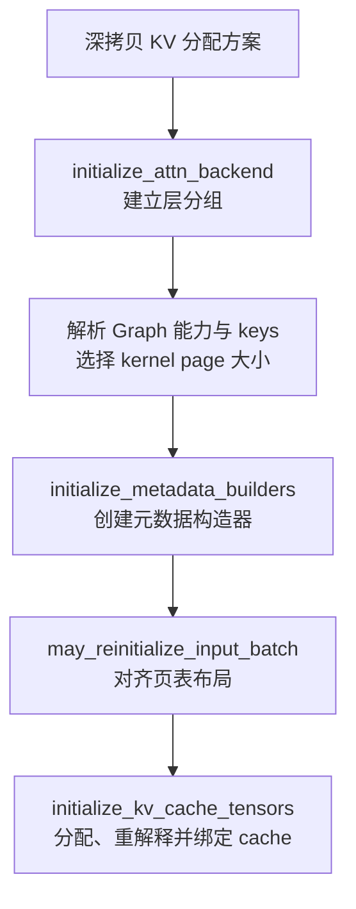
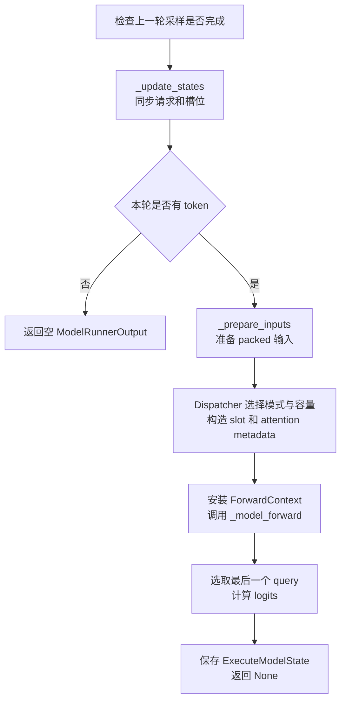

# GPUModelRunner：把调度计划转换为 GPU 模型执行

源码：[gpu_model_runner.py](../../nanovllm/worker/gpu_model_runner.py)。

本文围绕每个接口的**输入、返回值和内部状态变化**介绍当前实现。示例中的小规模参数用于
演示索引和内存布局，不是实际 Qwen3 模型配置。当前已接通同步 forward、采样、启动期
profiling 与单 token decode 的 FULL CUDA Graph；混合 prefill/decode 使用 eager。

## 这个类负责什么

`GPUModelRunner` 是一个 Worker 内真正持有模型、KV cache 和模型输入工作区的对象。
它接收 `SchedulerOutput`，将“本轮每个请求计算多少 token”的计划转换为模型输入，
再执行 forward、计算 logits，并为后续采样保留状态。

它主要维护三类东西：

- **长期资源**：模型权重、各层 KV cache、Attention 分组和 metadata builder。
- **跨轮请求状态**：`requests` 中的 Worker 请求镜像，以及 `input_batch` 中当前执行请求的槽位。
- **本轮执行数据**：packed token 输入、position、长度、slot mapping 和等待采样的 logits。

| 相关对象 | 对本类提供什么 | 本类如何使用 |
| --- | --- | --- |
| `SchedulerOutput` | 新请求、已有请求增量、完成通知和逐请求 token 数。 | 作为本轮输入，不在 runner 中重新决定调度。 |
| `CachedRequestState` | 一个请求在 Worker 侧的 prompt、输出 token、进度和 block IDs。 | 保存到 `requests[req_id]`，请求暂时离开 batch 时仍保留。 |
| `InputBatch` | 按请求槽位对齐的 CPU token 行、进度、温度和 block table。 | 同步请求后，从这些行收集本轮模型输入。 |
| `BlockTable` | kernel page table 和 packed token 的物理 KV slot。 | 在准备输入时提交页表并重算 slot mapping。 |
| `AttentionGroup` / builder | 同一后端与规格的层集合，以及后端元数据工厂。 | 初始化时分组；每轮为各层构造 metadata。 |
| 模型与 `Sampler` | hidden states、词表 logits 和采样运算。 | runner 编排调用，并负责把结果对应回 request ID。 |

`InputBatch` 的槽位复用与压缩细节见 [InputBatch.md](InputBatch.md)，物理地址转换细节见
[block_table.md](block_table.md)。本文只在它们引起 runner 状态变化时说明调用效果。

**Scheduler 拥有逻辑请求进度与 KV block 所属关系；runner 保存执行镜像。**
从 `input_batch` 移除请求不会释放它的物理 KV blocks，也不一定删除 `requests` 中的镜像。

## 接口阅读地图

| 阶段 | 主要接口 | 重点观察的变化 |
| --- | --- | --- |
| 创建工作区 | `__init__()` | 配置引用、空请求表和固定容量 buffer。 |
| 加载模型 | `load_model()`、`get_model()`、`get_kv_cache_spec()` | 模型出现、权重显存统计、各层 KV 规格。 |
| 初始化 KV | `initialize_kv_cache()` 及其辅助方法 | 配置副本、Attention 分组、builder、cache tensor 绑定。 |
| 同步请求 | `_update_states()` | `requests`、batch 槽位、进度和 block table。 |
| 准备输入 | `_prepare_inputs()` 及其辅助方法 | 完整 token 行变成本轮 packed 输入和物理 slot。 |
| 执行模型 | `execute_model()`、`_model_forward()` | hidden states、logits、`execute_model_state`。 |
| 交付输出 | `sample_tokens()`、`_bookkeeping_sync()` | 消费 logits，过滤中间 chunk 的候选，回填输出 token。 |
| profiling / 捕获 | `_dummy_run()`、`profile_run()`、`profile_cudagraph_memory()`、`capture_model()` | 模拟执行、估算启动显存、捕获正式 decode 图。 |

## 状态成员与有效范围

### 配置、资源和请求状态

| 成员 | 初始化或更新时机 | 语义 |
| --- | --- | --- |
| `vllm_config` 及各领域配置 | `__init__()` 保存引用。 | 与 Worker 共享配置；这里没有为每种配置创建副本。 |
| `device`、`dtype`、`pin_memory` | `__init__()`。 | 执行设备、模型精度和 CPU staging 是否锁页；锁页能力由平台查询，WSL 下关闭。 |
| `max_model_len` | 构造时从模型配置读取。 | 单个请求的上下文上限；`update_max_model_len()` 可以改变此成员。 |
| `max_num_tokens`、`max_num_reqs` | 构造时从调度配置读取。 | 单轮 token 预算和请求槽位上限。 |
| `model`、`model_memory_usage` | `load_model()` 成功后创建。 | 模型执行入口及加载造成的设备显存增量；启用 FULL 类策略时入口为 Graph Wrapper。 |
| `kv_cache_config` | `initialize_kv_cache()`。 | Engine 下发方案的深拷贝；构造结束时此属性尚不存在。 |
| `kv_caches` | 初始为空；绑定 cache 时追加 view。 | 各 Attention 层的 combined KV cache；以层名字典定位层更明确。 |
| `attn_groups` | 初始为空；初始化后端时填充。 | 外层是 KV group，内层是按后端、规格和本地 Q head 数划分的组。 |
| `_init_block_sizes`、`_init_kernel_block_sizes` | 构造时保存占位布局；重建 batch 时更新。 | 判断原 InputBatch 是否符合最终 block 布局。 |
| `_kernel_block_sizes` | KV 初始化时创建。 | 最终选定的各 group 的 kernel page 大小。 |
| `requests` | 初始为空；`_update_states()` 修改。 | 已在 Worker 建档且尚未完成的请求镜像，不限于本轮调度请求。 |
| `input_batch` | 构造时创建；布局不匹配时可能替换。 | 当前参与执行的紧凑请求槽位及其固定工作区。 |
| `sampler` | `__init__()` 创建。 | 根据 logits、正 temperature 与 processor 容器随机采样。 |
| `cudagraph_dispatcher`、`cudagraph_batch_sizes` | 构造时创建；后端能力解析后更新。 | 保存合法图布局及捕获尺寸，供启动捕获与在线分派使用。 |
| `execute_model_state` | 初始为 `None`；forward 成功后设置。 | forward 与采样之间的短生命周期状态。 |

`model` 也不是构造时设置为 `None`：当前代码是在加载成功后才创建该属性，因此
`get_model()` 用 `hasattr()` 判断是否完成初始化。

### 每轮复用的输入 buffer

设 `T = max_num_tokens`、`R = max_num_reqs`、`S = max(R + 1, T)`。
`CpuGpuBuffer` 同时持有 `.cpu`、`.gpu` 和可选 `.np`；`.np` 与 `.cpu` 共享存储，
CPU 修改不会自动传播到 GPU，仍需要执行拷贝。

| 成员 | 容量与类型 | 本轮有效范围 | 何时改写 |
| --- | --- | --- | --- |
| `input_ids` | CPU/GPU `int32[T]`。 | 前 `num_tokens` 个 packed token。 | `_prepare_inputs()` gather 到 CPU，随后上传。 |
| `positions` | GPU `int64[T]`。 | 前 `num_tokens` 个请求内逻辑位置。 | `_prepare_inputs()` 在 GPU 计算。 |
| `query_start_loc` | CPU/GPU `int32[R + 1]`。 | 前 `num_reqs + 1` 个 query 边界。 | 准备输入时填充；后缀重复最后一个边界。 |
| `seq_lens` | GPU `int32[R]`。 | 前 `num_reqs` 个本轮执行结束后的目标长度。 | 已计算长度加本轮 token 数；后缀置零。 |
| `optimistic_seq_lens_cpu` | CPU `int32[R]`。 | 有效请求的 KV 长度上界。 | metadata 构造时更新，避免从 GPU 同步读最大长度。 |
| `num_computed_tokens` | GPU `int32[R]`。 | 前 `num_reqs` 个执行前进度。 | 从 InputBatch 的 CPU 进度上传。 |
| `req_indices` | CPU/GPU `int64[T]`。 | 前 `num_tokens` 个 token 所属槽位。 | 按每请求调度数量重复槽位编号。 |
| `num_scheduled_tokens` | CPU/GPU `int32[R]`。 | 前 `num_reqs` 个调度数量。 | 按 InputBatch 顺序写入并上传。 |
| `query_pos` | CPU/GPU `int64[S]`。 | 前 `num_tokens` 个 query 内相对位置。 | 每个请求的一段都从 0 开始。 |
| `arange_np` | CPU `int64[S]`。 | 按需取前缀。 | 构造时创建连续整数，后续读取。 |
| `_arange_scratch` | CPU `int64[S]`。 | 当前没有消费者。 | 已分配，但现有方法未使用。 |

**固定容量不代表每轮执行全部容量。** 当前 eager 路径只把真实 token 前缀送给模型；
除显式清理的 buffer 外，其他无效后缀可能保留上一轮数据。

## 构造与模型加载接口

### `__init__(vllm_config, device)`：创建空运行时工作区

- **输入**：当前 Worker 的完整配置与已经选定的 CUDA device。
- **状态变化**：保存配置引用，创建 `Sampler`、占位 `InputBatch` 和固定 buffer。
- **此时未创建**：模型权重、正式 KV cache、metadata builder。

后文使用以下演示参数：

```python
max_num_reqs = 4       # 最多四个请求槽位。
max_num_tokens = 16    # 单轮最多执行十六个真实 token。
max_model_len = 64     # CPU token matrix 每行最多保存六十四个 token。
block_size = 256       # 满足当前 FA2 的 256 倍数约束。
kernel_block_size = 256
```

构造后可以观察到：

| 状态 | 值或形状 |
| --- | --- |
| `requests` | `{}` |
| `input_batch.req_ids` | `[]` |
| `input_batch.token_ids_cpu` | `int32[4, 64]` |
| `input_ids.cpu` / `.gpu` | `int32[16]`，初始为零。 |
| `query_start_loc.cpu` / `.gpu` | `int32[5]`，初始为零。 |
| `kv_caches` / `attn_groups` | `[]` / `[]` |
| `execute_model_state` | `None` |

这里的 block size 是占位值。正式规划下发后，`may_reinitialize_input_batch()` 再判断
这份布局能否继续使用。

### `update_max_model_len(max_model_len)`：只修改 runner 的长度成员

**当前实际效果只有 `self.max_model_len = max_model_len`。**
例如调用 `runner.update_max_model_len(48)` 后：

| 成员 | 调用前 | 调用后 |
| --- | --- | --- |
| `runner.max_model_len` | `64` | `48` |
| `input_batch.max_model_len` | `64` | `64` |
| `input_batch.token_ids_cpu.shape` | `[4, 64]` | `[4, 64]` |

它不会修改共享模型配置，也不会重新分配 token matrix 或缩小 block table。
调用方需要另行保证 runner、配置和 InputBatch 的容量约束一致。

### `load_model(load_dummy_weights=False)`：加载并保存模型

- **输入**：模型、设备和加载格式来自构造时保存的配置。
- **内部步骤**：选择 Loader，调用其 `load_model()`，用 `DeviceMemoryProfiler` 统计加载增量。
- **状态变化**：创建 `self.model` 和 `self.model_memory_usage`；模型构造时注册静态 Attention 层。
- **返回值**：`None`；加载结果保存在成员中。
- **当前参数边界**：`load_dummy_weights` 尚未参与分支判断，传 `True` 不会启用 dummy weights。

例如加载成功后，`compilation_config.static_forward_context` 可能包含：

```python
layer_names = [
    "model.layers.0.self_attn.attn",
    "model.layers.1.self_attn.attn",
]
```

这两个字符串以后用于收集 KV 规格、绑定 cache 和查找运行时 metadata。
Loader 的模型构造工具负责安装当前配置上下文；runner 不自己解析 checkpoint 名称。
CUDA OOM 会记录错误并重新抛出，当前没有失败回滚协议。

启用包含 FULL 的策略时，加载完成后用 `CUDAGraphWrapper` 包装模型入口；
`get_model()` 仍返回原模型，普通 forward 则经 `self.model` 进入包装层。

### `get_model()`：查询已加载模型

- 加载完成：返回 `self.model` 的引用，不创建副本。
- 尚未加载：抛出 `ValueError`。
- 启用 Graph 包装时通过 `unwrap()` 返回原模型；`self.model` 仍是实际 forward 执行入口。

### `get_kv_cache_spec()`：从静态层注册表读取存储需求

**输入来自已经构造的 Attention 层，不是本轮请求。** 方法查找注册的
`AttentionLayerBase` 实例，逐层调用 `get_kv_cache_spec()`，只收集非空规格。

下面的示意返回值对应两个结构相同的层：

```python
spec = FullAttentionSpec(
    block_size=256,
    num_kv_heads=2,
    head_size=8,
    dtype=torch.bfloat16,
)
kv_cache_specs = {
    layer_names[0]: spec,
    layer_names[1]: spec,
}
```

- **返回值**：`dict[str, KVCacheSpec]`，供 Engine 规划物理 cache。
- **状态变化**：不创建 KV tensor，也不保存为新的 runner 成员。
- 规格回答“一个 block 需要多少字节”；它还没有决定总共分配多少 blocks。

## KV cache 初始化接口

### `initialize_kv_cache(kv_cache_config, is_profiling=False)`：安装完整分配方案

这是正式 KV 初始化入口。以下方案沿用前面的两个层和规格：

```python
kv_cache_config = KVCacheConfig(
    num_blocks=16,  # 可用物理 block ID 范围为 [0, 16)。
    kv_cache_tensors=[
        KVCacheTensor(size=262144, shared_by=[layer_names[0]]),
        KVCacheTensor(size=262144, shared_by=[layer_names[1]]),
    ],
    kv_cache_groups=[
        KVCacheGroupSpec(layer_names=layer_names, kv_cache_spec=spec),
    ],
)
```

每层一个 block 的字节数为 `2 × 256 × 2 × 8 × 2 = 16384`：两个 K/V、256 个 token、
两个 KV heads、每 head 八个元素、每个 BF16 元素两字节。
所以每层十六个 blocks 占 `16 × 16384 = 262144` 字节，两层共 `524288` 字节。



顺序的含义是：先知道每层使用哪个后端，再确定它支持的 page 大小，最后才创建 builder、
InputBatch 和真实 cache。上述例子结束后，`_kernel_block_sizes == [256]`，
`kv_caches` 包含两个 `[16, 2, 256, 2, 8]` 的 view。

- `self.kv_cache_config` 是输入方案的**深拷贝**，不与输入对象共享同一份可变配置。
- `is_profiling` 目前传给后端初始化，但不会改变初始化流程。
- 当前只接通单个 full-attention KV group，不支持在活跃推理中重复初始化；已有分组或
  cache 列表会触发相关断言。

### `initialize_attn_backend()`：将层名组织为 Attention 分组

**输入**：`KVCacheConfig.kv_cache_groups` 和已经注册的 Attention 实例。

同一 KV group 内，以 `(后端类, KVCacheSpec, 本地 Q head 数)` 为 key 分组。
若例子中的两个层都使用 FlashAttention、相同规格和四个本地 Q heads，则：

| 状态 | 调用前 | 调用后 |
| --- | --- | --- |
| `attn_groups` | `[]` | `[[group]]` |
| `group.kv_cache_group_id` | 尚无 group。 | `0` |
| `group.layer_names` | 尚无 group。 | 两个层的完整名称。 |
| `group.backend` | 尚无 group。 | `FlashAttentionBackend` |
| `group.metadata_builders` | 尚无 group。 | `[]`，此时尚未创建 builder。 |

外层下标 `0` 是 KV group 编号，内层可以包含多个后端分组；它们不是 layer 编号。
当前非 `FullAttentionSpec` 会被拒绝，方案中的层未注册会抛 `ValueError`。

### `initialize_metadata_builders()`：为每个分组创建 builder

- **输入**：分配方案和与 KV groups 对齐的 `kernel_block_sizes`。
- **状态变化**：各 `AttentionGroup.metadata_builders` 从空列表变成包含一个 builder 的列表。
- **返回值**：`None`，builder 保存在组对象里。

例子中传入 `[256]` 后，`attn_groups[0][0].get_metadata_builder()` 可以返回
`FlashAttentionMetadataBuilder`。分组保留 manager block 的规格，builder 使用按 kernel
page 大小调整过的规格。这里仅创建工厂对象，还没有生成任何本轮 metadata。

### `may_reinitialize_input_batch()`：必要时替换占位 batch

- **输入**：最终 KV 方案与 kernel page 大小。
- **判断**：最终 manager block size 或 kernel block sizes 是否与构造时保存的布局不同。
- **布局相同**：继续使用原 `input_batch`。
- **布局不同**：创建新 `InputBatch`，同时更新 `_init_block_sizes` 和 `_init_kernel_block_sizes`。

例如占位 block size 为 `256`、正式方案改成 `512`，且后端也选用 `512`：

| 状态 | 调用前 | 调用后 |
| --- | --- | --- |
| `_init_block_sizes` | `[256]` | `[512]` |
| `_init_kernel_block_sizes` | `[256]` | `[512]` |
| `input_batch` | 原工作区对象。 | 新工作区对象。 |
| `input_batch.max_num_blocks_per_req` | `ceil(64 / 256) = 1` | `ceil(64 / 512) = 1` |
| `input_batch.logitsprocs` | 原容器。 | 沿用原容器引用。 |

**请求、token 行和槽位不会迁移到新工作区。** 这个接口应在接收真实请求前使用；
当前代码没有用断言阻止活跃 batch 被替换，也没有仅因 `max_model_len` 改变而重建 batch。
没有 KV groups 时直接返回，多个 groups 时抛 `NotImplementedError`。

### `_allocate_kv_cache_tensors()`：按字节分配 raw storage

输入是配置中的物理分配描述。每个 `KVCacheTensor` 对应一次 CUDA `int8` 零初始化分配，
再把它登记到 `shared_by` 的各层名下。

上面的方案返回两个 raw tensors：

| 字典 key | 值 | 含义 |
| --- | --- | --- |
| `layer_names[0]` | GPU `int8[262144]`。 | 第 0 层的完整 page pool。 |
| `layer_names[1]` | GPU `int8[262144]`。 | 第 1 层的独立 page pool。 |

- `int8` 是逐字节存储载体，不表示 K/V 被量化成 INT8。
- 方法返回局部字典，此时不会直接修改 `self.kv_caches`。
- 同一个分配的多个 `shared_by` 名称会引用同一个 raw tensor；当前常规单 group 方案每层
  独立分配，不应据此假设任意多层共享都可以安全使用。
- 返回前检查分配覆盖的层名集合恰好等于配置中的层名集合。

### `_reshape_kv_cache_tensors()`：把 raw bytes 解释为后端 cache view

**输入**：raw 字典、已经建立的 Attention 分组和 kernel page 大小。
方法按每层规格计算 manager block 数、每 block 的 kernel pages，再按后端声明的
shape 与 stride order（步幅顺序）建立 view。

```python
num_manager_blocks = 262144 // 16384     # 16 个 manager blocks。
num_kernel_pages_per_block = 256 // 256 # 每 block 一个 kernel page。
num_kernel_blocks = 16 * 1              # 16 个 kernel pages。
logical_shape = (16, 2, 256, 2, 8)      # page、K/V、token、KV head、head 元素。
```

转换后，字典的 key 不变，值从 `int8[262144]` 变成 BF16 `[16, 2, 256, 2, 8]`。
`view(dtype)`、`view(shape)` 和 `permute()` **共享原存储，不复制 KV 内容**；
实际物理排列来自后端，不能只根据逻辑 shape 假设所有切片都是连续的。

例如本层 page 3、offset 2 的 K/V，在此布局中分别通过：

```python
key = kv_cache[3, 0, 2]    # [2, 8]：这个 token 的所有 KV heads。
value = kv_cache[3, 1, 2]  # 与 Key 属于同一个逻辑 slot。
```

访问。后面的 slot `770 = 3 × 256 + 2` 是物理 token 格子编号，不能直接当成 raw byte
offset。当前方法要求 kernel page 大小整除 manager block 大小，并检查 raw 大小能被
每 manager block 的字节数整除。

### `initialize_kv_cache_tensors()`：连接分配、view 与模型层

这个方法顺序调用 raw 分配、view 重解释和 `bind_kv_cache()`，然后返回按层名组织的 cache 字典。

| 对象 | 调用前 | 调用后 |
| --- | --- | --- |
| `runner.kv_caches` | `[]` | 追加两个 combined cache views。 |
| 第 0 层 `Attention.kv_cache` | 空 tensor。 | 指向返回字典中第 0 层的 view。 |
| 第 1 层 `Attention.kv_cache` | 空 tensor。 | 指向返回字典中第 1 层的独立 view。 |

`Attention.forward()` 通过统一接口读取绑定的 combined `kv_cache`，Impl 再用
`unbind(1)` 取得 K/V 视图；执行路径无需维护旧的 `k_cache/v_cache` 字段。

## `_update_states()`：让请求镜像和 batch 与调度计划对齐

```python
def _update_states(
    self,
    scheduler_output: SchedulerOutput,
) -> Callable | None: ...
```

- **输入**：本轮 `SchedulerOutput`，其中进度是 forward **之前**的进度。
- **返回值**：当前始终为 `None`；没有 forward 后延迟修正状态的回调。
- **状态变化**：`requests`、InputBatch 槽位、CPU 进度、CPU block table 和 GPU temperature。
- **不会做**：执行模型、采样、提交 GPU block table、释放物理 KV blocks。

### 删除、更新和新增的顺序

1. 对 `finished_req_ids`，删除 Worker mirror，并从当前 batch 移除。
2. 从 batch 移除本轮未调度请求，以及需要重新加入的 resumed 请求。
3. 对 `scheduled_new_reqs` 创建 `CachedRequestState`，登记到 `requests`。
4. 对 `scheduled_cached_reqs` 更新执行前进度和 block table。
5. 将新请求和当前没有槽位的已有请求统一 `add_request()`。
6. 调用 `condense()` 消除空洞，再调用 `refresh_metadata()` 上传温度并交付槽位变化。

**所有删除必须先于任何新增。** InputBatch 的事件构造器会在复用空槽位时消费删除记录，
不能在新增已经开始后继续登记删除。

### 贯穿示例：A/B 继续执行，X 完成，C 加入

假设更新前 `requests` 中有 A、B、X，稳定 batch 顺序为 `[A, B, X]`。
A 是尚未完成的 prompt，B 已生成两个 token，X 刚结束：

| 请求 | prompt | 已生成输出 | 执行前已计算 token 数 | 已知完整长度 | block IDs |
| --- | --- | --- | ---: | ---: | --- |
| A | `[11, 12, 13, 14, 15, 16]` | `[]` | `2` | `6` | `[3]` |
| B | `[21, 22, 23]` | `[24, 25]` | `4` | `5` | `[7]` |
| C | `[31, 32, 33, 34]` | `[]` | `0` | `4` | `[9]` |

C 是本轮才发送的新请求，表中的 C 状态来自 `NewRequestData`。
本例 A 的进度 2 来自此前执行的 prompt chunk；B 的 token 25 尚未计算 K/V，
本轮 decode 要把它送进模型。B 的历史输出和 CPU token 行已由此前的 `sample_tokens()` 同步回填。

下面是本轮调度输入：

```python
scheduler_output = SchedulerOutput(
    scheduled_new_reqs=[
        NewRequestData(
            req_id="C",
            prompt_token_ids=[31, 32, 33, 34],
            sampling_params=SamplingParams(temperature=0.8),
            block_ids=[9],
            num_computed_tokens=0,
        ),
    ],
    scheduled_cached_reqs=CachedRequestData(
        req_ids=["A", "B"],
        resumed_req_ids=set(),
        new_token_ids=[],           # 当前没有 PP token 传输。
        all_token_ids={},
        new_block_ids=[None, None], # 本轮没有给 A/B 追加 blocks。
        num_computed_tokens=[2, 4],
        num_output_tokens=[0, 2],   # 必须与 Worker 中已有输出长度一致。
    ),
    num_scheduled_tokens={"B": 1, "A": 3, "C": 2},
    total_num_scheduled_tokens=6,
    finished_req_ids={"X"},
    preempted_req_ids=set(),
)
```

调用 `runner._update_states(scheduler_output)` 后：

| 状态 | 调用前 | 调用后 |
| --- | --- | --- |
| `requests` 的 keys | A、B、X。 | A、B、C；X mirror 被删除，C mirror 被创建。 |
| `input_batch.req_ids` | `[A, B, X]` | `[A, B, C]`；C 复用 X 的槽位 2。 |
| `req_id_to_index` | `A:0, B:1, X:2` | `A:0, B:1, C:2` |
| CPU token row 0 | A 的完整已知序列。 | `[11, 12, 13, 14, 15, 16, ...]` |
| CPU token row 1 | B 的完整已知序列。 | `[21, 22, 23, 24, 25, ...]` |
| CPU token row 2 | X 的旧序列。 | `[31, 32, 33, 34, ...]`，有效前缀被覆盖。 |
| `num_computed_tokens_cpu[:3]` | 上一份镜像进度。 | `[2, 4, 0]`，仍是执行前进度。 |
| CPU page table 有效前缀 | A `[3]`、B `[7]`、X 的旧表。 | A `[3]`、B `[7]`、C `[9]`。 |
| `temperature[:3]` | 旧 batch 的温度。 | A、B 原温度与 C 的 `0.8`，按新槽位顺序上传。 |

此时 GPU page table 仍需后续提交；`execute_model_state` 仍是 `None`，尚未执行 forward。
调度字典顺序是 B/A/C，batch 顺序却是 A/B/C，后面的输入必须按 **batch 顺序**整理。

### 已有请求新增 blocks：追加而不是覆盖

在另一个跨 block 边界的轮次，若 B 原 table 为 `[7]`，本轮新分配 `[12]`，则：

| 状态 | 调用前 | 调用后 |
| --- | --- | --- |
| `requests["B"].block_ids` | `[7]` | `[7, 12]` |
| B 的 CPU page table | `[7, ...]` | `[7, 12, ...]` |

对仍在 batch 的普通请求，runner 调用 `block_table.append_row()`；
若请求此前暂时离开 batch，则稍后 `add_request()` 根据 mirror 写入完整 table。

### 暂时未调度、抢占和恢复

假设 A 没有获得本轮 token budget：runner 从 InputBatch 移除 A，但保留 `requests["A"]`。
后续调度到 A 时，再把 mirror 加回 batch。其槽位可能改变，不能长期缓存 `req_index`。

抢占也是先离开 batch、保留 mirror。**当前 `_update_states()` 没有直接读取
`preempted_req_ids`，而是通过“本轮不在调度集合中”把请求移出 batch。**
抢占时它不会主动将 mirror 的 `num_computed_tokens` 清零，或清空旧 `block_ids`；
恢复时再用 Scheduler 下发的数据修正。

例如 A 原 block table 为 `[3]`，抢占后恢复，下发：

```python
resumed_req_ids = {"A"}
new_block_ids = [11]       # 对 resumed 请求，这表示完整新 table，不是新增后缀。
num_computed_tokens = 0   # 以本次恢复计划为准；没有可复用前缀时从头重算。
```

runner 会移除 A 的旧槽位，把 `requests["A"].block_ids` **替换**为 `[11]`，
更新 mirror 进度为 0，再通过 `add_request()` 写入完整 token 行和新页表。
旧 `[3]` 不会保留在恢复后的 table 中。

### 当前同步协议的边界

- 新请求 ID 已存在于 `requests` 时抛 `ValueError`；没有 streaming 请求重置语义。
- cached 请求直接通过 `self.requests[req_id]` 查找，未知 ID 当前实际会触发 `KeyError`。
- `new_token_ids` 必须为空；Worker 输出长度必须等于下发的 `num_output_tokens`，否则断言失败。
- `CachedRequestData.all_token_ids` 当前没有被读取，不能依靠它修复不同步的输出历史。
- 对持续留在 batch 的请求，当前只更新进度和新增 blocks，**没有在这里补写新输出 token**。
  CPU token matrix 的新输出已由上一轮采样路径回填。

## `_prepare_inputs()`：从完整 token 行得到本轮 packed 输入

```python
def _prepare_inputs(
    self,
    scheduler_output: SchedulerOutput,
    num_scheduled_tokens: np.ndarray,
) -> torch.Tensor: ...
```

这里按实际返回值写为 `torch.Tensor`；源码当前标注为 `tuple[torch.Tensor]`，
但返回表达式是一个 tensor，没有额外包成 tuple。

- **输入**：已经同步并压缩的 InputBatch，以及按槽位对齐的调度数量数组。
- **返回值**：每条请求最后一个 query token 的 packed 下标，供 LM head 取 hidden states。
- **状态变化**：GPU page table、packed token buffer、位置与长度 buffer、slot mapping。
- **不会推进**：`requests[req_id].num_computed_tokens`、CPU 请求进度和输出 token 列表。

### 每条请求只取“尚未计算的本轮区间”

继续使用 A/B/C，`execute_model()` 先根据 `input_batch.req_ids` 得到：

```python
req_ids = ["A", "B", "C"]
num_scheduled_tokens_np = np.array([3, 1, 2], dtype=np.int32)
```

每条请求读取区间为 `[num_computed_tokens, num_computed_tokens + num_scheduled_tokens)`：

| 槽位 | 请求 | 执行前进度 | 调度数量 | 本轮 position | 本轮 token IDs |
| ---: | --- | ---: | ---: | --- | --- |
| 0 | A | 2 | 3 | `[2, 3, 4]` | `[13, 14, 15]` |
| 1 | B | 4 | 1 | `[4]` | `[25]` |
| 2 | C | 0 | 2 | `[0, 1]` | `[31, 32]` |

packed（紧凑拼接）后，每个 token 的对应关系如下：

| packed 下标 | 请求槽位 | 请求 | query 内偏移 | 请求内 position | token ID |
| ---: | ---: | --- | ---: | ---: | ---: |
| 0 | 0 | A | 0 | 2 | 13 |
| 1 | 0 | A | 1 | 3 | 14 |
| 2 | 0 | A | 2 | 4 | 15 |
| 3 | 1 | B | 0 | 4 | 25 |
| 4 | 2 | C | 0 | 0 | 31 |
| 5 | 2 | C | 1 | 1 | 32 |

模型输入是六个 token 的一维 tensor，不是将三条请求都补到同一长度的二维 token 矩阵。

### 方法内部写入了哪些值

1. `commit_block_table(3)` 把 CPU 前三行 page table 上传。
2. 重复请求槽位编号，计算每个 query 的相对位置和区间终点。
3. 用请求内 position 从 CPU token matrix gather 到 `input_ids.cpu`。
4. 上传边界、进度、槽位编号、query 偏移和调度数量，计算 GPU positions 与目标长度。
5. 用 GPU 页表和 positions 计算 slot mapping，最后上传 token IDs。

CPU token matrix 每行宽度为 64，因此展平 gather 下标为 `req_index × 64 + position`：

```python
token_indices = [2, 3, 4, 68, 128, 129]
```

调用结束后的核心状态：

| 成员 | 本轮有效值 | 含义 |
| --- | --- | --- |
| `input_ids.cpu[:6]` / `.gpu[:6]` | `[13, 14, 15, 25, 31, 32]` | 本轮实际执行的 token。 |
| `req_indices.np[:6]` / `.gpu[:6]` | `[0, 0, 0, 1, 2, 2]` | 每个 packed token 属于哪个槽位。 |
| `query_pos.np[:6]` / `.gpu[:6]` | `[0, 1, 2, 0, 0, 1]` | 每段 query 内相对位置。 |
| `positions[:6]` | `[2, 3, 4, 4, 0, 1]` | RoPE 和物理 slot 使用的逻辑位置。 |
| `query_start_loc` 的完整 CPU/GPU buffer | `[0, 3, 4, 6, 6]` | 有效前四项划分 A/B/C；最后一项是未使用槽位的边界。 |
| `num_computed_tokens[:3]` | `[2, 4, 0]` | 执行前长度副本。 |
| `num_scheduled_tokens.np[:3]` / `.gpu[:3]` | `[3, 1, 2]` | 本轮执行数量。 |
| `seq_lens` 的完整 GPU buffer | `[5, 5, 2, 0]` | 本轮结束后的目标长度，空槽位置零。 |
| 返回的 `logits_indices` | `[2, 3, 5]` | A/B/C 各自最后一个 query 的 packed 下标。 |

GPU 拷贝在同一执行流中按依赖顺序使用。表中的 GPU 值指这些操作完成后的内容，不表示每次
H2D 调用都进行了 CPU 等待。

**`seq_lens == [5, 5, 2]` 不代表准备输入阶段已经算出了这些 K/V。**
它告诉 Attention 本轮 forward 应覆盖多长的序列；实际 K/V 要在模型层执行时才写入。

### `_get_cumsum_and_arange()`：区间终点和 query 内偏移

```python
cu_num_tokens = runner._get_cumsum_and_arange(
    np.array([3, 1, 2], dtype=np.int32),
    runner.query_pos.np,
)
```

| 对象 | 调用后 |
| --- | --- |
| 返回的 `cu_num_tokens` | `[3, 4, 6]`，默认 `int32`。 |
| 传入的 `arange_out[:6]` | `[0, 1, 2, 0, 0, 1]`，被原地改写。 |

它返回每段 query 的**终点**，不包含起点 0。`_prepare_inputs()` 再补上开头的 0，
组成 `query_start_loc == [0, 3, 4, 6]`。
`cumsum_dtype` 决定累计数组类型；调用方需要保证输入非空、输出 buffer 容量足够。

### `_prepare_input_ids()`：上传已经 gather 好的 token

当前实现只有 `self.input_ids.copy_to_gpu(total_num_scheduled_tokens)`。
沿用本例，CPU 前六项已经是 `[13, 14, 15, 25, 31, 32]`，调用后 GPU 前六项得到同样内容。

- 返回 `None`，不重新选择 token，也不改变请求进度。
- `scheduler_output`、`num_reqs`、`cu_num_tokens` 当前保留在签名中，但未被读取。
- 尚无“直接把上轮 GPU 采样 token scatter 到下轮输入”的优化；CPU token 行必须是最新的。

### `_make_buffer()`：创建双缓冲对象

```python
buffer = runner._make_buffer(16, dtype=torch.int32)
```

返回 CPU/GPU 同 shape 的 `CpuGpuBuffer`，两个 tensor 初始都为零。
`buffer.np[0] = 13` 只会改变 CPU tensor；需要再调用 `copy_to_gpu()` 才更新 device mirror。
`numpy=False` 时不创建 `.np`；本接口返回新对象，不自动把它登记成 runner 成员。

## slot mapping 与 attention metadata 接口

### 本例的物理 slot 如何得到

准备输入已经调用 `BlockTable.compute_slot_mapping()`。本例 block 与 kernel page 都是 256，
所以 A/B/C 的有效 page table 分别是 `[3]`、`[7]`、`[9]`。

| packed 下标 | 请求 | position | page ID | page 内 offset | slot |
| ---: | --- | ---: | ---: | ---: | ---: |
| 0 | A | 2 | 3 | 2 | `3 × 256 + 2 = 770` |
| 1 | A | 3 | 3 | 3 | `771` |
| 2 | A | 4 | 3 | 4 | `772` |
| 3 | B | 4 | 7 | 4 | `1796` |
| 4 | C | 0 | 9 | 0 | `2304` |
| 5 | C | 1 | 9 | 1 | `2305` |

于是 `block_table.slot_mapping.gpu[:6] == [770, 771, 772, 1796, 2304, 2305]`。
BlockTable 的 kernel 还会把固定容量 buffer 的剩余十项填为 `-1`。
这个方法计算地址，尚未往 cache 写入真实 K/V。

### `_get_slot_mappings()`：给同一 tensor 提供两种查询方式

本例调用：

```python
by_group, by_layer = runner._get_slot_mappings(
    num_tokens_padded=6,
    num_reqs_padded=3,
    num_tokens_unpadded=6,
    ubatch_slices=None,
)
```

返回结果的语义：

| 返回项 | 内容 | 消费者 |
| --- | --- | --- |
| `by_group` | `{0: slot_mapping_view}` | `_build_attention_metadata()` 按 KV group 查找。 |
| `by_layer` | 两个层名都映射到 `slot_mapping_view`。 | 运行时 ForwardContext 按层名查找。 |

这里 `slot_mapping_view` 是固定 GPU buffer 的前六项 view。
两种字典及组内所有层引用同一个 view，不创建逐层地址副本。
**各层共享 slot 坐标，不共享各层的 K/V 内容。**

- 未初始化 KV cache 或没有 KV groups：返回 `(None, None)`。
- 多 KV groups 或 `ubatch_slices` 非空：当前断言拒绝。
- `num_reqs_padded` 目前只用于约束检查，不会在这里生成虚拟请求元数据。

若独立演示 `num_tokens_padded=8`、`num_tokens_unpadded=6`，返回 view 的值会是：

```python
slot_mapping_view = [770, 771, 772, 1796, 2304, 2305, -1, -1]
```

本例是混合 batch，正常分派使用 eager；上述八行 view 用于说明 slot 后缀契约。
实际 FULL padding 只用于兼容的单 token decode，完整例子见 [BatchDescriptor](../cudagraph/BatchDescriptor.md#完整例子三个请求怎样补到四槽图)。

### `_build_attention_metadata()`：把 buffer view 交给后端 builder

本例调用参数为 `num_tokens=6`、`num_reqs=3`、`max_query_len=3`、`slot_mappings=by_group`。

方法先构造公共 metadata。其主要字段为：

| 字段 | 本例值或形状 |
| --- | --- |
| `query_start_loc` / `query_start_loc_cpu` | GPU/CPU `[0, 3, 4, 6]` |
| `seq_lens` | GPU `[5, 5, 2]` |
| `num_reqs` / `num_actual_tokens` | `3` / `6` |
| `max_query_len` / `max_seq_len` | `3` / `5` |
| `block_table_tensor` | GPU `[3, 1]`，有效 page ID 前缀分别是 `[3]`、`[7]`、`[9]`。 |
| `slot_mapping` | GPU `[770, 771, 772, 1796, 2304, 2305]` |
| `causal` | 默认 `True`；Builder 透传到后端，普通 decoder Query 不读取后续位置。 |

`max_seq_len` 从 CPU 的执行前长度加本轮数量得到，避免从 GPU 读回标量。
随后每个 AttentionGroup 的 builder 创建一份后端 metadata，再将它登记到组内每个层名：

```python
attn_metadata = {
    layer_names[0]: flash_metadata,
    layer_names[1]: flash_metadata,
}
```

- **返回值**：`(attn_metadata, None)`；第二项预留给投机解码，当前未返回公共 metadata。
- **共享关系**：同组各层复用同一个后端 metadata 对象，内部 tensor 多为持久 buffer 的 view。
- **状态变化**：准备有效长度及无效后缀，创建本轮局部 metadata；不复制 cache，也不推进请求状态。
- **生命周期**：下轮 buffer 更新会改变这些 view 看到的内容，不能把它们当作独立历史快照保存。
- FULL 使用补齐后的请求/token 容量，重复尾部 query 边界、将无效序列长度置零、页表填空页、slot 填 `-1`；捕获时固定 `max_seq_len=max_model_len`。
- 当前没有 cascade attention 或 micro-batch metadata 切分。

## 模型执行与采样接口

### `execute_model()`：编排一轮 forward，暂存 logits

```python
def execute_model(
    self,
    scheduler_output: SchedulerOutput,
) -> ModelRunnerOutput | None: ...
```

执行顺序为：



空批次也先同步请求状态，确保 finished 通知被处理。非空批次只有 forward 和 LM head
都成功后才创建采样状态；`None` 表示调用方需要继续调用 `sample_tokens()`，不是本轮没有结果。

当前它按 batch 顺序构造调度数组，并直接使用真实输入前缀：

```python
num_scheduled_tokens_np = np.array([3, 1, 2], dtype=np.int32)
num_tokens_unpadded = 6
max_query_len = 3

input_ids = runner.input_ids.gpu[:6]
positions = runner.positions[:6]
```

本例各请求 query 长度为 `[3,1,2]`，Dispatcher 选择 NONE，因而只使用真实六行输入。
兼容的单 token decode 则可选择 FULL 和补齐容量，再准备相应 metadata 与输入 view。
当前 Qwen3 文本路径只使用 token IDs 和 positions，没有接入多模态与 PP 的 `_preprocess()`。

`set_forward_context()` 已实现为创建并安装本轮 `ForwardContext`，作用域结束时恢复外层对象，
异常退出也会恢复。上下文保存静态层注册表 `no_compile_layers`、`attn_metadata` 和
`slot_mapping` 的引用，模型层通过 `get_forward_context()` 按完整层名查询。
具体模式与描述符也由上下文传给模型 Wrapper。`num_tokens` 保留接口兼容性，
当前未用于 DP 协调或计时；图分派已由 Runner 的 Dispatcher 完成。

### 本例的 hidden states 和 logits

假设演示模型的 `hidden_size=32`、`vocab_size=128`，执行后半段的数据形状为：

| 数据 | 形状 | 对应关系 |
| --- | --- | --- |
| `hidden_states` | `[6, 32]` | 六个 packed token，每个 token 一行。 |
| `logits_indices` | `[3]`，值 `[2, 3, 5]`。 | A/B/C 最后一个 query 的下标。 |
| `sample_hidden_states` | `[3, 32]` | A 的 token 15、B 的 token 25、C 的 token 32 的 hidden states。 |
| `logits` | `[3, 128]` | 按 A/B/C 槽位顺序，每请求一行词表分数。 |

**当前 logits 行数等于 batch 请求数，不是最终可采样请求数。**
A/C 的中间 prompt chunk 也经过 LM head；采样路径会丢弃这两行的候选。
没有 prompt logprobs 时无需给全部六个 token 都计算词表 logits。

### `ExecuteModelState`：forward 与 sampling 之间保留什么

这个 `NamedTuple` 当前只有两个成员：

| 成员 | 本例内容 | 使用目的 |
| --- | --- | --- |
| `scheduler_output` | 产生本轮输入的同一个调度输出对象。 | 结合执行前进度，判断请求是否完成本轮可采样计算。 |
| `logits` | `[3, 128]` GPU tensor。 | 后续按请求 temperature 执行采样。 |

正常 forward 完成后，状态变化是：

| 状态 | forward 前 | forward 后 |
| --- | --- | --- |
| `execute_model_state` | `None` | `ExecuteModelState(scheduler_output, logits)` |
| 方法返回值 | 尚无返回。 | `None` |
| `requests` 中的输出列表 | A `[]`、B `[24, 25]`、C `[]`。 | 不变，此接口尚未采样。 |
| CPU 请求进度 | `[2, 4, 0]` | 不变；本方法没有给 mirror 或 CPU 进度加调度数量。 |
| 各层 KV cache | 包含此前已计算的历史。 | 本轮 K/V 写入 slots `[770, 771, 772, 1796, 2304, 2305]`。 |

runner 不把整批 hidden states 保存到 `execute_model_state`。
`scheduler_output` 也没有深拷贝，因此下发后应按本轮快照使用，不应被调用方原地改动。

ForwardContext 的安装与恢复、Attention 的 combined cache 读取与计算均已接通。
这些小数值展示索引关系；真实模型需由配置和加载器提供合法结构与权重。

### `_model_forward()`：直接转发两个模型输入

当前方法本质上调用 `self.model(input_ids=input_ids, positions=positions)`。
metadata 与上下文已由调用方准备；图捕获或回放由 `self.model` 的 Wrapper 处理，
helper 本身只转发两个模型输入，不计算 logits。

- **输入**：当前有效 packed token IDs 与 positions。
- **返回值**：当前 Qwen3 模型返回的 hidden states，本例 shape 为 `[6, 32]`。
- **副作用**：通过模型层执行产生 KV 写入，而不是 helper 自己计算 cache 地址。
- 签名中的 `**model_kwargs` 目前没有继续传给模型；不能据此认为已经支持额外模型输入。

### `sample_tokens()`：采样、过滤与回填输出

方法先取出并清空 `execute_model_state`，经 `_sample()` 调用 Sampler，再由
`_bookkeeping_sync()` 将候选转成 CPU 列表，丢弃未完成 prompt 或恢复重算的请求行。
没有待消费状态时抛 `RuntimeError`，避免重复使用同一份 logits。

bookkeeping 以“执行前进度加本轮调度量”与完整已知 token 长度比较：

```python
num_computed_after = (
    req_state.num_computed_tokens
    + scheduler_output.num_scheduled_tokens[req_id]
)
should_sample = num_computed_after == req_state.num_tokens
```

| 请求 | 本轮计算后的长度 | 采样前完整已知长度 | 是否可以生成下一个 token |
| --- | ---: | ---: | --- |
| A | `2 + 3 = 5` | `6` | 否，prompt 还有一个 token 未计算。 |
| B | `4 + 1 = 5` | `5` | 是，本轮 decode 完成。 |
| C | `0 + 2 = 2` | `4` | 否，prompt 还有两个 token 未计算。 |

这里使用 `req_state.num_tokens`，而非仅比较 prompt 长度：抢占恢复可能需要重算已有输出。
正常调度还应保证计算后长度不超过已知长度；超过属于协议错误，不应继续采样。

假设 B 采样得到 token 26，按 batch 行对齐后，输出为：

```python
model_runner_output = ModelRunnerOutput(
    req_ids=["A", "B", "C"],
    req_id_to_index={"A": 0, "B": 1, "C": 2},
    sampled_token_ids=[[], [26], []],  # 中间 chunk 使用空行，不产生 token。
)
```

当前数据类的 `sampled_token_ids` 类型是
`list[list[int]]`；消费端需要按 `req_ids` / `req_id_to_index` 对齐，而不是对它调用 `.items()`。

有效 token 回填后，状态变化如下：

| 状态 | 采样前 | 采样后 |
| --- | --- | --- |
| `requests["B"].output_token_ids` | `[24, 25]` | `[24, 25, 26]` |
| `input_batch.token_ids_cpu[1, 5]` | 无有效 token。 | `26`，供下一轮 CPU gather。 |
| `input_batch.req_output_token_ids[1]` | 引用 B 的输出列表。 | 同一引用能看到新增 token。 |
| `execute_model_state` | 本轮调度输出与 logits。 | `None`，允许下一轮执行。 |

**新采样的 token 26 此时没有 K/V。** 它的逻辑位置是 5，需要下一轮再调度一个 token
执行模型。届时 Scheduler 下发 B 的执行前进度 5，`_update_states()` 将 Worker 进度对齐，
`_prepare_inputs()` 读取 `token_ids_cpu[1, 5]`，并生成 position 5 和 slot `7 × 256 + 5 = 1797`。

### 空批次与重复调用

`execute_model()` 有两种正常返回路径，调用方需要区分：

| 返回结果 | `execute_model_state` | 后续调用 |
| --- | --- | --- |
| `EMPTY_MODEL_RUNNER_OUTPUT` | 仍为 `None`。 | 本轮没有 forward，不调用采样。 |
| `None` | 成功后为非空状态。 | 必须消费本轮采样状态，才能再次执行。 |

若 `execute_model_state` 非空，`execute_model()` 在同步本轮请求之前就抛 `RuntimeError`，
避免旧 logits 与新槽位错配。采样状态必须对应生成它的同一份 batch 布局。

举例：若 batch 只剩 X，本轮 `total_num_scheduled_tokens=0` 且 `finished_req_ids={"X"}`，
方法仍调用 `_update_states()` 删除 X、压缩空 batch 并刷新事件边界，然后返回空结果。

这不是事务接口：即使 forward 失败，此前的请求同步和 buffer 改写也已经发生，当前没有自动回滚。

## profiling、预热和 CUDA Graph

这些入口共用持久输入 buffer，要求 `InputBatch` 没有活跃请求。dummy 执行不构造真实请求、
不推进 Scheduler 进度，也不创建待采样的 `execute_model_state`。

### `_dummy_run()` 与 `profile_run()`：准备模拟负载

| 方法 | 输入与返回值 | 调用效果 |
| --- | --- | --- |
| `_dummy_run(num_tokens, ...)` | 返回 `(hidden_states, last_hidden_states)`；后者为每个有效 dummy 请求的最后一行。 | 构造模拟调度量、输入和 metadata，通过模型入口执行。 |
| `profile_run()` | 无显式参数，返回 `None`。 | 以最大 token 预算执行 eager dummy，再运行 logits 与 sampler，供 Worker 统计 activation 峰值。 |
| `_dummy_sampler_run(hidden_states)` | 返回模拟采样输出。 | 使用独立的采样 metadata，覆盖词表投影与采样负载。 |

`is_profile=True` 强制使用 NONE；默认不构造 Attention metadata，FA 的 profiling 分支填零，
因此可在正式 KV 分配前执行。需要真实 FA 负载时，`force_attention=True` 要求已初始化 KV
与 builder。dummy 页表指向保留空块 0，slot 全为 `-1`，不写真实请求的 K/V。

`uniform_decode=True` 将每个 dummy 请求组织为一个 Query。捕获时使用 builder 的 capture
接口，把 `max_seq_len` 固定为 `max_model_len`，使图中的 Python 上界覆盖后续增长的 KV 长度。

### `profile_cudagraph_memory()`：估算图显存预算

该方法在正式 KV 分配前创建临时 cache，切换到独立 Graph pool，每种模式最多捕获最大的两档。
用首次捕获占用加上其余图的增量估算完整计划；后续每图增量至少计 1 MiB，返回估算字节数。

正常或异常退出捕获阶段时，都会关闭新增捕获、清理临时图、恢复原 pool，并释放临时 KV、
builder 与层绑定。Dispatcher keys 也会清空，正式 `initialize_kv_cache()` 随后重新生成。
清图使用全局 Wrapper 注册表，因此该流程按单个 Engine 的启动期使用。

### `capture_model()`：捕获正式模型 forward

正式 KV 初始化后，Runner 遍历 Dispatcher 给出的捕获计划。每种模式按容量降序执行，
由 `_warmup_and_capture()` 先用 NONE 至少预热一次，再用 FULL 调用相同输入链。
实际 `torch.cuda.graph()` 位于模型 Wrapper；图覆盖模型 forward，不包含 LM head 和 sampler。

方法返回捕获前后的空闲显存差，单位为字节；禁用 Graph 时返回 0。捕获窗口结束后关闭新增
捕获开关，在线执行只回放已有条目。部分图捕获成功后发生异常时，已有条目不会自动回滚。

当前 FA2 仅捕获 uniform 单 token decode。比如六个真实 decode 请求选中八槽图，Runner
将输入补零、无效长度置零、query 边界重复末值、页表填空页、slot 填 `-1`；模型执行八行，
最终只选择六个真实请求的 hidden states。**Scheduler 的进度仍只按六个真实 token 推进。**

模式与布局细节见 [CUDAGraphMode](../cudagraph/CUDAGraphMode.md)、
[Dispatcher](../cudagraph/CudagraphDispatcher.md) 和 [Graph Wrapper](../cudagraph/CUDAGraphWrapper.md)。

## 生命周期与不变量

### 资源生命周期

| 阶段 | 已具备的资源 | 可以调用什么 |
| --- | --- | --- |
| 构造结束 | 配置、空请求表、占位 batch、固定 buffer。 | 查询初始容量；尚不能执行模型。 |
| 模型加载结束 | 模型权重、静态 Attention 注册表、加载显存统计。 | `get_model()`、`get_kv_cache_spec()`、启动期 profiling。 |
| Engine 完成 cache 规划 | 外部 `KVCacheConfig`，尚未变成 runner 的真实 cache。 | `initialize_kv_cache()`。 |
| KV 初始化结束 | Attention groups、builders、cache views 和一致的页表布局。 | 启动预热、正式图捕获与后续模型执行。 |
| 一轮 forward 完成 | 本轮 logits 和非空 `execute_model_state`。 | 调用一次 `sample_tokens()`。 |
| 本轮采样完成 | 已回填输出 token，执行状态恢复为 `None`。 | 接受下一轮调度输出。 |

关闭执行端时，`shutdown()` 同步并释放 KV 引用与层绑定，清空静态层表、模型引用和 RoPE
缓存。Engine、Executor 与 Worker 的调用顺序见 [UniProcExecutor](../executor/UniProcExecutor.md)。

### 请求行与 token 轴的对应关系

- 所有按 request 索引的 buffer 必须使用 `input_batch.req_ids` 的同一顺序；
  不使用 Scheduler 字典顺序或旧的槽位缓存推断行对应关系。
- 第 i 个请求的 packed 区间是 `[query_start_loc[i], query_start_loc[i + 1])`。
- 区间内 positions 从该请求的执行前进度开始，连续增加本轮调度数量。
- `logits_indices[i] == query_start_loc[i + 1] - 1`，因此 logits 第 i 行仍对应第 i 个请求。
- `num_computed_tokens` 是执行前长度；`seq_lens` 是执行后目标长度；采样后的已知 token
  总长度还可能再增加一个。三个数量不能混用。

### 资源与 buffer 的约束

- 本轮逐请求数量应全部为正，总和等于 `total_num_scheduled_tokens`。
- 真实请求数和 token 数不能超过固定容量，位置必须落在已有 token 前缀和已分配页表范围内。
  当前 `execute_model()` 尚未逐项显式校验这些调度前置条件。
- 正式执行需要模型、单个 full-attention KV group 和 builders 都已初始化。
  当前非空执行直接访问 `kv_cache_config`，没有单独的未初始化错误分支。
- CPU block table 更新和槽位压缩完成后，才能提交 GPU page table 并计算本轮 slot。
- 请求暂时离开 batch 不等于 finished；恢复请求下发完整 table，普通请求下发新增后缀。
- 当前 CPU gather 路径依赖采样结果回填 CPU token 行，仅追加 mirror 的输出列表还不够。
- 初始化 cache 的深拷贝是独立方案；每轮 metadata 和 slot mapping 的 view 则不是历史快照。

## 当前实现边界

| 部分 | 当前状态 |
| --- | --- |
| 配置与 buffer 初始化、模型加载、KV 规格收集 | 已有具体实现。 |
| 后端分组、builder 创建、cache 分配与绑定 | 已有具体实现；正式执行布局限于单 group full attention。 |
| 请求同步、packed 输入、slot 与 metadata 构造 | 已接通；采样后同步回填 CPU token 行。 |
| `execute_model()` 与 `_model_forward()` | 同步执行，兼容的 decode 走 FULL，其他 batch 走 eager。 |
| `set_forward_context()` | 已实现上下文创建、安装与读取，正常或异常退出均恢复外层状态。 |
| `Attention.forward()` / `FlashAttentionImpl.forward()` | 通过 ForwardContext 取得按层数据，先写入缓存，再执行 FA2。 |
| 采样、dummy、profiling、Graph 显存估算与正式捕获 | 已实现；采样只支持正 temperature 的随机采样，默认 processor 为空。 |
| PIECEWISE、异步调度、投机解码、多模态、PP/DP/DCP、多 KV groups | 当前执行路径未接入。 |

阅读本类时，可以先从 A/B/C 示例追踪请求行如何变成 packed token，再看同一批数据如何
提供历史 KV 读取页表、当前 K/V 写入 slot 和最后一个 query 的 logits。
这三种索引正是 runner 连接调度与模型执行的核心工作。
